# VK-Highload-Coursework

## 1. Тема и целевая аудитория

> **Тема**: Google Photos

**Аудитория сервиса:**

- По данным Google на май 2025 года, сервис Google Photos достиг _1.5 млрд активных пользователей в месяц_ [^1]. Кроме того, общее количество загружаемых фотографий достигло 6 млрд/день. [^2]

**Функционал MVP:**

Аналог Google Photos будет иметь следующие функции:

- Авторизация
- Загрузка и скачивание фото
- Распознавание лиц на фото
- Поиск по галерее (дата, метаданные о камере, геоданные, лица в кадре)
- Возможность поделиться фото и видео
- Совместные альбомы (например, семейные)
- Уведомления при добавлении фото в совместный альбом

## 2. Расчет нагрузки

### 2.1. Продуктовые метрики:

| Показатель             |      Значение | Расчёт / источник                                                                                                                                                            |
| ---------------------- | ------------: | ---------------------------------------------------------------------------------------------------------------------------------------------------------------------------- |
| MAU                    | **~1.5 млрд** | Google в мае 2025 года сообщала о более чем 1.5 млрд активных пользователей в месяц. [^1]                                                                                    |
| DAU                    |  **~225 млн** | `1.5 млрд * 0,15 = 225 млн`. Коэффициент `DAU / MAU = 0,15` принимается как инженерное допущение на основе опубликованных benchmark-значений stickiness. [^3]                |
| Средний размер галереи | **2795 фото** | Среднестатистический пользователь смартфона хранит около 2795 фотографий в фотоплёнке. Значение используется как приближение среднего размера пользовательской галереи. [^4] |

Значение 2795 фотографий относится к фотоплёнке пользователя смартфона, а не непосредственно к Google Photos. Поэтому в данной работе оно используется как приближённая оценка размера пользовательской галереи. Это позволяет получить независимую проверку порядка необходимого объёма хранения.

#### 2.1.1. Распределение пользователей по регионам

Google не публикует актуальное разбиение аудитории Google Photos по географическим регионам. Поэтому для распределения аудитории проектируемого сервиса используется приближение по распределению пользователей Интернета в 2025 году. По данным World Bank / ITU, собранным и обработанным Our World in Data, в 2025 году в мире было около **6,046 млрд интернет-пользователей**. [^5]

Доли регионов рассчитываются как `Кол-во пользователей интернета в регионе / 6,046 млрд`. Далее предполагается, что доля аудитории Google Photos в каждом регионе примерно пропорциональна доле интернет-пользователей.

| Регион                                                  | Интернет-пользователи, 2025 |      Доля |           MAU |           DAU |   Действия/сутки |
| ------------------------------------------------------- | --------------------------: | --------: | ------------: | ------------: | ---------------: |
| Северная Америка                                        |                     367 млн |  **6,1%** |  **91,5 млн** | **13,73 млн** |    **770,7 млн** |
| Европа и Центральная Азия                               |                     862 млн | **14,3%** | **214,5 млн** | **32,18 млн** |   **1,807 млрд** |
| Латинская Америка и Карибский бассейн                   |                     558 млн |  **9,2%** | **138,0 млн** | **20,70 млн** |   **1,162 млрд** |
| Ближний Восток и Северная Африка, Афганистан и Пакистан |                     527 млн |  **8,7%** | **130,5 млн** | **19,58 млн** |   **1,099 млрд** |
| Африка к югу от Сахары                                  |                     472 млн |  **7,8%** | **117,0 млн** | **17,55 млн** |    **985,5 млн** |
| Восточная Азия и Тихоокеанский регион                   |                   2 110 млн | **34,9%** | **523,5 млн** | **78,53 млн** |   **4,410 млрд** |
| Южная Азия                                              |                   1 150 млн | **19,0%** | **285,0 млн** | **42,75 млн** |   **2,401 млрд** |
| **Итого**                                               |               **6 046 млн** |  **100%** |  **1,5 млрд** |   **225 млн** | **≈13,602 млрд** |

Здесь `Действия/сутки = 13,60225 млрд * доля региона` (п. 2.2). Аналогично можно распределять по регионам отдельные категории нагрузки из таблицы ниже. Такое распределение предполагает одинаковую среднюю активность пользователя во всех регионах. В реальной системе поведение, размер галереи, частота загрузок и доля push-уведомлений могут заметно различаться по регионам.

### 2.2. Среднее кол-во действий пользователя в день

В случаях, когда Google публикует месячное количество активных пользователей для определённого действия, сначала рассчитывается интенсивность действия на одного пользователя, а затем она переносится на выбранную аудиторию проекта.

| Тип действия                    | Среднее количество действий на 1 DAU в день | Как получено                                                                                                                                                                                                                                                                         | Действий в день при 225M DAU |
| ------------------------------- | ------------------------------------------: | ------------------------------------------------------------------------------------------------------------------------------------------------------------------------------------------------------------------------------------------------------------------------------------ | ---------------------------: |
| Авторизация / session           |                                    **1,09** | В исследовании Ubuntu One зафиксировано 42,5 млн пользовательских сессий за 30 дней при 1,294794 млн пользователей: `42,5 млн / 1,294794 млн / 30 ≈ 1,09 сессии/пользователя/день`. Значение используется как ориентир для personal-cloud сервиса. [^6]                              |      `1,09 * 225M = 245,25M` |
| Загрузка фото                   |                                   **26,67** | Google сообщила о более чем 6 млрд загружаемых фото и видео в день. В 2025 году Google Photos имел более 1,5 млрд MAU. Сначала получаем `6 млрд / 1,5 млрд = 4` загрузки на MAU в день, затем переносим показатель на проектируемую аудиторию: `4 * 1,5B / 225M ≈ 26,67`. [^2][^1]   |    `26,67 * 225M ≈ 6,0 млрд` |
| Скачивание фото                 |                                    **5,30** | Для проектируемого сервиса принимается инженерное допущение **~5,3 скачивания/DAU/день** (≈19,9% от действий по загрузке).                                                                                                                                                           |   `5,3 * 225M = 1,1925 млрд` |
| Распознавание лиц на новых фото |                                   **26,67** | Принимается одна фоновая задача распознавания для каждого нового загруженного фото/медиаобъекта: `1 * количество загрузок = 26,67 операции/DAU/день`. Речь идёт об одной задаче обработки фотографии, а не об отдельной операции на каждое найденное лицо.                           |    `26,67 * 225M ≈ 6,0 млрд` |
| Поиск по галерее                |                                   **0,247** | Google сообщила, что более 370 млн пользователей ежемесячно выполняют поиск по своим фото. Для оценки количества запросов принимается одно поисковое действие на одного такого пользователя в месяц: `370M / 1,5B ≈ 0,247`. [^1]                                                     |     `0,247 * 225M = 55,575M` |
| Шеринг                          |                                   **0,293** | Google сообщила, что более 440 млн пользователей ежемесячно делятся своими воспоминаниями. Принимается одно действие шеринга на одного такого пользователя в месяц: `440M / 1,5B ≈ 0,293`. [^1]                                                                                      |     `0,293 * 225M = 65,925M` |
| Создание совместного альбома    |                                   **0,010** | Открытых данных о частоте создания совместных альбомов нет, поэтому принимается сценарное допущение: **1% DAU создают совместный альбом в сутки**. `1% = 0,01` действия/DAU/день.                                                                                                    |        `0,01 * 225M = 2,25M` |
| Добавление в совместный альбом  |                                    **0,10** | При отсутствии открытых данных принимается: **10% DAU выполняют добавление в совместный альбом в сутки**. `10% = 0,10` действия/DAU/день.                                                                                                                                            |        `0,10 * 225M = 22,5M` |
| Просмотр совместного альбома    |                                    **0,20** | При отсутствии открытых данных принимается: **20% DAU выполняют просмотр совместного альбома в сутки**. `20% = 0,20` действия/DAU/день.                                                                                                                                              |          `0,20 * 225M = 45M` |
| Push-уведомления                |                                    **0,30** | Публичных данных Google Photos о числе push-уведомлений нет. Для согласования с нагрузкой совместных альбомов принимается **10% DAU выполняют добавление**, а на одно добавление приходится в среднем **3 получателя** (4 человека в семье): `0,10 * 3 = 0,30` уведомления/DAU/день. |        `0,30 * 225M = 67,5M` |
| **Итого**                       |                                  **≈60,93** |                                                                                                                                                                                                                                                                                      |            **≈13,6966 млрд** |

Таким образом, в среднем один активный пользователь генерирует около **60,45 пользовательских/фоновых операций в сутки** в соответствии с принятой моделью. При 225 млн DAU это составляет примерно **13,60225 млрд операций в сутки**.

### 2.3 Технические метрики:

Для проектируемого сервиса принимаются два уровня подписки:

- бесплатный — **10 GB**;
- платный — **200 GB**.

Исследование All About Cookies показывает, что 62% опрошенных пользователей платят за облачное хранилище. [^7]

Оценочная доля Google в размере **15–19% рынка personal cloud**. [^8]

Для расчёта принимается 62% \* 17% = **10,5% платных пользователей**. Это рассматривается как отдельное инженерное допущение.

Количество пользователей тарифов:

```text
Платные:
1,5 млрд * 10,5% = 157,5 млн пользователей

Бесплатные:
1,5 млрд * 89,5% = 1,3425 млрд пользователей
```

Номинальный логический объём предоставленного пользователям хранилища:

```text
157,5 млн * 200 GB + 1,3425 млрд * 10 GB

= 31,5 млрд GB + 13,425 млрд GB
≈ 44,925 млрд GB
≈ 44,93 EB
```

Полученное значение **44,93 EB** является логической ёмкостью, то есть объёмом, доступным пользователям по тарифам. Для оценки реального физического объёма хранения необходимо учитывать репликацию данных.

Тогда необходимый физический объём для пользовательских данных:

```text
44,93 EB * 3
≈ 134,78 EB
```

Таким образом:

- **логическая ёмкость:** `≈44,93 EB`;
- **физическая ёмкость с учётом 3-кратной репликации:** `≈134,78 EB`.

Полученное значение не включает дополнительные накладные расходы самой storage-системы, такие как служебные метаданные, свободный резерв для восстановления после отказов, временное пространство, версии объектов, thumbnails и индексы, т.к. размеры этих категорий являются погрешностью на фоне размера хранилища для основного контента. Поэтому **134,78 EB следует рассматривать как минимальную оценку физического объёма данных с учётом только трёхкратной репликации**.

Дополнительно можно оценить объём фотографий через средний размер пользовательской галереи:

```text
1,5 млрд пользователей * 2795 фото
≈ 4,1925 трлн фото
```

При среднем размере одного фото около 5 MB:

```text
4,1925 трлн * 5 MB
≈ 20,96 EB
```

С учётом трёхкратной репликации:

```text
20,96 EB * 3
≈ 62,89 EB
```

Эта оценка ниже расчётной ёмкости тарифов `134,78 EB`, поскольку пользователи в среднем не обязаны полностью заполнять выделенные квоты. Поэтому в качестве расчётного верхнего уровня инфраструктуры используется значение, полученное из тарифов.

#### 2.3.1. Пиковый трафик (2х от нормального)

Т.к. у сервиса облачного хранилища практически не бывает пиковых сезонов, кроме праздников, когда множество людей будет делать больше фотографий, будем считать, что пиковый трафик будет превышать средний **в 2 раза**.

В реальности трафик будет более-менее равномерный в виду регионального распределения пользователей, но для большей надежности системы я заложил 2-кратный пик как самый худший и маловероятный, но тем не менее возможный сценарий (например, при изменении условий по подписке, например, больше места в том же тарифе, и большое количество людей за раз оформит подписку и начнет загружать фото).

| Категория                                | Объём пикового трафика | Краткий расчёт                                              |
| ---------------------------------------- | ---------------------: | ----------------------------------------------------------- |
| Upload (входящий)                        |      **~5 556 Гбит/с** | `6 млрд * 5 MB * 8 / 86400 * 2 ≈ 5 556 Гбит/с`              |
| Download + Share / просмотр shared album |      **~1 146 Гбит/с** | `(1,1925 млрд + 45M) * 5 MB * 8 / 86400 * 2 ≈ 1 146 Гбит/с` |
| Служебный трафик                         |        **~132 Гбит/с** | `~66 Гбит/с * 2 ≈ 132 Гбит/с`                               |
| API / поиск / авторизация                |       **~1,61 Гбит/с** | `~314 866 RPS * 0,64 KB * 8 ≈ 1,61 Гбит/с`                  |
| **ИТОГО пиково**                         |      **~6 835 Гбит/с** | `5 556 + 1 146 + 132 + 1,61 ≈ 6 835 Гбит/с`                 |
|                                          |      **≈ 6,84 Тбит/с** |                                                             |

#### 2.3.2. RPS (средний / пиковый)

Средний RPS рассчитывается как:

`RPS_avg = N_day / 86400`

Пиковый RPS:

`RPS_peak = RPS_avg * 2`

| Категория             |   Средний / пиковый RPS | Краткая формула                 |
| --------------------- | ----------------------: | ------------------------------- |
| Авторизация / session |     **~2 839 / ~5 677** | `245,25M / 86400`               |
| Upload                |  **~69 444 / ~138 889** | `6 млрд / 86400`                |
| Download              |   **~13 802 / ~27 604** | `1,1925 млрд / 86400`           |
| Поиск                 |       **~643 / ~1 286** | `55,575M / 86400`               |
| Шеринг                |       **~763 / ~1 526** | `65,925M / 86400`               |
| Совместные альбомы    |       **~807 / ~1 615** | `(2,25M + 22,5M + 45M) / 86400` |
| Уведомления           |       **~781 / ~1 563** | `67,5M / 86400`                 |
| Face recognition      |  **~69 444 / ~138 889** | `6 млрд / 86400`                |
| **Итого**             | **~158 525 / ~317 050** |                                 |

#### 2.3.3. Распределение нагрузки по регионам

Если сохранить принятое допущение, что активность пользователей пропорциональна их региональной доле, то средний и пиковый RPS, а также пиковый сетевой трафик распределяются аналогично.

| Регион                                                  |      Доля |          MAU |         DAU |   Действия/сутки |  Средний RPS |  Пиковый RPS |    Пиковый трафик |
| ------------------------------------------------------- | --------: | -----------: | ----------: | ---------------: | -----------: | -----------: | ----------------: |
| Северная Америка                                        |  **6,1%** |     91,5 млн |   13,73 млн |   **835,49 млн** |   **~9 670** |  **~19 340** |   **~417 Гбит/с** |
| Европа и Центральная Азия                               | **14,3%** |    214,5 млн |   32,18 млн |   **1,959 млрд** |  **~22 669** |  **~45 338** |   **~977 Гбит/с** |
| Латинская Америка и Карибский бассейн                   |  **9,2%** |    138,0 млн |   20,70 млн |   **1,260 млрд** |  **~14 584** |  **~29 168** |   **~629 Гбит/с** |
| Ближний Восток и Северная Африка, Афганистан и Пакистан |  **8,7%** |    130,5 млн |   19,58 млн |   **1,192 млрд** |  **~13 792** |  **~27 583** |   **~595 Гбит/с** |
| Африка к югу от Сахары                                  |  **7,8%** |    117,0 млн |   17,55 млн |   **1,068 млрд** |  **~12 365** |  **~24 730** |   **~533 Гбит/с** |
| Восточная Азия и Тихоокеанский регион                   | **34,9%** |    523,5 млн |   78,53 млн |   **4,780 млрд** |  **~55 325** | **~110 650** | **~2,385 Тбит/с** |
| Южная Азия                                              | **19,0%** |    285,0 млн |   42,75 млн |   **2,602 млрд** |  **~30 120** |  **~60 239** | **~1,299 Тбит/с** |
| **Итого**                                               |  **100%** | **1,5 млрд** | **225 млн** | **≈13,697 млрд** | **~158 524** | **~317 049** |  **~6,84 Тбит/с** |

Краткие формулы:

`Региональный MAU = 1,5B * Доля региона`

`Региональный DAU = 225M * Доля региона`

`Региональные действия/сутки = 13,60225 млрд * Доля региона`

`RPS_avg = 157 433 * Доля региона`

`RPS_peak = 314 866 * Доля региона`

`Traffic_peak = 6 835 Гбит/с * Доля региона`

## 3. Глобальная балансировка

Для сервиса масштаба Google Photos одного локального балансировщика недостаточно: пользователи распределены по всему миру, а основная нагрузка формируется большими объёмами загрузки и скачивания данных.

### 3.1. Функциональное разбиение по доменам

Внешние точки входа сервиса разделяются по назначению:

| Контур  | Домен                  | Основные операции                                                       | Глобальная политика   |
| ------- | ---------------------- | ----------------------------------------------------------------------- | --------------------- |
| **CDN** | `media.photos.example` | Upload / Download                                                       | **Home-region based** |
| **API** | `api.photos.example`   | Авторизация, поиск, метаданные, шеринг, совместные альбомы, уведомления | **Latency-based**     |

Для CDN пользователь получает домашний регион (`home region`), который хранится как атрибут аккаунта. Все обычные upload/download-запросы сначала направляются в CDN-пул его home-региона. Это уменьшает количество межрегиональных обращений к данным и упрощает поддержку репликации.

Для API домашняя привязка не используется: запрос направляется в здоровый API-регион с минимальной измеренной задержкой до пользователя. Такой принцип соответствует latency-based DNS-маршрутизации, при которой выбирается регион с наименьшей сетевой задержкой до клиента.

### 3.2. Обоснование расположения ДЦ

Пиковый media-трафик из раздела 2 составляет:

```text
Upload                         ≈ 5 556 Гбит/с
Download + shared album view   ≈ 1 146 Гбит/с

Итого CDN-трафик               ≈ 6 702 Гбит/с
```

Если ограничить максимальную пиковую нагрузку одного CDN-ДЦ значением **250 Гбит/с** (т.е. 10 сетевых карт по **25 Гбит/с**), минимальное теоретическое количество площадок:

```text
ceil(6 702 / 250) = 27 CDN-ДЦ
```

Однако простого деления на 27 недостаточно: нагрузка между географическими регионами различается в несколько раз. Поэтому количество площадок дополнительно определяется региональной нагрузкой. В проекте используется **32 CDN-площадки**, что позволяет оставить запас относительно лимита 250 Гбит/с и не создавать одного доминирующего ДЦ.

| BGP Anycast-регион                    | Доля нагрузки | CDN-площадок | Средняя пиковая нагрузка на одну площадку |
| ------------------------------------- | ------------: | -----------: | ----------------------------------------: |
| Северная Америка                      |          6,1% |            2 |                           **~204 Гбит/с** |
| Европа + Центральная Азия             |         14,3% |            4 |                           **~240 Гбит/с** |
| Латинская Америка                     |          9,2% |            3 |                           **~206 Гбит/с** |
| MENA                                  |          8,7% |            3 |                           **~194 Гбит/с** |
| Африка к югу от Сахары                |          7,8% |            3 |                           **~174 Гбит/с** |
| Восточная Азия + Тихоокеанский регион |         34,9% |           11 |                           **~213 Гбит/с** |
| Южная Азия                            |         19,0% |            6 |                           **~212 Гбит/с** |
| **Итого**                             |      **100%** |       **32** |                          **≤ 250 Гбит/с** |

Таким образом, даже наиболее нагруженная отдельная площадка получает около **240 Гбит/с**, то есть примерно **3,6% общего CDN-трафика**, а не десятки процентов. Совокупная нагрузка региона EAP остаётся большой, но она распределяется между 11 CDN-площадками.

Предлагаемые инженерные точки размещения CDN:

| Регион                                | CDN-площадки                                                                                     |
| ------------------------------------- | ------------------------------------------------------------------------------------------------ |
| Северная Америка                      | Ashburn, Dallas                                                                                  |
| Европа + Центральная Азия             | Frankfurt, London, Warsaw, Istanbul                                                              |
| Латинская Америка                     | São Paulo, Santiago, Mexico City                                                                 |
| MENA                                  | Dubai, Tel Aviv, Cairo                                                                           |
| Африка к югу от Сахары                | Johannesburg, Cape Town, Lagos                                                                   |
| Восточная Азия + Тихоокеанский регион | Tokyo, Osaka, Seoul, Singapore, Hong Kong, Taipei, Bangkok, Jakarta, Sydney, Melbourne, Auckland |
| Южная Азия                            | Mumbai, Delhi, Bengaluru, Chennai, Dhaka, Karachi                                                |

### 3.3. Распределение API-запросов по ДЦ

API-трафик значительно меньше media-трафика: в пиковом режиме он составляет около **1,61 Гбит/с**, поэтому для API число площадок определяется в первую очередь требованиями к задержке и отказоустойчивости, а не пропускной способностью.

В проекте создаётся по две API-площадки в каждом из семи логических регионов:

| BGP Anycast-регион                    | API-ДЦ                 |
| ------------------------------------- | ---------------------- |
| Северная Америка                      | Ashburn, Dallas        |
| Европа + Центральная Азия             | Frankfurt, Warsaw      |
| Латинская Америка                     | São Paulo, Mexico City |
| MENA                                  | Dubai, Cairo           |
| Африка к югу от Сахары                | Johannesburg, Lagos    |
| Восточная Азия + Тихоокеанский регион | Tokyo, Singapore       |
| Южная Азия                            | Mumbai, Delhi          |

Для `api.photos.example` используется следующий алгоритм:

```text
Пользователь
     │
     ▼
Authoritative DNS
     │
     ▼
Latency-based routing
     │
     ├── ближайший здоровый API-регион
     │
     ▼
BGP Anycast VIP региона
     │
     ▼
один из API-ДЦ региона
```

Latency-based маршрутизация выбирает регион с минимальной измеренной задержкой среди доступных и здоровых регионов. При недоступности ближайшего региона запрос направляется в следующий по задержке регион.

После выбора API-региона BGP Anycast используется для выбора одной из нескольких точек входа внутри региона. Один сервисный префикс может объявляться с нескольких площадок, а сеть выбирает маршрут на основе своей глобальной топологии. RFC 4786 отдельно отмечает, что Anycast подходит для распределения сервиса между несколькими географическими узлами, но не гарантирует равномерное распределение нагрузки между ними. [^9]

Поэтому API Anycast используется прежде всего для выбора ближайшей и доступной точки входа и для failover, а не для точного распределения RPS.

### 3.4. Схема Anycast-балансировки

В данной работе выделяются семь логических **BGP Anycast-регионов**:

- Северная Америка
- Европа + Центральная Азия
- Латинская Америка
- MENA
- Африка к югу от Сахары
- Восточная Азия + Тихоокеанский регион
- Южная Азия

Для каждого региона CDN- и API-площадки объединяются в собственный пул входа. Внутри такого региона один и тот же сервисный префикс может анонсироваться несколькими площадками через BGP. Отказавшая площадка снимает анонс, после чего трафик переходит на другой Anycast-узел региона.

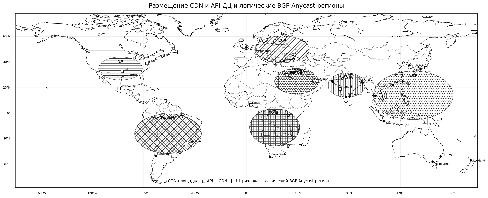

На карте **кружки обозначают CDN-площадки**, **квадраты — площадки, на которых одновременно размещены CDN и API**, а штрихованные области обозначают логические BGP Anycast-регионы.

### 3.5. Схемы балансировки API- и CDN-запросов

Для CDN применяется home-region based routing:

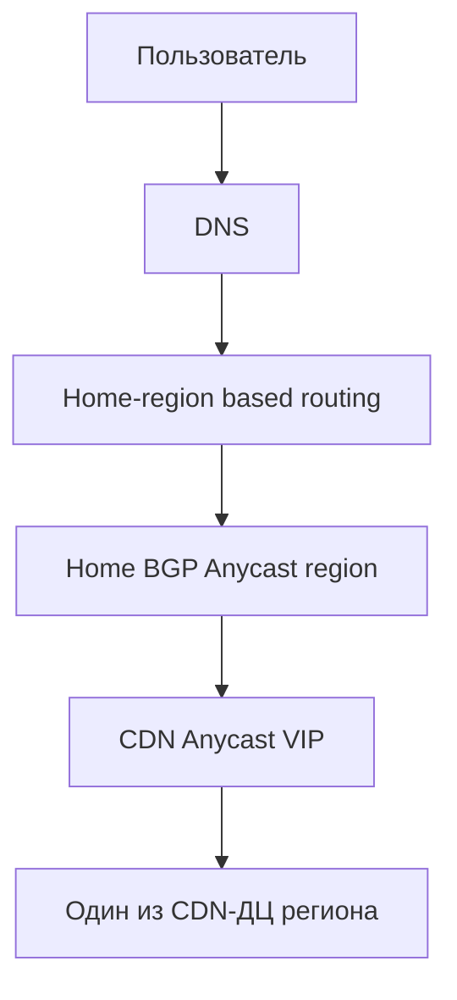

Критерий выбора для CDN — **home region пользователя**. Это сохраняет близость media-трафика к основному месту хранения и репликации данных.

Для API используется latency-based routing:

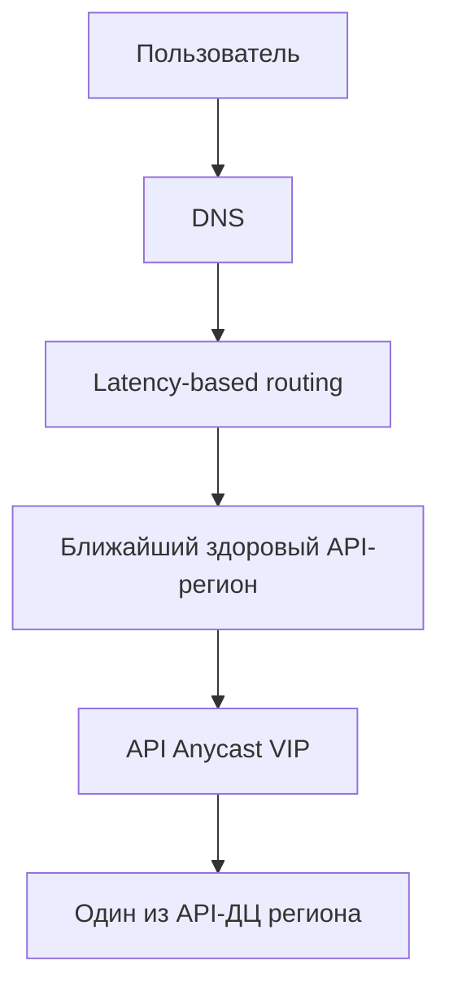

На уровне API допускается переключение между регионами, поскольку запросы к метаданным и индексам обслуживаются из реплицируемой инфраструктуры. Это позволяет выбирать ближайший по задержке регион без привязки к home region пользователя.

### 3.6. Механизм регулировки трафика между ДЦ

Для обоих контуров контролируются health checks, error rate и задержка. При отказе площадки её Anycast-анонс снимается, поэтому новый трафик перестаёт поступать на неисправный узел. RFC 4786 описывает именно такой принцип эксплуатации Anycast-сервисов. [^9]

Различие между контурами состоит в выборе резервной площадки:

| Контур | Основной критерий                | Failover                                                                                              |
| ------ | -------------------------------- | ----------------------------------------------------------------------------------------------------- |
| CDN    | Home region + доступность данных | Другая CDN-площадка того же региона; при крупном отказе — доступная реплика данных в соседнем регионе |
| API    | Минимальная задержка             | Следующий по latency здоровый API-регион                                                              |

Для CDN нельзя автоматически отправлять запрос в любой ближайший ДЦ: резервная площадка должна иметь доступ к соответствующей копии данных. Для API такая привязка слабее, поскольку метаданные и индексы предполагаются доступными в нескольких регионах.

Таким образом, итоговая глобальная схема разделяет задачи:

```text
                         Пользователь
                              │
                  ┌───────────┴───────────┐
                  │                       │
             CDN/media                   API
                  │                       │
          Home-region based          Latency-based
                  │                       │
          BGP Anycast region      BGP Anycast region
                  │                       │
           CDN-площадки (32)          API-ДЦ (14)
```

DNS выполняет выбор логического региона, BGP Anycast — выбор доступной точки входа внутри выбранного региона, а локальный L4/L7-балансировщик из раздела 4 распределяет трафик между серверами конкретного ДЦ.

## 4. Локальная балансировка

После глобального выбора точки входа трафик необходимо распределить между серверами внутри конкретного дата-центра. Поскольку в разделе 3 CDN и API вынесены в отдельные контуры, локальная балансировка также выполняется независимо для этих двух типов трафика.

Для обоих контуров используется двухуровневая схема: L3-маршрутизация с ECMP распределяет входящий поток между несколькими L4-балансировщиками, после чего L4 распределяет TCP-соединения между L7-балансировщиками Nginx. На L7 выполняется TLS termination и маршрутизация запроса к нужному сервису.

Разница между контурами определяется характером нагрузки:

- CDN обслуживает основной объём сетевого трафика: upload и download. Здесь главным ограничением является пропускная способность сетевых интерфейсов и балансировщиков.
- API обслуживает небольшой по объёму, но более чувствительный к задержке трафик: авторизацию, поиск, метаданные, шеринг, совместные альбомы и уведомления. Здесь важнее низкая задержка обработки запроса.

### 4.1. Локальная балансировка CDN

После выбора home-region пользователя глобальным уровнем запрос попадает в один из CDN-ДЦ этого региона. Внутри площадки используется следующая схема:

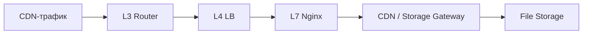

L3-маршрутизаторы используют ECMP и распределяют входящие соединения между несколькими L4-балансировщиками. Такой подход позволяет избежать единственной точки отказа и равномерно загрузить L4-узлы.

На L4-уровне TCP-соединения распределяются между Nginx. Поскольку CDN обрабатывает большие объёмы данных, основным ограничением является throughput, а не количество HTTP-запросов.

Nginx на L7 терминирует TLS и передаёт запросы в CDN/Storage Gateway. Upload-запрос приводит к записи объекта в файловое хранилище, а download-запрос — к чтению объекта из кеша или файлового хранилища. Бинарные данные не проходят через основную БД: БД содержит только метаданные и ссылку на объект.

Для CDN запросы не перераспределяются между произвольными ДЦ внутри локального слоя: глобальная home-region based политика из раздела 3 сохраняет привязку пользователя к своему региону. При отказе площадки переключение выполняется на уровне глобальной балансировки, после чего новый трафик поступает в другой доступный CDN-ДЦ того же региона или к доступной реплике данных.

### 4.2. Локальная балансировка API

Для API после latency-based выбора региона запрос попадает в один из API-ДЦ выбранного региона. Внутри ДЦ используется отдельный пул балансировщиков:

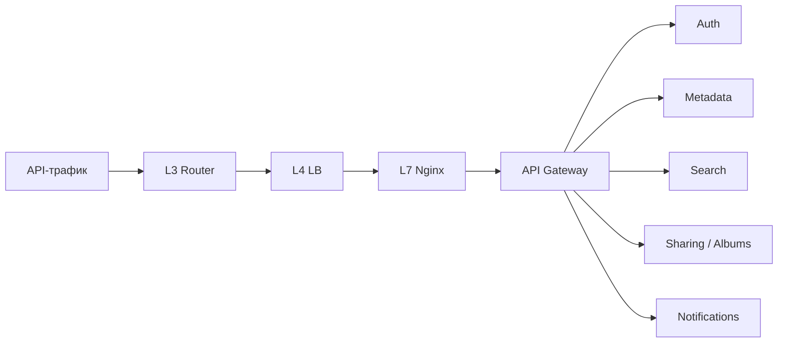

L4 выполняет распределение TCP-соединений между Nginx, а L7 анализирует HTTP-запрос и выбирает нужный backend.

API Gateway проверяет сессию, применяет rate-limit и маршрутизирует запросы в отдельные upstream-пулы сервисов. Расчёт L4/L7 в п. 4.5 не меняется: Gateway масштабируется отдельно как stateless-пул (≥3 pod на ДЦ).

Для большинства коротких API-запросов можно использовать `round-robin`. Для запросов с существенно различающимся временем выполнения предпочтителен `least_conn`. Поисковые запросы и операции с метаданными могут иметь отдельные upstream-пулы, что позволяет независимо масштабировать эти сервисы.

В отличие от CDN, API-ДЦ не привязаны к `home_region` пользователя. Глобальный слой уже выбрал регион с минимальной задержкой, поэтому локальный уровень должен прежде всего равномерно распределять запросы между доступными экземплярами сервисов.

### 4.3. Отказоустойчивость

Все уровни локальной балансировки должны иметь резерв. Отказ одного L4 или L7-узла не должен приводить к отказу всего дата-центра.

Для L4 используется схема **N×2**. Сначала определяется минимальное количество узлов, необходимое для обработки пикового трафика, затем количество удваивается. Например, если для площадки требуется 3 рабочих L4-узла, разворачивается 6.

Для L7 используется схема **N+2**. К расчётному количеству рабочих Nginx добавляются два резервных узла. Если требуется 10 рабочих экземпляров, фактически разворачивается 12.

При отказе отдельного L4-узла ECMP исключает неисправный маршрут, а оставшиеся узлы продолжают принимать трафик. При отказе Nginx L4-балансировщик перестаёт направлять на него новые соединения.

Полный отказ дата-центра обрабатывается уже глобальным уровнем из раздела 3: для CDN трафик переводится на другую площадку home-region либо на доступную реплику, а для API — на следующий здоровый регион с подходящей latency.

### 4.4. Расчёт количества балансировщиков CDN

Пиковый CDN-трафик из раздела 3 составляет около **6 702 Гбит/с**. Он распределён между **32 CDN-площадками**, при этом максимальная расчётная нагрузка одной площадки составляет около **240 Гбит/с**.

Для расчёта принимаются следующие инженерные ограничения:

- один L4-сервер способен безопасно обработать до **80 Гбит/с**;
- один L7-сервер Nginx способен обработать до **25 Гбит/с**;
- для L4 используется запас **N×2**;
- для L7 используется запас **N+2**.

Значения 80 и 25 Гбит/с являются инженерными допущениями проекта. Реальная производительность зависит от CPU, сетевых карт, TLS-нагрузки, размера пакетов и характера трафика.

Количество узлов для каждой CDN-площадки:

```text
N_L4 = ceil(Пиковый_трафик_ДЦ / 80 Гбит/с) × 2

N_L7 = ceil(Пиковый_трафик_ДЦ / 25 Гбит/с) + 2
```

Например, для самой нагруженной CDN-площадки в Европе:

```text
Пиковый трафик ≈ 240 Гбит/с

L4:
ceil(240 / 80) × 2
= 3 × 2
= 6 серверов

L7:
ceil(240 / 25) + 2
= 10 + 2
= 12 серверов
```

Расчёт по регионам:

| BGP Anycast-регион                    | CDN-ДЦ | Пиковый трафик одного CDN-ДЦ | L4 на один ДЦ | L7 на один ДЦ | Всего L4 | Всего L7 |
| ------------------------------------- | -----: | ---------------------------: | ------------: | ------------: | -------: | -------: |
| Северная Америка                      |      2 |                  ~204 Гбит/с |             6 |            11 |       12 |       22 |
| Европа + Центральная Азия             |      4 |                  ~240 Гбит/с |             6 |            12 |       24 |       48 |
| Латинская Америка                     |      3 |                  ~206 Гбит/с |             6 |            11 |       18 |       33 |
| MENA                                  |      3 |                  ~194 Гбит/с |             6 |            10 |       18 |       30 |
| Африка к югу от Сахары                |      3 |                  ~174 Гбит/с |             6 |             9 |       18 |       27 |
| Восточная Азия + Тихоокеанский регион |     11 |                  ~213 Гбит/с |             6 |            11 |       66 |      121 |
| Южная Азия                            |      6 |                  ~212 Гбит/с |             6 |            11 |       36 |       66 |
| **Итого**                             | **32** |             **≤ 240 Гбит/с** |             — |             — |  **192** |  **347** |

Таким образом, для CDN-контура требуется ориентировочно **192 L4-балансировщика и 347 L7-балансировщиков**. Наиболее большое количество узлов приходится на Восточную Азию и Тихоокеанский регион, поскольку там расположено 11 CDN-площадок.

### 4.5. Расчёт количества балансировщиков API

Пиковый внешний API-трафик из раздела 2 составляет около **1,61 Гбит/с**. В соответствии с архитектурой раздела 3 он распределяется между **14 API-ДЦ**.

Для размерного расчёта принимается равномерное распределение как базовый сценарий:

```text
1,61 Гбит/с / 14 ≈ 0,115 Гбит/с на API-ДЦ
```

Фактическое распределение не обязано быть равномерным, поскольку глобальный слой использует latency-based routing. Однако даже при существенном skew нагрузки один API-ДЦ остаётся далеко ниже пропускной способности одного L4/L7-узла, принятой в проекте.

Для каждой площадки:

```text
N_L4 = ceil(0,115 / 80) × 2
     = 1 × 2
     = 2 сервера

N_L7 = ceil(0,115 / 25) + 2
     = 1 + 2
     = 3 сервера
```

При 14 API-ДЦ получаем:

| Показатель         | На один API-ДЦ | Всего для 14 API-ДЦ |
| ------------------ | -------------: | ------------------: |
| Пиковый API-трафик |    ~115 Мбит/с |        ~1,61 Гбит/с |
| L4                 |              2 |              **28** |
| L7 Nginx           |              3 |              **42** |

Таким образом, API-контур требует ориентировочно **28 L4** и **42 L7** узлов.

### 4.6. Итоговая схема локальной балансировки

В результате локальная архитектура имеет два независимых пула:

```text
CDN:
L3 / ECMP → L4 → L7 Nginx → CDN / Storage Gateway → File Storage

API:
L3 / ECMP → L4 → L7 Nginx → Auth / Metadata / Search / Sharing / Notifications
```

Для CDN локальная балансировка рассчитана от пикового сетевого трафика каждой площадки. Для API она рассчитана от RPS и небольшого сетевого объёма, поэтому пропускная способность балансировщиков не является ограничивающим фактором.

Суммарно для обеих плоскостей получается ориентировочно:

```text
L4 = 192 + 28 = 220 серверов
L7 = 347 + 42 = 389 серверов
```

При этом эти значения относятся именно к балансировщикам. Backend-сервера API, Storage Gateway, CDN-кеши и файловое хранилище масштабируются отдельно.

### 4.7. Выбор алгоритмов балансировки

На L4-уровне используется распределение TCP-соединений между доступными L7-узлами. Основная цель этого слоя — эффективно распределить сетевой поток и обеспечить отказоустойчивость.

На L7-уровне алгоритм выбирается по характеру сервиса:

- `round-robin` — для коротких API-запросов с близким временем обработки;
- `least_conn` — для запросов с различной длительностью выполнения;
- отдельные upstream-пулы — для независимого масштабирования Auth, Metadata, Search, Sharing/Albums, Notifications и CDN/Storage Gateway.

Такое разделение сохраняет простую локальную схему и одновременно позволяет независимо масштабировать CDN и API. Глобальный уровень отвечает за выбор региона и площадки, а локальный — за распределение нагрузки между экземплярами сервисов внутри выбранного ДЦ.

## 5. Логическая схема БД

Логическая схема описывает сущности сервиса и связи между ними без привязки к конкретной СУБД, способу хранения или шардингу. Отдельно показаны основная метаинформация, файловые данные, поисковый индекс, результаты распознавания лиц, кеши и буферы фоновых операций.

Расчёты нагрузки используют значения из раздела 2: около **4,1925 трлн фотографий**, средний размер файла **5 MB**, около **6 млрд загрузок/сутки**, **1,1925 млрд скачиваний/сутки**, **55,575 млн поисковых запросов/сутки**, **65,925 млн операций шеринга/сутки** и около **158 525 QPS** среднего пользовательского и фонового потока. Пиковая нагрузка принимается в 2 раза выше средней. Файловый контент при этом не проходит через основную БД: БД хранит метаданные и ссылку на объект, а байты файла обслуживаются файловым хранилищем/CDN.

**Служебные поля.** Во всех долгоживущих сущностях есть `created_at`. Там, где строку можно изменить, добавлен `updated_at`. Там, где строку можно удалить или отозвать пользователем, добавлен `deleted_at` (логическое удаление: строка остаётся в «корзине» 30 суток и потом удаляется фоновой задачей). Для неизменяемых и производных данных (`media_objects`, `face_embeddings`) `updated_at` не нужен: они не редактируются, а пересоздаются. Для временных буферов достаточно `created_at` и срока жизни (`expires_at`, `next_retry_at`).

```mermaid
erDiagram
    USERS ||--o{ SESSIONS : has
    USERS ||--o{ PHOTOS : owns
    PHOTOS ||--|| MEDIA_OBJECTS : stored_as

    USERS ||--o{ FACE_PROFILES : has
    PHOTOS ||--o{ FACE_EMBEDDINGS : contains
    FACE_PROFILES ||--o{ FACE_EMBEDDINGS : identifies
    PHOTOS ||--o{ FACE_JOBS : processed_by

    USERS ||--o{ ALBUMS : owns
    USERS ||--o{ ALBUM_MEMBERS : participates
    ALBUMS ||--o{ ALBUM_MEMBERS : contains
    ALBUMS ||--o{ ALBUM_ITEMS : contains
    PHOTOS ||--o{ ALBUM_ITEMS : contains

    USERS ||--o{ SHARES : creates
    USERS ||--o{ SHARES : receives
    USERS ||--o{ NOTIFICATIONS : receives

    PHOTOS ||--o{ SEARCH_INDEX : indexed
    PHOTOS ||--o| SCAN_PENDING : awaits_verdict

    USERS ||--o{ UPLOAD_BUFFER : uploads
    NOTIFICATIONS ||--o{ NOTIFICATION_BUFFER : queued

    USERS {
        uuid user_id PK
        string email
        string home_region
        timestamp created_at
        timestamp updated_at
        timestamp deleted_at
    }

    SESSIONS {
        uuid session_id PK
        uuid user_id FK
        binary token_hash
        timestamp expires_at
        timestamp created_at
        timestamp updated_at
        timestamp deleted_at
    }

    PHOTOS {
        uuid photo_id PK
        uuid owner_id FK
        uuid object_id FK
        smallint scan_status
        timestamp created_at
        timestamp updated_at
        string camera_model
        float latitude
        float longitude
        timestamp deleted_at
    }

    MEDIA_OBJECTS {
        uuid object_id PK
        string object_key
        bigint size_bytes
        binary checksum
        string mime_type
        timestamp created_at
        timestamp deleted_at
    }

    FACE_PROFILES {
        uuid face_id PK
        uuid user_id FK
        string person_label
        uuid cluster_id
        timestamp created_at
        timestamp updated_at
        timestamp deleted_at
    }

    FACE_EMBEDDINGS {
        uuid embedding_id PK
        uuid photo_id FK
        uuid face_id FK
        binary embedding
        binary bounding_box
        timestamp created_at
    }

    FACE_JOBS {
        uuid job_id PK
        uuid photo_id FK
        smallint status
        int attempts
        timestamp created_at
        timestamp updated_at
    }

    ALBUMS {
        uuid album_id PK
        uuid owner_id FK
        string title
        timestamp created_at
        timestamp updated_at
        timestamp deleted_at
    }

    ALBUM_MEMBERS {
        uuid album_id FK
        uuid user_id FK
        smallint role
        timestamp joined_at
        timestamp updated_at
        timestamp deleted_at
    }

    ALBUM_ITEMS {
        uuid album_id FK
        uuid photo_id FK
        uuid added_by FK
        timestamp added_at
        timestamp updated_at
        timestamp deleted_at
    }

    SHARES {
        uuid share_id PK
        uuid owner_id FK
        uuid recipient_id FK
        smallint type
        uuid resource_id
        timestamp expires_at
        timestamp created_at
        timestamp updated_at
        timestamp deleted_at
    }

    NOTIFICATIONS {
        uuid notification_id PK
        uuid recipient_id FK
        smallint notification_type
        string payload
        timestamp read_at
        timestamp created_at
        timestamp deleted_at
    }

    SEARCH_INDEX {
        uuid photo_id FK
        uuid owner_id FK
        timestamp date
        string camera
        binary geo
        uuid face_id FK
        string search_text
        timestamp updated_at
    }

    UPLOAD_BUFFER {
        uuid upload_id PK
        uuid user_id FK
        int chunk_number
        bigint size_bytes
        timestamp created_at
        timestamp expires_at
    }

    NOTIFICATION_BUFFER {
        uuid event_id PK
        uuid notification_id FK
        int attempts
        timestamp created_at
        timestamp next_retry_at
    }

    SCAN_PENDING {
        timestamp hour_bucket PK
        smallint shard PK
        uuid photo_id PK
        timestamp created_at
        timestamp expires_at
    }
```

### 5.1. Основные сущности

##### 5.1.1. Допущения по размерам полей

Размер каждой записи рассчитывается как сумма размеров её полей и условных накладных расходов на структуру записи.

| Тип поля                                    | Принятый размер | Обоснование                                       |
| ------------------------------------------- | --------------: | ------------------------------------------------- |
| UUID, внешний ключ FK                       |            16 B | Бинарный идентификатор длиной 128 бит             |
| `TIMESTAMP`                                 |             8 B | 64-битное представление временной метки           |
| `BIGINT`                                    |             8 B | 64-битное целое число                             |
| `INT`                                       |             4 B | 32-битное целое число                             |
| `SMALLINT`                                  |             2 B | Компактное представление статуса или перечисления |
| `FLOAT64`                                   |             8 B | Число с плавающей точкой двойной точности         |
| SHA-256 checksum                            |            32 B | Бинарный хеш размером 256 бит                     |
| Вектор лица: 512 × `FLOAT32`                |         2 048 B | 512 чисел по 4 байта                              |
| Bounding box лица                           |            16 B | Четыре координаты по 4 байта                      |
| `email`                                     |            42 B | 40 B содержимого и 2 B на длину                   |
| `home_region`                               |            18 B | 16 B содержимого и 2 B на длину                   |
| `camera_model`                              |            42 B | 40 B содержимого и 2 B на длину                   |
| `person_label`                              |            34 B | 32 B содержимого и 2 B на длину                   |
| `title` альбома                             |            66 B | 64 B содержимого и 2 B на длину                   |
| `object_key`                                |            66 B | 64 B содержимого и 2 B на длину                   |
| `mime_type`                                 |            26 B | 24 B содержимого и 2 B на длину                   |
| `search_text`                               |           514 B | 512 B содержимого и 2 B на длину                  |
| `notification.payload`                      |           130 B | 128 B содержимого и 2 B на длину                  |
| `metadata_blob` в кеше                      |           256 B | Принятый средний размер блока метаданных          |
| `token_hash`                                |            32 B | Бинарный хеш токена                               |
| `resource_id`, `cluster_id`                 |            16 B | Предполагается бинарный UUID                      |
| Координаты `latitude`, `longitude`          |      8 B каждое | Два поля `FLOAT64`                                |
| Геоданные `geo`                             |            16 B | Две координаты `FLOAT64`                          |
| `payload` и текстовые поля переменной длины |      По таблице | Используется средний размер содержимого           |

Размеры строк — инженерные допущения, а не ограничения максимальной длины. Предполагается, что строки хранятся в UTF-8, а их средний размер соответствует приведённым значениям. Для компактных статусов, ролей и типов предполагается числовое представление, а не текстовые названия.

Для каждой записи дополнительно учитывается **24 B** условных накладных расходов на структуру записи, выравнивание и информацию о nullable-полях. Это упрощённая оценка, поскольку реальные расходы зависят от СУБД и её формата хранения.

В расчётах используются десятичные единицы: 1 GB = \(10^9\) B, 1 TB = \(10^{12}\) B, 1 PB = \(10^{15}\) B и 1 EB = \(10^{18}\) B.

Полученные значения отражают расчётный объём записей, включая принятые накладные расходы на запись. Вторичные индексы, журналы транзакций, физическая репликация, свободный резерв СУБД и служебные структуры конкретного движка не включены. Для кешей и буферов применяется аналогичная оценка размера записей, но фактический расход памяти или диска может быть выше.

#### 5.1.2. Оценка размеров хранилища

| Таблица               | Назначение                                                    | Основные поля                                                                                                                         |                                                            Оценка объёма |          Чтение, QPS avg / peak |                                            Запись, QPS avg / peak | Консистентность                                                           | Ключ распределения нагрузки                                                                                    |
| --------------------- | ------------------------------------------------------------- | ------------------------------------------------------------------------------------------------------------------------------------- | -----------------------------------------------------------------------: | ------------------------------: | ----------------------------------------------------------------: | ------------------------------------------------------------------------- | -------------------------------------------------------------------------------------------------------------- |
| `users`               | Учётные записи и настройки пользователя                       | `user_id`, `email`, `home_region`, `created_at`, `updated_at`, `deleted_at`                                                           |                                            1,5 млрд × 124 B ≈ **186 GB** |                   2 839 / 5 677 |                                                                 — | Сильная                                                                   | `user_id`; распределение близко к равномерному                                                                 |
| `sessions`            | Сессии авторизации                                            | `session_id`, `user_id`, `token_hash`, `expires_at`, `created_at`, `updated_at`, `deleted_at`                                         |                                            1,5 млрд × 120 B ≈ **180 GB** |                   2 839 / 5 677 |                                                     2 839 / 5 677 | Сильная                                                                   | `session_id` для записи, `user_id` для проверки активных сессий                                                |
| `photos`              | Метаданные фотографии или видео, статус проверки              | `photo_id`, `owner_id`, `object_id`, `created_at`, `updated_at`, `deleted_at`, `camera_model`, `latitude`, `longitude`, `scan_status` |                                      4,1925 трлн × 156 B ≈ **654,03 TB** |                 14 445 / 28 889 | 69 444 / 138 889 (+ повторные записи статуса, ≈ 69 444 / 138 889) | Сильная для ownership и commit; межрегиональные копии могут быть eventual | `photo_id`; логический доступ — `(owner_id, created_at, photo_id)`                                             |
| `media_objects`       | Метаданные файлового объекта                                  | `object_id`, `object_key`, `size_bytes`, `checksum`, `mime_type`, `created_at`, `deleted_at`                                          |                                      4,1925 трлн × 188 B ≈ **788,19 TB** |                 13 802 / 27 604 |                                                  69 444 / 138 889 | Бинарный объект неизменяем; репликация — eventual                         | `object_id` / `object_key`; случайные идентификаторы для равномерных записей                                   |
| `face_profiles`       | Кластеры и идентичности лиц пользователя                      | `face_id`, `user_id`, `person_label`, `cluster_id`, `created_at`, `updated_at`, `deleted_at`                                          |                                           ≈15 млрд × 130 B ≈ **1,95 TB** |                     643 / 1 286 |                                                  69 444 / 138 889 | Eventual; строится асинхронно после загрузки                              | `user_id`, внутри пользователя — `face_id`                                                                     |
| `face_embeddings`     | Векторные признаки найденных лиц                              | `embedding_id`, `photo_id`, `face_id`, `embedding`, `bounding_box`, `created_at`                                                      |                                     ≈4,1925 трлн × 2 144 B ≈ **8,99 PB** |                     643 / 1 286 |                                                  69 444 / 138 889 | Eventual; результат фоновой обработки                                     | `photo_id` + `face_id`; поиск по лицу идёт через индекс                                                        |
| `albums`              | Совместные альбомы                                            | `album_id`, `owner_id`, `title`, `created_at`, `updated_at`, `deleted_at`                                                             |                                           ≈150 млн × 146 B ≈ **21,9 GB** |                     781 / 1 563 |                                                           26 / 52 | Сильная                                                                   | `album_id`; создание распределяется по владельцам                                                              |
| `album_members`       | Участники совместного альбома                                 | `album_id`, `user_id`, `role`, `joined_at`, `updated_at`, `deleted_at`                                                                |                                            ≈600 млн × 82 B ≈ **49,2 GB** |                     521 / 1 042 |                                                         260 / 521 | Сильная в рамках альбома                                                  | `album_id`; возможны hot-spot для популярных альбомов                                                          |
| `album_items`         | Фотографии внутри альбома                                     | `album_id`, `photo_id`, `added_by`, `added_at`, `updated_at`, `deleted_at`                                                            |                                      ≈209,625 млрд × 96 B ≈ **20,12 TB** |                     521 / 1 042 |                                                         260 / 521 | Сильная в рамках альбома                                                  | `(album_id, added_at, photo_id)`; возможны hot-spot                                                            |
| `shares`              | Права доступа и ссылки на общие ресурсы                       | `share_id`, `owner_id`, `resource_id`, `recipient_id`, `expires_at`, `created_at`, `updated_at`, `deleted_at`                         |                                           ≈1,5 млрд × 122 B ≈ **183 GB** |                     763 / 1 526 |                                                       763 / 1 526 | Сильная для изменения прав; read-after-write                              | `share_id`; lookup также по `recipient_id`                                                                     |
| `notifications`       | История уведомлений                                           | `notification_id`, `recipient_id`, `type`, `payload`, `read_at`, `created_at`, `deleted_at`                                           |                                       ≈2,025 млрд × 212 B ≈ **429,3 GB** |                     781 / 1 563 |                                                       781 / 1 563 | Eventual; возможны дубликаты доставки                                     | `recipient_id + created_at`; возможны hot-key                                                                  |
| `search_index`        | Индекс поиска по дате, камере, геоданным и лицам              | `owner_id`, `photo_id`, `date`, `camera`, `geo`, `face_id`, `search_text`, `updated_at`                                               |                                       ≈4,1925 трлн × 660 B ≈ **2,77 PB** |                     643 / 1 286 |                                                  69 444 / 138 889 | Eventual; допустима задержка появления нового фото                        | `owner_id` в начале логического ключа                                                                          |
| `face_jobs`           | Очередь и история задач распознавания                         | `job_id`, `photo_id`, `status`, `attempts`, `created_at`, `updated_at`                                                                |                          42 млрд записей за 7 суток × 78 B ≈ **3,28 TB** |                69 444 / 138 889 |                                                  69 444 / 138 889 | At-least-once; обработчики должны быть идемпотентными                     | `job_id`; рабочая выборка по статусу и времени                                                                 |
| `session_cache`       | Горячий кеш сессий                                            | `session_id`, `user_id`, `expires_at`                                                                                                 |                                             ≈1,5 млрд × 64 B ≈ **96 GB** |                   2 839 / 5 677 |                                                     2 839 / 5 677 | Eventual, TTL                                                             | `session_id`; равномерный random/hash key                                                                      |
| `metadata_cache`      | Горячий кеш метаданных фотографий                             | `photo_id`, `metadata_blob`, `ttl`                                                                                                    |                                      ≈41,925 млрд × 304 B ≈ **12,75 TB** |                ≈11 556 / 23 112 |                                                    ≈2 889 / 5 778 | Eventual, TTL; источник истины — `photos`                                 | `photo_id`; равномерный hash key                                                                               |
| `upload_buffer`       | Метаданные незавершённых загрузок                             | `upload_id`, `user_id`, `chunk_no`, `bytes`, `created_at`, `expires_at`                                                               |                                  ≈20,83 млн записей × 84 B ≈ **1,75 GB** |                69 444 / 138 889 |                                                  69 444 / 138 889 | At-least-once; повторная запись чанка безопасна                           | `upload_id + chunk_no`; случайный `upload_id`                                                                  |
| `notification_buffer` | Буфер очереди push-уведомлений                                | `event_id`, `notification_id`, `attempts`, `created_at`, `next_retry_at`                                                              |                                       ≈2,8125 млн × 76 B ≈ **213,75 MB** |                     781 / 1 563 |                                                       781 / 1 563 | At-least-once; дедупликация по `event_id`                                 | `event_id`; равномерные random/hash key                                                                        |
| `scan_pending`        | Журнал загрузок без вердикта сканера (для Pending Reconciler) | `hour_bucket`, `shard`, `photo_id`, `created_at`, `expires_at`                                                                        | ≈4,2 млн живых записей × 66 B ≈ **275 MB** (допущение: вердикт за ≈60 с) | Раз в минуту, 256 партиций окна |              вставка 69 444 / 138 889 + удаление 69 444 / 138 889 | At-least-once; потеря записи компенсируется TTL и повтором загрузки       | `(hour_bucket, shard)`, где `shard = hash(photo_id) mod 256`; без шарда все записи часа шли бы в одну партицию |

> **Все QPS в таблице — средние и пиковые. Пик = 2 × среднее**, в соответствии с моделью раздела 2. Значения относятся к логическим операциям над сущностью, поэтому фактическое число физических операций конкретной СУБД может быть выше из-за индексов, журналирования, репликации и фоновых процессов.

> **\*** Там, где раздел 2 не содержит прямой продуктовой метрики, используются отдельные инженерные допущения: 10 лицевых профилей на пользователя; одно сохраняемое face-embedding на фотографию; 0,1 совместного альбома на MAU; в среднем 4 участника альбома; 5% фотографий попадают в совместные альбомы; одна сохранённая share-запись на пользователя; хранение уведомлений 30 суток; история face-job 7 суток; кеширование 1% самых горячих фотографий; попадание в metadata cache около 80%; TTL upload buffer 5 минут; TTL notification buffer 1 час. Эти допущения нужны только для оценки размера сущностей и не изменяют исходные продуктовые нагрузки раздела 2.

> Размер `face_embeddings` рассчитан для одного вектора на фотографию. Если на одной фотографии обнаруживается несколько лиц, объём будет выше. Для `face_profiles` принято около 15 млрд профилей, исходя из 10 профилей на пользователя.

> `scan_pending`: время до вердикта сканера ≈60 с, TTL записи 24 ч, `gc_grace_seconds` таблицы 1 час и стратегия компакшена TWCS, так как записи короткоживущие и удаляются сканером по вердикту

### 5.2. Файловые данные

Основной бинарный контент хранится отдельно от метаданных. Для каждой фотографии в `media_objects` хранится ссылка `object_key`, размер, checksum и тип файла, тогда как сами байты находятся в файловом хранилище и обслуживаются CDN.

При **4,1925 трлн фотографий** и среднем размере **5 MB** получается:

```text
4,1925 трлн × 5 MB ≈ 20,96 EB логического файлового контента
```

При трёхкратной репликации это около:

```text
20,96 EB × 3 ≈ 62,89 EB
```

Это независимая проверка объёма фотографий из раздела 2. Для верхней оценки инфраструктуры в работе остаётся более консервативное значение **134,78 EB физической ёмкости**, полученное из пользовательских квот 10 GB / 200 GB.

Важно, что **20,96 EB не означает, что такой объём проходит через основную БД**. В БД находятся только метаданные объектов, а большие файлы идут через CDN и файловое хранилище.

### 5.3. Кеши и буферы

Кеши и буферы являются частью логической схемы, хотя физически могут быть реализованы отдельными системами хранения. Их задача — уменьшить количество обращений к основной БД и хранить временное состояние незавершённых операций.

`session_cache` содержит идентификатор сессии, пользователя и время истечения срока действия. При 1,5 млрд записей и расчётном размере 64 B логический объём составляет около **96 GB**. Фактический расход оперативной памяти зависит от реализации кеша и её служебных структур.

`metadata_cache` содержит идентификатор фотографии, блок метаданных и TTL. При допущении о кешировании 1% фотографий получается около 41,925 млрд записей. При размере 304 B на запись расчётный объём составляет около **12,75 TB**. Источником истины остаётся таблица `photos`: при промахе кеша или истечении TTL данные читаются из постоянного хранилища.

`upload_buffer` хранит состояние незавершённых загрузок и информацию об отдельных чанках. При 6 млрд загрузок в сутки и TTL 5 минут среднее число одновременно активных загрузок оценивается как:

```text
6 млрд / 86400 × 300 ≈ 20,83 млн загрузок
```

Для метаданных одной незавершённой загрузки принимается размер 84 B:

```text
20,83 млн × 84 B ≈ 1,75 GB
```

Это только метаданные. Если предположить, что для каждой активной загрузки временно хранится в среднем 5 MB данных, объём временного бинарного контента составит:

```text
20,83 млн × 5 MB ≈ 104 TB
```

При двукратном пике соответствующая оценка возрастает примерно до **208 TB временного бинарного контента** и **3,5 GB метаданных загрузок**. Бинарные чанки предполагается хранить в отдельном временном файловом или объектном хранилище, а не в строках основной БД.

`notification_buffer` используется для повторной доставки push-уведомлений. При 67,5 млн уведомлений в сутки и TTL 1 час среднее количество событий в буфере составляет:

```text
67,5 млн / 86400 × 3600 ≈ 2,8125 млн событий
```

При расчётном размере одной записи 76 B логический объём метаданных очереди составляет:

```text
2,8125 млн × 76 B ≈ 213,75 MB
```

Фактический объём очереди может быть выше из-за служебных структур брокера, индексов, повторных доставок и задержек обработки.

`scan_pending` — буфер незавершённых проверок. Gateway создаёт запись при приёме файла, сканер удаляет её по вердикту, а Pending Reconciler обрабатывает записи старше 10 минут (повторная публикация `scan-jobs`) и старше 24 часов (EXPIRED). Объём живых записей ≈275 MB (п. 5.1.2). Фактический объём на диске выше за счёт tombstones до истечения `gc_grace_seconds`.

### 5.4. Требования к консистентности

Для разных сущностей требуется различный уровень консистентности.

Для `users`, `sessions`, прав доступа в `shares` и структуры совместных альбомов (`albums`, `album_members`, `album_items`) требуется **сильная консистентность**. Нельзя допустить ситуацию, когда пользователь уже удалён или лишён доступа, но старое состояние ещё позволяет изменять альбом или читать защищённый ресурс.

Для `photos` и `media_objects` важна атомарность операции фиксации: запись считается завершённой только тогда, когда метаданные указывают на существующий объект. Сам бинарный объект после загрузки предпочтительно считать неизменяемым; обновления создают новую версию/объект, а не изменяют уже опубликованные байты.

`search_index`, `face_profiles`, `face_embeddings` и результаты `face_jobs` могут быть **eventually consistent**. После загрузки новая фотография может появиться в поиске и результатах распознавания с небольшой задержкой. Это приемлемо, поскольку эти данные являются производными от `photos` и `media_objects`.

Для `notifications`, `notification_buffer` и `face_jobs` применяется модель **at-least-once**. Повторная доставка или повторная обработка возможны, поэтому операции должны быть идемпотентными, а события должны иметь уникальный `event_id`/`job_id`.

Для кешей применяется **eventual consistency + TTL**. Источником истины всегда остаётся основное хранилище.

Статус проверки `photos.scan_status` пишут по очереди два сервиса (Gateway ставит PENDING, сканер — CLEAN или REJECTED, Reconciler — EXPIRED). Для этого достаточно `LOCAL_QUORUM`, а порядок гарантирует сама сага: переходы возможны только из PENDING. Чтение чужим сервисом (Search, Albums) всегда фильтрует по `scan_status = CLEAN`. Для `scan_pending` применяется модель at-least-once.

### 5.5. Распределение нагрузки по ключам

Основным ключом для пользовательских данных является `user_id`. Он используется при авторизации, доступе к галерее, настройках и части операций шеринга. Для равномерного распределения данных желательно использовать достаточно большое пространство идентификаторов, например случайные или хешированные значения, а не последовательные номера как физический ключ распределения.

Для фотографий естественный идентификатор — `photo_id`, но большинство пользовательских запросов сначала ограничивается владельцем. Поэтому логический доступ к галерее должен строиться вокруг составного ключа **`(owner_id, created_at, photo_id)`**. Это позволяет эффективно выбирать фотографии одного пользователя за заданный интервал времени. При этом один пользователь с очень большой галереей способен генерировать существенно больше чтений, чем средний пользователь, поэтому такая сущность является потенциальным источником skew.

Для `search_index` ключ должен начинаться с `owner_id`. Это важно, потому что поисковые запросы вроде «фотографии за 2024 год» сами по себе обладают очень высокой популярностью. Привязка индекса к владельцу не позволяет одному глобальному терму превратиться в единственный горячий ключ.

Для совместных альбомов естественный ключ — `album_id`. Чтения `album_items` и `album_members` концентрируются вокруг конкретного альбома. Поэтому особенно популярный семейный альбом может стать hot-key. Логически это решается разбиением доступа по времени и идентификатору элемента, например `(album_id, added_at, photo_id)`, без изменения модели предметной области.

`notifications` естественным образом распределяются по `recipient_id`. Основная нагрузка — выборка последних уведомлений одного пользователя. Здесь также возможен skew для очень активных аккаунтов, поэтому ключ должен дополняться временем создания.

Очереди и буферы (`face_jobs`, `upload_buffer`, `notification_buffer`) должны использовать случайные или хешированные идентификаторы, чтобы записи распределялись равномерно. Для очередей одновременно нужен индекс/логический порядок по `status + created_at` или `next_retry_at`, поскольку workers выбирают не произвольный объект, а готовые к обработке задачи.

Таким образом, схема сочетает три типа нагрузки: равномерные операции по идентификаторам пользователей/объектов, сильно локализованные запросы по владельцу и альбому, а также фоновые потоковые операции по очередям. Наиболее вероятные источники неравномерности — **крупные пользовательские галереи, популярные совместные альбомы и частые записи/чтения индекса поиска**.

### 5.6. Итоговая логика работы

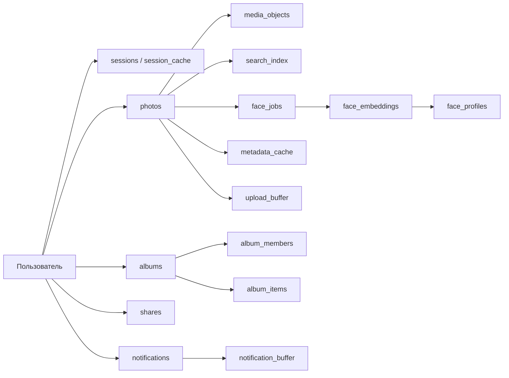

Основная БД хранит метаданные и состояния, `media_objects` содержит адреса файлов, а большой бинарный контент обслуживается файловым хранилищем и CDN. Производные структуры (`search_index`, `face_embeddings`) обновляются асинхронно, а кеши и буферы разгружают постоянное хранилище и изолируют фоновые операции от пользовательского пути.

## 6. Физическая схема БД

Физическая схема привязывает таблицы из раздела 5 к конкретным СУБД. Стек выбран из классов хранилищ лекции под характер нагрузки каждой таблицы:

- **PostgreSQL** (реляционные, OLTP) — данные с сильной консистентностью: пользователи, сессии, альбомы, ссылки и права доступа. Это четыре независимые базы: `auth`, `albums`, `shares`, `user_access`.
- **Cassandra** (NoSQL, OLTP) — огромные объёмы с высокой нагрузкой на запись: метаданные фото, поисковый индекс, лица, уведомления.
- **Redis** и **Aerospike** (in-memory и SSD optimized) — кеши сессий и метаданных.
- **Kafka** (стриминговые) — задачи распознавания лиц и события между сервисами; **RabbitMQ** (брокер сообщений) — доставка push с повторами.
- **Ceph** (объектное хранилище) — байты файлов и буфер загрузок; **etcd** (координационные) — выбор лидера Patroni и карта шардов.

Данные каждого региона живут в контуре его `home_region` (п. 3.1). Глобальным остаётся только кластер `auth` (`users`, `sessions`). Шардирование в PostgreSQL нужно по объёму, а не по QPS: нагрузка на шард не превышает единиц QPS.

### 6.1. Схема

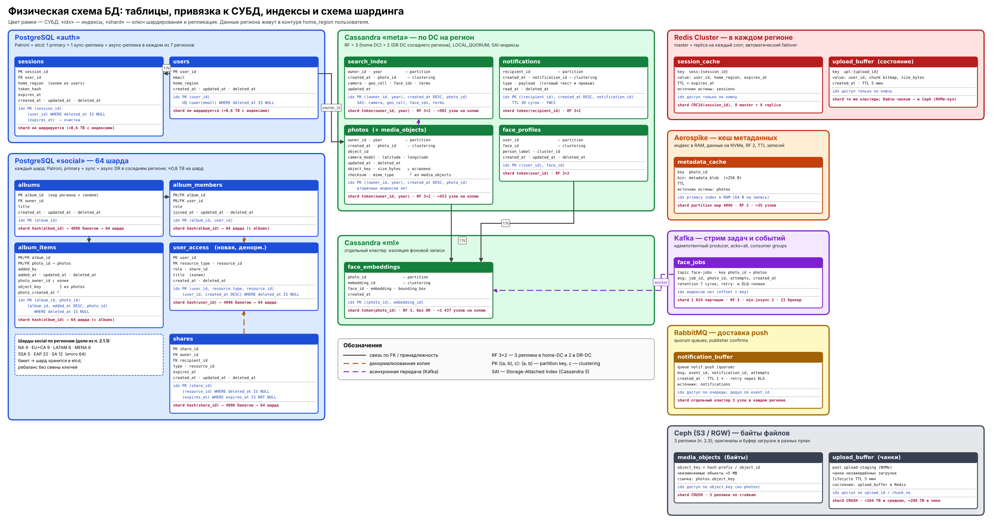

На схеме показаны таблицы с полями, ключами и индексами (`idx`), ключом шардирования и репликацией (`shard`), а также связи между ними. Бывшая база `social` разделена на три независимые базы по сервисам (альбомы, ссылки, проекция доступа), у каждой свой ключ и своё число узлов. Таблица `user_access` появилась из-за денормализации (п. 6.5), `face_photos` — обратный индекс для поиска по лицу (п. 6.2.3), а `media_objects` встроена в `photos`.

### 6.2. Описание таблиц и выбор СУБД

| Таблица                                  | Хранилище                                           | Почему                                                                                                                                                                                                                                    |
| ---------------------------------------- | --------------------------------------------------- | ----------------------------------------------------------------------------------------------------------------------------------------------------------------------------------------------------------------------------------------- |
| `users`                                  | PostgreSQL «auth»                                   | 282 GB, записей почти нет, нужны сильная консистентность и уникальность `email`                                                                                                                                                           |
| `sessions`                               | PostgreSQL «auth»                                   | Отзыв сессии должен действовать сразу; 5,7k write QPS в пике выдерживает один primary, горячие чтения берёт `session_cache`                                                                                                               |
| `photos` (+ `media_objects`)             | Cassandra «meta»                                    | 1,3 PB, 139k write QPS в пике; главный запрос — диапазон по `(owner_id, year, created_at)`; `LOCAL_QUORUM` даёт сильную консистентность в home-DC, межрегиональные копии асинхронны                                                       |
| `face_profiles`                          | Cassandra «meta»                                    | Много записей, eventual-консистентность, чтение по `user_id`; хранит centroid человека для сверки новых лиц                                                                                                                               |
| `face_photos`                            | Cassandra «meta»                                    | Обратный индекс «человек → фото»: одна партиция даёт страницу фото человека без перебора (п. 6.2.3)                                                                                                                                       |
| `face_embeddings`                        | Cassandra «ml»                                      | 9,0 PB, запись 139k QPS, чтение 1,3k QPS; отдельный кластер, чтобы фоновая запись не мешала чтению галереи                                                                                                                                |
| `albums`, `album_members`, `album_items` | PostgreSQL «albums»                                 | Сильная консистентность внутри альбома: все три таблицы в одном шарде (ключ `album_id`) и меняются одной транзакцией вместе с outbox. Запросы по пользователю («мои альбомы») в эти шарды не ходят: их обслуживает user_access (п. 6.5.2) |
| `shares`                                 | PostgreSQL «shares»                                 | Изменение прав требует сильной консистентности и read-after-write; уникальность, отзыв по `resource_id`, очистка по `expires_at`                                                                                                          |
| `user_access`                            | PostgreSQL «user_access»                            | Денормализованный список «что доступно пользователю» (п. 6.5); два пути доступа (список по дате и точечная проверка) закрываются двумя индексами                                                                                          |
| `notifications`                          | Cassandra «meta»                                    | Выборка последних по `recipient_id`, TTL 30 суток встроен в СУБД, eventual-консистентность                                                                                                                                                |
| `search_index`                           | Cassandra «meta»                                    | 2,8 PB, 139k write QPS; любой запрос ограничен одним `owner_id`, то есть одной партицией, фильтры закрывают SAI-индексы. Поисковых движков в стеке лекции нет                                                                             |
| `face_jobs`                              | Kafka                                               | Поток 69k msg/s (139k в пике), at-least-once, хранение 7 суток, повторное чтение; воркеры — consumer group                                                                                                                                |
| `session_cache`                          | Redis Cluster                                       | 192 GB, TTL, задержка меньше миллисекунды                                                                                                                                                                                                 |
| `metadata_cache`                         | Aerospike                                           | 10,7 TB: в Redis (только RAM) нужно ≈360 узлов, в Aerospike (индекс в RAM, данные на NVMe) ≈35                                                                                                                                            |
| `upload_buffer`                          | Redis (состояние) + Ceph NVMe-пул (чанки)           | 104 TB байтов не место для БД; состояние загрузки (≈21 млн ключей, ≈2,7 GB) живёт в Redis с TTL 5 мин                                                                                                                                     |
| `notification_buffer`                    | RabbitMQ                                            | Всего 1,5k msg/s и 383 MB; нужны ack и повтор с задержкой (DLX + TTL)                                                                                                                                                                     |
| `media_objects` (байты)                  | Ceph (S3/RGW)                                       | 20,96 EB неизменяемых объектов по ≈5 MB, проблемы мелких файлов нет                                                                                                                                                                       |
| `share_cache`                            | Redis Cluster (тот же кластер, что `session_cache`) | Запись ≈0,1 KB, ≈2,1 млн активных ссылок ≈ сотни MB: не меняет число узлов; TTL 60 с                                                                                                                                                      |

#### 6.2.1. Почему Cassandra, а не MongoDB

Наш профиль для `photos`, `search_index`, `face_*`: append-only запись неизменяемых строк (≈0,56 млн записей/с в пике суммарно по четырём таблицам), доступ только по ключу, 1–5 тысяч узлов, несколько ДЦ.

| Критерий        | Cassandra                                                                                                               | MongoDB                                                                                                              | Что важно для нас                                                 |
| --------------- | ----------------------------------------------------------------------------------------------------------------------- | -------------------------------------------------------------------------------------------------------------------- | ----------------------------------------------------------------- |
| Запись          | Masterless: любая реплика принимает запись; LSM — commit log + memtable, последовательный I/O, без чтения перед записью | Один primary на шард (replica set); WiredTiger — B-дерево, случайный I/O                                             | 139k write QPS на каждую из 4 таблиц                              |
| Масштабирование | Добавили узел — токены перераспределяются, драйвер сам знает, куда идти (token-aware)                                   | Нужны `mongos`, config servers и балансировщик чанков; шард — это целый replica set из 3 узлов                       | 1 085 – 4 497 узлов на таблицу                                    |
| Несколько ДЦ    | RF задаётся на ДЦ (3 + 2), `LOCAL_QUORUM` не выходит за пределы home-DC                                                 | В replica set один primary на весь набор: запись из другого ДЦ идёт через него                                       | Запись в home-DC, асинхронная копия в DR-DC                       |
| Отказ узла      | Выборов нет, драйвер уходит на другую реплику                                                                           | Выборы нового primary, на это время запись в шард недоступна                                                         | Нет простоя записи при отказах                                    |
| Диск            | Строки лежат отсортированными по PK, отдельного индекса под PK нет                                                      | Обязательный индекс по `_id` плюс индекс по ключу шардирования: на 4,19 трлн документов это десятки TB лишнего диска | Узкие строки (154 B), индексы заметно раздувают объём             |
| Запросы         | Только по ключу партиции; нет join и ad hoc запросов                                                                    | Богатый язык запросов, вторичные индексы, агрегации                                                                  | Все запросы идут по `owner_id` / `user_id`: богатый язык не нужен |

Цена выбора: приходится денормализовать (п. 6.5), держать 50% диска свободным под компакшены (поэтому узел — 6 TB данных на 12 TB NVMe) и удалять мягко (`deleted_at`), чтобы не плодить tombstones. MongoDB выиграла бы при гибких запросах, вложенных документах и объёмах в единицы TB; здесь этого нет. Для таблиц, где нужны транзакции и уникальность (`users`, альбомы), берём PostgreSQL.

#### 6.2.2. Почему PostgreSQL для альбомов и доступа, а не Cassandra

Объём (≈50 TB) Cassandra бы выдержала. Выбор определяют не размер и не QPS, а семантика данных.

| Критерий                | PostgreSQL                                                                                                                    | Cassandra                                                                                                                                     | Что важно для нас                                                                                        |
| ----------------------- | ----------------------------------------------------------------------------------------------------------------------------- | --------------------------------------------------------------------------------------------------------------------------------------------- | -------------------------------------------------------------------------------------------------------- |
| Нагрузка                | 7,8k QPS на всё, ≈120 QPS на шард из 64                                                                                       | Рассчитана на сотни тысяч QPS записи                                                                                                          | Запись в альбомы в 50 раз меньше, чем в `photos` (2,6k против 139k QPS): преимущество Cassandra не нужно |
| Транзакции              | ACID на шарде: `album_items` + `album_members` + outbox одной транзакцией                                                     | Нет транзакций между партициями; logged batch атомарен только по записи, без изоляции; LWT работает в одной партиции и дорог (4 раунда Paxos) | Событие в Kafka (через outbox) не должно ни потеряться, ни уйти без изменения                            |
| Несколько путей доступа | Вторичные индексы ведёт сама СУБД в той же транзакции: у `album_items` три (по альбому, по порядку добавления, по `photo_id`) | Каждый путь — отдельная таблица, синхронизировать надо самим; materialized views считаются экспериментальными                                 | Страница альбома, `photo.deleted`, «мои альбомы», отзыв ссылок по `resource_id`                          |
| Целостность             | `UNIQUE`, `NOT NULL`, `CHECK`: фото не может попасть в альбом дважды                                                          | Запись по PK — это upsert, дубль молча перезапишет строку; уникальность только через LWT                                                      | Права и состав альбома нельзя портить гонкой двух запросов                                               |
| Изменяемость            | Строки часто меняются и удаляются (роли, `expires_at`, отзыв ссылки, фото убрали из альбома): MVCC + vacuum                   | Каждое обновление и удаление — новая версия или tombstone, чтение собирает версии из нескольких SSTable                                       | Cassandra нужна для неизменяемых строк (`photos`), альбомы к ним не относятся                            |
| Цена                    | 192 узла для `albums` (64 шарда × 3)                                                                                          | ≈45 узлов (50 TB / 6 TB × RF 5), но без индексов: вторые и третьи таблицы под другие ключи ещё увеличат объём                                 | 192 узла — около 2% от ≈8,9k узлов Cassandra: платим узлами за корректность                              |

`user_access` по одному ключу (`user_id`) подошла бы и Cassandra, но ей нужны два пути: список по дате и точечная проверка «есть ли доступ к ресурсу». В PostgreSQL это два индекса одной таблицы, в Cassandra — две таблицы. При 0,44 TB заводить для этого второй стек не оправдано.

#### 6.2.3. Поиск по лицу

Все запросы по лицам ограничены одним пользователем: чужие фото не сравниваются никогда. Есть два разных запроса, и ни один из них не перебирает индекс всех фото.

| Запрос                                                        | Как выполняется                                                                                                                                                                                                  | Сколько читает                                                |
| ------------------------------------------------------------- | ---------------------------------------------------------------------------------------------------------------------------------------------------------------------------------------------------------------- | ------------------------------------------------------------- |
| Показать фото человека (чтение)                               | `face_photos`: партиция `(owner_id, face_id, year)`, строки отсортированы по `created_at DESC`, страница — `LIMIT 50`; идём от свежего года к старому                                                            | Одна партиция, ≈50 строк по ≈110 B                            |
| Отнести новое лицо к человеку (запись, воркер из `face_jobs`) | Читаем `face_profiles` пользователя (одна партиция, ≈10 centroid по 2 KB), считаем близость нового embedding к каждому centroid; выше порога — `face_id` этого человека, иначе `face_id = 0` («не распределено») | ≈20 KB и ≈10 сравнений 512-мерных векторов, доли миллисекунды |

Фоновая пересборка (Spark, по одному пользователю): берёт партиции `face_id = 0`, группирует лица, создаёт новых людей, пересчитывает centroid, переносит строки из `face_id = 0` в `face_photos` нового человека и обновляет `face_embeddings.face_id`. Перебор есть только здесь и ограничен нераспределёнными лицами одного пользователя. Так же исправляются дубли людей, если два воркера одновременно создали человека для одного лица. Онлайн-путь centroid не меняет, поэтому гонок на запись centroid нет.

`face_photos` — это и есть отдельный поисковый индекс из стека лекции: таблица, построенная под запрос. SAI по `face_ids` в `search_index` остаётся только для комбинированных запросов («человек + камера» и подобных) внутри партиции владельца.

Цена: ещё одна копия связи «фото — человек» (≈0,46 PB, ≈385 узлов с RF 3+2); слияние двух людей — фоновая перезапись строк `face_photos` (до десятков тысяч), в интерфейсе допускаем задержку; на `photo.deleted` нужные `face_id` берём из `face_embeddings` по `photo_id`.

Допущения для расчёта: 8,99 PB / 4,19 трлн фото ≈ 2,1 KB — один 512-мерный float32-вектор на фото, то есть ≈1 лицо на фото; строка `face_photos` ≈110 B (идентификаторы 8 B, `object_key` ≈64 B, `deleted_at`); ≈10 людей на пользователя (1,5 млрд пользователей).

### 6.3. Шардирование и резервирование (потаблично)

**Зачем шардируем и почему три базы:** `social` разделена на три базы по сервисам. У каждой свой ключ доступа, объём и жизненный цикл, поэтому и число узлов у каждой своё. Распределённых транзакций между ними нет: связь идёт через события (outbox → Debezium → Kafka), а внешних ключей между базами нет.

- **`albums`** (альбомы, участники, фото в альбоме): ≈50,4 TB с индексами. Пик ≈7,8k QPS (5,2k чтений + 2,6k записей), то есть ≈120 QPS на шард из 64; такое выдержал бы и один primary. А вот данных много, тогда как один узел PostgreSQL комфортно держит ≈2 TB: на этом объёме индексы ещё помещаются в RAM, а vacuum и восстановление из бэкапа укладываются в разумное время. По объёму нужно минимум 26 шардов (50,4 TB / 2 TB). Берём 64: (а) шард 0,8 TB восстанавливается ≈30 мин, единая база на 50 TB — ≈31 час; (б) запас роста ×2,5 до лимита 2 TB; (в) 4096 бакетов делятся поровну, а регионы получают целое число шардов по своей доле (NA 4 … EAP 22) — данные остаются в `home_region`; (г) сбой или порча шарда касается 1/64 альбомов. Ключ `hash(album_id)` держит все три таблицы альбома в одном шарде: транзакция локальная, 2PC нет.
- **`shares`** (266 GB) и **`user_access`** (437 GB): помещаются на один узел с запасом, шардировать их незачем. Это 7 региональных кластеров, по одному на `home_region`. Самый большой регион EAP (22/64 ≈ 34%) — 91 GB и 150 GB, восстановление ≈6 мин. `shares` попадает в кластер по коду региона в `share_id`; `user_access` — по `home_region` получателя.
- **`users`** (282 GB, 5,7k read QPS в пике, записей почти нет) не шардируется: он целиком помещается на один узел, а глобальная уникальность `email` при шардировании потребовала бы межшардовой проверки.

В Cassandra шардирование встроено (партиционирование по partition key): число узлов определяется объёмом (≤ 6 TB данных на узел) и записью 139k QPS.

Допущения для расчёта: шард PostgreSQL до 2 TB с индексами, узел Cassandra до 6 TB данных (12 TB NVMe, остальное под компакшены). Размеры индексов PostgreSQL — по п. 6.4, SAI в Cassandra около 25% (допущение).

| Таблица                                  | Шардирование                                                                                                                                                                                                                                               | Горячее резервирование                                                                                                                                  |
| ---------------------------------------- | ---------------------------------------------------------------------------------------------------------------------------------------------------------------------------------------------------------------------------------------------------------- | ------------------------------------------------------------------------------------------------------------------------------------------------------- |
| `users`, `sessions`                      | Не шардируются: (384 + 420 GB) × 1,4 ≈ 1,1 TB на один кластер                                                                                                                                                                                              | Patroni: primary (Frankfurt) + sync-реплика в соседнем ДЦ (RPO = 0) + async-реплика в каждом из 7 регионов (чтение и DR); автофейловер ≈30 с через etcd |
| `albums`, `album_members`, `album_items` | `hash(album_id)` → 4096 бакетов → **64 шарда**. `album_id` содержит код региона (3 бита). Шарды по регионам: NA 4, EU 9, LATAM 6, MENA 6, SSA 5, EAP 22, SA 12. Объём: `album_items` 30,2 TB + индексы 20,1 TB, всего ≈50,4 TB → ≈0,8 TB на шард           | Каждый шард: Patroni, primary + sync + async DR в соседнем регионе (192 узла). Карта «бакет → шард» хранится в etcd, ребаланс без смены ключей          |
| `shares`                                 | Не шардируется: 183 GB + 83 GB индексов, **7 региональных кластеров** (регион в `share_id`), максимум 91 GB (EAP). Горячие строки кешируются в Redis (share:{share_id}, TTL 60 с, сброс по share.revoked), чтобы открытие ссылки не делало лишнего запроса | Patroni в каждом регионе: primary + sync + async DR в соседнем регионе (21 узел)                                                                        |
| `user_access`                            | Не шардируется: 252 GB + 185 GB индексов, **7 региональных кластеров** (по `home_region` получателя), максимум 150 GB (EAP), пик чтений ≈0,9k QPS в EAP                                                                                                    | Как у `shares` (21 узел)                                                                                                                                |
| `photos`                                 | Cassandra, partition key `(owner_id, year)`: партиция ограничена одним годом одного владельца. 1,30 PB → **217 узлов на копию**                                                                                                                            | RF 3 в home-DC + 2 в DR-DC (≈1 085 узлов). Пары DC: NA↔LATAM, EU↔MENA, EAP↔SA, SSA→EU. Запись и чтение `LOCAL_QUORUM`                                   |
| `search_index`                           | Cassandra, partition key `(owner_id, year)`. 2,77 PB × 1,25 (SAI) = 3,46 PB → **578 узлов на копию**                                                                                                                                                       | RF 3+2 (≈2 890 узлов), `LOCAL_ONE` (eventual)                                                                                                           |
| `face_photos`                            | Cassandra, partition key `(owner_id, face_id, year)`: партиция ограничена одним человеком за один год (до десятков тысяч строк по ≈110 B, единицы MB). ≈0,46 PB → **77 узлов на копию**                                                                    | RF 3+2 (≈385 узлов), `LOCAL_ONE`; производные данные, пересобираются                                                                                    |
| `notifications`, `face_profiles`         | Cassandra, partition key `recipient_id` / `user_id`; 0,43 TB и ≈33 TB (с centroid), размещаются на тех же узлах «meta»                                                                                                                                     | RF 3+2, `LOCAL_ONE`                                                                                                                                     |
| `face_embeddings`                        | Cassandra «ml», partition key `photo_id`. 8,99 PB → **1 499 узлов на копию**                                                                                                                                                                               | RF 3 без DR (≈4 497 узлов): данные производные, при потере региона пересчитываются через `face_jobs`                                                    |
| `face_jobs`                              | Kafka, ключ `photo_id`, 1 024 партиции, распределены по регионам пропорционально долям из п. 2.1.1. 8,06 TB × 3 = 24,2 TB                                                                                                                                  | RF 3, `min.insync.replicas = 2`, `acks=all`, rack-awareness; 3 брокера в каждом регионе (21)                                                            |
| `session_cache`                          | Redis Cluster, 16 384 слота по `CRC16(session_id)`. 192 GB × 1,5 (накладные расходы) = 288 GB, до 80 GB на master → **8 master** (EAP 2, остальные по 1)                                                                                                   | Реплика на каждый master, автоматический failover; кеш восстанавливается из `sessions`                                                                  |
| `upload_buffer`                          | Состояние в тех же Redis; чанки в Ceph NVMe-пуле (≈104 TB в среднем, ≈208 TB в пике)                                                                                                                                                                       | Redis как выше; Ceph 3 реплики; данные временные (TTL 5 мин)                                                                                            |
| `metadata_cache`                         | Aerospike, 4096 партиций. 41,9 млрд записей × RF 2 = 83,9 млрд копий × 64 B индекса = 5,4 TB RAM → при 154 GB индекса на узел (256 GB RAM × 60%) **≈35 узлов**, не менее 3 на регион. Данные 21,5 TB на NVMe помещаются с запасом                          | RF 2: отказ узла не теряет данные; кеш восстанавливается из `photos`                                                                                    |
| `notification_buffer`                    | Не шардируется: 383 MB                                                                                                                                                                                                                                     | RabbitMQ, quorum queues, кластер из 3 узлов в каждом регионе                                                                                            |
| `media_objects` (байты)                  | Ceph, CRUSH равномерно раскладывает объекты по OSD; `object_key` начинается с хеш-префикса                                                                                                                                                                 | 3 реплики по стойкам (п. 2.3); асинхронная межрегиональная копия (RGW multisite) для failover из п. 3.6                                                 |

### 6.4. Индексы

Допущения: запись B-дерева в PostgreSQL ≈ длина ключа + 16 B (заголовок и указатель на строку); идентификаторы 8 B, поля выровнены по 8 B; частичные индексы считаем по всем строкам (верхняя оценка); `expires_at` задан у 30% записей `shares`; SAI в Cassandra ≈ 25% от данных таблицы.

| Таблица           | Индексы (размер на диске, по всем шардам и кластерам)                                                                                              | Для какого запроса                                                                                                                                                                                               |
| ----------------- | -------------------------------------------------------------------------------------------------------------------------------------------------- | ---------------------------------------------------------------------------------------------------------------------------------------------------------------------------------------------------------------- |
| `users`           | PK `(user_id)` — 36 GB; UNIQUE `lower(email)` WHERE `deleted_at IS NULL` — 60 GB                                                                   | Логин по email                                                                                                                                                                                                   |
| `albums`          | PK `(album_id)` — 3,6 GB                                                                                                                           | Открыть альбом («мои альбомы» — через `user_access`)                                                                                                                                                             |
| `album_members`   | PK `(album_id, user_id)` — 19,2 GB                                                                                                                 | Проверка членства и роли                                                                                                                                                                                         |
| `album_items`     | PK `(album_id, photo_id)` — 6,71 TB; `(album_id, added_at DESC, photo_id)` WHERE `deleted_at IS NULL` — 8,39 TB; `(photo_id)` — 5,03 TB            | Уникальность фото в альбоме; страница альбома по порядку добавления; найти копии удалённого фото (`photo.deleted`)                                                                                               |
| `shares`          | PK `(share_id)` — 36 GB; `(resource_id)` WHERE `deleted_at IS NULL` — 36 GB; `(expires_at)` WHERE `expires_at IS NOT NULL` — 10,8 GB               | Открыть ссылку; отозвать все доступы к ресурсу; очистка просроченных                                                                                                                                             |
| `user_access`     | PK `(resource_type, resource_id, user_id)` — 84 GB; `(user_id, resource_type, created_at DESC, resource_id)` WHERE `deleted_at IS NULL` — 100,8 GB | PK: проверка доступа (заданы все три колонки) и все получатели ресурса в кластере (`album.renamed`, отзыв, удаление альбома); второй индекс: страница «мои альбомы» или «мне дали ссылки» по дате без сортировки |
| `photos`          | PK `((owner_id, year), created_at DESC, photo_id)` — отдельной структуры нет, строки отсортированы по ключу                                        | Галерея: последние N фото, диапазон дат; точечное чтение одного фото по полному ключу                                                                                                                            |
| `search_index`    | Та же PK + SAI по `camera`, `geo_cell`, `face_ids`, `terms` — ≈0,69 PB                                                                             | Поиск внутри партиций владельца: дата, камера, геоданные; лицо в комбинации с другими фильтрами                                                                                                                  |
| `face_photos`     | PK `((owner_id, face_id, year), created_at DESC, photo_id)` — отдельной структуры нет                                                              | Фото человека: одна партиция, страница по дате; `face_id = 0` — нераспределённые лица для пересборки                                                                                                             |
| `notifications`   | PK `((recipient_id), created_at DESC, notification_id)`                                                                                            | Последние уведомления пользователя                                                                                                                                                                               |
| `face_profiles`   | PK `((user_id), face_id)`                                                                                                                          | Список людей в галерее и их centroid для сверки новых лиц                                                                                                                                                        |
| `face_embeddings` | PK `((photo_id), embedding_id)`                                                                                                                    | Эмбеддинги лиц одной фотографии                                                                                                                                                                                  |

**Порядок колонок в `user_access`.** В составном индексе сначала идут колонки с условием равенства (`user_id`, `resource_type`), затем колонка сортировки (`created_at DESC`), затем `resource_id` как tie-breaker для keyset-пагинации. Раньше индекс был `(user_id, created_at DESC)` без `resource_type`: запрос «только альбомы, свежие сверху» читал бы и ссылки и отбрасывал их после чтения. Теперь он спускается к `(user_id, 'album')` и читает ровно страницу. Общий список двух типов собирается слиянием двух отсортированных выборок в приложении. PK сделан `(resource_type, resource_id, user_id)`: для точечной проверки доступа порядок колонок не важен (заданы все три), а такой порядок отдаёт всех получателей ресурса одним диапазоном. Это нужно событиям `album.renamed` (копия `title`), отзыву и удалению альбома: один `UPDATE` на кластер вместо точечных запросов по каждому участнику. Для списка «что доступно пользователю» PK не подходит: `user_id` стоит последним, поэтому для этого запроса нужен отдельный индекс выше.

Итого по хранилищам (на одну копию данных, без репликации):

| Хранилище                 | Данные                                                                                                              | Индексы                                  | Всего                      |
| ------------------------- | ------------------------------------------------------------------------------------------------------------------- | ---------------------------------------- | -------------------------- |
| PostgreSQL `auth`         | 186 GB                                                                                                              | 96 GB                                    | 282 GB                     |
| PostgreSQL `albums`       | 30,25 TB                                                                                                            | 20,15 TB (≈67% от данных)                | 50,4 TB (≈0,8 TB на шард)  |
| PostgreSQL `shares`       | 183 GB                                                                                                              | 83 GB                                    | 266 GB                     |
| PostgreSQL `user_access`  | 252 GB                                                                                                              | 185 GB                                   | 437 GB                     |
| Cassandra «meta»          | 4,56 PB (`photos` 1,30 + `search_index` 2,77 + `face_photos` 0,46 + 33 TB `face_profiles` + 0,4 TB `notifications`) | SAI 0,69 PB                              | ≈5,25 PB                   |
| Cassandra «ml»            | 8,99 PB                                                                                                             | —                                        | 8,99 PB                    |
| Aerospike                 | 12,75 TB × RF 2 = 25,5 TB NVMe                                                                                      | 5,37 TB RAM (primary index)              | 25,5 TB NVMe + 5,37 TB RAM |
| Redis (сессии и загрузки) | 414 GB RAM                                                                                                          | 96 GB из них — индекс `user_id` → сессии | 414 GB RAM                 |
| Kafka                     | 3,28 TB × RF 3 = 9,84 TB                                                                                            | индексы сегментов — доли процента        | 9,84 TB                    |

Индексы PostgreSQL в `albums` занимают около двух третей от данных: строки `album_items` узкие (144 B), и на них три индекса. Для RabbitMQ доступ идёт только по очереди, дополнительных индексов нет. Частичные индексы `WHERE deleted_at IS NULL` не хранят строки из «корзины». Во всех таблицах Cassandra, кроме `search_index`, вторичных индексов нет: запросы закрывает первичный ключ.

### 6.5. Денормализация

| Что дублируем                                                              | Куда                           | Зачем                                                                                       | Как согласуем                                                                                                                    |
| -------------------------------------------------------------------------- | ------------------------------ | ------------------------------------------------------------------------------------------- | -------------------------------------------------------------------------------------------------------------------------------- |
| Поля `media_objects` (`object_key`, `size_bytes`, `checksum`, `mime_type`) | В `photos`                     | Страница галереи читается одной выборкой по партиции, без N+1 обращений; 13,8k download QPS | Связь 1:1, объект неизменяем, рассинхрона нет                                                                                    |
| `photo_owner_id`, `photo_created_at`, `object_key`                         | В `album_items`                | Страница альбома без обращений в чужие партиции `photos`                                    | Объект неизменяем; удаление фото помечает копии событием `photo.deleted` из Kafka                                                |
| `object_key`                                                               | В `face_photos`                | Сетка фото человека без обращений в `photos`                                                | Объект неизменяем; `photo.deleted` помечает строки (нужные `face_id` берём из `face_embeddings`)                                 |
| `album_members` и `shares` по получателю                                   | В `user_access`                | «Мои и доступные мне альбомы» без запроса ко всем 64 шардам `albums` и кластерам `shares`   | Outbox в той же транзакции → Debezium → Kafka → обновление; eventual, лаг секунды. Права всегда проверяются по основным таблицам |
| `title` альбома                                                            | В `user_access`                | Список альбомов без join                                                                    | Событие `album.renamed`                                                                                                          |
| `home_region`                                                              | В `sessions` и `session_cache` | Маршрутизация запроса в нужный регион без обращения к `users`                               | Не меняется после регистрации                                                                                                    |
| Готовые текст и превью                                                     | В `notifications.payload`      | Уведомление показывается без join с `albums` и `photos`                                     | Снимок на момент события, не обновляется                                                                                         |
| Метаданные фото и `face_ids`                                               | В `search_index`               | Поиск без join                                                                              | Обновление по событиям `photo.uploaded` и `face.recognized`, индекс можно пересобрать                                            |

#### 6.5.2. Зачем `user_access`, если есть `shares`

| Таблица         | Роль                                                      | Где хранится                                    | На какой вопрос отвечает                       |
| --------------- | --------------------------------------------------------- | ----------------------------------------------- | ---------------------------------------------- |
| `album_members` | Источник истины: участники альбома и их роли              | «albums», шард по `album_id`                    | Кто в альбоме                                  |
| `shares`        | Источник истины: выданные доступы и ссылки (`expires_at`) | «shares», кластер региона из `share_id`         | Открыть ссылку; отозвать все доступы к ресурсу |
| `user_access`   | Проекция обеих таблиц по получателю                       | «user_access», кластер `home_region` получателя | Что доступно этому пользователю                |

Вопрос «что мне расшарили» задаётся по получателю, а источники разложены по `album_id` и по регионам `share_id`. Без проекции он уходит во все 64 шарда `albums` и во все кластеры `shares`: (1 042 + 1 526) пиковых QPS × 64 ≈ 164k запросов в секунду к шардам, причём время ответа определяет самый медленный шард. С проекцией — ≈2,6k запросов и один кластер региона получателя. Цена: 2,1 млрд строк, ≈0,44 TB с индексами (252 + 185 GB), то есть меньше 1% объёма `albums`. Явно: `album_members` по `album_id` отвечает на вопрос "кто в альбоме", а "в каких альбомах состоит пользователь" всегда идёт через `user_access`. Хранить `shares` по получателю вместо проекции не стали: тогда scatter переехал бы в «отозвать все доступы к ресурсу». Регион получателя консьюмер событий берёт из `users` (async-реплика в своём регионе).

#### 6.5.3. Маршрутизация основных запросов к доступу

| Запрос                               | Путь                                                                                                                                                                      | Обращений к БД                                                  |
| ------------------------------------ | ------------------------------------------------------------------------------------------------------------------------------------------------------------------------- | --------------------------------------------------------------- |
| Мои и расшаренные мне альбомы        | `user_access` региона пользователя: `(user_id, 'album')`, страница по `created_at DESC`                                                                                   | 1, без обхода шардов                                            |
| Открыть альбом участником            | Шард `albums` по `hash(album_id)`: роль из `album_members` и страница `album_items` в одном шарде одним соединением (`album_members` и `album_items` лежат в одном шарде) | 1                                                               |
| Открыть альбом по ссылке             | `shares` (кеш Redis, TTL 60 с, сброс по событию `share.revoked`) → шард `albums`                                                                                          | 1 при попадании в кеш, 2 при промахе; обе точечные чтения по PK |
| Добавить участника или выдать доступ | Транзакция в `albums` или `shares` + outbox → Debezium → Kafka → `user_access` получателя                                                                                 | 1 синхронная запись, проекция обновляется за секунды            |

Права всегда проверяются по основным таблицам (`album_members`, `shares`), `user_access` отвечает только за списки. Для ссылки кеш `shares` содержит срок действия, поэтому просроченная ссылка отклоняется без обращения к БД; отзыв ссылки доходит до кеша событием.

### 6.6. Клиентские библиотеки и интеграции

Библиотеки указаны для Go; у всех перечисленных СУБД есть аналоги для Java и Python.

| Хранилище  | Клиент                                               | Интеграции                                                                                     |
| ---------- | ---------------------------------------------------- | ---------------------------------------------------------------------------------------------- |
| PostgreSQL | `pgx` v5 + `pgxpool`, `golang-migrate`               | Patroni + etcd; Debezium (outbox → Kafka)                                                      |
| Cassandra  | `gocql` (token-aware, DC-aware, prepared statements) | Spark Cassandra Connector для пересборки `search_index`, `face_photos` и перекластеризации лиц |
| Redis      | `go-redis` v9 (`ClusterClient`)                      | —                                                                                              |
| Aerospike  | `aerospike-client-go`                                | —                                                                                              |
| Kafka      | `franz-go`: идемпотентный producer, consumer groups  | Debezium (Kafka Connect)                                                                       |
| RabbitMQ   | `amqp091-go` (publisher confirms)                    | —                                                                                              |
| Ceph       | `aws-sdk-go-v2` (S3 API к RGW)                       | —                                                                                              |
| etcd       | `clientv3`                                           | Карта шардов `albums`, DCS для Patroni                                                         |

Основные потоки между хранилищами:

- **Загрузка:** Storage Gateway → чанки в Ceph (буфер) → фиксация: запись в `photos` (`LOCAL_QUORUM`) и событие `photo.uploaded` в Kafka → индексер пишет `search_index`, воркеры из `face-jobs` пишут `face_embeddings`.
- **Лица:** воркер сверяет embedding с centroid людей этого же пользователя из `face_profiles` → `face_embeddings` → событие `face.recognized` → `face_photos` и `search_index.face_ids`. Просмотр фото человека — чтение одной партиции `face_photos`.
- **Альбомы:** транзакция в PostgreSQL «albums» (`album_items` + outbox) → Debezium → Kafka → обновление `user_access` региона получателя и сервис уведомлений (`notifications` в Cassandra, `notification_buffer` в RabbitMQ). Ссылки: «shares» → outbox → Kafka → `user_access`.
- **Метрики:** `postgres_exporter`, JMX-экспортер Cassandra, `redis_exporter`, `kafka_exporter` → VictoriaMetrics с алертами.

### 6.7. Балансировка запросов и мультиплексирование подключений

| Хранилище  | Балансировка                                                                                                                                                                                                                                  | Мультиплексирование                                                                             | Переключение при отказе                                            |
| ---------- | --------------------------------------------------------------------------------------------------------------------------------------------------------------------------------------------------------------------------------------------- | ----------------------------------------------------------------------------------------------- | ------------------------------------------------------------------ |
| PostgreSQL | HAProxy: порт записи → primary, порт чтения → реплики (round-robin), health-check через Patroni REST (`/primary`, `/replica`); карту «бакет → шард» для `albums` клиент берёт из etcd, кластер `shares` и `user_access` выбирается по региону | PgBouncer, `pool_mode = transaction`: ≈10 000 клиентских соединений → ≈40–100 серверных на шард | Patroni выбирает нового primary (≈30 с), HAProxy переключается сам |
| Cassandra  | На клиенте: `TokenAwareHostPolicy` поверх DC-aware (`local_dc` = home-регион), speculative execution для чтения                                                                                                                               | 2–4 соединения на узел, запросы мультиплексируются по stream id                                 | Драйвер уходит на другую реплику, при отказе DC — в DR-DC          |
| Redis      | `ClusterClient`: карта слотов, `MOVED`/`ASK`                                                                                                                                                                                                  | Пул соединений + pipelining                                                                     | Кластер повышает реплику (≈5–10 с)                                 |
| Aerospike  | Smart client с картой партиций, ходит сразу в нужный узел                                                                                                                                                                                     | —                                                                                               | Кластер мигрирует партиции                                         |
| Kafka      | Producer: ключ → партиция; consumer group coordinator                                                                                                                                                                                         | Батчи (`linger.ms = 5`, lz4)                                                                    | Выбор нового лидера партиции                                       |
| RabbitMQ   | L4 HAProxy перед 3 узлами                                                                                                                                                                                                                     | Одно TCP-соединение на сервис, много каналов                                                    | Quorum queue выбирает нового лидера                                |
| Ceph RGW   | L7 Nginx (Storage Gateway из п. 4.1) → пул RGW                                                                                                                                                                                                | Keep-alive, multipart upload                                                                    | RGW stateless, узел исключается из пула                            |

### 6.8. Схема резервного копирования

| Данные                                                 | Схема                                                                                                                                                                                                                                                                                | RPO / RTO                                                                                                                         |
| ------------------------------------------------------ | ------------------------------------------------------------------------------------------------------------------------------------------------------------------------------------------------------------------------------------------------------------------------------------ | --------------------------------------------------------------------------------------------------------------------------------- |
| PostgreSQL (`auth`, `albums`, `shares`, `user_access`) | pgBackRest с реплики: full раз в неделю + diff ежедневно + непрерывная архивация WAL (`archive_timeout = 60 s`) в Ceph S3 другого региона; PITR; хранение 30 суток; восстановление проверяется раз в месяц. `user_access` дополнительно пересобирается из `album_members` и `shares` | RPO ≤ 1 мин (в регионе 0 благодаря sync-реплике); RTO шарда `albums` 0,8 TB ≈30 мин, кластера `shares` / `user_access` — до 6 мин |
| Cassandra: `photos`, `notifications`, `face_profiles`  | От потери узлов и региона защищает RF 3+2. От логических ошибок: корзина 30 суток (`deleted_at`) и ежесуточные snapshots (hardlinks) на узлах, хранение 3 суток. Полная копия `photos` (1,3 PB) не делается: она стоила бы как само хранилище                                        | RPO ≈ 0 внутри региона; восстановление ошибочно удалённых данных из snapshot — часы                                               |
| Cassandra: `search_index`, `face_photos`               | Не бэкапятся: производные данные, пересобираются из `photos` и `face_embeddings`                                                                                                                                                                                                     | Пересборка занимает дни, до этого поиск работает на DR-копии                                                                      |
| Cassandra: `face_embeddings`                           | RF 3, snapshots 3 суток; при потере пересчитываются через `face_jobs`                                                                                                                                                                                                                | —                                                                                                                                 |
| Redis, Aerospike                                       | Не бэкапятся: кеши, восстанавливаются из PostgreSQL и Cassandra                                                                                                                                                                                                                      | —                                                                                                                                 |
| Kafka                                                  | Не бэкапится: хранение 7 суток, события восстанавливаются из outbox и Cassandra                                                                                                                                                                                                      | —                                                                                                                                 |
| RabbitMQ                                               | Quorum-реплики, TTL сообщений 1 ч; топология (exchanges, queues, policies) выгружается в Git                                                                                                                                                                                         | —                                                                                                                                 |
| Ceph (файлы)                                           | Объекты неизменяемы, 3 реплики по стойкам, асинхронная копия в соседний регион. Удаление пользователем — `deleted_at`, сборщик удаляет объект через 30 суток                                                                                                                         | RPO ≈ 0 внутри региона                                                                                                            |
| etcd                                                   | `etcdctl snapshot save` каждые 30 мин в Ceph S3, хранение 7 суток                                                                                                                                                                                                                    | RPO ≤ 30 мин, RTO ≈ 15 мин                                                                                                        |

# 7. Алгоритмы работы системы

## 7.1. Алгоритм асинхронной обработки загруженной фотографии

**Подсистема:** загрузка фотографий, объектное хранилище, проверка безопасности файлов, обработка событий, индексирование и распознавание лиц.

**Задача:** принять фотографию и сохранить её, не заставляя пользователя ждать завершения всех фоновых операций (проверки, построения индекса и анализа лиц), и при этом не публиковать непроверенный файл.

**Входные данные и ограничения:**

- идентификатор пользователя;
- бинарные данные фотографии;
- метаданные: время съёмки, модель камеры, геоданные и другие доступные атрибуты;
- контрольная сумма файла;
- размер файла и ограничения на допустимый формат.

**Результат:** фотография сохранена в объектном хранилище, проверена, её метаданные записаны в Cassandra, событие о публикации передано на асинхронную обработку. После выполнения фоновых задач фотография становится доступна через поиск и поиск по лицам. Если проверка не пройдена, файл попадает в карантин, а владелец получает уведомление.

**Тип алгоритма:** хореографическая сага (п. 9.4.2) с шагами T1–T6.

**Последовательность работы:**

1. API проверяет авторизацию пользователя, формат файла, размер и наличие обязательных полей.
2. Storage Gateway принимает файл и при необходимости разбивает его на части. Части сохраняются в бакет `ingest` Ceph.
3. После получения всех частей система проверяет целостность файла по контрольной сумме.
4. **T1.** Gateway записывает метаданные фотографии в Cassandra со статусом PENDING и запись в `scan_pending`, публикует событие `scan-jobs`. Пользователь получает подтверждение «принято».
5. **T2.** Content Scanner Worker читает `scan-jobs`, проверяет тип и формат файла, декодирует изображение в песочнице, запускает антивирусную проверку и сверку с хеш-списками, извлекает EXIF.
6. **T3 (точка невозврата).** При положительном вердикте файл копируется в бакет `media`, в бакет `derived` кладётся уменьшенная прокси-копия, статус фотографии становится CLEAN, запись `scan_pending` удаляется, публикуются события `photo.uploaded` и `face-jobs`.
7. **Компенсация.** При отрицательном вердикте файл переносится в `quarantine`, статус становится REJECTED, публикуется `photo.rejected`, владелец получает уведомление.
8. **T4–T6.** Сервис индексирования обновляет `search_index`, обработчик компьютерного зрения обнаруживает лица по прокси-копии и формирует эмбеддинги, Indexer дописывает идентификаторы лиц. До завершения этих задач возможна временная задержка появления результатов в поиске.

**Используемые структуры данных:** временные части файла и объект в Ceph (`ingest`, затем `media`), прокси в `derived`, запись метаданных и статуса в Cassandra, журнал `scan_pending`, события `scan-jobs`, `photo.uploaded`, `face-jobs`, `photo.rejected` в Kafka, поисковая запись в `search_index`, данные о лицах в `face_embeddings` и `face_photos`.

**Альтернативы и обоснование выбора:**

- **Синхронная проверка и обработка в запросе пользователя.** Упрощает отслеживание результата, но увеличивает задержку загрузки и связывает доступность API с производительностью сканера и ML.
- **Публикация файла сразу, проверка потом.** Быстрее для пользователя, но открывает окно, в котором непроверенный файл может раздаваться через CDN и расшариваться. Мы выбираем fail-closed.
- **Периодический поиск новых записей в базе.** Не требует событийного контура, но создаёт дополнительную нагрузку на базу и увеличивает задержку обработки.
- **Распределённая транзакция (2PC) между Ceph, Cassandra и Kafka.** Неприменима: блокировки при 139 тыс. загрузок/с недопустимы, а Kafka и Ceph не участвуют в XA-транзакциях.
- **Центральный оркестратор саги.** Упрощает наблюдение за шагами, но добавляет критичный компонент и нагрузку на его хранилище состояния; выбрана хореография через Kafka.

**Влияние на БД и нагрузку:** запись метаданных, проверка и распознавание лиц выполняются отдельно от пользовательского запроса. Kafka буферизует поток событий, поэтому отставание сканера или обработчиков не блокирует приём новых загрузок. Запись в Cassandra и публикация события в Kafka не атомарны: потерю публикации на шаге T1 закрывает Pending Reconciler, который по журналу `scan_pending` повторно публикует `scan-jobs`, а по истечении 24 часов переводит загрузку в EXPIRED. Все шаги идемпотентны, поэтому повторная обработка событий безопасна. Расчёт парка сканеров (≈570 узлов) приведён в п. 10.3.2.

## 7.2. Алгоритм распознавания и группировки лиц

**Подсистема:** фоновая обработка фотографий, профили лиц и индекс
поиска по лицам.

**Задача:** определить, соответствует ли лицо на новой фотографии одному
из ранее созданных профилей пользователя, и обеспечить поиск фотографий
по найденному человеку.

**Входные данные и ограничения:** - идентификатор владельца
фотографии; - прокси-копия изображения (до 1280 px) из бакета `derived`; - модель, формирующая векторное представление лица; - профили лиц
пользователя и порог сходства; - эмбеддинг лица размерностью 512
значений типа `FLOAT32` (около 2048 байт без учёта накладных расходов).

**Результат:** эмбеддинг сохранён; лицо связано с существующим профилем
либо для него создан новый профиль/неразобранная группа; обратный индекс
фотографий обновлён.

**Последовательность работы:**

1.  Обработчик получает событие `face-jobs` и загружает прокси-копию из `derived`

2.  Модель компьютерного зрения обнаруживает лица на изображении.

3.  Для каждого лица ML Inference Service (gRPC `DetectAndEmbed`) вычисляет эмбеддинг — вектор признаков размерностью 512

4.  Система получает профили лиц соответствующего пользователя из
    `face_profiles`.

5.  Для каждого профиля вычисляется косинусное расстояние между
    эмбеддингом нового лица (x) и центроидом профиля (c):

    $$d(x,c)=1-\frac{x\cdot c}{\|x\|\|c\|}$$

6.  Если минимальное расстояние не превышает заданный порог
    ($\tau$), лицо связывается с соответствующим профилем. Если ни
    один профиль не подходит, система создаёт новый профиль либо
    помещает лицо в неразобранную группу.

7.  Эмбеддинг сохраняется в `face_embeddings`, связь фотографии с
    профилем --- в `face_photos`, а необходимые поисковые атрибуты
    обновляются в `search_index`.

8.  При повторной обработке события система должна избегать создания
    дубликатов и повторного добавления одной и той же связи.

**Используемые структуры данных:** `face_profiles` хранит профили и
центроиды; `face_embeddings` --- векторные представления обнаруженных
лиц; `face_photos` --- обратный индекс фотографий по владельцу, профилю
лица и году; `search_index` --- поисковые атрибуты фотографии.

**Альтернативы и обоснование выбора:**

- **Сравнение со всеми ранее найденными эмбеддингами.** Может точнее
  учитывать разнообразие внешности одного человека, но увеличивает
  объём сравнений и стоимость обработки.
- **Сравнение с центроидами профилей.** Сокращает количество сравнений
  и упрощает реализацию, поэтому подходит как базовый вариант MVP.
- **Индекс приближённого поиска ближайших соседей (ANN).** Может быть
  полезен при очень больших коллекциях профилей, но требует
  дополнительной инфраструктуры и отдельного обслуживания индекса.

**Влияние на БД и нагрузку:** распознавание выполняется асинхронно на
отдельных worker-процессах, которые можно масштабировать независимо от
API. Число сравнений зависит от количества профилей конкретного
пользователя. Порог ($\tau$) необходимо подбирать экспериментально
на репрезентативном наборе данных: слишком высокий порог увеличит число
ошибочных объединений, а слишком низкий --- число разделённых профилей
одного человека. Описанный алгоритм отвечает за сопоставление эмбеддинга
с профилями; обнаружение лиц и вычисление эмбеддингов выполняются
отдельной ML-моделью.

## 7.3. Алгоритм поиска фотографий по метаданным и лицам

**Подсистема:** Search Service, поисковый индекс Cassandra и индекс
фотографий по лицам.

**Задача:** находить фотографии пользователя по дате, камере,
географическому положению и человеку без полного сканирования всей
коллекции.

**Входные данные и ограничения:** - идентификатор владельца; - диапазон
дат или год; - необязательные фильтры: модель камеры, географическая
ячейка, идентификатор профиля лица и другие поддерживаемые атрибуты; -
курсор пагинации и лимит результатов.

**Результат:** упорядоченный список идентификаторов фотографий и
доступных метаданных, соответствующих фильтрам.

**Последовательность работы:**

1.  Сервис проверяет авторизацию и определяет владельца, от имени
    которого выполняется поиск.
2.  Запрос нормализуется: даты приводятся к единому формату, проверяется
    корректность диапазонов и допустимость фильтров.
3.  Для обычного поиска сервис ограничивает выборку партицией владельца
    и годом в `search_index`, ключ которой имеет вид
    `((owner_id, year), created_at DESC, photo_id)`.
4.  Фильтры по камере, географической ячейке и другим атрибутам
    применяются с использованием предусмотренных индексов Cassandra SAI,
    если сочетание фильтров поддерживается выбранной версией Cassandra.
5.  Для поиска по человеку сервис обращается к `face_photos`, где ключ
    партиционирования включает владельца, идентификатор лица и год.
6.  Результаты возвращаются страницами с использованием курсора или
    keyset-пагинации, чтобы не загружать всю коллекцию за один запрос.
7.  При необходимости сервис объединяет результаты нескольких годовых
    партиций и удаляет дубликаты по `photo_id`.

**Используемые структуры данных:** `search_index` для поиска по
метаданным; `face_photos` для поиска по профилю лица; составные ключи
Cassandra для ограничения области чтения; курсор пагинации для
последовательного получения результатов.

**Альтернативы и обоснование выбора:**

- **Полное сканирование таблицы.** Просто в реализации, но неприемлемо
  для коллекции из триллионов фотографий: стоимость чтения и задержка
  будут слишком высокими.
- **Отдельный поисковый движок, например Elasticsearch/OpenSearch.**
  Предоставляет развитые возможности полнотекстового поиска и
  комбинирования фильтров, но требует отдельного кластера,
  синхронизации данных и дополнительной эксплуатации.
- **Cassandra с денормализованными таблицами и SAI.** Позволяет
  хранить поисковые проекции рядом с остальными данными и
  масштабировать чтение горизонтально. При этом запросы должны
  соответствовать модели ключей, а поддерживаемые сочетания
  SAI-фильтров необходимо проверить для выбранной версии Cassandra.

**Влияние на БД и нагрузку:** запросы ограничиваются данными конкретного
владельца и небольшими временными диапазонами, что сокращает объём
чтения. Денормализация ускоряет поиск, но увеличивает объём хранения и
количество записей при загрузке фотографии. Индексы не отменяют
необходимости контролировать размер партиций, ограничивать число
возвращаемых строк и проверять реальные планы выполнения запросов.

## 7.4. Алгоритм формирования уведомлений при изменении общего альбома

**Подсистема:** управление общими альбомами, распространение событий и
доставка уведомлений.

**Задача:** уведомлять участников общего альбома об изменениях, не
блокируя пользовательский запрос ожиданием доставки уведомлений и не
теряя события при временных сбоях.

**Входные данные и ограничения:** - идентификатор события и тип
изменения; - идентификатор альбома и инициатора изменения; - список
участников и их права доступа; - настройки уведомлений получателей; -
ограничения на частоту отправки и повторные попытки.

**Результат:** событие об изменении альбома обработано, записи
уведомлений сохранены, а задания на доставку переданы в очередь.
Фактическая доставка может происходить с задержкой.

**Последовательность работы:**

1.  Сервис в одной транзакции PostgreSQL изменяет данные альбома или его
    состав и записывает событие в таблицу transactional outbox.
2.  Debezium отслеживает изменения outbox и передаёт событие в Kafka.
3.  Обработчик определяет участников альбома, которым положено
    уведомление, исключая инициатора, если он не должен получать
    уведомление о собственном действии.
4.  Для каждого получателя создаётся запись уведомления в Cassandra.
    Событие получает стабильный идентификатор, позволяющий обнаруживать
    повторную обработку.
5.  Задания на доставку помещаются в RabbitMQ. Отдельные workers
    отправляют push-уведомления или передают их соответствующему сервису
    доставки.
6.  При временной ошибке сообщение повторно ставится в обработку с
    задержкой. После исчерпания числа попыток оно направляется в очередь
    ошибок для последующего анализа.
7.  Обработчики подтверждают сообщение только после выполнения
    необходимой операции сохранения или передачи. Повторная доставка не
    должна приводить к созданию дубликатов уведомлений.

**Используемые структуры данных:** таблицы альбомов и участников в
PostgreSQL, transactional outbox, события Kafka, таблица `notifications`
в Cassandra, очередь RabbitMQ и очередь ошибок.

**Альтернативы и обоснование выбора:**

- **Синхронная отправка из API.** Проще, но повышает задержку ответа и
  делает API зависимым от доступности внешних каналов доставки.
- **Публикация в Kafka без transactional outbox.** Может потерять
  событие между фиксацией изменения в PostgreSQL и публикацией в
  брокер.
- **Использование одного брокера для всех этапов.** Может упростить
  архитектуру, однако Kafka удобна для событийного потока и повторного
  чтения, а RabbitMQ --- для очереди заданий доставки с
  подтверждениями и повторными попытками.

**Влияние на БД и нагрузку:** пользовательский запрос выполняет только
изменение данных и запись события в outbox. Формирование и доставка
уведомлений масштабируются независимо. Модель доставки является как
минимум однократной (at-least-once), поэтому возможны повторные
сообщения; стабильные идентификаторы событий, идемпотентная обработка и
дедупликация необходимы для предотвращения дубликатов. Денормализованные
данные доступа, если они обновляются асинхронно, могут временно
отставать от исходных таблиц; окончательная проверка прав доступа должна
опираться на источник истины.

# 8. Технологии

| Технология                     | Область применения                                                      | Обоснование выбора                                                                                                                                |
| ------------------------------ | ----------------------------------------------------------------------- | ------------------------------------------------------------------------------------------------------------------------------------------------- |
| Go                             | Backend API, сервисы загрузки и фоновые обработчики                     | Подходит для сетевых сервисов с большим количеством параллельных запросов; горутины и каналы упрощают конкурентную обработку.                     |
| Nginx                          | L7-балансировка, завершение TLS                                         | Принимает HTTP(S)-трафик, завершает TLS-соединения и распределяет запросы между экземплярами сервисов.                                            |
| PostgreSQL                     | Пользователи, сессии, альбомы, участники и права доступа                | Поддерживает ACID-транзакции, ограничения целостности и согласованное изменение связанных записей.                                                |
| Patroni                        | Высокая доступность PostgreSQL                                          | Автоматизирует контроль состояния кластера и переключение на резервный узел при отказе лидера.                                                    |
| etcd                           | Координация, DCS для Patroni, карта шардов                              | Предоставляет согласованное распределённое хранилище метаданных и механизм координации узлов.                                                     |
| Apache Cassandra               | Метаданные фотографий, поисковые проекции, данные о лицах и уведомления | Подходит для горизонтально масштабируемых нагрузок чтения и записи. Модель данных проектируется под конкретные запросы.                           |
| Redis Cluster                  | Кэш сессий и состояние загрузки                                         | Обеспечивает быстрый доступ к часто используемым данным и поддерживает распределение ключей по кластеру.                                          |
| Aerospike                      | Кэш метаданных фотографий                                               | Используется для быстрого доступа к часто запрашиваемым метаданным и для масштабирования кэша на несколько узлов.                                 |
| Apache Kafka                   | События загрузки фотографий и фоновые задания                           | Буферизует поток событий, позволяет масштабировать потребителей независимо и повторно читать события в пределах срока хранения.                   |
| RabbitMQ                       | Очередь доставки уведомлений                                            | Поддерживает подтверждения обработки, повторные попытки и маршрутизацию сообщений в очереди ошибок.                                               |
| Ceph (RADOS Gateway, S3 API)   | Хранение оригиналов фотографий и временных частей загрузки              | Предназначен для распределённого объектного хранения и позволяет работать с объектами через S3-совместимый интерфейс.                             |
| BGP Anycast                    | Входная маршрутизация между регионами                                   | Один IP-адрес может анонсироваться из нескольких регионов; маршрутизация направляет пользователя к одному из доступных региональных входов.       |
| IPVS/LVS                       | L4-балансировка TCP/UDP-соединений                                      | Перераспределяет сетевые соединения между доступными балансировщиками или backend-узлами на транспортном уровне.                                  |
| Debezium                       | Передача событий из transactional outbox в Kafka                        | Использует CDC для чтения изменений PostgreSQL и публикации событий без отдельной небезопасной пары операций «запись в БД — публикация в брокер». |
| Cassandra SAI                  | Фильтрация поисковых запросов по атрибутам                              | Позволяет выполнять поддерживаемые индексные фильтры внутри выбранной модели данных Cassandra без полного сканирования всей таблицы.              |
| ML-модель компьютерного зрения | Обнаружение лиц и вычисление эмбеддингов                                | Преобразует изображение лица в вектор признаков, который можно сопоставлять с профилями лиц пользователя.                                         |
| VictoriaMetrics                | Сбор и хранение метрик, мониторинг                                      | Подходит для хранения временных рядов метрик и наблюдения за задержками, ошибками, очередями и загрузкой узлов.                                   |
| Grafana Loki                   | Централизованное логгирование                                           | Loki оптимизирует хранение логов с использованием меток и хорошо сочетается с Grafana.                                                            |
| pgx                            | Доступ Go-сервисов к PostgreSQL                                         | Предоставляет драйвер и пул соединений для работы с PostgreSQL из Go.                                                                             |
| gocql                          | Доступ Go-сервисов к Cassandra                                          | Клиентская библиотека для выполнения запросов к Cassandra из Go.                                                                                  |
| go-redis                       | Доступ Go-сервисов к Redis                                              | Обеспечивает взаимодействие с Redis и Redis Cluster из Go-приложений.                                                                             |
| Aerospike Client Go            | Доступ к Aerospike                                                      | Позволяет backend-сервисам читать и обновлять записи в кэше Aerospike.                                                                            |
| franz-go                       | Доступ Go-сервисов к Kafka                                              | Клиент Kafka для публикации событий и работы consumer groups из Go.                                                                               |
| amqp091-go                     | Доступ Go-сервисов к RabbitMQ                                           | Реализует взаимодействие с RabbitMQ по AMQP 0-9-1, включая публикацию и получение сообщений.                                                      |
| AWS SDK for Go v2              | Доступ к Ceph через S3 API                                              | Позволяет использовать S3-совместимые операции для загрузки, чтения и управления объектами.                                                       |
| golang-migrate                 | Миграции схемы PostgreSQL                                               | Позволяет версионировать и воспроизводимо применять изменения структуры базы данных.                                                              |
| Spark Cassandra Connector      | Пакетная обработка и перестроение индексов                              | Позволяет выполнять распределённую обработку больших объёмов данных Cassandra при восстановлении или перестроении производных представлений.      |
| Kubernetes                     | Запуск, масштабирование и обновление сервисов и воркеров                | Управляет жизненным циклом pod: probes, graceful shutdown, PodDisruptionBudget, service discovery по DNS.                                         |
| KEDA                           | Автоскейлинг воркеров                                                   | Масштабирует consumer-воркеры по consumer lag Kafka и длине очереди RabbitMQ.                                                                     |
| Envoy (sidecar и API Gateway)  | Service mesh и вход в API                                               | mTLS между сервисами, таймауты, повторы идемпотентных запросов, circuit breaker; маршрутизация, rate-limit и проверка сессии на входе.            |
| gRPC, Protobuf, OpenAPI        | Контракты внутренних и внешних API                                      | Строгие типизированные контракты, внутренние вызовы по gRPC, внешний REST описан OpenAPI; ломающие изменения проверяются в CI.                    |
| Schema Registry                | Контракты событий Kafka                                                 | Хранит схемы Protobuf и проверяет совместимость версий, чтобы новый consumer читал старые события.                                                |
| Vault                          | Секреты и сертификаты                                                   | Короткие lease на пароли БД и ключи подписи, автоматическое обновление сертификатов mesh.                                                         |
| Unleash (OpenFeature)          | Feature-флаги и kill-switch                                             | Включение и выключение ML, push и ограничения загрузки без деплоя (graceful degradation, п. 9.6).                                                 |
| ClamAV                         | Антивирусная проверка в Content Scanner Worker                          | Открытый антивирусный движок, работает на узлах сканера параллельно с проверкой формата.                                                          |
| Triton Inference Server (GPU)  | ML Inference Service                                                    | Динамический батчинг и обслуживание моделей детектора лиц и эмбеддингов на GPU.                                                                   |
| OpenTelemetry, Grafana Tempo   | Распределённые трейсы                                                   | Сквозной `trace_id` через HTTP, gRPC и заголовки Kafka; просмотр в Grafana.                                                                       |

# 9. Обеспечение надёжности

Раздел сводит в одну таблицу способы резервирования всех компонентов системы из разделов 3–8 и 10. Все числа (количество площадок, узлов, коэффициенты репликации, RPO/RTO) взяты из предыдущих разделов; новые инженерные допущения вынесены в п. 9.7.

## 9.1. Принципы

- **Нет единой точки отказа.** Каждый слой (DNS, маршрутизация, балансировщики, сервисы, хранилища, очереди) имеет минимум два независимых экземпляра в разных доменах отказа: узел, стойка, ДЦ, регион.
- **Stateless-сервисы, состояние в хранилищах.** API-сервисы, Storage Gateway и Nginx не хранят состояние локально, поэтому любой экземпляр заменяем любым другим.
- **Источник истины и производные данные разделены.** Источники истины (`users`, `sessions`, `photos`, файлы в Ceph, `album_members`, `shares`) защищены репликацией и бэкапами. Производные (`search_index`, `face_photos`, `face_embeddings`, `user_access`, кеши) пересобираются из источников истины и бэкапятся только там, где это оправдано.
- **At-least-once + идемпотентность.** Любой обработчик событий можно перезапустить, повторная обработка не создаёт дублей (разделы 5.4, 7).
- **Деградация вместо отказа.** При потере части мощности сервис сохраняет чтение и скачивание, а фоновые операции (распознавание лиц, индексация, push) откладываются в очередях.
- **Непроверенный контент не публикуется (fail-closed).** Файл попадает в бакет `media`, из которого раздаёт CDN, только после вердикта сканера. Недоступность сканера задерживает публикацию, но не пропускает непроверенное.
- **Консистентность между сервисами через saga, а не через распределённые транзакции.** Операция, затрагивающая несколько хранилищ, разбивается на локальные транзакции с компенсациями и повторами (п. 9.4).

## 9.2. Сводная таблица резервирования

| Компонент                                                                         | Количество / размещение                                                      | Способ резервирования                                                                                                                             | Поведение при отказе                                                                                                                                      | RPO / RTO                                                      |
| --------------------------------------------------------------------------------- | ---------------------------------------------------------------------------- | ------------------------------------------------------------------------------------------------------------------------------------------------- | --------------------------------------------------------------------------------------------------------------------------------------------------------- | -------------------------------------------------------------- |
| **Внешняя балансировка**                                                          |                                                                              |                                                                                                                                                   |                                                                                                                                                           |                                                                |
| Authoritative DNS (GeoDNS)                                                        | Несколько NS-серверов в разных регионах                                      | Несколько authoritative-серверов, health-checks площадок, при недоступности региона он исключается из ответов (п. 3.1, 3.6)                       | Клиенты получают адреса здоровых регионов; отказ одного NS-сервера не заметен                                                                             | RPO — / RTO ≈ TTL записи                                       |
| BGP Anycast                                                                       | 7 логических регионов; в каждом ≥2 площадки (CDN 2–11, API 2)                | Один префикс анонсируется с нескольких площадок; отказавшая площадка снимает анонс (RFC 4786)                                                     | Трафик автоматически уходит на другую площадку региона                                                                                                    | RTO — секунды (сходимость BGP)                                 |
| **Контур CDN / media (32 площадки)**                                              |                                                                              |                                                                                                                                                   |                                                                                                                                                           |                                                                |
| Площадка CDN                                                                      | 32 площадки, ≤240 Гбит/с на площадку при лимите 250                          | Несколько площадок в каждом регионе; failover на другую площадку home-региона, при крупном отказе — на реплику данных в соседнем регионе (п. 3.6) | При среднем трафике (≈пик/2) потеря одной площадки региона укладывается в лимит 250 Гбит/с; при пиковом — деградация (п. 9.3)                             | RTO — секунды–минуты                                           |
| L3 Router (ECMP)                                                                  | ≥2 маршрутизатора на ДЦ                                                      | Несколько маршрутизаторов, ECMP исключает неисправный маршрут                                                                                     | Поток перераспределяется между оставшимися                                                                                                                | RTO — секунды                                                  |
| L4 LB (IPVS/LVS)                                                                  | 192 (CDN), 28 (API); схема **N×2**                                           | Удвоение числа узлов: потеря половины парка не снижает пропускную способность ниже пиковой                                                        | Узел снимается из ECMP, соединения идут на остальные                                                                                                      | RTO — секунды                                                  |
| L7 Nginx                                                                          | 347 (CDN), 42 (API); схема **N+2**                                           | Два резервных узла сверх расчётных; health-check на L4                                                                                            | L4 перестаёт направлять новые соединения на отказавший Nginx                                                                                              | RTO — секунды                                                  |
| Storage Gateway                                                                   | Пул stateless-экземпляров в каждой CDN-площадке (≥3, допущение)              | Stateless; состояние загрузки в Redis, чанки в Ceph S3 (`ingest`); загрузка возобновляется на любом экземпляре                                    | Клиент повторяет запрос, загрузка продолжается с последнего чанка                                                                                         | RPO ≈ 0 / RTO — секунды                                        |
| **Контур API (14 ДЦ)**                                                            |                                                                              |                                                                                                                                                   |                                                                                                                                                           |                                                                |
| Площадка API                                                                      | 14 ДЦ, по 2 в каждом из 7 регионов                                           | Два ДЦ в регионе; DNS latency-based направляет в следующий здоровый регион (п. 3.3, 3.6)                                                          | Пользователь переключается на следующий по задержке регион; метаданные и индексы доступны в нескольких регионах                                           | RTO ≈ TTL DNS                                                  |
| API Gateway                                                                       | ≥3 pod на API-ДЦ в разных стойках (допущение)                                | Stateless; счётчики rate-limit в Redis; health-check на L7                                                                                        | L7 исключает pod, запросы идут на остальные; при недоступности Redis rate-limit работает по локальному счётчику                                           | RTO — секунды                                                  |
| Auth, Metadata, Search, Albums, Sharing, Notifications                            | ≥3 экземпляра каждого сервиса на ДЦ в разных стойках (допущение)             | Stateless, отдельные upstream-пулы, таймауты, ограниченные повторы идемпотентных запросов, поэтапное обновление                                   | Gateway и sidecar исключают неисправный экземпляр, запросы идут на остальные                                                                              | RTO — секунды                                                  |
| **Платформа и оркестрация**                                                       |                                                                              |                                                                                                                                                   |                                                                                                                                                           |                                                                |
| Kubernetes control plane                                                          | 3 мастера на кластер ДЦ; свой etcd, отдельный от etcd Patroni                | Raft-кворум; работающие pod не зависят от control plane                                                                                           | Уже запущенные pod работают; не работают новые деплои и автоскейлинг                                                                                      | RPO — / RTO ≈ минуты                                           |
| Envoy-sidecar и control plane сервис-меша                                         | Sidecar в каждом pod API-контура и воркеров; control plane ≥2                | Sidecar держит последнюю полученную конфигурацию                                                                                                  | Отказ control plane не останавливает трафик; новые маршруты не применяются                                                                                | RTO — 0 для трафика                                            |
| Schema Registry                                                                   | 3 экземпляра на регион (допущение)                                           | Схемы хранятся в compacted-топике Kafka; клиенты кешируют схемы                                                                                   | Сериализация и десериализация идут из кеша клиента; новые схемы не регистрируются                                                                         | RPO = 0 / RTO — секунды                                        |
| Vault                                                                             | 5 узлов Raft на регион (допущение)                                           | Кворум; сервисы кешируют выданные lease                                                                                                           | Работающие сервисы живут на ранее выданных секретах до истечения lease                                                                                    | RTO — минуты                                                   |
| Сервис feature-флагов                                                             | 2 экземпляра на регион (допущение)                                           | Клиенты кешируют значения флагов в процессе                                                                                                       | Используются последние известные значения                                                                                                                 | RTO — 0                                                        |
| **Реляционные БД (PostgreSQL + Patroni)**                                         |                                                                              |                                                                                                                                                   |                                                                                                                                                           |                                                                |
| PostgreSQL `auth` (`users`, `sessions`)                                           | 1 глобальный кластер (≈1,1 TB): primary в Frankfurt                          | Sync-реплика в соседнем ДЦ, async-реплика в каждом из 7 регионов; Patroni + etcd                                                                  | Автоматический failover на sync-реплику; чтение продолжается с региональных реплик и из `session_cache`                                                   | RPO = 0 / RTO ≈ 30 с                                           |
| PostgreSQL `albums`                                                               | 64 шарда (по 0,8 TB), 192 узла                                               | В каждом шарде primary + sync + async DR в соседнем регионе; карта «бакет → шард» в etcd                                                          | Failover в пределах одного шарда, остальные 63 не затронуты (отказ касается 1/64 альбомов)                                                                | RPO = 0 / RTO ≈ 30 с (восстановление шарда из бэкапа ≈ 30 мин) |
| PostgreSQL `shares`, `user_access`                                                | 7 региональных кластеров, по 21 узлу на каждую базу                          | Primary + sync + async DR в соседнем регионе                                                                                                      | Failover внутри региона; `user_access` дополнительно пересобирается из `album_members` и `shares`                                                         | RPO = 0 / RTO ≈ 30 с (восстановление ≤ 6 мин)                  |
| HAProxy + PgBouncer                                                               | ≥2 экземпляра перед каждым кластером                                         | Порт записи → primary, порт чтения → реплики; health-check через Patroni REST                                                                     | После failover HAProxy автоматически переключается на нового primary                                                                                      | RTO ≈ 30 с                                                     |
| **NoSQL-хранилища (Cassandra)**                                                   |                                                                              |                                                                                                                                                   |                                                                                                                                                           |                                                                |
| Cassandra «meta»: `photos`, `scan_pending`                                        | ≈218 узлов на копию, ≈1 090 с репликами                                      | RF 3 в home-DC + 2 в DR-DC; `LOCAL_QUORUM`; rack-aware; пары ДЦ: NA↔LATAM, EU↔MENA, EAP↔SA, SSA→EU                                                | Потеря 1 узла из 3 в home-DC не влияет на запись и чтение; при отказе DC драйвер уходит в DR-DC                                                           | RPO ≈ 0 в регионе / RTO — секунды                              |
| Cassandra «meta»: `search_index`, `face_photos`, `notifications`, `face_profiles` | ≈2 890, ≈385 узлов и узлы «meta»                                             | RF 3+2, `LOCAL_ONE`; производные данные пересобираются из `photos` и `face_embeddings`                                                            | Узел заменяется без простоя; при потере региона поиск работает на DR-копии                                                                                | RPO — допустима задержка / RTO — секунды (пересборка — дни)    |
| Cassandra «ml»: `face_embeddings`                                                 | ≈1 499 узлов на копию, ≈4 497 с репликами                                    | RF 3 без DR; snapshots 3 суток; при потере региона пересчёт через `face-jobs`                                                                     | Узел заменяется без простоя; при потере региона распознавание пересчитывается                                                                             | RPO — / RTO — часы–дни (пересчёт)                              |
| **Кеши**                                                                          |                                                                              |                                                                                                                                                   |                                                                                                                                                           |                                                                |
| Redis Cluster (`session_cache`, `share_cache`, состояние загрузки, rate-limit)    | 8 master + 8 реплик                                                          | Реплика на каждый master, автоматический failover; кеши восстанавливаются из `sessions` и `shares`                                                | Повышение реплики; при промахе читаем из PostgreSQL                                                                                                       | RPO — (кеш) / RTO ≈ 5–10 с                                     |
| Aerospike (`metadata_cache`)                                                      | ≈35 узлов, не менее 3 на регион                                              | RF 2, миграция партиций между узлами; кеш восстанавливается из `photos`                                                                           | Потеря узла не теряет данные; при промахе читаем из Cassandra                                                                                             | RPO — (кеш) / RTO — секунды                                    |
| **Брокеры и поток событий**                                                       |                                                                              |                                                                                                                                                   |                                                                                                                                                           |                                                                |
| Kafka                                                                             | 3 брокера в каждом регионе (21)                                              | RF 3, `min.insync.replicas = 2`, `acks=all`, rack-awareness; хранение 7 суток (`scan-jobs` — 3 суток)                                             | Выбор нового лидера партиции; события не теряются, обработчики догоняют по consumer lag                                                                   | RPO = 0 при `acks=all` / RTO — секунды                         |
| RabbitMQ                                                                          | Кластер из 3 узлов в каждом регионе                                          | Quorum queues, HAProxy L4 перед узлами, повтор с задержкой (DLX + TTL), очередь ошибок                                                            | Выбор нового лидера очереди; сообщения не теряются                                                                                                        | RPO = 0 / RTO — секунды                                        |
| Debezium (Kafka Connect)                                                          | ≥2 worker-а в distributed-режиме (допущение)                                 | Смещения хранятся в Kafka, чтение из логической репликации PostgreSQL; при падении worker-а другой подхватывает коннектор                         | События outbox доставляются с задержкой, но не теряются (at-least-once)                                                                                   | RPO = 0 / RTO — секунды–минуты                                 |
| **Объектное хранилище и координация**                                             |                                                                              |                                                                                                                                                   |                                                                                                                                                           |                                                                |
| Ceph S3: `media`, `ingest`, `derived`, `quarantine`                               | Логически 44,93 EB, физически ≈134,78 EB                                     | 3 реплики по стойкам (CRUSH); `media` — ещё асинхронная межрегиональная копия RGW multisite; `ingest` и `derived` с TTL; объекты неизменяемы      | Потеря OSD или стойки восстанавливается автоматически; при отказе региона `media` читается из копии соседнего региона                                     | RPO ≈ 0 в регионе / RTO — секунды                              |
| Ceph RGW                                                                          | Пул stateless-узлов за Nginx                                                 | Stateless, узел исключается из пула                                                                                                               | Запросы идут на оставшиеся RGW                                                                                                                            | RTO — секунды                                                  |
| etcd                                                                              | Кластер Raft из 5 узлов в каждом регионе (допущение)                         | Кворум: переживает потерю 2 узлов; snapshot каждые 30 мин в Ceph S3, хранение 7 суток                                                             | При потере лидера выбирается новый; без кворума останавливаются только failover Patroni и обновление карты шардов, текущие запросы работают по кешу карты | RPO ≤ 30 мин / RTO ≈ 15 мин                                    |
| **Контур проверки файлов**                                                        |                                                                              |                                                                                                                                                   |                                                                                                                                                           |                                                                |
| Content Scanner Worker                                                            | ≈570 узлов по 32 vCPU (556 + N+2 на 7 регионов, расчёт в п. 10.3.2)          | Consumer group, N+2; fail-closed                                                                                                                  | Задачи копятся в Kafka `scan-jobs`, публикация фото задерживается, непроверенное не публикуется                                                           | RPO = 0 / RTO — минуты                                         |
| Pending Reconciler                                                                | 2 экземпляра, лидер выбирается через lease                                   | Находит загрузки без вердикта старше 10 минут и повторно публикует `scan-jobs`; по истечении 24 ч переводит загрузку в EXPIRED                    | Пропущенный запуск переносится на следующий                                                                                                               | RPO = 0 / RTO — минуты                                         |
| **ML-контур**                                                                     |                                                                              |                                                                                                                                                   |                                                                                                                                                           |                                                                |
| ML Inference Service (GPU)                                                        | ≈107 GPU: 93 + N+2 на 7 регионов (расчёт в п. 10.3.2)                        | Пул stateless-реплик, client-side балансировка                                                                                                    | Face Worker приостанавливает чтение `face-jobs`, лаг растёт, остальной сервис работает                                                                    | RPO = 0 / RTO — минуты                                         |
| **Фоновые обработчики**                                                           |                                                                              |                                                                                                                                                   |                                                                                                                                                           |                                                                |
| Indexer, Face Worker, Access Projector, Notification Worker, Push Sender          | Группа экземпляров на каждый обработчик (consumer group / несколько workers) | Масштабируются независимо; при падении экземпляра партиции перераспределяются; идемпотентная запись по ключам                                     | Задачи копятся в Kafka / RabbitMQ и разбираются после восстановления; рост lag вызывает алерт                                                             | RPO = 0 / RTO — минуты                                         |
| Face Regroup Job (Spark)                                                          | Запуск по расписанию                                                         | Перезапускаемая идемпотентная задача, работает с партициями `face_id = 0`                                                                         | Пропущенный запуск переносится на следующий, пользовательский путь не затронут                                                                            | —                                                              |
| Push-провайдеры (APNs / FCM)                                                      | Внешняя зависимость                                                          | Очередь RabbitMQ, повторы с задержкой, очередь ошибок; уведомление уже записано в `notifications`                                                 | Push приходит с задержкой, список уведомлений в приложении доступен                                                                                       | RPO = 0                                                        |
| **Наблюдаемость**                                                                 |                                                                              |                                                                                                                                                   |                                                                                                                                                           |                                                                |
| Prometheus                                                                        | Две идентичные реплики в каждом регионе (допущение)                          | Обе реплики независимо опрашивают одни и те же цели                                                                                               | Отказ одной реплики не прерывает сбор метрик и алертов                                                                                                    | RTO — 0                                                        |
| Alertmanager                                                                      | Кластер из 3 экземпляров (допущение)                                         | Gossip-кластер, дедупликация алертов                                                                                                              | Алерты продолжают уходить дежурным                                                                                                                        | RTO — 0                                                        |
| Grafana                                                                           | ≥2 stateless-экземпляра                                                      | Балансировка между экземплярами, дашборды хранятся как код в Git                                                                                  | Пользователь открывается на другом экземпляре                                                                                                             | RTO — секунды                                                  |
| Vector / Loki                                                                     | Vector — агент на каждом узле; Loki — несколько экземпляров                  | Vector буферизует логи на диске узла; Loki хранит чанки в объектном хранилище с репликацией                                                       | При недоступности Loki логи не теряются, а догоняются; на пользовательские запросы не влияет                                                              | RPO — логи могут задерживаться                                 |
| Tempo (трейсы)                                                                    | Несколько экземпляров на регион; блоки в Ceph S3 (допущение)                 | Репликация, сэмплирование трейсов                                                                                                                 | Потеря трейсов не влияет на пользовательский путь                                                                                                         | —                                                              |

## 9.3. Сценарии отказов

| Сценарий                                                                  | Что происходит                                                                                              | Что видит пользователь                                                                                                   |
| ------------------------------------------------------------------------- | ----------------------------------------------------------------------------------------------------------- | ------------------------------------------------------------------------------------------------------------------------ |
| Отказ узла L4 / L7 / сервиса                                              | Health-check исключает узел, запас N×2 / N+2 / ≥3 экземпляров покрывает потерю                              | Ничего                                                                                                                   |
| Отказ одного узла хранилища (Cassandra, Ceph, Kafka, Redis, Aerospike)    | Кворум остаётся: Cassandra (2 из 3), Kafka (ISR ≥ 2), Ceph (2 из 3 реплик), реплика Redis становится master | Ничего или единичные повторы запросов                                                                                    |
| Отказ primary PostgreSQL                                                  | Patroni выбирает новым primary sync-реплику (RPO = 0), HAProxy переключается                                | Запись в затронутый шард недоступна ≈30 с, чтение продолжается                                                           |
| Отказ одной CDN-площадки                                                  | Снимается Anycast-анонс, трафик уходит на другие площадки региона                                           | При среднем трафике ничего; при пике возможна деградация                                                                 |
| Отказ API-ДЦ или региона                                                  | DNS по latency переводит клиентов в следующий здоровый регион                                               | Рост задержки; запросы, обращённые к региону-владельцу данных, идут через межрегиональные реплики                        |
| Отказ всего региона                                                       | Cassandra и Ceph читаются из DR-копий соседнего региона, PostgreSQL повышает async DR-реплику               | Чтение и скачивание доступны; запись и фоновая обработка могут работать в ограниченном режиме до завершения переключения |
| Отказ брокера или обработчика                                             | События остаются в Kafka (7 суток) / RabbitMQ и обрабатываются после восстановления                         | Новое фото появляется в поиске и распознавании с задержкой, push приходит позже                                          |
| Отказ сканера, антивируса или Ceph в контуре проверки                     | Задача не подтверждается и остаётся в `scan-jobs`; фото остаётся в PENDING; публикации нет (fail-closed)    | Фото «обрабатывается» дольше; после восстановления сага продолжается с того же шага                                      |
| Потеря публикации `scan-jobs` (запись в Cassandra была, Kafka недоступна) | Pending Reconciler находит загрузку без вердикта старше 10 минут и публикует задачу повторно                | Фото «обрабатывается» дольше                                                                                             |
| Перегрузка или отказ ML                                                   | Face Worker приостанавливает чтение `face-jobs`, лаг растёт; фото уже доступны и ищутся по метаданным       | Лица на новых фото появляются позже                                                                                      |
| Логическая ошибка (случайное удаление)                                    | Корзина 30 суток (`deleted_at`), snapshots Cassandra 3 суток, PITR PostgreSQL 30 суток (п. 6.8)             | Восстановление за часы по обращению                                                                                      |
| Отказ контура мониторинга                                                 | Пользовательский трафик не затронут, логи буферизуются на узлах                                             | Ничего; дежурные получают алерт от внешней проверки                                                                      |

**Деградация при одновременном пике и отказе.** Нагрузка 2× от среднего (п. 2.3.1) — сценарий, который сам заложен как маловероятный; одновременная потеря площадки в этот момент ещё менее вероятна. Если она всё же произошла, оставшиеся площадки региона могут превысить лимит 250 Гбит/с (например, для Северной Америки 408 Гбит/с на одну оставшуюся площадку). В этом режиме приоритет отдаётся скачиванию и просмотру, загрузка замедляется (повторы с backoff на клиенте, чанки докачиваются), а фоновые операции откладываются в очередях.

## 9.4. Асинхронные паттерны

В системе два асинхронных паттерна, которые дают консистентность между сервисами без распределённых транзакций, и один механизм доставки команд.

|                  | Паттерн 1: Transactional Outbox + события                 | Паттерн 2: Saga                                                            | Механизм: очередь задач                                                    |
| ---------------- | --------------------------------------------------------- | -------------------------------------------------------------------------- | -------------------------------------------------------------------------- |
| Задача           | Надёжно опубликовать событие вместе с изменением данных   | Довести операцию через несколько сервисов и хранилищ до конца или отменить | Доставить команду одному исполнителю с повторами                           |
| Технология       | PostgreSQL outbox → Debezium → Kafka                      | События Kafka + состояние в БД + Pending Reconciler                        | RabbitMQ, quorum queues                                                    |
| Где используется | Альбомы и шеринг (`album.events`, `share.events`)         | Загрузка фотографии                                                        | Доставка push                                                              |
| Что гарантирует  | Событие не теряется и не публикуется без изменения данных | Каждый шаг либо завершён, либо компенсирован, либо будет повторён          | Сообщение обработано хотя бы один раз, ошибки разбираются в очереди ошибок |

### 9.4.1. Паттерн 1: Transactional Outbox

Сервис в одной транзакции PostgreSQL меняет данные и пишет событие в таблицу outbox. Debezium читает журнал PostgreSQL и публикует событие в Kafka. Потребители (Access Projector, Notification Worker, Sharing Service) читают топики независимыми consumer group. Издатель не знает потребителей, а потребитель может перечитать события за 7 суток. Необратимо падающие сообщения уходят в топик `*.dlq` для разбора оператором.

Паттерн работает там, где источник данных — PostgreSQL. Для Cassandra («photos») единой транзакции с Kafka нет, поэтому там нужен второй паттерн.

### 9.4.2. Паттерн 2: Saga

**Что это.** Saga разбивает операцию, затрагивающую несколько сервисов, на цепочку локальных транзакций. Каждая транзакция атомарна внутри своего хранилища. Если шаг не удался, выполняются компенсирующие действия для уже сделанных шагов. Общей распределённой транзакции (2PC) нет: между Cassandra, Ceph и Kafka её нельзя сделать надёжно и быстро, а блокировки при 139 тыс. загрузок/с недопустимы.

**Тип.** Мы используем хореографическую сагу: нет центрального координатора, каждый сервис реагирует на событие предыдущего шага и публикует событие следующего. Состояние саги хранится в БД (`photos.scan_status`, `scan_pending`).

**Сага «Загрузка фотографии».** Шаги делятся на три вида: компенсируемые (до точки невозврата), точка невозврата (pivot) и повторяемые (после неё).

| Шаг | Сервис                 | Локальная транзакция                                                                                                      | Событие дальше                | Если шаг упал                                                                                                                                                                                               | Вид                                                                              |
| --- | ---------------------- | ------------------------------------------------------------------------------------------------------------------------- | ----------------------------- | ----------------------------------------------------------------------------------------------------------------------------------------------------------------------------------------------------------- | -------------------------------------------------------------------------------- |
| T1  | Storage Gateway        | Объект целиком в `ingest`; `photos` со статусом PENDING; запись в `scan_pending`                                          | `scan-jobs`                   | Клиент повторяет загрузку; если публикация `scan-jobs` потерялась, Pending Reconciler публикует её повторно; при отсутствии вердикта 24 часа объект удаляется TTL-правилом, статус EXPIRED (компенсация T1) | Компенсируемый                                                                   |
| T2  | Content Scanner Worker | Проверка файла; вердикт CLEAN или REJECTED                                                                                | —                             | Задача остаётся в Kafka, повтор с идемпотентной обработкой; сканер fail-closed                                                                                                                              | Компенсируемый                                                                   |
| T3  | Content Scanner Worker | При CLEAN: копия в `media`, прокси в `derived`, `scan_status = CLEAN`, EXIF в `photos`, удаление записи из `scan_pending` | `photo.uploaded`, `face-jobs` | Повторяется до успеха                                                                                                                                                                                       | **Pivot**: с этого момента фото доступно пользователю и для скачивания через CDN |
| T4  | Indexer                | Запись в `search_index`                                                                                                   | —                             | Повторяется до успеха (запись по ключу идемпотентна)                                                                                                                                                        | Повторяемый                                                                      |
| T5  | Face Worker (+ ML)     | Эмбеддинги, `face_photos`, `face_embeddings`                                                                              | `face.recognized`             | Повторяется до успеха; при перегрузке ML пауза                                                                                                                                                              | Повторяемый                                                                      |
| T6  | Indexer                | Дописывает `face_ids` в `search_index`                                                                                    | —                             | Повторяется до успеха                                                                                                                                                                                       | Повторяемый                                                                      |

**Путь компенсации (вердикт REJECTED).** Сканер переносит объект в `quarantine`, удаляет его из `ingest`, ставит `scan_status = REJECTED`, удаляет запись из `scan_pending` и публикует `photo.rejected`. Notification Worker уведомляет владельца. Файл в `media` не попадал, поэтому отменять публикацию не нужно. Каждое компенсирующее действие идемпотентно: повтор для уже отклонённого фото ничего не меняет.

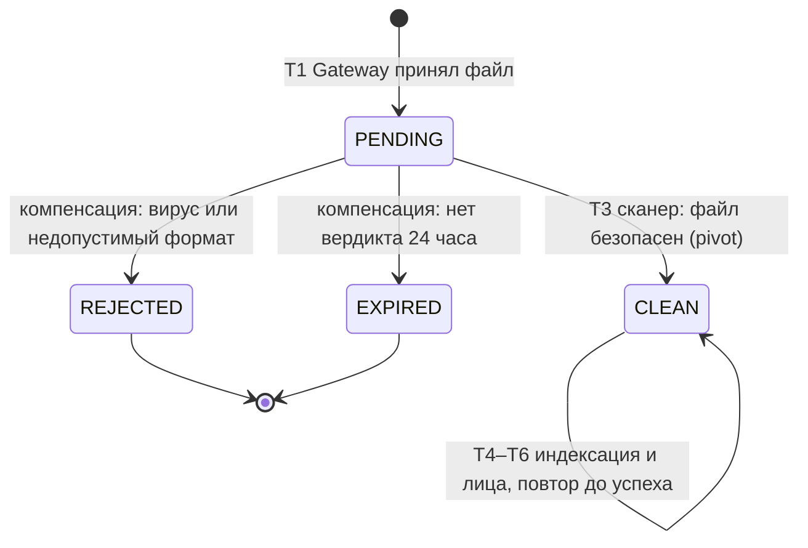

**Восстановление саги.** Pending Reconciler раз в минуту читает `scan_pending`: записи старше 10 минут означают, что сага остановилась до T3. Он повторно публикует `scan-jobs`. Записи старше 24 часов приводят к EXPIRED. Благодаря этому сбой между записью в Cassandra и публикацией в Kafka (п. 7.1) не оставляет загрузку навсегда зависшей.

**Требования к участникам саги:**

- каждый шаг идемпотентен: ключи записей (`photo_id`, детерминированный `embedding_id = hash(photo_id, номер лица)`), повтор события не создаёт дублей;
- каждый шаг можно перезапустить после обрыва в любой момент (graceful shutdown, п. 9.5);
- состояние саги хранится в БД, а не в памяти сервиса;
- события версионируются схемой в Schema Registry (п. 10.9).

**Почему хореография, а не центральный оркестратор (Temporal).**

|               | Хореография через Kafka (выбрано)      | Центральный оркестратор                                            |
| ------------- | -------------------------------------- | ------------------------------------------------------------------ |
| Связность     | Сервисы знают только топики            | Оркестратор знает все шаги                                         |
| Отказ         | Нет центральной точки отказа           | Оркестратор — критичный компонент                                  |
| Масштаб       | Kafka справляется с 139 тыс. событий/с | Хранилище состояния оркестратора принимает до 6 млрд задач в сутки |
| Наблюдаемость | Сквозной `trace_id` и lag по топикам   | Историю шагов даёт сам оркестратор                                 |

Цена выбора: порядок шагов нигде не записан в одном месте кода. Он зафиксирован в таблице выше и в п. 10.4.2.

**Второй пример: удаление фото.** Событие `photo.deleted` (п. 6.5) запускает такую же цепочку повторяемых шагов: убрать копии из `album_items`, `face_photos`, `search_index`, сбросить `metadata_cache`, а оригинал из Ceph удалить сборщиком через 30 суток. Здесь нет компенсируемых шагов, зато есть компенсация «восстановить из корзины» (событие `photo.restored`). Эта сага в каталог сервисов раздела 10 не вынесена: она не входит в MVP и показана для полноты.

### 9.4.3. Механизм: очередь задач (RabbitMQ)

Для команд, адресованных одному исполнителю, используется очередь задач: доставка push. Сообщение разбирается одним из конкурирующих workers, при ошибке уходит в retry-очередь (DLX + TTL), после исчерпания попыток — в очередь ошибок.

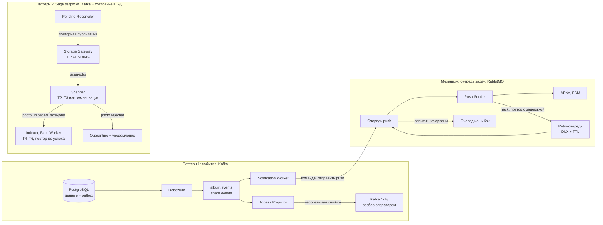

Notification Worker читает события паттерна 1, а команды на отправку передаёт через очередь. Так отказ push-провайдера не тормозит чтение событий из Kafka: уведомление уже записано в `notifications`, а команда ждёт в очереди.

## 9.5. Graceful shutdown

**Общий протокол** для всех stateless-сервисов в Kubernetes:

1. Pod получает SIGTERM, readiness-проба сразу начинает возвращать «не готов». Новые запросы на него не приходят.
2. `preStop`-пауза 5–10 с, пока L7/L4 и sidecar обновят список endpoints.
3. Сервис перестаёт принимать новые соединения и дорабатывает активные запросы до таймаута.
4. Закрывает пулы соединений, фиксирует offsets, сбрасывает буферы.
5. Выходит с кодом 0. Если не успел за `terminationGracePeriodSeconds`, получает SIGKILL. Все операции должны быть безопасны к такому обрыву: идемпотентность и возобновление (требования к шагам саги, п. 9.4.2).

`PodDisruptionBudget` ограничивает число одновременно останавливаемых pod (не более 10% пула или 1 pod в небольших пулах), чтобы плановое обновление не приводило к потере мощности.

| Компонент                                              | Что происходит при остановке                                                                                                                                                                            | Таймаут                    |
| ------------------------------------------------------ | ------------------------------------------------------------------------------------------------------------------------------------------------------------------------------------------------------- | -------------------------- |
| L7 Nginx                                               | `nginx -s quit`: перестаёт принимать новые соединения, дожидается текущих; L4 перед этим выводит узел из ротации (weight = 0)                                                                           | 60 с                       |
| L4 (IPVS)                                              | Узел убирается из ECMP, существующие соединения доживают                                                                                                                                                | 60 с                       |
| API Gateway                                            | Readiness off, дорабатывает запросы, закрывает keep-alive с `Connection: close`                                                                                                                         | 30 с                       |
| Auth, Metadata, Search, Albums, Sharing, Notifications | Readiness off, доработка запросов, закрытие пулов к БД и кешам                                                                                                                                          | 30 с                       |
| Storage Gateway                                        | Новые загрузки не принимаются. Активная multipart-загрузка прерывается без потерь: клиент докачивает с последнего чанка на другом экземпляре, состояние в Redis и список частей в Ceph S3 (`ListParts`) | 120 с                      |
| Content Scanner Worker                                 | Прекращает poll, дорабатывает текущие файлы, делает commit offset. Недоработанная задача после обрыва придёт повторно, обработка идемпотентна                                                           | 60 с                       |
| Face Worker                                            | Прекращает poll, дописывает текущий батч в Cassandra, commit offset. Детерминированный `embedding_id` делает повтор безопасным                                                                          | 60 с                       |
| Indexer, Access Projector, Notification Worker         | Прекращают poll, дорабатывают сообщение, commit offset                                                                                                                                                  | 30 с                       |
| Push Sender                                            | Прекращает приём из очереди, дожидается ack отправленных, невыполненные возвращаются в очередь (nack)                                                                                                   | 30 с                       |
| ML Inference                                           | Readiness off, доработка текущих батчей GPU, затем остановка                                                                                                                                            | 60 с                       |
| Debezium worker                                        | Останавливает коннектор, сохраняет offset, другой worker подхватывает коннектор                                                                                                                         | 30 с                       |
| Pending Reconciler                                     | Освобождает lease лидера, второй экземпляр становится лидером                                                                                                                                           | 15 с                       |
| PostgreSQL                                             | Плановое обслуживание: `patronictl switchover` на sync-реплику (RPO = 0), затем остановка старого primary                                                                                               | ≈30 с недоступности записи |
| Cassandra                                              | `nodetool drain` (сброс memtable, остановка приёма), затем остановка; hints собирают пропущенные записи                                                                                                 | минуты                     |
| Kafka                                                  | Controlled shutdown: лидерство партиций переносится на другие брокеры до остановки                                                                                                                      | секунды                    |
| Redis, Aerospike                                       | Плановый failover реплики или миграция партиций, затем остановка                                                                                                                                        | секунды                    |
| Ceph OSD                                               | Флаг `noout` на время обслуживания, чтобы не запускалась лишняя ребалансировка                                                                                                                          | по регламенту              |
| etcd                                                   | По одному узлу, с проверкой кворума между шагами                                                                                                                                                        | по регламенту              |

## 9.6. Graceful degradation

Приоритеты на деградацию: **безопасность и целостность → чтение и скачивание → загрузка → индексация и поиск → ML и уведомления.** Чем ниже в списке, тем раньше система жертвует этим при перегрузке.

### 9.6.1. Общие механизмы

| Механизм              | Как работает                                                                                                                 |
| --------------------- | ---------------------------------------------------------------------------------------------------------------------------- |
| Таймауты и deadline   | Каждый вызов имеет deadline, он передаётся по цепочке gRPC и уменьшается на каждом шаге                                      |
| Повторы               | Только для идемпотентных запросов, backoff с jitter, бюджет повторов 10% от трафика, чтобы повторы не превращались в шторм   |
| Circuit breaker       | Sidecar размыкает цепь при росте ошибок или задержки зависимости, часть запросов идёт сразу на fallback                      |
| Bulkhead              | Отдельные пулы соединений и воркеров на каждую зависимость: медленная Cassandra не занимает потоки сервиса целиком           |
| Load shedding         | При перегрузке API Gateway отвечает `429 Retry-After` или `503` на запросы низкого приоритета, не доводя сервис до таймаутов |
| Backpressure воркеров | При росте ошибок зависимости воркер ставит consumer на паузу (`pause`), не набирая необработанные задачи                     |
| Feature-флаги         | Выключатели без деплоя: `ml.faces.enabled`, `push.enabled`, `search.facets.enabled`, `uploads.throttle`                      |

### 9.6.2. Уровни деградации

| Уровень | Триггер                                           | Что отключается или ограничивается                                                                                         | Что видит пользователь                                        |
| ------- | ------------------------------------------------- | -------------------------------------------------------------------------------------------------------------------------- | ------------------------------------------------------------- |
| L0      | Норма                                             | —                                                                                                                          | Всё работает                                                  |
| L1      | Рост lag фоновых воркеров > 15 мин                | Face Regroup Job и пересборки приостановлены                                                                               | Ничего                                                        |
| L2      | Lag Face Worker или ML > 1 ч, перегрузка GPU      | Флаг `ml.faces.enabled = false`: задачи копятся в Kafka, фото сразу индексируются по метаданным                            | Лица на новых фото появляются позже, остальной поиск работает |
| L3      | Деградация Cassandra или рост p99 поиска          | Поиск сужается до фильтра по дате, камера и геофильтры отключены, размер страницы уменьшен; Metadata читает только из кеша | Поиск упрощённый, ответ с пометкой «не все фильтры применены» |
| L4      | Перегрузка Ceph или пик загрузки сверх расчётного | Загрузка замедляется: `429 Retry-After`, клиент докачивает с backoff; приоритет у скачивания                               | Загрузка медленнее, просмотр не страдает                      |
| L5      | Потеря региона или кворума хранилища              | Режим read-only: запись отклоняется `503`, чтение и скачивание из DR-реплик, сессии работают                               | Можно смотреть, нельзя загружать                              |

Безопасность не деградирует ни на каком уровне: сканер остаётся fail-closed, а права проверяются по источникам истины.

### 9.6.3. Что делает каждый сервис при отказе зависимости

| Сервис                | Зависимость отказала                         | Что делаем                                                                                                | Что видит пользователь                             |
| --------------------- | -------------------------------------------- | --------------------------------------------------------------------------------------------------------- | -------------------------------------------------- |
| API Gateway           | Redis (rate-limit, `session_cache`)          | Rate-limit работает по локальному счётчику pod; проверка сессии — напрямую через Auth Service             | Ничего                                             |
| Auth Service          | Redis `session_cache`                        | Читает `sessions` из PostgreSQL ближайшей реплики с локальным LRU                                         | Чуть выше задержка                                 |
| Auth Service          | PostgreSQL `auth` недоступен                 | Выданные сессии принимаются по кешу и подписанному токену до истечения; новые логины отклоняются `503`    | Новые входы невозможны                             |
| Metadata Service      | Aerospike                                    | Читает напрямую из Cassandra с ограничением RPS и коротким локальным кешем                                | Чуть выше задержка                                 |
| Metadata Service      | Cassandra `LOCAL_QUORUM`                     | Чтение из DR-ДЦ, при L5 — read-only                                                                       | Возможна задержка, свежие фото могут не показаться |
| Search Service        | Cassandra SAI медленный                      | Урезает запрос до фильтра по дате, возвращает частичный результат с признаком `has_more`                  | Меньше фильтров, результат ограничен               |
| Search Service        | `face_photos` или `face_profiles` недоступны | Вкладка «Люди» скрыта или помечена как временно недоступная, остальной поиск работает                     | Нет поиска по людям                                |
| Albums Service        | Один шард `albums`                           | Недоступны только альбомы этого шарда (1/64), список альбомов берётся из `user_access`                    | Часть альбомов недоступна                          |
| Albums Service        | `user_access`                                | Список ограничивается альбомами, где пользователь владелец, через шард `albums`                           | Список неполный                                    |
| Sharing Service       | Redis `share_cache`                          | Читает `shares` из PostgreSQL, нагрузка ограничена                                                        | Ничего                                             |
| Sharing Service       | Kafka                                        | Изменения копятся в outbox PostgreSQL, проекции отстают; отзыв ссылки по-прежнему проверяется по `shares` | Списки обновляются позже                           |
| Notifications Service | Cassandra                                    | Возвращает пустой список с баннером                                                                       | Нет истории уведомлений                            |
| Storage Gateway       | Redis (состояние загрузки)                   | Восстанавливает состояние из Ceph S3 (`ListParts`)                                                        | Ничего                                             |
| Storage Gateway       | Ceph медленный                               | `429 Retry-After`, загрузка замедляется                                                                   | Загрузка медленнее                                 |
| Storage Gateway       | Kafka недоступна                             | Принимает файл, оставляет PENDING и запись в `scan_pending`; Reconciler опубликует `scan-jobs` позже      | Фото «обрабатывается» дольше                       |
| Content Scanner       | Недоступен AV-движок или Ceph                | Задача не подтверждается, остаётся в Kafka; публикации нет (fail-closed)                                  | Фото «обрабатывается» дольше                       |
| Face Worker           | ML Inference перегружен                      | Приостанавливает чтение `face-jobs`, лаг растёт                                                           | Лица появляются позже                              |
| Indexer               | Cassandra                                    | Пауза, повтор после восстановления; запись по ключу идемпотентна                                          | Новые фото появляются в поиске позже               |
| Access Projector      | PostgreSQL `user_access`                     | Пауза, события остаются в Kafka 7 суток; проекцию можно пересобрать                                       | Список расшаренных альбомов отстаёт                |
| Notification Worker   | Cassandra или RabbitMQ                       | Пауза чтения событий; события остаются в Kafka                                                            | Уведомления позже                                  |
| Push Sender           | APNs / FCM                                   | Повторы с задержкой, затем очередь ошибок; уведомление уже записано в `notifications`                     | Push позже, список в приложении есть               |

## 9.7. Допущения и ограничения

- Количество экземпляров сервисов (≥3 на ДЦ), API Gateway (≥3 pod на ДЦ), Storage Gateway (≥3 на площадку), worker-ов Debezium (≥2), реплик Prometheus (2), Alertmanager (3), узлов etcd (5), мастеров Kubernetes (3), узлов Vault (5), реплик Schema Registry (3) — инженерные допущения проекта; в предыдущих разделах эти значения не рассчитывались.
- Размер парка сканеров (≈570 узлов) и GPU (≈107) рассчитан в п. 10.3.2 на допущениях о производительности одного узла: 250 файлов/с на узел сканера и 1 500 изображений/с на один GPU. Их нужно подтвердить нагрузочным тестом.
- Значения RTO — оценочные, основаны на типичном времени срабатывания механизмов (Patroni ≈30 с, Redis ≈5–10 с, сходимость BGP — секунды) и должны подтверждаться учениями (chaos-тестирование, регулярная проверка восстановления из бэкапа раз в месяц, п. 6.8).
- Таймауты graceful shutdown и пороги переключения уровней деградации (п. 9.5–9.6) — стартовые значения, их надо подтверждать нагрузочными тестами и учениями. Включение уровней L2–L5 требует, чтобы клиенты корректно обрабатывали `429`, `503` и признак `has_more`.
- Асинхронные копии между регионами (Cassandra DR, Ceph multisite, PostgreSQL async DR) дают RPO > 0 при потере всего региона: последние секунды записей могут быть потеряны. Для PostgreSQL в пределах региона RPO = 0 за счёт sync-реплики.
- Полный бэкап `photos` (1,3 PB) и файлов Ceph не делается: он стоил бы как само хранилище. Защита строится на репликации, неизменяемости объектов, корзине 30 суток и snapshots.
- Сага загрузки даёт согласованность в конечном счёте: между T1 и T3 фото видно владельцу только как «обрабатывается». Время до публикации определяется очередью `scan-jobs` и в норме составляет секунды.
- Обязательства по обработке запрещённого контента (регламент и отчётность перед внешними организациями) выходят за рамки инженерного описания и определяются юридическим регламентом.
- Backups и политики хранения по каждой СУБД описаны в п. 6.8 и здесь не дублируются.

# 10. Схема проекта

Раздел собирает в одну картину решения из разделов 3–9: как пользовательский запрос попадает в сервис, как он проходит через слои балансировки и API Gateway, какие сервисы и хранилища участвуют в обработке и как данные движутся между ними в синхронном и фоновом режимах. Каждый сервис описан отдельно: для него указано, откуда он читает, куда пишет, какие топики и очереди использует и с какими сервисами взаимодействует. Отдельным контуром показаны метрики, логирование и трейсы, отдельным — платформа оркестрации.

## 10.1. Схема взаимодействия сервисов

На схеме показаны два независимых входных контура (CDN/media и API), все сервисы отдельными узлами, хранилища, S3 с бакетами, шины событий, контур проверки файлов, ML-контур, блок оркестрации и контур наблюдаемости. Схема даёт общую картину по слоям: стрелки показывают направление запроса и событий между слоями, а связи каждого сервиса с конкретными базами, топиками и другими сервисами описаны в каталоге сервисов (п. 10.3) и сводных матрицах (п. 10.3.3, 10.3.4).

```mermaid
flowchart TB
    classDef edge fill:#c8e6c9,stroke:#4caf50,color:#000
    classDef svc fill:#bbdefb,stroke:#1976d2,color:#000
    classDef store fill:#ffe0b2,stroke:#f57c00,color:#000
    classDef worker fill:#fff59d,stroke:#fbc02d,color:#000
    classDef bus fill:#e0e0e0,stroke:#757575,color:#000
    classDef mon fill:#ffcdd2,stroke:#e57373,color:#000
    classDef orch fill:#e1bee7,stroke:#8e24aa,color:#000
    classDef ext fill:#fff,stroke:#999,stroke-dasharray:4 3,color:#000

    Client["Клиенты<br/>мобильное приложение, web"]

    subgraph MON["Метрики, логи, трейсы"]
        direction LR
        Vector["Vector<br/>агенты сбора логов"] --> Loki["Loki<br/>хранилище логов"] --> Grafana["Grafana<br/>дашборды, логи, трейсы"]
        Prometheus["Prometheus<br/>метрики"] --> Grafana
        Prometheus --> Alertmanager["Alertmanager<br/>алерты дежурным"]
        Tempo["Tempo<br/>трейсы OpenTelemetry"] --> Grafana
    end

    subgraph ORCH["Оркестрация и платформа"]
        direction LR
        K8s["Kubernetes<br/>запуск pod, probes, HPA и KEDA"]
        Mesh["Service mesh, Envoy<br/>mTLS, таймауты, retry, circuit breaker"]
        Reg["Schema Registry<br/>Protobuf-контракты событий"]
        Flags["Feature-флаги<br/>kill-switch ML, push, загрузки"]
        Vault["Vault<br/>секреты и сертификаты"]
    end

    GeoDNS["GeoDNS<br/>media: по home-региону<br/>api: по задержке"]
    API["API-контур, 14 ДЦ<br/>BGP Anycast → L3 ECMP → L4 IPVS<br/>→ L7 Nginx: TLS"]
    GW["API Gateway<br/>маршрутизация по OpenAPI, проверка сессии,<br/>rate-limit, idempotency-key, trace_id"]
    CDN["CDN-контур, 32 площадки<br/>BGP Anycast → L3 ECMP → L4 IPVS<br/>→ L7 Nginx: TLS, маршрутизация"]
    SG["Storage Gateway<br/>multipart-загрузка, отдача файлов из media"]

    Client -->|адрес региона| GeoDNS
    Client -->|"HTTPS: API"| API
    Client -->|загрузка и скачивание файлов| CDN
    API --> GW
    CDN --> SG

    %% ---------- API-сервисы ----------
    Auth["Auth Service<br/>сессии, home_region"]
    Meta["Metadata Service<br/>список фото, object_key"]
    Search["Search Service<br/>планировщик запросов,<br/>поиск по метаданным и лицам"]
    Albums["Albums Service<br/>альбомы, участники,<br/>список своих альбомов"]
    Sharing["Sharing Service<br/>выдача, открытие и отзыв ссылок"]
    Notif["Notifications Service<br/>список уведомлений"]

    GW -->|"REST → gRPC, подписанная идентичность"| Meta & Search & Albums & Sharing & Notif
    GW -->|ValidateSession| Auth
    SG -->|ValidateSession| Auth

    Albums -->|"gRPC: BatchGetPhotos"| Meta
    Sharing -->|"gRPC: CheckAccess"| Albums
    Search -->|"gRPC: BatchGetPhotos"| Meta

    %% ---------- хранилища ----------
    PGAuth[("PostgreSQL auth<br/>sessions, users, глобальный")]
    Redis[("Redis<br/>session_cache, share_cache,<br/>состояние загрузки, rate-limit")]
    Aero[("Aerospike<br/>metadata_cache")]
    Cass[("Cassandra meta<br/>photos, search_index, face_photos,<br/>notifications, scan_pending")]
    CassML[("Cassandra ml<br/>face_embeddings, face_profiles")]
    etcd[("etcd<br/>карта бакет → шард")]
    PGAlb[("PostgreSQL albums<br/>album_items, album_members, outbox,<br/>64 шарда")]
    PGShare[("PostgreSQL shares<br/>shares, outbox, региональный")]
    PGAcc[("PostgreSQL user_access<br/>региональный")]
    S3[("Ceph RGW, S3 API<br/>buckets: ingest, media,<br/>derived, quarantine")]

    Auth -->|sessions| PGAuth
    Auth -->|session_cache| Redis
    GW -->|"rate-limit, session_cache"| Redis
    Meta -->|горячие метаданные| Aero
    Meta -->|photos| Cass
    Search -->|"search_index, face_photos"| Cass
    Search -->|"face_profiles: список людей"| CassML
    Notif -->|notifications| Cass
    Albums -->|карта шардов| etcd
    Albums -->|"hash(album_id)"| PGAlb
    Albums -->|мои и расшаренные альбомы| PGAcc
    Sharing -->|"shares, открытие ссылки"| PGShare
    Sharing -->|"share_cache, TTL 60 с"| Redis

    %% ---------- путь загрузки ----------
    SG -->|"чанки и объект в ingest"| S3
    SG -->|"photos status=PENDING, scan_pending"| Cass
    SG -->|состояние загрузки, TTL 5 мин| Redis
    SG -->|"отдача файла из media"| S3

    %% ---------- асинхронный контур ----------
    Kafka["Kafka<br/>scan-jobs, photo.uploaded, photo.rejected,<br/>face-jobs, face.recognized,<br/>album.events, share.events"]:::bus
    Debezium["Debezium<br/>читает outbox"]
    Scanner["Content Scanner Worker<br/>проверка файла, EXIF,<br/>прокси-копия для ML"]
    Recon["Pending Reconciler<br/>повторно публикует scan-jobs"]
    FaceW["Face Worker<br/>привязка лиц к профилям,<br/>публикует face.recognized"]
    ML["ML Inference Service, GPU<br/>детектор лиц + эмбеддинги"]
    Indexer["Indexer<br/>обновляет search_index"]
    Regroup["Face Regroup Job<br/>Spark: перегруппировка face_id = 0"]
    Proj["Access Projector<br/>проекция user_access"]
    NotifW["Notification Worker<br/>запись уведомлений, задания на push"]
    Rabbit["RabbitMQ<br/>очередь push, очередь ошибок"]:::bus
    Push["Push Sender<br/>отправка с повторами"]
    APNs["APNs, FCM<br/>push клиенту"]

    SG -.->|scan-jobs| Kafka
    Recon -->|читает scan_pending| Cass
    Recon -.->|повторная публикация scan-jobs| Kafka
    Kafka -.->|scan-jobs| Scanner
    Scanner -->|"читает ingest, пишет media и derived,<br/>плохие файлы в quarantine"| S3
    Scanner -->|"photos: scan_status, EXIF<br/>scan_pending: удаление"| Cass
    Scanner -.->|"photo.uploaded, face-jobs, photo.rejected"| Kafka

    Kafka -.->|face-jobs| FaceW
    FaceW -->|читает прокси из derived| S3
    FaceW -->|"gRPC: DetectAndEmbed"| ML
    FaceW -->|"face_embeddings, face_profiles"| CassML
    FaceW -->|face_photos| Cass
    FaceW -.->|face.recognized| Kafka
    Kafka -.->|"photo.uploaded, face.recognized"| Indexer
    Indexer -->|search_index| Cass
    Regroup -->|"face_embeddings, face_profiles"| CassML
    Regroup -->|face_photos| Cass

    PGAlb -.->|outbox| Debezium
    PGShare -.->|outbox| Debezium
    Debezium -.->|"album.events, share.events"| Kafka
    Kafka -.->|share.revoked| Sharing
    Kafka -.->|"album.events, share.events"| Proj
    Kafka -.->|"album.events, share.events, photo.rejected"| NotifW
    Proj -->|"user_access в home_region получателя"| PGAcc
    NotifW -->|notifications| Cass
    NotifW -.->|задания push| Rabbit
    Rabbit -.-> Push --> APNs

    class GeoDNS,API,CDN,SG,GW edge
    class Auth,Meta,Search,Albums,Sharing,Notif svc
    class PGAuth,Redis,Aero,Cass,CassML,etcd,PGAlb,PGShare,PGAcc,S3 store
    class Debezium,Scanner,Recon,FaceW,ML,Indexer,Regroup,Proj,NotifW,Push worker
    class Vector,Loki,Grafana,Prometheus,Alertmanager,Tempo mon
    class K8s,Mesh,Reg,Flags,Vault orch
    class APNs ext
```

Кластеры PostgreSQL `shares` и `user_access` региональные (по `home_region`), `auth` — глобальный, а базы `albums` разнесены по 64 шардам внутри регионов. Данные пользователя всегда лежат в контуре его `home_region` (п. 3.1, раздел 6).

Узлы контура наблюдаемости и блока оркестрации показаны на схеме отдельными группами без стрелок от остальных компонентов: каждый сервис и воркер запускается Kubernetes, ходит в соседние сервисы через Envoy-sidecar, читает схемы событий из Schema Registry, флаги из сервиса флагов, секреты из Vault, отдаёт метрики и пишет логи и трейсы по общим правилам из п. 10.7 и 10.9. Media-контур (Storage Gateway, Ceph) работает без sidecar: он передаёт гигабайты в секунду, и лишний прокси на пути данных был бы дорогим.

## 10.2. Состав схемы

| Слой                    | Компоненты                                                                                             | Роль                                                                                        |
| ----------------------- | ------------------------------------------------------------------------------------------------------ | ------------------------------------------------------------------------------------------- |
| Внешняя балансировка    | Authoritative DNS, BGP Anycast, 7 логических регионов                                                  | Выбор региона и доступной точки входа (раздел 3)                                            |
| Локальная балансировка  | L3/ECMP, L4 (IPVS/LVS), L7 Nginx                                                                       | Распределение трафика внутри ДЦ, TLS termination (раздел 4)                                 |
| Оркестрация и платформа | API Gateway, Kubernetes, Envoy service mesh, Schema Registry, сервис feature-флагов, Vault             | Вход в API, запуск и масштабирование сервисов, связь сервисов, контракты, секреты (п. 10.9) |
| Media-контур            | Storage Gateway, Ceph RGW (S3: `ingest`, `media`, `derived`, `quarantine`)                             | Приём и отдача байтов файлов; через БД байты не проходят                                    |
| Контур проверки         | Content Scanner Worker, Pending Reconciler                                                             | Проверка безопасности файлов до публикации, восстановление саги загрузки (п. 9.4)           |
| API-контур              | Auth Service, Metadata Service, Search Service, Albums Service, Sharing Service, Notifications Service | Синхронная обработка пользовательских запросов                                              |
| ML-контур               | Face Worker, ML Inference Service (GPU), Face Regroup Job (Spark), Indexer                             | Распознавание лиц, индексация (п. 10.4.5, 10.4.8)                                           |
| Фоновые обработчики     | Access Projector, Notification Worker, Push Sender                                                     | Проекции доступа, уведомления и push                                                        |
| Хранилища               | PostgreSQL, Cassandra, Redis, Aerospike, Ceph, etcd                                                    | Данные по классам нагрузки (раздел 6)                                                       |
| Шины событий            | Kafka, RabbitMQ, Debezium                                                                              | События, saga, очереди доставки с повторами (раздел 9.4)                                    |
| Наблюдаемость           | Prometheus, Alertmanager, Grafana, Vector, Loki, Tempo                                                 | Метрики, алерты, дашборды, сбор и хранение логов, трейсы (п. 10.7)                          |

## 10.3. Каталог сервисов

Для каждого сервиса указано всё, что нужно разработчику: что он читает и пишет, какие топики и очереди использует, с кем общается. «Синхронно» означает прямой вызов (HTTP/gRPC) через L7-пул или sidecar, «событие» — через Kafka или RabbitMQ. Сессию пользователя проверяет API Gateway; API-сервисы получают от него подписанную идентичность (`user_id`, `home_region`) и Auth Service сами не вызывают.

### 10.3.1. Синхронные сервисы

#### API Gateway

| Параметр                | Значение                                                                                                                                                                                                                                                                                    |
| ----------------------- | ------------------------------------------------------------------------------------------------------------------------------------------------------------------------------------------------------------------------------------------------------------------------------------------- |
| Назначение              | Единая точка входа во все API: маршрутизация, проверка сессии, ограничение частоты запросов                                                                                                                                                                                                 |
| Входящие запросы        | L7 Nginx, REST/JSON по OpenAPI 3, версия в пути `/v1/...`                                                                                                                                                                                                                                   |
| Что делает              | Проверяет сессию (Redis `session_cache`, при промахе через Auth Service); подписывает внутренний токен с `user_id`, `home_region`; применяет rate-limit (token bucket по `user_id` и IP в Redis); проверяет `Idempotency-Key` для POST; ставит `trace_id` и deadline; переводит REST в gRPC |
| Читает / пишет          | Redis (счётчики rate-limit, `session_cache`)                                                                                                                                                                                                                                                |
| Kafka / RabbitMQ        | не использует                                                                                                                                                                                                                                                                               |
| Синхронно вызывает      | Auth Service (при промахе кеша), все API-сервисы по gRPC                                                                                                                                                                                                                                    |
| Вызывается синхронно из | клиент через L7 Nginx                                                                                                                                                                                                                                                                       |
| Масштабирование         | Stateless, HPA по RPS и CPU                                                                                                                                                                                                                                                                 |

#### Storage Gateway

| Параметр                | Значение                                                                                                                                                                                         |
| ----------------------- | ------------------------------------------------------------------------------------------------------------------------------------------------------------------------------------------------ |
| Назначение              | Приём и отдача байтов файлов на `media.photos.example`                                                                                                                                           |
| Входящие запросы        | Клиент через CDN-контур: L3 → L4 → L7 Nginx                                                                                                                                                      |
| Пишет в хранилища       | Ceph S3, бакет `ingest` (чанки и итоговый объект); Redis (состояние загрузки: `upload_id`, номера чанков, TTL 5 минут); Cassandra `photos` со статусом PENDING и `scan_pending` (`LOCAL_QUORUM`) |
| Читает из хранилищ      | Ceph S3, бакет `media` (отдача файла); Redis (состояние загрузки). Из `ingest`, `derived` и `quarantine` не отдаёт никогда                                                                       |
| Публикует в Kafka       | `scan-jobs` (ключ `photo_id`)                                                                                                                                                                    |
| Читает из Kafka         | —                                                                                                                                                                                                |
| Синхронно вызывает      | Auth Service (проверка сессии и определение `home_region`)                                                                                                                                       |
| Вызывается синхронно из | только от клиента                                                                                                                                                                                |
| Роль в саге             | Шаг T1 саги загрузки (п. 9.4.2). Gateway больше не публикует `photo.uploaded` и `face-jobs`: это делает сканер после проверки                                                                    |

#### Auth Service

| Параметр                | Значение                                                                                      |
| ----------------------- | --------------------------------------------------------------------------------------------- |
| Назначение              | Проверка и создание сессий, выдача `home_region`                                              |
| Пишет в хранилища       | PostgreSQL `auth` (`sessions`, `users`); Redis (`session_cache`)                              |
| Читает из хранилищ      | Redis `session_cache`; при промахе — PostgreSQL `auth` (ближайшая реплика) с заполнением кеша |
| Kafka / RabbitMQ        | не использует                                                                                 |
| Синхронно вызывает      | —                                                                                             |
| Вызывается синхронно из | API Gateway, Storage Gateway                                                                  |

#### Metadata Service

| Параметр                | Значение                                                                                                          |
| ----------------------- | ----------------------------------------------------------------------------------------------------------------- |
| Назначение              | Список фотографий и метаданные (в том числе `object_key` для скачивания)                                          |
| Читает из хранилищ      | Aerospike `metadata_cache`; при промахе — Cassandra `photos` (партиция `(owner_id, year)`)                        |
| Пишет в хранилища       | Aerospike `metadata_cache` (заполнение кеша)                                                                      |
| Kafka / RabbitMQ        | не использует                                                                                                     |
| Синхронно вызывает      | —                                                                                                                 |
| Вызывается синхронно из | API Gateway; Albums Service и Search Service (gRPC `BatchGetPhotos`)                                              |
| Особенности             | Фото со `scan_status`, отличным от CLEAN, в списки не попадают (владельцу показывается заглушка «обрабатывается») |

#### Search Service

| Параметр                | Значение                                                                                                                                                                                                                                |
| ----------------------- | --------------------------------------------------------------------------------------------------------------------------------------------------------------------------------------------------------------------------------------- |
| Назначение              | Поиск по дате, камере, геоданным и людям, список людей                                                                                                                                                                                  |
| Читает из хранилищ      | Cassandra `search_index` (партиция `(owner_id, year)`, фильтры SAI); Cassandra `face_photos` (партиция `(owner_id, face_id, year)`); Cassandra `ml`: `face_profiles` (только `face_id` и `person_label` для списка людей, без centroid) |
| Пишет в хранилища       | — (только чтение)                                                                                                                                                                                                                       |
| Kafka / RabbitMQ        | не использует                                                                                                                                                                                                                           |
| Синхронно вызывает      | Metadata Service (gRPC `BatchGetPhotos`: `object_key`, статус, `deleted_at`)                                                                                                                                                            |
| Вызывается синхронно из | API Gateway                                                                                                                                                                                                                             |
| Внутренние модули       | валидатор запроса → планировщик → исполнитель → гидратор результатов → курсор (подробно в п. 10.4.8)                                                                                                                                    |

#### Albums Service

| Параметр                | Значение                                                                                                                                                                              |
| ----------------------- | ------------------------------------------------------------------------------------------------------------------------------------------------------------------------------------- |
| Назначение              | Альбомы, их содержимое и участники                                                                                                                                                    |
| Пишет в хранилища       | PostgreSQL `albums` (шард по `hash(album_id)`): `album_items`, `album_members` и таблица outbox — одной транзакцией                                                                   |
| Читает из хранилищ      | PostgreSQL `albums` (проверка прав по `album_members`); PostgreSQL `user_access` (список «мои и расшаренные мне альбомы», один запрос к одному кластеру); etcd (карта «бакет → шард») |
| Публикует в Kafka       | напрямую не публикует: события попадают в Kafka через outbox и Debezium (`album.events`)                                                                                              |
| Читает из Kafka         | —                                                                                                                                                                                     |
| Синхронно вызывает      | Metadata Service (gRPC `BatchGetPhotos`)                                                                                                                                              |
| Вызывается синхронно из | API Gateway; Sharing Service (gRPC `CheckAccess`)                                                                                                                                     |

#### Sharing Service

| Параметр                | Значение                                                                                                                  |
| ----------------------- | ------------------------------------------------------------------------------------------------------------------------- |
| Назначение              | Выдача, открытие и отзыв ссылок на альбомы                                                                                |
| Пишет в хранилища       | PostgreSQL `shares` (региональный кластер): `shares` и outbox — одной транзакцией; Redis `share_cache` (TTL 60 с)         |
| Читает из хранилищ      | Redis `share_cache`, при промахе — PostgreSQL `shares`                                                                    |
| Публикует в Kafka       | напрямую не публикует: через outbox и Debezium (`share.events`, в том числе `share.revoked`)                              |
| Читает из Kafka         | `share.events` — по `share.revoked` сбрасывает запись в `share_cache`                                                     |
| Синхронно вызывает      | Albums Service (gRPC `CheckAccess` при открытии ссылки; Albums читает нужный шард `albums`, карта «бакет → шард» из etcd) |
| Вызывается синхронно из | API Gateway                                                                                                               |

#### Notifications Service

| Параметр                | Значение                                                      |
| ----------------------- | ------------------------------------------------------------- |
| Назначение              | Выдача пользователю списка уведомлений и пометка прочитанными |
| Читает из хранилищ      | Cassandra `notifications`                                     |
| Пишет в хранилища       | Cassandra `notifications` (статус «прочитано»)                |
| Kafka / RabbitMQ        | не использует                                                 |
| Синхронно вызывает      | —                                                             |
| Вызывается синхронно из | API Gateway                                                   |

### 10.3.2. Фоновые обработчики и вспомогательные компоненты

#### Content Scanner Worker

| Параметр           | Значение                                                                                                                                                                                                                                                                                    |
| ------------------ | ------------------------------------------------------------------------------------------------------------------------------------------------------------------------------------------------------------------------------------------------------------------------------------------- |
| Назначение         | Проверка безопасности файла перед публикацией; извлечение метаданных; подготовка прокси-копии для ML                                                                                                                                                                                        |
| Читает из Kafka    | `scan-jobs` (consumer group, ключ `photo_id`)                                                                                                                                                                                                                                               |
| Читает из хранилищ | Ceph S3, бакет `ingest` (оригинал)                                                                                                                                                                                                                                                          |
| Пишет в хранилища  | Ceph S3: при CLEAN — копия объекта в `media` и прокси в `derived` (TTL 7 суток); при REJECTED — объект в `quarantine`, удаление из `ingest`. Cassandra `photos`: `scan_status`, `camera_model`, `latitude`, `longitude`, `object_key`. Cassandra `scan_pending`: удаляет запись по вердикту |
| Публикует в Kafka  | при CLEAN: `photo.uploaded` (с EXIF) и `face-jobs` (с ключом прокси); при REJECTED: `photo.rejected`                                                                                                                                                                                        |
| Синхронные вызовы  | нет                                                                                                                                                                                                                                                                                         |
| Идемпотентность    | Повтор для фото в статусе CLEAN или REJECTED ничего не меняет                                                                                                                                                                                                                               |
| Режим отказа       | fail-closed: недоступность AV, Ceph или сбой проверки оставляют задачу в Kafka                                                                                                                                                                                                              |
| Роль в саге        | Шаги T2 и T3 (pivot) и путь компенсации (п. 9.4.2)                                                                                                                                                                                                                                          |

Что проверяет сканер, по шагам:

1. Совпадение заявленного типа, расширения и magic bytes; белый список форматов (JPEG, PNG, HEIC, WebP, MP4 и т. п.); ограничения на размер, число пикселей и длительность (защита от decompression bomb).
2. Полное декодирование изображения в песочнице: повреждённые файлы и полиглоты (изображение, содержащее исполняемые данные) отсекаются.
3. Антивирусная проверка (ClamAV или аналог) и сверка с хеш-списками запрещённого контента.
4. Извлечение EXIF: время съёмки, модель камеры, GPS. Эти значения идут в событие `photo.uploaded`, поэтому Indexer не читает файл.
5. Генерация прокси-копии (до 1280 px) в `derived`.

Вердикты: CLEAN, REJECTED (вирус или нарушение формата) или SUSPECT (запрещённый контент: отдельный регламент и ручная проверка вне инженерной схемы).

Расчёт парка (допущения):

```text
Пик: 138 889 файлов/с (раздел 2.3.2)
Один узел 32 vCPU: ≈130 мс CPU на файл
  (декодирование 5 МБ ≈ 50 мс, проверка форматов и EXIF ≈ 25 мс, антивирус ≈ 40 мс, прокси ≈ 15 мс)
  → 32 / 0,13 ≈ 250 файлов/с
N = ceil(138 889 / 250) = 556 узлов
+ N+2 на каждый из 7 регионов = 556 + 14 ≈ 570 узлов
```

Внутренний трафик: сканер перечитывает файлы из `ingest`, это порядка 5,6 Тбит/с на пике внутри регионов (не внешний трафик, он остаётся в ДЦ рядом с Ceph). Копия `ingest → media` выполняется в Ceph на стороне сервера (S3 `CopyObject`); допущение, что при размещении в одном placement-таргете данные не перезаписываются полностью, нужно проверить на стенде. Если не подтвердится, нагрузка на запись Ceph вырастет примерно на объём загрузок.

Бакеты:

| Бакет        | Что хранит                                   | Политика                                                                       |
| ------------ | -------------------------------------------- | ------------------------------------------------------------------------------ |
| `ingest`     | Загруженные, ещё непроверенные файлы и чанки | TTL 24 ч для необработанных; наружу не отдаётся                                |
| `media`      | Проверенные оригиналы                        | 3 реплики, RGW multisite (п. 9.2), единственный бакет, из которого раздаёт CDN |
| `derived`    | Прокси-копии для ML                          | TTL 7 суток, ≈150 КБ на файл                                                   |
| `quarantine` | Отклонённые файлы                            | Закрытый доступ, хранение по регламенту                                        |

Объём `derived`: 6 млрд/сутки × 7 суток × 150 КБ ≈ 6,3 ПБ, с тремя репликами ≈ 19 ПБ, то есть ≈0,014% от 134,78 ЭБ. Чтение прокси Face Worker-ом: 138 889 × 150 КБ ≈ 21 ГБ/с ≈ 167 Гбит/с на пике, вместо ≈5,6 Тбит/с при чтении оригиналов.

#### Pending Reconciler

| Параметр           | Значение                                                                                                        |
| ------------------ | --------------------------------------------------------------------------------------------------------------- |
| Назначение         | Восстановление саги загрузки: закрывает разрыв между записью в Cassandra и публикацией в Kafka (п. 7.1, 9.4.2)  |
| Читает из хранилищ | Cassandra `scan_pending` (записи старше 10 минут без вердикта)                                                  |
| Пишет в хранилища  | Cassandra `photos`: `scan_status = EXPIRED` для записей старше 24 часов; удаляет такие записи из `scan_pending` |
| Публикует в Kafka  | `scan-jobs` (повторно)                                                                                          |
| Запуск             | Каждую минуту, лидер выбирается через lease                                                                     |

#### Face Worker

| Параметр           | Значение                                                                                                          |
| ------------------ | ----------------------------------------------------------------------------------------------------------------- |
| Назначение         | Распознавание лиц: оркестрация ML и привязка к профилям                                                           |
| Читает из Kafka    | `face-jobs` (ключ `photo_id`, 1 024 партиции): `photo_id`, `owner_id`, ключ прокси в `derived`                    |
| Читает из хранилищ | Ceph S3 `derived` (прокси); Cassandra `ml`: `face_profiles` (centroid пользователя, локальный LRU-кеш 60 с)       |
| Синхронно вызывает | ML Inference Service (gRPC `DetectAndEmbed`)                                                                      |
| Пишет в хранилища  | Cassandra `ml`: `face_embeddings`; Cassandra: `face_photos`                                                       |
| Публикует в Kafka  | `face.recognized` (`photo_id`, `owner_id`, `face_ids[]`)                                                          |
| Идемпотентность    | `embedding_id = hash(photo_id, номер лица)`: повтор перезаписывает те же строки                                   |
| Особенности        | Сравнение эмбеддингов с centroid по косинусному расстоянию (п. 7.2); нераспределённые лица получают `face_id = 0` |

#### ML Inference Service

| Параметр         | Значение                                                                                                              |
| ---------------- | --------------------------------------------------------------------------------------------------------------------- |
| Назначение       | Детектор лиц и модель эмбеддингов на GPU                                                                              |
| Интерфейс        | gRPC `DetectAndEmbed(image) → faces[{bbox, embedding[512]}]`, поддержка батчей                                        |
| Работа           | Динамический батчинг на стороне сервера инференса; детекция на прокси 640 px, эмбеддинг на выровненных кропах 112×112 |
| Хранилища, Kafka | не использует (stateless)                                                                                             |
| Перегрузка       | Отвечает `RESOURCE_EXHAUSTED`, Face Worker ставит consumer на паузу                                                   |
| Версионирование  | Версия модели в ответе и в `face_embeddings`; при смене модели эмбеддинги пересчитываются через `face-jobs`           |

Расчёт парка (допущение: 1 500 изображений/с на один GPU при детекции на 640 px и пакетной обработке):

```text
Пик: 138 889 / 1 500 ≈ 93 GPU
+ N+2 на 7 регионов: 93 + 14 ≈ 107 GPU
CPU у Face Worker: декодирование прокси 1280 px ≈ 8 мс → 138 889 × 0,008 ≈ 1 110 vCPU ≈ 35 узлов по 32 vCPU
```

#### Face Regroup Job (Spark)

| Параметр           | Значение                                                           |
| ------------------ | ------------------------------------------------------------------ |
| Назначение         | Периодическая перегруппировка нераспределённых лиц (`face_id = 0`) |
| Читает из хранилищ | Cassandra `ml`: `face_embeddings`                                  |
| Пишет в хранилища  | Cassandra `ml`: `face_profiles`; Cassandra: `face_photos`          |
| Kafka / RabbitMQ   | не использует                                                      |
| Запуск             | по расписанию, фоновая пересборка                                  |

#### Indexer

| Параметр                  | Значение                                                                                                                                                                 |
| ------------------------- | ------------------------------------------------------------------------------------------------------------------------------------------------------------------------ |
| Назначение                | Построение и обновление `search_index`                                                                                                                                   |
| Читает из Kafka           | `photo.uploaded` (метаданные нового файла, включая EXIF, файл не читается), `face.recognized` (обновление `face_ids`)                                                    |
| Пишет в хранилища         | Cassandra `search_index`: `camera`, `geo_cell`, `date`, `search_text` (от `photo.uploaded`), `face_ids` (от `face.recognized`)                                           |
| Публикует                 | —                                                                                                                                                                        |
| Синхронные вызовы         | нет                                                                                                                                                                      |
| Идемпотентность и порядок | Запись по ключу `(owner_id, year, photo_id)` по колонкам (upsert): порядок прихода `photo.uploaded` и `face.recognized` не важен, второе событие дописывает свои колонки |

#### Access Projector

| Параметр          | Значение                                                                         |
| ----------------- | -------------------------------------------------------------------------------- |
| Назначение        | Поддержка проекции `user_access` («к каким альбомам у пользователя есть доступ») |
| Читает из Kafka   | `album.events`, `share.events`                                                   |
| Пишет в хранилища | PostgreSQL `user_access` в кластере `home_region` получателя                     |
| Публикует         | —                                                                                |
| Синхронные вызовы | нет                                                                              |
| Особенности       | проекция производная: её можно пересобрать из `album_members` и `shares`         |

#### Notification Worker

| Параметр             | Значение                                                                                           |
| -------------------- | -------------------------------------------------------------------------------------------------- |
| Назначение           | Формирование уведомлений по событиям альбомов, шеринга и отклонённых загрузок                      |
| Читает из Kafka      | `album.events`, `share.events`, `photo.rejected` (уведомление владельцу «файл не прошёл проверку») |
| Пишет в хранилища    | Cassandra `notifications`                                                                          |
| Публикует в RabbitMQ | задания на отправку push                                                                           |
| Синхронные вызовы    | нет                                                                                                |

#### Push Sender

| Параметр           | Значение                                                                                                   |
| ------------------ | ---------------------------------------------------------------------------------------------------------- |
| Назначение         | Доставка push-уведомлений клиентам                                                                         |
| Читает из RabbitMQ | очередь заданий push (с подтверждениями, повторами с задержкой; после исчерпания попыток — очередь ошибок) |
| Синхронные вызовы  | внешний push-провайдер (APNs / FCM)                                                                        |
| Хранилища          | не использует                                                                                              |

### 10.3.3. Сводная матрица: сервис → хранилище

`R` — читает, `W` — пишет. Хранилища указаны вместе с таблицами или кластерами.

| Сервис                | PostgreSQL                    | Cassandra                                                     | Redis                             | Aerospike            | Ceph S3                                        | etcd |
| --------------------- | ----------------------------- | ------------------------------------------------------------- | --------------------------------- | -------------------- | ---------------------------------------------- | ---- |
| API Gateway           | —                             | —                                                             | R/W rate-limit; R `session_cache` | —                    | —                                              | —    |
| Storage Gateway       | —                             | W `photos` (PENDING), W `scan_pending`                        | R/W состояние загрузки            | —                    | W `ingest`; R `media`                          | —    |
| Auth Service          | R/W `auth`                    | —                                                             | R/W `session_cache`               | —                    | —                                              | —    |
| Metadata Service      | —                             | R `photos`                                                    | —                                 | R/W `metadata_cache` | —                                              | —    |
| Search Service        | —                             | R `search_index`, `face_photos`, `face_profiles`              | —                                 | —                    | —                                              | —    |
| Albums Service        | R/W `albums`; R `user_access` | —                                                             | —                                 | —                    | —                                              | R    |
| Sharing Service       | R/W `shares`                  | —                                                             | R/W `share_cache`                 | —                    | —                                              | —    |
| Notifications Service | —                             | R/W `notifications`                                           | —                                 | —                    | —                                              | —    |
| Content Scanner       | —                             | W `photos` (статус, EXIF); W `scan_pending` (удаление записи) | —                                 | —                    | R `ingest`; W `media`, `derived`, `quarantine` | —    |
| Pending Reconciler    | —                             | R `scan_pending`; W `photos` (EXPIRED)                        | —                                 | —                    | —                                              | —    |
| Indexer               | —                             | W `search_index`                                              | —                                 | —                    | —                                              | —    |
| Face Worker           | —                             | R `face_profiles`; W `face_embeddings`, `face_photos`         | —                                 | —                    | R `derived`                                    | —    |
| Face Regroup Job      | —                             | R `face_embeddings`; W `face_profiles`, `face_photos`         | —                                 | —                    | —                                              | —    |
| Access Projector      | W `user_access`               | —                                                             | —                                 | —                    | —                                              | —    |
| Notification Worker   | —                             | W `notifications`                                             | —                                 | —                    | —                                              | —    |
| Push Sender           | —                             | —                                                             | —                                 | —                    | —                                              | —    |

### 10.3.4. Сводная матрица: топики и очереди

| Топик / очередь          | Ключ / назначение                                  | Кто публикует                        | Кто читает                                                                   |
| ------------------------ | -------------------------------------------------- | ------------------------------------ | ---------------------------------------------------------------------------- |
| Kafka `scan-jobs`        | `photo_id`; задача на проверку файла               | Storage Gateway, Pending Reconciler  | Content Scanner Worker                                                       |
| Kafka `photo.uploaded`   | `photo_id`; файл проверен и опубликован, с EXIF    | Content Scanner Worker               | Indexer                                                                      |
| Kafka `photo.rejected`   | `photo_id`; файл не прошёл проверку                | Content Scanner Worker               | Notification Worker                                                          |
| Kafka `face-jobs`        | `photo_id`; задача на распознавание лиц            | Content Scanner Worker               | Face Worker (consumer group)                                                 |
| Kafka `face.recognized`  | результат распознавания                            | Face Worker                          | Indexer                                                                      |
| Kafka `album.events`     | изменения альбомов и участников                    | Debezium (из outbox шардов `albums`) | Access Projector, Notification Worker                                        |
| Kafka `share.events`     | выдача и отзыв ссылок, в том числе `share.revoked` | Debezium (из outbox `shares`)        | Access Projector, Notification Worker, Sharing Service (сброс `share_cache`) |
| Kafka `*.dlq`            | необратимо упавшие сообщения                       | Любой consumer                       | Оператор, мониторинг                                                         |
| RabbitMQ: очередь push   | задания на отправку push                           | Notification Worker                  | Push Sender                                                                  |
| RabbitMQ: очередь ошибок | сообщения, исчерпавшие попытки доставки            | RabbitMQ (dead-letter)               | разбор оператором / мониторинг                                               |

Публикация `scan-jobs` и запись в Cassandra не атомарны. Это разрыв шага T1 саги загрузки; его закрывает Pending Reconciler (п. 9.4.2). Все обработчики идемпотентны.

Размер `scan-jobs`: ≈200 B на сообщение, 69 444 сообщений/с в среднем, хранение 3 суток ≈ 3,6 ТБ, с RF 3 ≈ 10,8 ТБ.

## 10.4. Потоки данных

#### 10.4.1. Авторизация и проверка сессии

1. Клиент обращается к `api.photos.example`; DNS по latency выбирает ближайший здоровый API-регион.
2. Запрос проходит L3 → L4 → L7 и попадает в API Gateway.
3. API Gateway проверяет сессию по `session_cache` в Redis. При промахе обращается к Auth Service, который читает `sessions` из PostgreSQL `auth` (ближайшая реплика) и заполняет кеш. Вход (`POST /v1/sessions`) Gateway передаёт Auth Service.
4. Gateway формирует подписанную идентичность (`user_id`, `home_region`) и передаёт её в API-сервисы. По `home_region` остальные сервисы определяют, в каком контуре лежат данные пользователя, без обращения к `users`.

Права на ресурсы проверяются по источникам истины (`album_members`, `shares`), а не по кешам и проекциям.

#### 10.4.2. Загрузка фотографии (saga)

Загрузка — сага из шагов T1–T6 (п. 9.4.2).

1. Клиент отправляет файл на `media.photos.example`; DNS направляет его в CDN-пул его `home_region`.
2. Запрос проходит L3 → L4 → L7 Nginx и попадает в Storage Gateway; Gateway проверяет сессию через Auth Service.
3. Gateway принимает файл по частям (multipart): чанки пишутся в бакет `ingest` Ceph S3, состояние загрузки (`upload_id`, номера чанков, TTL 5 минут) — в Redis.
4. После получения всех частей проверяется контрольная сумма, объект фиксируется в `ingest`.
5. **T1.** Gateway записывает строку `photos` со статусом PENDING и запись `scan_pending`, публикует `scan-jobs` в Kafka. Пользователь получает подтверждение «принято», фото в галерее помечено как обрабатываемое.
6. **T2.** Content Scanner Worker читает `scan-jobs`, берёт объект из `ingest`, выполняет проверки (п. 10.3.2).
7. **T3 (pivot).** При CLEAN сканер копирует объект в `media`, кладёт прокси в `derived`, обновляет `photos` (`scan_status = CLEAN`, EXIF, `object_key`), удаляет запись `scan_pending` и публикует `photo.uploaded` и `face-jobs`. Только после этого фото открывается для скачивания через CDN и расшаривания.
8. **Компенсация.** При REJECTED объект переносится в `quarantine`, `photos.scan_status = REJECTED`, запись `scan_pending` удаляется, публикуется `photo.rejected`; Notification Worker сообщает владельцу.
9. **T4–T6.** Indexer читает `photo.uploaded` и обновляет `search_index`; Face Worker читает `face-jobs` (п. 10.4.5), Indexer после `face.recognized` дописывает `face_ids`.

Если публикация `scan-jobs` не удалась, Pending Reconciler через ≤10 минут находит запись в `scan_pending` и публикует задачу повторно. Если вердикта нет 24 часа, загрузка получает статус EXPIRED, а правило жизненного цикла `ingest` удаляет объект.

#### 10.4.3. Скачивание и просмотр

1. Список фотографий: Metadata Service читает страницу `photos` по партиции `(owner_id, year)`. Горячие метаданные отдаются из Aerospike (`metadata_cache`), при промахе — из Cassandra.
2. Метаданные содержат `object_key`, поэтому клиент получает ссылку на файл без обращений в другие таблицы.
3. Сам файл клиент скачивает с `media.photos.example`: запрос идёт в CDN-пул home-региона → Nginx → Storage Gateway → кеш или бакет `media` Ceph. Файлы вне `media` (то есть непроверенные) отдать невозможно.

#### 10.4.4. Поиск по метаданным и лицам

1. Запрос приходит в API Gateway и далее в Search Service.
2. Search Service строит план запроса, читает `search_index` или `face_photos` в рамках партиций одного владельца и дополняет результат данными из Metadata Service (п. 10.4.8).
3. Результаты возвращаются страницами (keyset-пагинация). Выборка всегда ограничена одним владельцем, поэтому глобальных горячих ключей нет.

#### 10.4.5. Распознавание лиц

1. Face Worker читает `face-jobs` (ключ `photo_id`) и достаёт прокси-копию из `derived`.
2. Отправляет прокси в ML Inference Service (`DetectAndEmbed`): детектор находит лица, модель возвращает для каждого `bbox` и эмбеддинг 512 × float32.
3. Воркер загружает `face_profiles` пользователя (≈10 centroid, из локального кеша или Cassandra `ml`) и считает косинусное расстояние до каждого centroid (п. 7.2). Ближайший профиль в пределах порога τ — этот человек; иначе `face_id = 0`.
4. Записывает `face_embeddings` (Cassandra `ml`, `embedding_id = hash(photo_id, номер лица)`) и `face_photos` (Cassandra, партиция `(owner_id, face_id, year)`), публикует `face.recognized`.
5. Indexer читает `face.recognized` и дописывает `face_ids` в `search_index`.
6. Face Regroup Job (Spark) периодически берёт `face_id = 0` отдельного пользователя, группирует лица, создаёт новых людей, пересчитывает centroid и переносит строки в `face_photos`.

При перегрузке ML Face Worker ставит consumer на паузу, лаг растёт, остальные функции сервиса работают (п. 9.6).

#### 10.4.6. Совместные альбомы и шеринг

1. Albums Service выбирает шард `albums` по `hash(album_id)`: карту «бакет → шард» берёт из etcd. Изменение `album_items`/`album_members` и запись в outbox выполняются одной транзакцией PostgreSQL (паттерн Transactional Outbox, п. 9.4.1). Sharing Service выдаёт ссылку аналогично: запись в `shares` и outbox — одной транзакцией.
2. Debezium читает outbox шардов `albums` и кластера `shares` и публикует события в Kafka (`album.events`, `share.events`).
3. Access Projector читает оба топика и обновляет проекцию `user_access` в кластере `home_region` получателя.
4. Список «мои и расшаренные мне альбомы» читается Albums Service из `user_access` одним запросом к одному кластеру.
5. Открытие ссылки: Sharing Service читает `shares` (через `share_cache` в Redis, TTL 60 с), затем обращается к Albums Service (`CheckAccess`), который читает нужный шард `albums`. Сброс `share_cache` происходит по событию `share.revoked` из `share.events`, которое читает Sharing Service.

#### 10.4.7. Уведомления

1. Notification Worker читает `album.events`, `share.events` и `photo.rejected`, определяет получателей и пишет записи в `notifications` (Cassandra).
2. Для push Notification Worker ставит задания в RabbitMQ.
3. Push Sender берёт задания из очереди и отправляет push через APNs/FCM; доставка идёт с подтверждениями и повторами с задержкой, после исчерпания попыток сообщение уходит в очередь ошибок.
4. Список уведомлений пользователь получает через Notifications Service, который читает `notifications` из Cassandra.

#### 10.4.8. Search Service и ML: как данные ходят внутри

Как данные попадают в поиск и как поиск их читает.

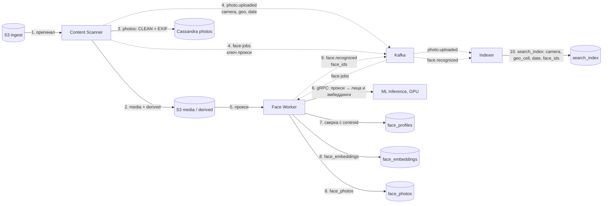

Что получает каждое хранилище поиска и из какого события:

| Хранилище         | Кто пишет                                      | Из какого события                         | Что лежит                                         |
| ----------------- | ---------------------------------------------- | ----------------------------------------- | ------------------------------------------------- |
| `search_index`    | Indexer                                        | `photo.uploaded`, затем `face.recognized` | Дата, камера, `geo_cell`, текст, `face_ids`       |
| `face_photos`     | Face Worker, Face Regroup Job                  | `face-jobs`                               | Обратный индекс «человек → фото»                  |
| `face_embeddings` | Face Worker                                    | `face-jobs`                               | Вектор лица для пересборок, поиск по нему не идёт |
| `face_profiles`   | Face Worker (создание), Regroup Job (centroid) | `face-jobs`, пересборка                   | Люди пользователя                                 |

Чтение: запрос поиска проходит API Gateway и попадает в Search Service.

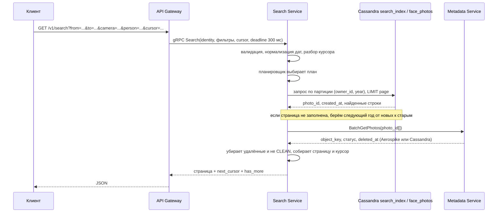

Планы выполнения:

| Запрос                                 | План | Что читаем                                                                                                        |
| -------------------------------------- | ---- | ----------------------------------------------------------------------------------------------------------------- |
| Только даты и (или) камера и геоячейка | A    | `search_index`, партиции `(owner_id, year)` от свежего года к старому; фильтры `camera`, `geo_cell` закрывает SAI |
| Только человек                         | B    | `face_photos`, партиция `(owner_id, face_id, year)`, страница по `created_at DESC`                                |
| Человек вместе с датой или камерой     | C    | `search_index` с SAI по `face_ids` и остальными фильтрами внутри партиции владельца                               |
| Список людей                           | D    | `face_profiles` пользователя (`face_id`, `person_label`), одна партиция                                           |

Детали исполнения:

- **Всегда один владелец.** Любая выборка ограничена `owner_id` из подписанной идентичности, поэтому чужие данные недостижимы, а глобальных горячих ключей нет.
- **Годы последовательно, не параллельно.** Исполнитель берёт самый свежий год и только если страница не заполнена, переходит к следующему. Это ограничивает нагрузку: большинство запросов закрывается одной партицией.
- **Гидратация.** Строки поиска содержат идентификаторы. За `object_key`, статусом и признаком удаления Search Service идёт в Metadata Service по gRPC батчем (`BatchGetPhotos`), используется `metadata_cache`. Так `search_index` не дублирует данные, которые уже хранятся в `photos`.
- **Фильтрация.** Фото со `scan_status`, отличным от CLEAN, и с `deleted_at` в результат не попадают, даже если `search_index` ещё не успел обновиться.
- **Курсор.** Курсор содержит год, `created_at`, `photo_id` последней строки и хеш фильтров. Он подписан, поэтому клиент не может подменить владельца или фильтры.
- **Свежесть.** Новое фото попадает в `search_index` после `photo.uploaded` (секунды), а `face_ids` дописываются после `face.recognized` (десятки секунд, при перегрузке ML — позже). Это eventual consistency (п. 5.4).
- **Лимиты и деградация.** Deadline запроса 300 мс; при превышении возвращается частичный результат с `has_more = true` (п. 9.6).

## 10.5. Балансировка

### 10.5.1. Внешняя балансировка

| Контур      | Домен                  | Политика DNS      | Выбор точки входа                                                                                                 | Failover                                                                                      |
| ----------- | ---------------------- | ----------------- | ----------------------------------------------------------------------------------------------------------------- | --------------------------------------------------------------------------------------------- |
| CDN / media | `media.photos.example` | Home-region based | Home-регион пользователя → BGP Anycast VIP → один из CDN-ДЦ региона (всего 32 площадки, ≤ 250 Гбит/с на площадку) | Другая CDN-площадка региона; при крупном отказе — доступная реплика данных в соседнем регионе |
| API         | `api.photos.example`   | Latency-based     | Ближайший здоровый API-регион → BGP Anycast VIP → один из двух API-ДЦ региона (всего 14)                          | Следующий по задержке здоровый API-регион                                                     |

DNS выбирает логический регион, BGP Anycast — доступную точку входа внутри региона. Отказавшая площадка снимает анонс префикса, после чего новый трафик уходит на другие узлы региона. Anycast не гарантирует равномерности, поэтому используется для близости и failover, а не для точного распределения RPS (п. 3.3).

### 10.5.2. Локальная балансировка в ДЦ

В обоих контурах работает одна и та же цепочка, а пулы независимы:

```text
L3 Router (ECMP) → L4 LB (IPVS/LVS, N×2) → L7 Nginx (N+2) → API Gateway (API-контур) / Storage Gateway (CDN-контур) → сервисы
```

- **CDN-контур** упирается в пропускную способность: расчёт даёт 192 L4 и 347 L7 по 32 площадкам (п. 4.4). Nginx терминирует TLS и передаёт запросы в Storage Gateway.
- **API-контур** упирается в задержку, а не в трафик: по 2 L4 и 3 L7 на ДЦ, всего 28 и 42 (п. 4.5). После L7 Nginx запрос попадает в API Gateway, который маршрутизирует его в отдельные upstream-пулы Auth Service, Metadata Service, Search Service, Albums Service, Sharing Service и Notifications Service; они масштабируются независимо; `round-robin` для коротких запросов, `least_conn` для запросов с разным временем выполнения.
- Отказ L4-узла исключается из ECMP, отказ Nginx — снимается с балансировки на L4. Полный отказ ДЦ обрабатывается внешним уровнем.
- Экспортёры метрик есть на L4 (IPVS) и L7 (Nginx); см. п. 10.7.

### 10.5.3. Внутренняя балансировка запросов к хранилищам и между сервисами

Вызовы между сервисами внутри ДЦ (например, `BatchGetPhotos`) идут через Envoy-sidecar с балансировкой по Kubernetes endpoints, а фоновые обработчики распределяются самими брокерами. Балансировка к хранилищам устроена так:

| Хранилище        | Как распределяется нагрузка                                                                                                                                                                                                  | Переключение при отказе                                            |
| ---------------- | ---------------------------------------------------------------------------------------------------------------------------------------------------------------------------------------------------------------------------- | ------------------------------------------------------------------ |
| PostgreSQL       | HAProxy: порт записи → primary, порт чтения → реплики; PgBouncer (`transaction`) мультиплексирует ≈10 000 клиентских соединений в десятки серверных; шард `albums` — по карте из etcd, `shares` и `user_access` — по региону | Patroni выбирает нового primary (≈30 с), HAProxy переключается сам |
| Cassandra        | На клиенте: token-aware + DC-aware (`local_dc` = home-регион)                                                                                                                                                                | Драйвер уходит на другую реплику, при отказе ДЦ — в DR-ДЦ          |
| Redis, Aerospike | Smart-клиенты с картой слотов / партиций                                                                                                                                                                                     | Повышение реплики (≈5–10 с) / миграция партиций                    |
| Kafka            | Ключ → партиция (`photo_id`, 1 024 партиции); consumer group распределяет партиции между воркерами                                                                                                                           | Выбор нового лидера партиции                                       |
| RabbitMQ         | L4 HAProxy перед кластером из 3 узлов; несколько воркеров на очередь                                                                                                                                                         | Quorum queue выбирает нового лидера                                |
| Ceph RGW         | L7 Nginx (Storage Gateway) → пул RGW; CRUSH равномерно раскладывает объекты по OSD                                                                                                                                           | RGW stateless, узел исключается из пула                            |

Шардирование и репликация данных описаны в п. 6.3, подробности по клиентам и мультиплексированию — в п. 6.6–6.7.

## 10.6. Итоговая схема балансировки одним взглядом

```text
                          Клиент
                             │
                            DNS
              ┌──────────────┴──────────────┐
    media.photos.example            api.photos.example
     home-region based                latency-based
              │                              │
   BGP Anycast, 32 CDN-площадки   BGP Anycast, 14 API-ДЦ
              │                              │
      L3/ECMP → L4 → Nginx           L3/ECMP → L4 → Nginx
              │                              │
       Storage Gateway                 API Gateway
              │                              │
    Ceph S3: ingest → media     Auth / Metadata / Search / Albums /
              │                 Sharing / Notifications
              │                              │
              │                 PostgreSQL / Cassandra / Redis /
              │                 Aerospike (клиентская балансировка)
              │
              └─► Kafka scan-jobs ─► Content Scanner ─► media, derived
                        │
                  Kafka: photo.uploaded, face-jobs
                        │
   Indexer / Face Worker (+ ML GPU) / Access Projector / Notification Worker
                        │
                    RabbitMQ ──► Push Sender ──► push

   Оркестрация (отдельный контур):
   Kubernetes, Envoy mesh, Schema Registry, флаги, Vault

   Наблюдаемость (отдельный контур):
   Prometheus ──► Alertmanager, Grafana    Vector ──► Loki ──► Grafana    Tempo ──► Grafana
```

## 10.7. Метрики, логирование и трейсы

### 10.7.1. Компоненты

| Компонент    | Роль                                                                                             |
| ------------ | ------------------------------------------------------------------------------------------------ |
| Prometheus   | Сбор метрик (pull с экспортёров и сервисов), хранение временных рядов, вычисление правил алертов |
| Alertmanager | Группировка и маршрутизация алертов дежурным                                                     |
| Grafana      | Дашборды по метрикам (Prometheus), просмотр логов (Loki) и трейсов (Tempo)                       |
| Vector       | Агент на каждом узле: собирает логи сервисов, хранилищ и балансировщиков и отправляет в Loki     |
| Loki         | Хранилище логов с поиском по меткам (сервис, ДЦ, регион, `trace_id`)                             |
| Tempo        | Хранилище трейсов OpenTelemetry; один `trace_id` проходит от запроса до записи в БД              |

Контур наблюдаемости развёрнут в каждом регионе; Grafana читает данные всех регионов. Логи и метрики не содержат содержимого файлов и персональных данных пользователей: в записях используются идентификаторы (`photo_id`, `album_id`).

### 10.7.2. Что собирается по слоям

| Слой                                                                                           | Ключевые метрики                                                                                                        | Логи                                                                 |
| ---------------------------------------------------------------------------------------------- | ----------------------------------------------------------------------------------------------------------------------- | -------------------------------------------------------------------- |
| L3 / L4 / L7 (Nginx)                                                                           | RPS, число активных соединений, доля 5xx, задержка upstream, состояние health-check                                     | access/error-логи Nginx, события исключения узла из ротации          |
| API Gateway                                                                                    | RPS, доля `429` и 5xx, p50/p95/p99 задержки по маршрутам, hit-rate `session_cache`                                      | запросы с `trace_id`, срабатывания rate-limit                        |
| Storage Gateway                                                                                | загрузки в секунду, размер и длительность загрузок, доля неудачных загрузок, задержка записи в Ceph                     | ошибки загрузки с `upload_id`, ошибки публикации в Kafka             |
| API-сервисы (Auth, Metadata, Search, Albums, Sharing, Notifications)                           | RPS, p50/p95/p99 задержки, доля ошибок по эндпоинтам, hit-rate кешей (`session_cache`, `metadata_cache`, `share_cache`) | запросы с `trace_id`, ошибки обращений к хранилищам                  |
| Content Scanner Worker                                                                         | скорость проверки, доля REJECTED и SUSPECT, consumer lag `scan-jobs`, время от PENDING до CLEAN                         | ошибки проверки с `photo_id`, срабатывания AV                        |
| Pending Reconciler                                                                             | число записей в `scan_pending`, число повторно опубликованных задач, число EXPIRED                                      | события восстановления с `photo_id`                                  |
| ML Inference Service                                                                           | загрузка GPU, размер батча, длина очереди, p99 задержки инференса, доля `RESOURCE_EXHAUSTED`                            | ошибки инференса с версией модели                                    |
| Фоновые обработчики (Indexer, Face Worker, Access Projector, Notification Worker, Push Sender) | consumer lag по группе, скорость обработки, число повторов, длина очереди ошибок                                        | ошибки обработки сообщений с ключом события (`photo_id`, `album_id`) |
| Face Regroup Job (Spark)                                                                       | длительность и результат запусков, число перераспределённых лиц                                                         | логи задач Spark                                                     |
| PostgreSQL / PgBouncer                                                                         | число соединений, занятость пулов, лаг репликации, события Patroni                                                      | логи PostgreSQL, события failover                                    |
| Cassandra                                                                                      | задержки чтения и записи по `LOCAL_QUORUM`, pending compactions, hinted handoff, состояние узлов                        | логи узлов, предупреждения о больших партициях                       |
| Redis / Aerospike                                                                              | память, hit-rate, evictions, задержка, состояние реплик                                                                 | логи узлов, события failover                                         |
| Kafka                                                                                          | consumer lag, under-replicated partitions, скорость продюсеров и консьюмеров, лидеры партиций                           | логи брокеров                                                        |
| RabbitMQ                                                                                       | длина очередей, скорость публикации и подтверждений, размер очереди ошибок                                              | логи узлов, события смены лидера quorum queue                        |
| Debezium                                                                                       | задержка репликации outbox, состояние коннекторов                                                                       | логи коннекторов                                                     |
| Ceph / RGW                                                                                     | заполнение пулов и бакетов, состояние OSD, задержка RGW, скорость восстановления                                        | логи RGW и OSD                                                       |
| etcd                                                                                           | состояние кластера, задержка коммитов, наличие лидера                                                                   | логи узлов                                                           |
| Kubernetes, Envoy                                                                              | рестарты pod, нехватка ресурсов, срабатывания circuit breaker, доля retry                                               | события планировщика, логи sidecar                                   |

### 10.7.3. Основные алерты

- рост доли 5xx или p99-задержки в любом API-сервисе, в API Gateway и в Storage Gateway; рост доли `429` на Gateway;
- рост consumer lag у Content Scanner, Indexer, Face Worker, Access Projector или Notification Worker, а также рост очереди ошибок в RabbitMQ и топиках `*.dlq`;
- рост числа записей в `scan_pending` и числа EXPIRED, доля REJECTED выше порога;
- загрузка GPU выше порога, рост `RESOURCE_EXHAUSTED` у ML Inference;
- лаг репликации PostgreSQL, срабатывание failover Patroni, недоступность узла Cassandra;
- падение hit-rate кешей ниже порога и рост evictions в Redis и Aerospike;
- заполнение Ceph выше порога, недоступные OSD;
- отставание Debezium: события из outbox не доходят до Kafka;
- потеря лидера в etcd и недоступность Prometheus, Loki или Tempo (проверяется независимым внешним check).

## 10.8. Отказоустойчивость на уровне схемы

- **Сбой узла балансировщика:** ECMP и health-check убирают узел из ротации; запас N×2 для L4 и N+2 для L7.
- **Сбой ДЦ:** снимается Anycast-анонс; CDN переходит на другую площадку home-региона или на реплику данных, API — на следующий здоровый регион по latency.
- **Сбой хранилища:** автофейловер Patroni для PostgreSQL, репликация RF 3+2 в Cassandra, реплики Redis и Aerospike, quorum queues в RabbitMQ, RF 3 в Kafka.
- **Сбой сканера:** фото остаются в PENDING, публикации нет (fail-closed), задачи копятся в Kafka; Reconciler повторно публикует потерянные задачи (п. 9.4.2).
- **Сбой ML:** лаг `face-jobs` растёт, фото уже доступны и ищутся по метаданным, лица появляются позже.
- **Сбой фонового обработчика:** события остаются в Kafka (хранение 7 суток) и обрабатываются после восстановления; at-least-once плюс идемпотентность не допускают дублей в результатах. Рост consumer lag фиксируется алертом (п. 10.7.3).
- **Сбой Push Sender или push-провайдера:** задания остаются в очереди RabbitMQ, повторы идут с задержкой, после исчерпания попыток сообщение попадает в очередь ошибок; сами уведомления уже записаны в `notifications` и доступны через Notifications Service.
- **Сбой платформы оркестрации:** отказ control plane Kubernetes или service mesh не останавливает работающие pod и трафик, не работают только деплои, автоскейлинг и новые маршруты (п. 9.2).
- **Рассинхронизация производных данных:** `search_index`, `face_photos`, `user_access` и кеши можно пересобрать из источников истины (`photos`, `face_embeddings`, `album_members`, `shares`).
- **Сбой контура наблюдаемости:** на работу пользовательских запросов не влияет; сервисы буферизуют логи на узле (Vector), метрики восстанавливаются при следующем опросе Prometheus.

## 10.9. Оркестрация сервисов

«Кирпичики», через которые сервисы находят друг друга, договариваются о форматах и не мешают друг другу при сбоях.

### 10.9.1. Кирпичики

| Кирпичик             | Что делает                                                                                                                                         | Технология                                                         |
| -------------------- | -------------------------------------------------------------------------------------------------------------------------------------------------- | ------------------------------------------------------------------ |
| API Gateway          | Единый вход в API: маршрутизация по OpenAPI, проверка сессии, rate-limit, idempotency-key, trace_id (п. 10.3.1)                                    | Envoy-based gateway                                                |
| Планировщик запуска  | Запускает сервисы, проверяет готовность, перезапускает упавшие, масштабирует                                                                       | Kubernetes: Deployments, StatefulSets, probes, PodDisruptionBudget |
| Автоскейлинг         | API-сервисы по RPS и CPU; воркеры по consumer lag; ML по загрузке GPU                                                                              | HPA, KEDA (lag Kafka и длина очереди)                              |
| Service discovery    | Сервисы находят друг друга по DNS-имени сервиса и EndpointSlices                                                                                   | Kubernetes DNS                                                     |
| Service mesh         | mTLS между сервисами, таймауты, повторы идемпотентных запросов (бюджет 10%), circuit breaker, outlier detection, балансировка с учётом локальности | Envoy-sidecar (API-контур и воркеры; media-путь без sidecar)       |
| Контракты API        | Внешний API — REST/JSON, спецификация OpenAPI 3, версия `/v1`; внутренний — gRPC и Protobuf; ломающие изменения проверяются в CI                   | OpenAPI, Protobuf, `buf breaking`                                  |
| Контракты событий    | Схемы сообщений Kafka в Protobuf, совместимость BACKWARD (новый consumer читает старые события)                                                    | Schema Registry                                                    |
| Конфигурация и флаги | Конфигурация через ConfigMap, kill-switch и пороги деградации через сервис флагов                                                                  | Kubernetes ConfigMap, Unleash или совместимый (OpenFeature)        |
| Секреты              | Пароли БД и ключи подписи выдаются короткими lease, сертификаты mesh обновляются автоматически                                                     | Vault                                                              |
| Трассировка          | W3C `traceparent` передаётся через HTTP, gRPC и заголовки Kafka; один `trace_id` проходит от запроса до записи в БД                                | OpenTelemetry → Tempo                                              |
| Идемпотентность      | `Idempotency-Key` на POST, ключи записей воркеров, `event_id`                                                                                      | Redis (ключи запросов с TTL), ключи в БД                           |

### 10.9.2. Карта API

Внешние эндпоинты, доступные через API Gateway и `media.photos.example`:

| Эндпоинт                                                                                | Сервис                      | Примечание                                |
| --------------------------------------------------------------------------------------- | --------------------------- | ----------------------------------------- |
| `POST /v1/sessions`, `DELETE /v1/sessions/current`                                      | Auth                        | Вход и выход                              |
| `GET /v1/photos`, `GET /v1/photos/{id}`                                                 | Metadata                    | Список по диапазону дат, курсор           |
| `GET /v1/search`                                                                        | Search                      | Фильтры: даты, камера, геоячейка, человек |
| `GET /v1/people`, `GET /v1/people/{id}/photos`                                          | Search                      | План D и B                                |
| `GET/POST /v1/albums`, `.../albums/{id}/items`, `.../members`                           | Albums                      | Идемпотентные POST                        |
| `POST /v1/shares`, `DELETE /v1/shares/{id}`, `GET /v1/shares/{token}`                   | Sharing                     | Выдача, отзыв, открытие ссылки            |
| `GET /v1/notifications`, `POST /v1/notifications/read`                                  | Notifications               | Список, пометка прочитанными              |
| `POST /v1/uploads`, `PUT /v1/uploads/{id}/chunks/{n}`, `POST /v1/uploads/{id}/complete` | Storage Gateway (`media.*`) | Multipart-загрузка, шаг T1 саги           |
| `GET /v1/media/{object_key}`                                                            | Storage Gateway (`media.*`) | Скачивание только из `media`              |

Внутренние gRPC-вызовы:

| Вызов             | От кого                      | К кому       | Назначение                          |
| ----------------- | ---------------------------- | ------------ | ----------------------------------- |
| `ValidateSession` | API Gateway, Storage Gateway | Auth         | Проверка сессии при промахе кеша    |
| `BatchGetPhotos`  | Search, Albums               | Metadata     | Данные фото пачкой                  |
| `CheckAccess`     | Sharing                      | Albums       | Права на альбом при открытии ссылки |
| `DetectAndEmbed`  | Face Worker                  | ML Inference | Лица и эмбеддинги                   |

### 10.9.3. Оркестрация или хореография

Загрузка фотографии — цепочка из нескольких сервисов (Storage Gateway → Scanner → Indexer и Face Worker). Мы не вводим центральный оркестратор вроде Temporal, а используем хореографическую сагу на событиях Kafka. Состояние саги хранится в `photos.scan_status` и `scan_pending`, а недостающие шаги довыполняет Pending Reconciler. Сравнение подходов и шаги саги — в п. 9.4.2.

# 11. Список серверов

Раздел считает железо по методике лекции «Хостинг» [^17]: удельное потребление ресурсов на единицу нагрузки берётся из таблицы методички и умножается на плановый пик из раздела 2. Всё, чего в методичке нет, взято из сторонних бенчмарков и помечено.

## 11.1. Правила расчёта

| Правило                      | Как применено                                                                                                                                                                                                                                                                            |
| ---------------------------- | ---------------------------------------------------------------------------------------------------------------------------------------------------------------------------------------------------------------------------------------------------------------------------------------- |
| Нормативы производительности | Таблица методички (RPS на ядро): C++ лёгкое API — 5 000, C++ средняя бизнес-логика — 100, C++ тяжёлая — 10, Nginx TLS handshake — 500 CPS. Go приравнен к строкам C++ (компилируемый язык). Своих оценок производительности нет.                                                         |
| Плановый пик                 | Пик из п. 2.3.2 × **1,3** (запас на рост).                                                                                                                                                                                                                                               |
| Потеря 1 ДЦ                  | Для CDN и API каждый ДЦ региона должен нести весь регион: `C_ДЦ = 1,3 × P_региона / (n − 1)`. БД, Ceph, Kafka переживают потерю ДЦ за счёт репликации (п. 6.3, 9.2), для данных запас заполнения 20%. Асинхронные воркеры: рост +30% и N+2 на регион, при потере ДЦ растёт lag (п. 9.6). |
| Накладные расходы Kubernetes | Методичка: до 50% для нагруженных сервисов. Для pod'ов API и воркеров CPU × **1,5**. Сканеры, балансировщики, Ceph и БД работают на железе без Kubernetes: они потребляют сервер целиком, и в этой схеме CPU throttling и виртуальной сети нет.                                          |
| Единая конфигурация          | «Максимум ядер, много RAM, немного NVMe» [^17]: один узел `kubenode` почти для всех ролей. Свои конфигурации только там, где этого требует нагрузка: GPU, диски Ceph, NVMe-ёмкость Cassandra.                                                                                            |
| Физика или виртуалки         | Сервис от 6 серверов — на физических, по 2 сервера в 3 ДЦ. Мелкие stateful-компоненты платформы (мастера Kubernetes, etcd, Vault, мониторы Ceph, RabbitMQ, HAProxy) — виртуальные машины на общих хостах.                                                                                |
| RAM                          | Память в избытке (8 GB на ядро), поэтому считается только там, где она определяет число узлов: Redis и индекс Aerospike.                                                                                                                                                                 |
| Амортизация                  | 5 лет, то есть 20% стоимости в год.                                                                                                                                                                                                                                                      |

## 11.2. Ресурсы по сервисам

Колонка «CPU» — ядра с запасом роста; для pod'ов в Kubernetes дополнительно × 1,5. RAM — число экземпляров × значение из методички (10 MB для лёгкого API, 100 MB для средней и тяжёлой логики). Net — пик × 0,64 KB на запрос (п. 2.3.1). Пик взят из п. 2.3.2.

| Сервис                      | Пик, RPS | Класс (методичка)    | RPS на ядро | CPU, ядер | CPU в k8s (× 1,5) | RAM, GB | Net, Мбит/с |
| --------------------------- | -------: | -------------------- | ----------: | --------: | ----------------: | ------: | ----------: |
| API Gateway (Envoy)         |   39 271 | C++, лёгкое JSON API |       5 000 |        10 |                15 |    0,15 |         201 |
| Auth                        |    5 677 | C++, средняя логика  |         100 |        74 |               111 |    11,1 |          29 |
| Metadata                    |   27 604 | C++, лёгкое JSON API |       5 000 |         7 |                11 |    0,11 |         141 |
| Search                      |    1 286 | C++, средняя логика  |         100 |        17 |                25 |     2,5 |           7 |
| Albums                      |    1 615 | C++, средняя логика  |         100 |        21 |                31 |     3,1 |           8 |
| Sharing                     |    1 526 | C++, средняя логика  |         100 |        20 |                30 |     3,0 |           8 |
| Notifications               |    1 563 | C++, лёгкое JSON API |       5 000 |         1 |                 1 |    0,01 |           8 |
| Content Scanner (без k8s)   |  138 889 | C++, тяжёлая логика  |          10 |    18 056 |                 — |   1 806 |   5 600 000 |
| Face Worker                 |  138 889 | C++, средняя логика  |         100 |     1 806 |             2 708 |   270,8 |     167 000 |
| Indexer (2 события на фото) |  277 778 | C++, лёгкое JSON API |       5 000 |        72 |               108 |    1,08 |           — |
| Nginx, TLS CDN (запросов/с) |  166 493 | Nginx, handshake     |     500 CPS |       433 |                 — |       — |           — |
| Nginx, TLS API              |   39 271 | Nginx, handshake     |     500 CPS |       102 |                 — |       — |           — |

Сканер: каждый файл (декодирование 5 MB, проверка формата и EXIF, антивирус, прокси) — это тяжёлая обработка около 100 мс CPU, что соответствует строке «C++, тяжёлая бизнес-логика, 10 RPS на ядро» и согласуется с разбором в п. 10.3.2 (≈130 мс). Face Worker: декодирование прокси 1 280 px ≈ 8 мс, это строка «средняя логика». Для Nginx взят худший случай: каждый запрос открывает новое TLS-соединение. Всё равно нужно всего 535 ядер (≈ 9 серверов), поэтому число L7 определяет полоса, а не handshake'и.

Net колонки Content Scanner и Face Worker — внутренний трафик в пределах ДЦ: перечитывание оригиналов из `ingest` (≈5,6 Тбит/с) и прокси из `derived` (≈167 Гбит/с, п. 10.3.2).

**GPU.** В методичке нормы для GPU нет, берём сторонний бенчмарк: полный цикл детекции и эмбеддинга лиц (InsightFace-REST, SCRFD + ArcFace, TensorRT) — до **820 изображений/с** на RTX 4090 [^18]; L40S построен на том же кристалле AD102, принимаем 820 на GPU. Планово: 138 889 × 1,3 / 820 = **220 GPU**. Это в 2,4 раза больше расчёта п. 10.3.2 (93 GPU при 1 500 изображений/с, значение без источника); оценка 820 тоже верхняя («up to»), её нужно подтвердить стендом на L40S.

**Ёмкость хранилищ (по объёму, не по нагрузке).** Для БД и Ceph нормы «RPS на ядро» не применимы: узлы определяет объём данных (п. 6.3, 2.3). Проверка по нагрузке: пик записи 139 тыс. QPS на таблицу Cassandra, умноженный на RF (3 или 5) и разделённый на 1 085 – 4 497 узлов, даёт ≈ 90–640 записей/с на узел, то есть ничтожно для 64 ядер.

## 11.3. Конфигурации серверов

Цены: узел `kubenode` — из методички [^17]; остальное — оценка по комплектующим (HDD 20 TB — $350: распродажи $269–329, розница около $533 [^11][^12]; GPU L40S — $8–10 тыс. [^13]).

| Название      | Хостинг | Конфигурация                                                                                       | Ядер | Покупка, $ | Амортизация, $/мес | Мощность, кВт |
| ------------- | ------- | -------------------------------------------------------------------------------------------------- | ---: | ---------: | -----------------: | ------------: |
| kubenode      | own     | 2×Xeon 6338 / 16×32 GB / 2×NVMe 4 TB / 2×25 Gb/s                                                   |   64 |     14 500 |                242 |          0,65 |
| kubenode-100G | own     | kubenode, сетевые карты 2×100 Gb/s (под L4 IPVS, +$1 000, допущение)                               |   64 |     15 500 |                258 |          0,65 |
| cass-node     | own     | kubenode, NVMe 2×7,68 TB (12 TB под данные, +$1 500, допущение)                                    |   64 |     16 000 |                267 |          0,65 |
| gpu-node      | own     | kubenode + 4×NVIDIA L40S 48 GB (4×$10 000)                                                         |   64 |     54 500 |                908 |          2,05 |
| osd-hdd       | own     | 2×Xeon 6338 / 16×32 GB / **90×HDD 20 TB** / NVMe 7,68 TB под WAL и RocksDB / 2×100 Gb/s, корпус 4U |   64 |     55 000 |                917 |          1,40 |
| osd-nvme      | own     | kubenode с 8×NVMe 15,36 TB (bucket index RGW и `ingest`)                                           |   64 |     30 500 |                508 |          0,65 |

Мощность (допущение): 2 процессора по 205 Вт + память и диски ≈ 650 Вт на узел; HDD — по ≈ 8 Вт. «Аренда» в методичке для `kubenode` — $241 в месяц, что и есть амортизация $14 500 / 60 мес.

Сети: коммутаторы ToR и spine, оптика — +12% к серверам (допущение). Хостинг и электричество — $150 за кВт в месяц с учётом PUE (допущение).

## 11.4. Сводная таблица серверов

| Роль / сервисы                                                                                                                               | Конфигурация  |    Серверов | Хостинг                               |
| -------------------------------------------------------------------------------------------------------------------------------------------- | ------------- | ----------: | ------------------------------------- |
| L4 IPVS: CDN 320 и API 28                                                                                                                    | kubenode-100G |         348 | own                                   |
| L7 Nginx: CDN 544 и API 42                                                                                                                   | kubenode      |         586 | own                                   |
| Storage Gateway + Ceph RGW (CDN)                                                                                                             | kubenode      |         544 | own                                   |
| Kubernetes, API-контур: Gateway, Auth, Metadata, Search, Albums, Sharing, Notifications                                                      | kubenode      |          42 | own                                   |
| Kubernetes, воркеры: Face Worker, Indexer, Access Projector, Notification Worker, Push Sender, Debezium, Pending Reconciler, Schema Registry | kubenode      |          67 | own                                   |
| Content Scanner Worker (без Kubernetes)                                                                                                      | kubenode      |         300 | own                                   |
| ML Inference (Triton): 238 GPU                                                                                                               | gpu-node      |          61 | own                                   |
| PostgreSQL: `albums` 192, `shares` 21, `user_access` 21, `auth` 9                                                                            | kubenode      |         243 | own                                   |
| Cassandra «meta» и «ml»                                                                                                                      | cass-node     |      11 527 | own                                   |
| Aerospike (`metadata_cache`)                                                                                                                 | kubenode      |          23 | own                                   |
| Redis Cluster: 8 master + 8 реплик, по 2 экземпляра на сервер                                                                                | kubenode      |           8 | own                                   |
| Kafka                                                                                                                                        | kubenode      |          28 | own                                   |
| Ceph: HDD-узлы (`media`, `derived`, `quarantine`)                                                                                            | osd-hdd       |     121 680 | own                                   |
| Ceph: NVMe-узлы (bucket index RGW, пул `ingest`)                                                                                             | osd-nvme      |          71 | own                                   |
| VM-хосты платформы: мастера k8s 96, etcd 35, Vault 35, RabbitMQ 21, мониторы Ceph 21, HAProxy 14 (222 ВМ)                                    | kubenode      |          21 | own                                   |
| Наблюдаемость: метрики, логи, трейсы (по 5 на регион)                                                                                        | kubenode      |          35 | own                                   |
| CI и тестовые стенды                                                                                                                         | аренда        |           — | cloud / дешёвый bare-metal, вне парка |
| **Итого**                                                                                                                                    |               | **135 584** |                                       |

Серверы: **6,92 млрд $**, с сетью (+12%) **7,75 млрд $**; мощность **≈179 МВт**.

Как получены числа:

- **L4, L7, Storage Gateway** — формулы п. 4.4: `N_L4 = ceil(C_ДЦ/80)×2`, `N_L7 = N_GW = ceil(C_ДЦ/25)+2`, где C_ДЦ рассчитан с потерей одного ДЦ (п. 11.5). Для API — минимум из п. 4.5 (28 L4 и 42 L7). Узел `kubenode` имеет 2×25 Gb/s: 25 Gbit/s на стороне клиента и 25 на стороне backend, поэтому он соответствует L7 из п. 4.4. L4 с картами 2×25 Gb/s держал бы 50 Gbit/s вместо 80, и их стало бы 498 вместо 320 для CDN.
- **Сканеры:** 18 056 ядер / 64 = 283 сервера, плюс N+2 на регион и округление: 300.
- **ML:** 220 GPU + 2 на регион (N+2) и округление до серверов по 4: 238 GPU, 61 сервер.
- **Cassandra:** узлы п. 6.3 × 1,3: `photos` 283×5 = 1 415; `search_index` 752×5 = 3 760; `face_photos` 101×5 = 505; `face_embeddings` 1 949×3 = 5 847.
- **Ceph HDD:** 134,78 EB × 1,3 / 0,8 (запас 20%) = **219 EB** физически; сервер 90 × 20 TB = 1,8 PB, значит 121 680 серверов и 10,95 млн дисков. Ёмкость, а не нагрузка, определяет число узлов: на пике записи занято около 42 тыс. дисков из 10,95 млн.
- **Ceph NVMe:** bucket index RGW (4,19 трлн объектов × 300 B × 3 реплики × 1,3 / 0,7 ≈ 7,0 PB, 300 B — допущение) + `ingest` (208 TB × 3 × 1,3 / 0,8 ≈ 1,0 PB): 8,0 PB / 122,88 TB = 66, не менее 2 на регион: 71.
- **Aerospike:** индекс 5,4 TB × 1,3 = 7,0 TB в RAM; на узле 512 GB × 60% = 307 GB, то есть 23 узла (вместо 35 при 256 GB, п. 6.3). **Redis:** 288 GB × 1,3 = 374 GB, 8 master по ≤ 80 GB (п. 6.3). **Kafka:** 4 брокера на регион (потеря брокера не нарушает `min.insync.replicas = 2`).
- **PostgreSQL:** объём шарда 0,8 TB × 1,3 = 1,04 TB < 2 TB: число узлов не растёт.

## 11.5. Расчёт по регионам и ДЦ

Число ДЦ региона — из п. 3.2 (32 CDN-площадки, из них 14 с API по 2 на регион).

**CDN-контур** (`C_ДЦ = 1,3 × P_региона / (n − 1)`):

| Регион    |  ДЦ | P региона, Гбит/с | C_ДЦ, Гбит/с | L4 / ДЦ | L7 / ДЦ | GW+RGW / ДЦ | Всего L4 | Всего L7 | Всего GW |
| --------- | --: | ----------------: | -----------: | ------: | ------: | ----------: | -------: | -------: | -------: |
| NA        |   2 |               408 |        530,4 |      14 |      24 |          24 |       28 |       48 |       48 |
| EU+CA     |   4 |               960 |        416,0 |      12 |      19 |          19 |       48 |       76 |       76 |
| LATAM     |   3 |               618 |        401,7 |      12 |      19 |          19 |       36 |       57 |       57 |
| MENA      |   3 |               582 |        378,3 |      10 |      18 |          18 |       30 |       54 |       54 |
| SSA       |   3 |               522 |        339,3 |      10 |      16 |          16 |       30 |       48 |       48 |
| EAP       |  11 |             2 343 |        304,6 |       8 |      15 |          15 |       88 |      165 |      165 |
| SA        |   6 |             1 272 |        330,7 |      10 |      16 |          16 |       60 |       96 |       96 |
| **Итого** |  32 |             6 705 |            — |       — |       — |           — |  **320** |  **544** |  **544** |

В штатном режиме площадки работают в пределах лимита 250 Гбит/с (п. 3.2), при потере ДЦ региона до 530 Гбит/с (NA). Проверка по CPU: на ДЦ при потере соседа приходится до 13 200 новых соединений в секунду, это 0,4 сервера по норме 500 CPS на ядро (32 000 CPS на сервер), поэтому ограничивает именно полоса.

**API-контур Kubernetes** (по 2 ДЦ в регионе, каждый несёт весь регион × 1,3; минимум 3 pod'а на сервис в разных стойках, п. 9.2):

| Регион    | Pod'ов на ДЦ | Ядер в requests | Серверов на ДЦ |  ДЦ |  Всего |
| --------- | -----------: | --------------: | -------------: | --: | -----: |
| NA        |           22 |              50 |              3 |   2 |      6 |
| EU+CA     |           26 |              58 |              3 |   2 |      6 |
| LATAM     |           24 |              54 |              3 |   2 |      6 |
| MENA      |           23 |              52 |              3 |   2 |      6 |
| SSA       |           23 |              52 |              3 |   2 |      6 |
| EAP       |           46 |              98 |              3 |   2 |      6 |
| SA        |           29 |              64 |              3 |   2 |      6 |
| **Итого** |            — |               — |              — |  14 | **42** |

Число серверов задаёт требование отказоустойчивости (3 стойки), а не нагрузка: весь API с запасом требует 224 ядра (≈ 4 сервера на весь мир). Чувствительность: если сервисы будут не на C++/Go, а на Django (500 RPS на ядро для лёгкого API, 10 для средней логики), потребность вырастет до 2 100 ядер, то есть ≈ 75 серверов вместо 42. На общий итог это не влияет.

**Остальные роли по регионам:**

| Регион    |  ДЦ | OSD HDD всего | OSD на ДЦ | NVMe-узлов | Сканеров | GPU (серверов) | Воркеры k8s |
| --------- | --: | ------------: | --------: | ---------: | -------: | -------------: | ----------: |
| NA        |   2 |         7 423 |     3 712 |          5 |       20 |         16 (4) |           6 |
| EU+CA     |   4 |        17 400 |     4 350 |         10 |       43 |         34 (9) |           9 |
| LATAM     |   3 |        11 195 |     3 732 |          7 |       28 |         23 (6) |           7 |
| MENA      |   3 |        10 586 |     3 529 |          6 |       27 |         22 (6) |           7 |
| SSA       |   3 |         9 491 |     3 164 |          6 |       25 |         20 (5) |           7 |
| EAP       |  11 |        42 466 |     3 861 |         24 |      101 |        79 (20) |          19 |
| SA        |   6 |        23 119 |     3 854 |         13 |       56 |        44 (11) |          12 |
| **Итого** |  32 |   **121 680** |         — |     **71** |  **300** |   **238 (61)** |      **67** |

Один ДЦ хранит 3,2–4,4 тыс. OSD-серверов и потребляет 4,4–6,1 МВт. Это нужно закладывать при выборе площадок. Потеря ДЦ не требует резерва ёмкости: данные остаются доступны из реплик в других стойках и ДЦ, а перестроение третьей реплики откладывается до возврата ДЦ. Для запаса используется заполнение 80%.

## 11.6. Контейнеры и аллокация ресурсов в Kubernetes

Узел `kubenode`: 64 ядра, 512 GB RAM. Limits CPU равны requests у сервисов, чувствительных к задержке, чтобы не допустить throttling [^17]. RAM в requests небольшая (в избытке), limit — защита от аномального роста (OOM kill).

| Контейнер                                                                                         | CPU/r | CPU/l | RAM/r | RAM/l | Экземпляров                                                                    |
| ------------------------------------------------------------------------------------------------- | ----: | ----: | ----: | ----: | ------------------------------------------------------------------------------ |
| API Gateway (Envoy)                                                                               |     4 |     4 |  2 Gb |  4 Gb | 3 на каждый из 14 API-ДЦ                                                       |
| Auth                                                                                              |     2 |     2 |  1 Gb |  2 Gb | на ДЦ: NA 4, EU 8, LATAM 6, MENA 5, SSA 5, EAP 20, SA 11                       |
| Metadata, Notifications                                                                           |     2 |     2 |  1 Gb |  2 Gb | 3 каждый на ДЦ                                                                 |
| Search, Albums, Sharing                                                                           |     2 |     2 |  1 Gb |  2 Gb | 3 каждый на ДЦ (EAP: 5, 6 и 6)                                                 |
| Face Worker                                                                                       |     8 |     8 |  4 Gb |  8 Gb | на регион: NA 21, EU 49, LATAM 32, MENA 30, SSA 27, EAP 119, SA 65 (всего 343) |
| Indexer                                                                                           |     4 |     4 |  2 Gb |  4 Gb | на регион: NA 2, EU 4, LATAM 3, MENA 3, SSA 3, EAP 10, SA 6 (всего 31)         |
| Access Projector, Notification Worker, Push Sender, Debezium, Pending Reconciler, Schema Registry |     2 |     2 |  1 Gb |  2 Gb | по 3 экземпляра каждого на регион                                              |

Масштабирование: API — HPA по RPS и CPU, воркеры — KEDA по lag Kafka и длине очереди RabbitMQ (п. 8). Content Scanner, ML Inference (Triton), Ceph и БД работают на железе без Kubernetes: сканер — по одному процессу-воркеру на ядро, Triton — по одному экземпляру на GPU.

## 11.7. Стоимость владения

| Статья                                                         |         Значение |
| -------------------------------------------------------------- | ---------------: |
| Серверы (п. 11.4)                                              |      6,92 млрд $ |
| Сеть, +12%                                                     |      0,83 млрд $ |
| **Капитальные затраты**                                        |  **7,75 млрд $** |
| Амортизация, 5 лет (20% в год)                                 |  1 549 млн $/год |
| Хостинг и электричество: 179,5 МВт × $150 за кВт в месяц       |    323 млн $/год |
| Замена дисков: 1,5% из 10,95 млн HDD в год × $400              |     66 млн $/год |
| Транзит: 6,84 Тбит/с пика × $0,5 за Мбит/с в месяц (допущение) |     41 млн $/год |
| Эксплуатация и персонал: 10% от амортизации и хостинга         |    187 млн $/год |
| **Итого в год**                                                | **≈2,17 млрд $** |

Ceph HDD — **96,8%** закупки (6,69 млрд из 6,92 млрд $), сами диски — 55% (3,83 млрд $). Все остальные серверы вместе, включая 11,5 тыс. узлов Cassandra, — 0,22 млрд $, то есть 3,2%.

## 11.8. Своё железо или аренда

Методичка [^17] описывает варианты так: облако (AWS) — «очень дорого, особенно виртуальные машины и сетевой трафик», не рекомендуется для крупных проектов; дешёвая аренда bare-metal — «примитивная сеть, долгий provisioning»; собственное железо — «самая низкая удельная стоимость ресурса», рекомендуется для крупных проектов с хорошо прогнозируемой нагрузкой; в общем случае рекомендуется гибрид.

Цена одного узла `kubenode` в месяц (64 ядра): своё железо — $242 амортизации + $98 хостинга (0,65 кВт × $150) = **$340**; AWS c7a.16xlarge on-demand (64 ядра, без SMT) — $3,284/ч [^15] = **$2 397**, то есть в 7 раз дороже. На ядро: $5,3 против $37,5.

Облако для всего проекта (us-east-1, цены на момент расчёта):

| Статья в облаке                                                                                         |  Год, млн $ |
| ------------------------------------------------------------------------------------------------------- | ----------: |
| Вычисления без БД: 1 951 сервер × 64 ядра по $0,0513 за ядро-час (c7a.8xlarge $1,642/ч / 32 ядра) [^15] |          56 |
| БД и очереди (Cassandra, PostgreSQL, Aerospike, Kafka): 11 821 узлов × 2×i7i.8xlarge по $3,02/ч [^16]   |         625 |
| GPU: 244 L40S (61 сервер × 4) × $1,57 за GPU-час (медиана 35 провайдеров, ноябрь 2026) [^19]            |           3 |
| Запросы: 6 млрд PUT и 1,24 млрд GET в сутки [^14]                                                       |          11 |
| Исходящий трафик: 6,2 PB/сутки × $0,05 за GB (выше 150 TB) [^14]                                        |         113 |
| Хранилище S3, квоты: 44,93 EB × 1,3 × $0,021 за GB-месяц (выше 500 TB) [^14]                            |      14 719 |
| **Итого, оплата за квоты**                                                                              | **≈15 528** |
| Итого, оплата только за реально занятый объём (20,96 EB × 1,3 вместо квот)                              |     ≈ 7 676 |

| Вариант                                 | Год, млрд $ | Отношение к своему железу |
| --------------------------------------- | ----------: | ------------------------: |
| **Своё железо** (п. 11.7)               |    **2,17** |                         1 |
| Облако, оплата за квоты                 |        15,5 |                      7,2× |
| Облако, оплата за реально занятый объём |         7,7 |                      3,5× |

**Вывод: своё железо выгоднее в 3,5–7,2 раза.** Вычисления в облаке стоят 0,69 млрд $ против 0,07 млрд $ у собственных (10×, как и говорит методичка про виртуальные машины). Но решает хранение: один S3 стоит 14,7 млрд $, больше всего собственного парка вместе взятого; чтобы облако сравнялось по цене, S3 должен давать скидку 91%. Дешёвая аренда bare-metal не подходит: нужна сеть 6,8 Тбит/с и 10,9 млн дисков, а у таких хостингов сеть примитивная (1 Гбит/с на сервер), а провижининг занимает недели.

**Рекомендуемая модель — гибрид**, как советует методичка: основная нагрузка (хранение, CDN, БД, обработка) на собственном железе, потому что профиль нагрузки хорошо прогнозируется; временные ресурсы (CI, тестовые стенды, нагрузочные тесты, разовые пересчёты эмбеддингов при смене ML-модели) арендуются в облаке или у дешёвого bare-metal. Эти ресурсы в парк выше не включены.

## 11.9. Допущения и ограничения

- Нормы производительности взяты из методички [^17]. Go приравнен к C++; сканер приравнен к «тяжёлой бизнес-логике» (≈100 мс CPU на файл), что нужно подтвердить стендом. Для GPU взят сторонний бенчмарк [^18] (до 820 изображений/с на RTX 4090 при полном цикле детекции и эмбеддинга) — отдельный замер на L40S может изменить число GPU в 1,5–2 раза.
- Цены серверов кроме `kubenode` (оценка по комплектующим): корпус 4U на 90 дисков ≈ $8 000, NVMe 15,36 TB ≈ $2 000; цены HDD, GPU и NVMe в 2026 году колеблются, поэтому стоимость нужно обновить перед защитой.
- Не включены: строительство ДЦ, лицензии, юридические затраты на контент, резервные каналы, объём логов и трейсов (в наблюдаемость заложено по 5 серверов на регион, для 135 тыс. серверов это нижняя оценка).
- Противоречие в разделах 6 и 9: п. 9.2 предусматривает асинхронную межрегиональную копию `media` (RGW multisite), но 134,78 EB включают только 3 реплики. Если копия полная, ёмкость Ceph и её стоимость вырастут примерно на треть (≈ +2,2 млрд $ капитальных затрат), вывод про облако не изменится.
- Failure domain Ceph внутри региона — стойка. Регион из 2 ДЦ (NA) не может держать 3 реплики в 3 ДЦ, поэтому потеря ДЦ закрывается multisite-копией, а не CRUSH.

[^3]: DAU/MAU Ratio (Stickiness): Definition, Formula & Benchmarks // IdeaPlan. 2024. URL: https://www.ideaplan.io/metrics/dau-mau-ratio-stickiness

[^4]: Woolf M. 26+ Mobile Photography Statistics for 2026 // PhotoAiD. 2023, обновлено 9 Dec. 2025. URL: https://photoaid.com/blog/mobile-photography-statistics/ (дата обращения: 24.09.2026).

[^7]: Schafer D. Cloud Storage Pricing Guide: Compare Google One, iCloud, OneDrive, Dropbox, and More // All About Cookies. 24 June 2026. URL: https://allaboutcookies.org/cloud-storage-pricing

[^8]: Gupta A. Personal Cloud Market Size, Share & Trends [2035] // Market Research Future. 2026. URL: https://www.marketresearchfuture.com/reports/personal-cloud-market-7041

[^6]: Gracia-Tinedo R., Tian Y., Sampé J., Harkous H., Lenton J., García-López P., Sánchez-Artigas M., Vukolić M. Dissecting UbuntuOne: Autopsy of a Global-scale Personal Cloud Back-end // Proceedings of the 2015 Internet Measurement Conference. 2015. DOI: 10.1145/2815675.2815677. URL: https://www.researchgate.net/publication/282334268_Dissecting_UbuntuOne_Autopsy_of_a_Global-scale_Personal_Cloud_Back-end

[^2]: Selier J. Ask Photos: A new way to search your photos with Gemini // Google. 14 May 2024. URL: https://blog.google/products-and-platforms/products/photos/ask-photos-google-io-2024/

[^1]: Ben-Yair S. 10 tips for 10 years of Google Photos // Google. 28 May 2025. URL: https://blog.google/products-and-platforms/products/photos/google-photos-10-years-tips-tricks/

[^5]: Our World in Data. Number of people using the Internet. Данные International Telecommunication Union (ITU) // World Bank, 2025; обновление 27 July 2026. URL: https://ourworldindata.org/grapher/number-of-internet-users

[^9]: Abley G., Lindqvist J. RFC 4786 — Operation of Anycast Services. RFC Editor, 2006. URL: https://www.rfc-editor.org/rfc/rfc4786

[^10]: Amazon Web Services. Latency-based routing — Amazon Route 53 Developer Guide. URL: https://docs.aws.amazon.com/Route53/latest/DeveloperGuide/routing-policy-latency.html

[^11]: Tom's Hardware. 20TB Seagate Exos X20 HDD on sale at Newegg ($269 / $329). URL: https://www.tomshardware.com/news/20tb-of-server-class-hard-drive-storage-for-269-dollars

[^12]: CDW. Seagate Exos X24 ST20000NM001H, 20 TB, SATA. URL: https://www.cdw.com/product/seagate-exos-x24-20tb-sata-sed/8368249

[^13]: PNY NVL40STCGPU-KIT: NVIDIA L40S 48GB, $7 676; CloudNinjas: $10 584. URL: https://cloudninjas.com/collections/asrock-rack-4u10g-egs2-gpu-upgrades/products/nvidia-l40s-48gb-data-center-gpu

[^14]: Amnic. AWS S3 Pricing: Storage, Requests & Transfer Breakdown. URL: https://amnic.com/blogs/amazon-s3-storage-costs ; Upstash. AWS S3 Pricing Explained (2026). URL: https://upstash.com/blog/aws-s3-pricing-explained-2026

[^15]: DevZero. c7a.8xlarge pricing ($1,642/ч, 32 vCPU). URL: https://www.devzero.io/instances/aws/c7a.8xlarge

[^16]: Holori. AWS i7i.8xlarge Price ($3,02/ч, 32 vCPU, 256 GiB, NVMe). URL: https://calculator.holori.com/aws/ec2/i7i.8xlarge

[^17]: Лекция 11. Базовый расчёт аппаратных ресурсов, выбор модели развёртывания и хостинга // VK Highload. URL: https://github.com/init/highload/blob/main/highload_l11_hosting.md

[^18]: SthPhoenix. InsightFace-REST: пропускная способность SCRFD + ArcFace (TensorRT), до 820 fps на RTX 4090, RTX 2080 SUPER — 179 fps. URL: https://github.com/SthPhoenix/InsightFace-REST

[^19]: GetDeploying. NVIDIA L40S: цены аренды GPU, медиана $1,57 за GPU-час на 12 ноября 2026. URL: https://getdeploying.com/gpus/nvidia-l40s
