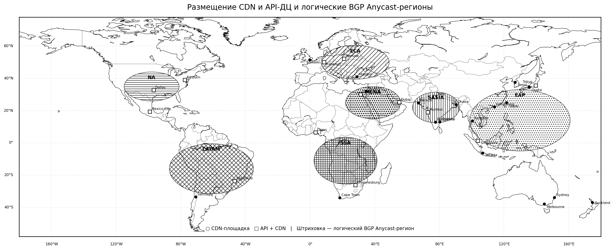
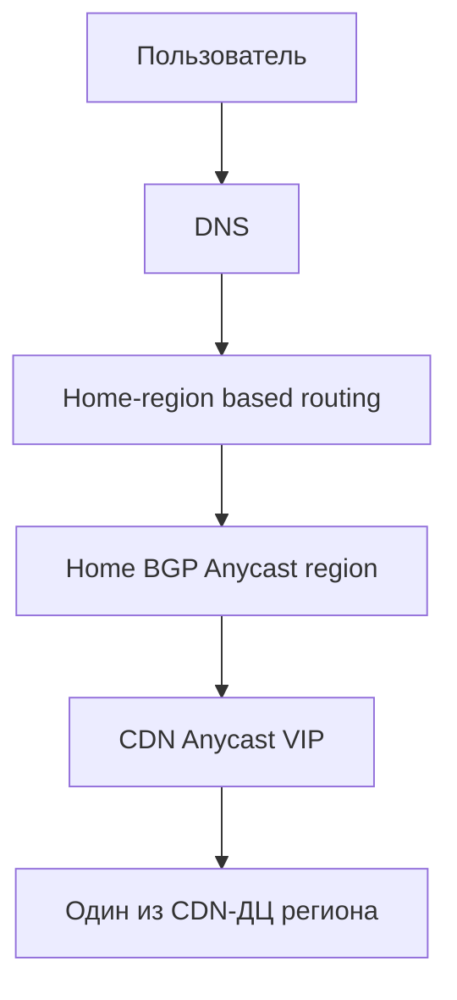
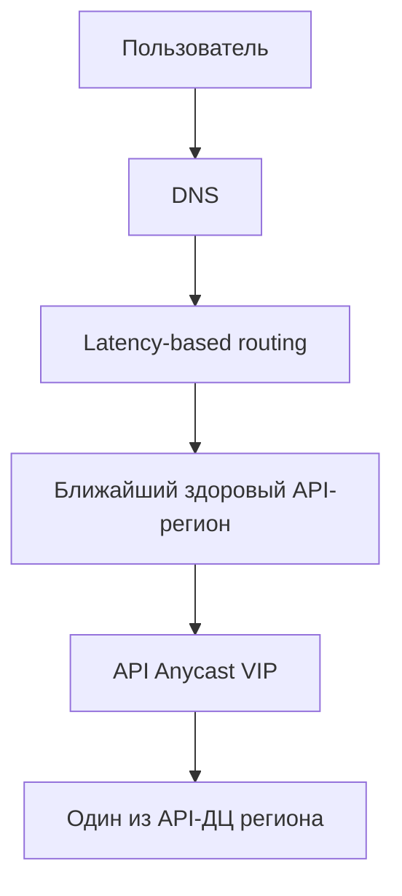
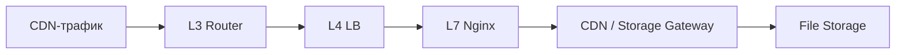
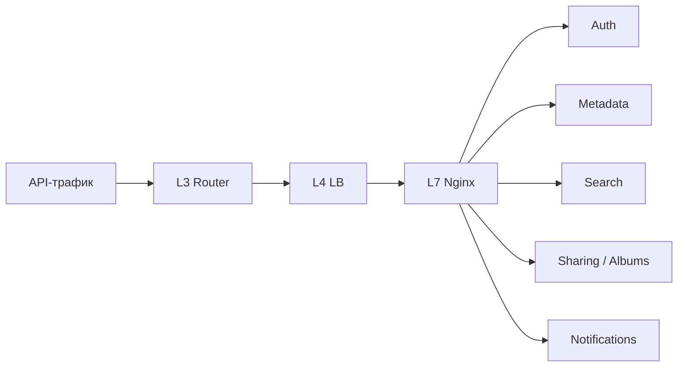
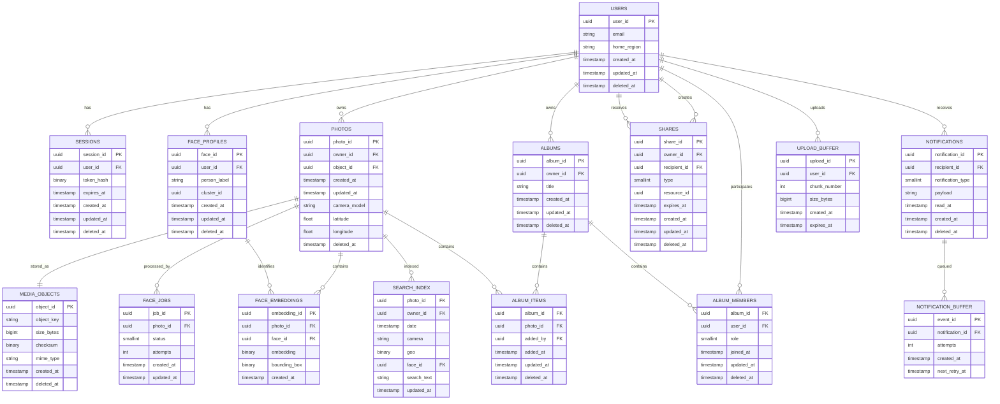
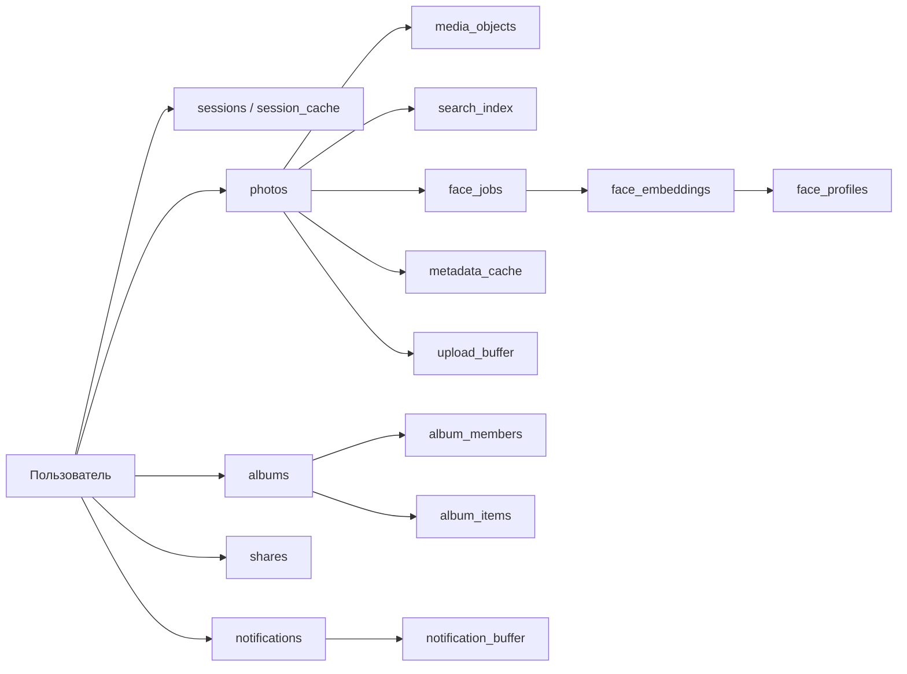
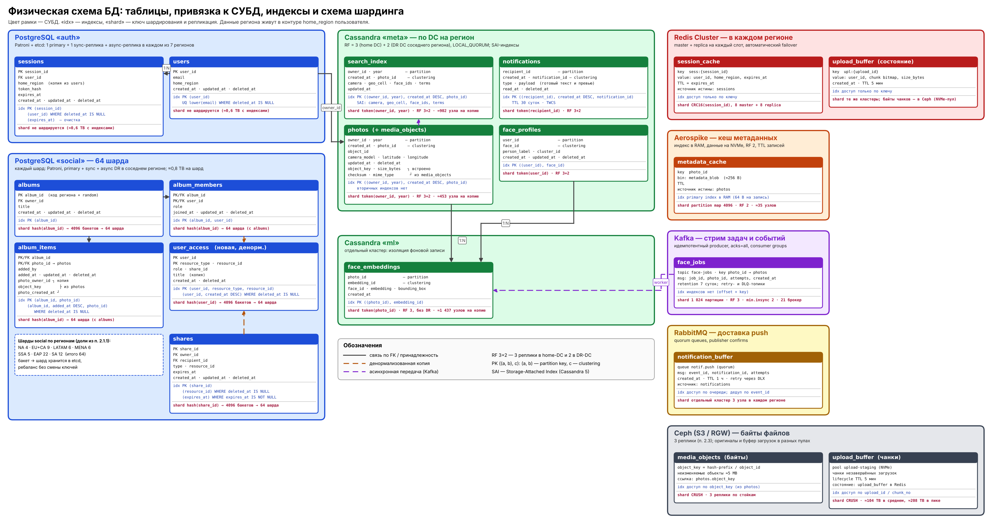

# VK-Highload-Coursework

## 1. Тема и целевая аудитория

> **Тема**: Google Photos

**Аудитория сервиса:**

- По данным Google на май 2025 года, сервис Google Photos достиг _1.5 млрд активных пользователей в месяц_ [^1]. Кроме того, общее количество загружаемых фотографий достигло 6 млрд/день. [^2]

**Функционал MVP:**

Аналог Google Photos будет иметь следующие функции:

- Авторизация
- Загрузка и скачивание фото
- Распознавание лиц на фото
- Поиск по галерее (дата, метаданные о камере, геоданные, лица в кадре)
- Возможность поделиться фото и видео
- Совместные альбомы (например, семейные)
- Уведомления при добавлении фото в совместный альбом

## 2. Расчет нагрузки

### 2.1. Продуктовые метрики:

| Показатель             |      Значение | Расчёт / источник                                                                                                                                                            |
| ---------------------- | ------------: | ---------------------------------------------------------------------------------------------------------------------------------------------------------------------------- |
| MAU                    | **~1.5 млрд** | Google в мае 2025 года сообщала о более чем 1.5 млрд активных пользователей в месяц. [^1]                                                                                    |
| DAU                    |  **~225 млн** | `1.5 млрд * 0,15 = 225 млн`. Коэффициент `DAU / MAU = 0,15` принимается как инженерное допущение на основе опубликованных benchmark-значений stickiness. [^3]                |
| Средний размер галереи | **2795 фото** | Среднестатистический пользователь смартфона хранит около 2795 фотографий в фотоплёнке. Значение используется как приближение среднего размера пользовательской галереи. [^4] |

Значение 2795 фотографий относится к фотоплёнке пользователя смартфона, а не непосредственно к Google Photos. Поэтому в данной работе оно используется как приближённая оценка размера пользовательской галереи. Это позволяет получить независимую проверку порядка необходимого объёма хранения.

#### 2.1.1. Распределение пользователей по регионам

Google не публикует актуальное разбиение аудитории Google Photos по географическим регионам. Поэтому для распределения аудитории проектируемого сервиса используется приближение по распределению пользователей Интернета в 2025 году. По данным World Bank / ITU, собранным и обработанным Our World in Data, в 2025 году в мире было около **6,046 млрд интернет-пользователей**. [^5]

Доли регионов рассчитываются как `Кол-во пользователей интернета в регионе / 6,046 млрд`. Далее предполагается, что доля аудитории Google Photos в каждом регионе примерно пропорциональна доле интернет-пользователей.

| Регион                                                  | Интернет-пользователи, 2025 |      Доля |           MAU |           DAU |   Действия/сутки |
| ------------------------------------------------------- | --------------------------: | --------: | ------------: | ------------: | ---------------: |
| Северная Америка                                        |                     367 млн |  **6,1%** |  **91,5 млн** | **13,73 млн** |    **770,7 млн** |
| Европа и Центральная Азия                               |                     862 млн | **14,3%** | **214,5 млн** | **32,18 млн** |   **1,807 млрд** |
| Латинская Америка и Карибский бассейн                   |                     558 млн |  **9,2%** | **138,0 млн** | **20,70 млн** |   **1,162 млрд** |
| Ближний Восток и Северная Африка, Афганистан и Пакистан |                     527 млн |  **8,7%** | **130,5 млн** | **19,58 млн** |   **1,099 млрд** |
| Африка к югу от Сахары                                  |                     472 млн |  **7,8%** | **117,0 млн** | **17,55 млн** |    **985,5 млн** |
| Восточная Азия и Тихоокеанский регион                   |                   2 110 млн | **34,9%** | **523,5 млн** | **78,53 млн** |   **4,410 млрд** |
| Южная Азия                                              |                   1 150 млн | **19,0%** | **285,0 млн** | **42,75 млн** |   **2,401 млрд** |
| **Итого**                                               |               **6 046 млн** |  **100%** |  **1,5 млрд** |   **225 млн** | **≈13,602 млрд** |

Здесь `Действия/сутки = 13,60225 млрд * доля региона` (п. 2.2). Аналогично можно распределять по регионам отдельные категории нагрузки из таблицы ниже. Такое распределение предполагает одинаковую среднюю активность пользователя во всех регионах. В реальной системе поведение, размер галереи, частота загрузок и доля push-уведомлений могут заметно различаться по регионам.

### 2.2. Среднее кол-во действий пользователя в день

В случаях, когда Google публикует месячное количество активных пользователей для определённого действия, сначала рассчитывается интенсивность действия на одного пользователя, а затем она переносится на выбранную аудиторию проекта.

| Тип действия                    | Среднее количество действий на 1 DAU в день | Как получено                                                                                                                                                                                                                                                                         | Действий в день при 225M DAU |
| ------------------------------- | ------------------------------------------: | ------------------------------------------------------------------------------------------------------------------------------------------------------------------------------------------------------------------------------------------------------------------------------------ | ---------------------------: |
| Авторизация / session           |                                    **1,09** | В исследовании Ubuntu One зафиксировано 42,5 млн пользовательских сессий за 30 дней при 1,294794 млн пользователей: `42,5 млн / 1,294794 млн / 30 ≈ 1,09 сессии/пользователя/день`. Значение используется как ориентир для personal-cloud сервиса. [^6]                              |      `1,09 * 225M = 245,25M` |
| Загрузка фото                   |                                   **26,67** | Google сообщила о более чем 6 млрд загружаемых фото и видео в день. В 2025 году Google Photos имел более 1,5 млрд MAU. Сначала получаем `6 млрд / 1,5 млрд = 4` загрузки на MAU в день, затем переносим показатель на проектируемую аудиторию: `4 * 1,5B / 225M ≈ 26,67`. [^2][^1]   |    `26,67 * 225M ≈ 6,0 млрд` |
| Скачивание фото                 |                                    **5,30** | Для проектируемого сервиса принимается инженерное допущение **~5,3 скачивания/DAU/день** (≈19,9% от действий по загрузке).                                                                                                                                                           |   `5,3 * 225M = 1,1925 млрд` |
| Распознавание лиц на новых фото |                                   **26,67** | Принимается одна фоновая задача распознавания для каждого нового загруженного фото/медиаобъекта: `1 * количество загрузок = 26,67 операции/DAU/день`. Речь идёт об одной задаче обработки фотографии, а не об отдельной операции на каждое найденное лицо.                           |    `26,67 * 225M ≈ 6,0 млрд` |
| Поиск по галерее                |                                   **0,247** | Google сообщила, что более 370 млн пользователей ежемесячно выполняют поиск по своим фото. Для оценки количества запросов принимается одно поисковое действие на одного такого пользователя в месяц: `370M / 1,5B ≈ 0,247`. [^1]                                                     |     `0,247 * 225M = 55,575M` |
| Шеринг                          |                                   **0,293** | Google сообщила, что более 440 млн пользователей ежемесячно делятся своими воспоминаниями. Принимается одно действие шеринга на одного такого пользователя в месяц: `440M / 1,5B ≈ 0,293`. [^1]                                                                                      |     `0,293 * 225M = 65,925M` |
| Создание совместного альбома    |                                   **0,010** | Открытых данных о частоте создания совместных альбомов нет, поэтому принимается сценарное допущение: **1% DAU создают совместный альбом в сутки**. `1% = 0,01` действия/DAU/день.                                                                                                    |        `0,01 * 225M = 2,25M` |
| Добавление в совместный альбом  |                                    **0,10** | При отсутствии открытых данных принимается: **10% DAU выполняют добавление в совместный альбом в сутки**. `10% = 0,10` действия/DAU/день.                                                                                                                                            |        `0,10 * 225M = 22,5M` |
| Просмотр совместного альбома    |                                    **0,20** | При отсутствии открытых данных принимается: **20% DAU выполняют просмотр совместного альбома в сутки**. `20% = 0,20` действия/DAU/день.                                                                                                                                              |          `0,20 * 225M = 45M` |
| Push-уведомления                |                                    **0,30** | Публичных данных Google Photos о числе push-уведомлений нет. Для согласования с нагрузкой совместных альбомов принимается **10% DAU выполняют добавление**, а на одно добавление приходится в среднем **3 получателя** (4 человека в семье): `0,10 * 3 = 0,30` уведомления/DAU/день. |        `0,30 * 225M = 67,5M` |
| **Итого**                       |                                  **≈60,93** |                                                                                                                                                                                                                                                                                      |            **≈13,6966 млрд** |

Таким образом, в среднем один активный пользователь генерирует около **60,45 пользовательских/фоновых операций в сутки** в соответствии с принятой моделью. При 225 млн DAU это составляет примерно **13,60225 млрд операций в сутки**.

### 2.3 Технические метрики:

Для проектируемого сервиса принимаются два уровня подписки:

- бесплатный — **10 GB**;
- платный — **200 GB**.

Исследование All About Cookies показывает, что 62% опрошенных пользователей платят за облачное хранилище. [^7]

Оценочная доля Google в размере **15–19% рынка personal cloud**. [^8]

Для расчёта принимается 62% \* 17% = **10,5% платных пользователей**. Это рассматривается как отдельное инженерное допущение.

Количество пользователей тарифов:

```text
Платные:
1,5 млрд * 10,5% = 157,5 млн пользователей

Бесплатные:
1,5 млрд * 89,5% = 1,3425 млрд пользователей
```

Номинальный логический объём предоставленного пользователям хранилища:

```text
157,5 млн * 200 GB + 1,3425 млрд * 10 GB

= 31,5 млрд GB + 13,425 млрд GB
≈ 44,925 млрд GB
≈ 44,93 EB
```

Полученное значение **44,93 EB** является логической ёмкостью, то есть объёмом, доступным пользователям по тарифам. Для оценки реального физического объёма хранения необходимо учитывать репликацию данных.

Тогда необходимый физический объём для пользовательских данных:

```text
44,93 EB * 3
≈ 134,78 EB
```

Таким образом:

- **логическая ёмкость:** `≈44,93 EB`;
- **физическая ёмкость с учётом 3-кратной репликации:** `≈134,78 EB`.

Полученное значение не включает дополнительные накладные расходы самой storage-системы, такие как служебные метаданные, свободный резерв для восстановления после отказов, временное пространство, версии объектов, thumbnails и индексы, т.к. размеры этих категорий являются погрешностью на фоне размера хранилища для основного контента. Поэтому **134,78 EB следует рассматривать как минимальную оценку физического объёма данных с учётом только трёхкратной репликации**.

Дополнительно можно оценить объём фотографий через средний размер пользовательской галереи:

```text
1,5 млрд пользователей * 2795 фото
≈ 4,1925 трлн фото
```

При среднем размере одного фото около 5 MB:

```text
4,1925 трлн * 5 MB
≈ 20,96 EB
```

С учётом трёхкратной репликации:

```text
20,96 EB * 3
≈ 62,89 EB
```

Эта оценка ниже расчётной ёмкости тарифов `134,78 EB`, поскольку пользователи в среднем не обязаны полностью заполнять выделенные квоты. Поэтому в качестве расчётного верхнего уровня инфраструктуры используется значение, полученное из тарифов.

#### 2.3.1. Пиковый трафик (2х от нормального)

Т.к. у сервиса облачного хранилища практически не бывает пиковых сезонов, кроме праздников, когда множество людей будет делать больше фотографий, будем считать, что пиковый трафик будет превышать средний **в 2 раза**.

В реальности трафик будет более-менее равномерный в виду регионального распределения пользователей, но для большей надежности системы я заложил 2-кратный пик как самый худший и маловероятный, но тем не менее возможный сценарий (например, при изменении условий по подписке, например, больше места в том же тарифе, и большое количество людей за раз оформит подписку и начнет загружать фото).

| Категория                                | Объём пикового трафика | Краткий расчёт                                              |
| ---------------------------------------- | ---------------------: | ----------------------------------------------------------- |
| Upload (входящий)                        |      **~5 556 Гбит/с** | `6 млрд * 5 MB * 8 / 86400 * 2 ≈ 5 556 Гбит/с`              |
| Download + Share / просмотр shared album |      **~1 146 Гбит/с** | `(1,1925 млрд + 45M) * 5 MB * 8 / 86400 * 2 ≈ 1 146 Гбит/с` |
| Служебный трафик                         |        **~132 Гбит/с** | `~66 Гбит/с * 2 ≈ 132 Гбит/с`                               |
| API / поиск / авторизация                |       **~1,61 Гбит/с** | `~314 866 RPS * 0,64 KB * 8 ≈ 1,61 Гбит/с`                  |
| **ИТОГО пиково**                         |      **~6 835 Гбит/с** | `5 556 + 1 146 + 132 + 1,61 ≈ 6 835 Гбит/с`                 |
|                                          |      **≈ 6,84 Тбит/с** |                                                             |

#### 2.3.2. RPS (средний / пиковый)

Средний RPS рассчитывается как:

`RPS_avg = N_day / 86400`

Пиковый RPS:

`RPS_peak = RPS_avg * 2`

| Категория             |   Средний / пиковый RPS | Краткая формула                 |
| --------------------- | ----------------------: | ------------------------------- |
| Авторизация / session |     **~2 839 / ~5 677** | `245,25M / 86400`               |
| Upload                |  **~69 444 / ~138 889** | `6 млрд / 86400`                |
| Download              |   **~13 802 / ~27 604** | `1,1925 млрд / 86400`           |
| Поиск                 |       **~643 / ~1 286** | `55,575M / 86400`               |
| Шеринг                |       **~763 / ~1 526** | `65,925M / 86400`               |
| Совместные альбомы    |       **~807 / ~1 615** | `(2,25M + 22,5M + 45M) / 86400` |
| Уведомления           |       **~781 / ~1 563** | `67,5M / 86400`                 |
| Face recognition      |  **~69 444 / ~138 889** | `6 млрд / 86400`                |
| **Итого**             | **~158 525 / ~317 050** |                                 |

#### 2.3.3. Распределение нагрузки по регионам

Если сохранить принятое допущение, что активность пользователей пропорциональна их региональной доле, то средний и пиковый RPS, а также пиковый сетевой трафик распределяются аналогично.

| Регион                                                  |      Доля |          MAU |         DAU |   Действия/сутки |  Средний RPS |  Пиковый RPS |    Пиковый трафик |
| ------------------------------------------------------- | --------: | -----------: | ----------: | ---------------: | -----------: | -----------: | ----------------: |
| Северная Америка                                        |  **6,1%** |     91,5 млн |   13,73 млн |   **835,49 млн** |   **~9 670** |  **~19 340** |   **~417 Гбит/с** |
| Европа и Центральная Азия                               | **14,3%** |    214,5 млн |   32,18 млн |   **1,959 млрд** |  **~22 669** |  **~45 338** |   **~977 Гбит/с** |
| Латинская Америка и Карибский бассейн                   |  **9,2%** |    138,0 млн |   20,70 млн |   **1,260 млрд** |  **~14 584** |  **~29 168** |   **~629 Гбит/с** |
| Ближний Восток и Северная Африка, Афганистан и Пакистан |  **8,7%** |    130,5 млн |   19,58 млн |   **1,192 млрд** |  **~13 792** |  **~27 583** |   **~595 Гбит/с** |
| Африка к югу от Сахары                                  |  **7,8%** |    117,0 млн |   17,55 млн |   **1,068 млрд** |  **~12 365** |  **~24 730** |   **~533 Гбит/с** |
| Восточная Азия и Тихоокеанский регион                   | **34,9%** |    523,5 млн |   78,53 млн |   **4,780 млрд** |  **~55 325** | **~110 650** | **~2,385 Тбит/с** |
| Южная Азия                                              | **19,0%** |    285,0 млн |   42,75 млн |   **2,602 млрд** |  **~30 120** |  **~60 239** | **~1,299 Тбит/с** |
| **Итого**                                               |  **100%** | **1,5 млрд** | **225 млн** | **≈13,697 млрд** | **~158 524** | **~317 049** |  **~6,84 Тбит/с** |

Краткие формулы:

`Региональный MAU = 1,5B * Доля региона`

`Региональный DAU = 225M * Доля региона`

`Региональные действия/сутки = 13,60225 млрд * Доля региона`

`RPS_avg = 157 433 * Доля региона`

`RPS_peak = 314 866 * Доля региона`

`Traffic_peak = 6 835 Гбит/с * Доля региона`

## 3. Глобальная балансировка

Для сервиса масштаба Google Photos одного локального балансировщика недостаточно: пользователи распределены по всему миру, а основная нагрузка формируется большими объёмами загрузки и скачивания данных.

### 3.1. Функциональное разбиение по доменам

Внешние точки входа сервиса разделяются по назначению:

| Контур  | Домен                  | Основные операции                                                       | Глобальная политика   |
| ------- | ---------------------- | ----------------------------------------------------------------------- | --------------------- |
| **CDN** | `media.photos.example` | Upload / Download                                                       | **Home-region based** |
| **API** | `api.photos.example`   | Авторизация, поиск, метаданные, шеринг, совместные альбомы, уведомления | **Latency-based**     |

Для CDN пользователь получает домашний регион (`home region`), который хранится как атрибут аккаунта. Все обычные upload/download-запросы сначала направляются в CDN-пул его home-региона. Это уменьшает количество межрегиональных обращений к данным и упрощает поддержку репликации.

Для API домашняя привязка не используется: запрос направляется в здоровый API-регион с минимальной измеренной задержкой до пользователя. Такой принцип соответствует latency-based DNS-маршрутизации, при которой выбирается регион с наименьшей сетевой задержкой до клиента.

### 3.2. Обоснование расположения ДЦ

Пиковый media-трафик из раздела 2 составляет:

```text
Upload                         ≈ 5 556 Гбит/с
Download + shared album view   ≈ 1 146 Гбит/с

Итого CDN-трафик               ≈ 6 702 Гбит/с
```

Если ограничить максимальную пиковую нагрузку одного CDN-ДЦ значением **250 Гбит/с** (т.е. 10 сетевых карт по **25 Гбит/с**), минимальное теоретическое количество площадок:

```text
ceil(6 702 / 250) = 27 CDN-ДЦ
```

Однако простого деления на 27 недостаточно: нагрузка между географическими регионами различается в несколько раз. Поэтому количество площадок дополнительно определяется региональной нагрузкой. В проекте используется **32 CDN-площадки**, что позволяет оставить запас относительно лимита 250 Гбит/с и не создавать одного доминирующего ДЦ.

| BGP Anycast-регион                    | Доля нагрузки | CDN-площадок | Средняя пиковая нагрузка на одну площадку |
| ------------------------------------- | ------------: | -----------: | ----------------------------------------: |
| Северная Америка                      |          6,1% |            2 |                           **~204 Гбит/с** |
| Европа + Центральная Азия             |         14,3% |            4 |                           **~240 Гбит/с** |
| Латинская Америка                     |          9,2% |            3 |                           **~206 Гбит/с** |
| MENA                                  |          8,7% |            3 |                           **~194 Гбит/с** |
| Африка к югу от Сахары                |          7,8% |            3 |                           **~174 Гбит/с** |
| Восточная Азия + Тихоокеанский регион |         34,9% |           11 |                           **~213 Гбит/с** |
| Южная Азия                            |         19,0% |            6 |                           **~212 Гбит/с** |
| **Итого**                             |      **100%** |       **32** |                          **≤ 250 Гбит/с** |

Таким образом, даже наиболее нагруженная отдельная площадка получает около **240 Гбит/с**, то есть примерно **3,6% общего CDN-трафика**, а не десятки процентов. Совокупная нагрузка региона EAP остаётся большой, но она распределяется между 11 CDN-площадками.

Предлагаемые инженерные точки размещения CDN:

| Регион                                | CDN-площадки                                                                                     |
| ------------------------------------- | ------------------------------------------------------------------------------------------------ |
| Северная Америка                      | Ashburn, Dallas                                                                                  |
| Европа + Центральная Азия             | Frankfurt, London, Warsaw, Istanbul                                                              |
| Латинская Америка                     | São Paulo, Santiago, Mexico City                                                                 |
| MENA                                  | Dubai, Tel Aviv, Cairo                                                                           |
| Африка к югу от Сахары                | Johannesburg, Cape Town, Lagos                                                                   |
| Восточная Азия + Тихоокеанский регион | Tokyo, Osaka, Seoul, Singapore, Hong Kong, Taipei, Bangkok, Jakarta, Sydney, Melbourne, Auckland |
| Южная Азия                            | Mumbai, Delhi, Bengaluru, Chennai, Dhaka, Karachi                                                |

### 3.3. Распределение API-запросов по ДЦ

API-трафик значительно меньше media-трафика: в пиковом режиме он составляет около **1,61 Гбит/с**, поэтому для API число площадок определяется в первую очередь требованиями к задержке и отказоустойчивости, а не пропускной способностью.

В проекте создаётся по две API-площадки в каждом из семи логических регионов:

| BGP Anycast-регион                    | API-ДЦ                 |
| ------------------------------------- | ---------------------- |
| Северная Америка                      | Ashburn, Dallas        |
| Европа + Центральная Азия             | Frankfurt, Warsaw      |
| Латинская Америка                     | São Paulo, Mexico City |
| MENA                                  | Dubai, Cairo           |
| Африка к югу от Сахары                | Johannesburg, Lagos    |
| Восточная Азия + Тихоокеанский регион | Tokyo, Singapore       |
| Южная Азия                            | Mumbai, Delhi          |

Для `api.photos.example` используется следующий алгоритм:

```text
Пользователь
     │
     ▼
Authoritative DNS
     │
     ▼
Latency-based routing
     │
     ├── ближайший здоровый API-регион
     │
     ▼
BGP Anycast VIP региона
     │
     ▼
один из API-ДЦ региона
```

Latency-based маршрутизация выбирает регион с минимальной измеренной задержкой среди доступных и здоровых регионов. При недоступности ближайшего региона запрос направляется в следующий по задержке регион.

После выбора API-региона BGP Anycast используется для выбора одной из нескольких точек входа внутри региона. Один сервисный префикс может объявляться с нескольких площадок, а сеть выбирает маршрут на основе своей глобальной топологии. RFC 4786 отдельно отмечает, что Anycast подходит для распределения сервиса между несколькими географическими узлами, но не гарантирует равномерное распределение нагрузки между ними. [^9]

Поэтому API Anycast используется прежде всего для выбора ближайшей и доступной точки входа и для failover, а не для точного распределения RPS.

### 3.4. Схема Anycast-балансировки

В данной работе выделяются семь логических **BGP Anycast-регионов**:

- Северная Америка
- Европа + Центральная Азия
- Латинская Америка
- MENA
- Африка к югу от Сахары
- Восточная Азия + Тихоокеанский регион
- Южная Азия

Для каждого региона CDN- и API-площадки объединяются в собственный пул входа. Внутри такого региона один и тот же сервисный префикс может анонсироваться несколькими площадками через BGP. Отказавшая площадка снимает анонс, после чего трафик переходит на другой Anycast-узел региона.



На карте **кружки обозначают CDN-площадки**, **квадраты — площадки, на которых одновременно размещены CDN и API**, а штрихованные области обозначают логические BGP Anycast-регионы.

### 3.5. Схемы балансировки API- и CDN-запросов

Для CDN применяется home-region based routing:



Критерий выбора для CDN — **home region пользователя**. Это сохраняет близость media-трафика к основному месту хранения и репликации данных.

Для API используется latency-based routing:



На уровне API допускается переключение между регионами, поскольку запросы к метаданным и индексам обслуживаются из реплицируемой инфраструктуры. Это позволяет выбирать ближайший по задержке регион без привязки к home region пользователя.

### 3.6. Механизм регулировки трафика между ДЦ

Для обоих контуров контролируются health checks, error rate и задержка. При отказе площадки её Anycast-анонс снимается, поэтому новый трафик перестаёт поступать на неисправный узел. RFC 4786 описывает именно такой принцип эксплуатации Anycast-сервисов. [^9]

Различие между контурами состоит в выборе резервной площадки:

| Контур | Основной критерий                | Failover                                                                                              |
| ------ | -------------------------------- | ----------------------------------------------------------------------------------------------------- |
| CDN    | Home region + доступность данных | Другая CDN-площадка того же региона; при крупном отказе — доступная реплика данных в соседнем регионе |
| API    | Минимальная задержка             | Следующий по latency здоровый API-регион                                                              |

Для CDN нельзя автоматически отправлять запрос в любой ближайший ДЦ: резервная площадка должна иметь доступ к соответствующей копии данных. Для API такая привязка слабее, поскольку метаданные и индексы предполагаются доступными в нескольких регионах.

Таким образом, итоговая глобальная схема разделяет задачи:

```text
                         Пользователь
                              │
                  ┌───────────┴───────────┐
                  │                       │
             CDN/media                   API
                  │                       │
          Home-region based          Latency-based
                  │                       │
          BGP Anycast region      BGP Anycast region
                  │                       │
           CDN-площадки (32)          API-ДЦ (14)
```

DNS выполняет выбор логического региона, BGP Anycast — выбор доступной точки входа внутри выбранного региона, а локальный L4/L7-балансировщик из раздела 4 распределяет трафик между серверами конкретного ДЦ.

## 4. Локальная балансировка

После глобального выбора точки входа трафик необходимо распределить между серверами внутри конкретного дата-центра. Поскольку в разделе 3 CDN и API вынесены в отдельные контуры, локальная балансировка также выполняется независимо для этих двух типов трафика.

Для обоих контуров используется двухуровневая схема: L3-маршрутизация с ECMP распределяет входящий поток между несколькими L4-балансировщиками, после чего L4 распределяет TCP-соединения между L7-балансировщиками Nginx. На L7 выполняется TLS termination и маршрутизация запроса к нужному сервису.

Разница между контурами определяется характером нагрузки:

- CDN обслуживает основной объём сетевого трафика: upload и download. Здесь главным ограничением является пропускная способность сетевых интерфейсов и балансировщиков.
- API обслуживает небольшой по объёму, но более чувствительный к задержке трафик: авторизацию, поиск, метаданные, шеринг, совместные альбомы и уведомления. Здесь важнее низкая задержка обработки запроса.

### 4.1. Локальная балансировка CDN

После выбора home-region пользователя глобальным уровнем запрос попадает в один из CDN-ДЦ этого региона. Внутри площадки используется следующая схема:



L3-маршрутизаторы используют ECMP и распределяют входящие соединения между несколькими L4-балансировщиками. Такой подход позволяет избежать единственной точки отказа и равномерно загрузить L4-узлы.

На L4-уровне TCP-соединения распределяются между Nginx. Поскольку CDN обрабатывает большие объёмы данных, основным ограничением является throughput, а не количество HTTP-запросов.

Nginx на L7 терминирует TLS и передаёт запросы в CDN/Storage Gateway. Upload-запрос приводит к записи объекта в файловое хранилище, а download-запрос — к чтению объекта из кеша или файлового хранилища. Бинарные данные не проходят через основную БД: БД содержит только метаданные и ссылку на объект.

Для CDN запросы не перераспределяются между произвольными ДЦ внутри локального слоя: глобальная home-region based политика из раздела 3 сохраняет привязку пользователя к своему региону. При отказе площадки переключение выполняется на уровне глобальной балансировки, после чего новый трафик поступает в другой доступный CDN-ДЦ того же региона или к доступной реплике данных.

### 4.2. Локальная балансировка API

Для API после latency-based выбора региона запрос попадает в один из API-ДЦ выбранного региона. Внутри ДЦ используется отдельный пул балансировщиков:



L4 выполняет распределение TCP-соединений между Nginx, а L7 анализирует HTTP-запрос и выбирает нужный backend.

Для большинства коротких API-запросов можно использовать `round-robin`. Для запросов с существенно различающимся временем выполнения предпочтителен `least_conn`. Поисковые запросы и операции с метаданными могут иметь отдельные upstream-пулы, что позволяет независимо масштабировать эти сервисы.

В отличие от CDN, API-ДЦ не привязаны к `home_region` пользователя. Глобальный слой уже выбрал регион с минимальной задержкой, поэтому локальный уровень должен прежде всего равномерно распределять запросы между доступными экземплярами сервисов.

### 4.3. Отказоустойчивость

Все уровни локальной балансировки должны иметь резерв. Отказ одного L4 или L7-узла не должен приводить к отказу всего дата-центра.

Для L4 используется схема **N×2**. Сначала определяется минимальное количество узлов, необходимое для обработки пикового трафика, затем количество удваивается. Например, если для площадки требуется 3 рабочих L4-узла, разворачивается 6.

Для L7 используется схема **N+2**. К расчётному количеству рабочих Nginx добавляются два резервных узла. Если требуется 10 рабочих экземпляров, фактически разворачивается 12.

При отказе отдельного L4-узла ECMP исключает неисправный маршрут, а оставшиеся узлы продолжают принимать трафик. При отказе Nginx L4-балансировщик перестаёт направлять на него новые соединения.

Полный отказ дата-центра обрабатывается уже глобальным уровнем из раздела 3: для CDN трафик переводится на другую площадку home-region либо на доступную реплику, а для API — на следующий здоровый регион с подходящей latency.

### 4.4. Расчёт количества балансировщиков CDN

Пиковый CDN-трафик из раздела 3 составляет около **6 702 Гбит/с**. Он распределён между **32 CDN-площадками**, при этом максимальная расчётная нагрузка одной площадки составляет около **240 Гбит/с**.

Для расчёта принимаются следующие инженерные ограничения:

- один L4-сервер способен безопасно обработать до **80 Гбит/с**;
- один L7-сервер Nginx способен обработать до **25 Гбит/с**;
- для L4 используется запас **N×2**;
- для L7 используется запас **N+2**.

Значения 80 и 25 Гбит/с являются инженерными допущениями проекта. Реальная производительность зависит от CPU, сетевых карт, TLS-нагрузки, размера пакетов и характера трафика.

Количество узлов для каждой CDN-площадки:

```text
N_L4 = ceil(Пиковый_трафик_ДЦ / 80 Гбит/с) × 2

N_L7 = ceil(Пиковый_трафик_ДЦ / 25 Гбит/с) + 2
```

Например, для самой нагруженной CDN-площадки в Европе:

```text
Пиковый трафик ≈ 240 Гбит/с

L4:
ceil(240 / 80) × 2
= 3 × 2
= 6 серверов

L7:
ceil(240 / 25) + 2
= 10 + 2
= 12 серверов
```

Расчёт по регионам:

| BGP Anycast-регион                    | CDN-ДЦ | Пиковый трафик одного CDN-ДЦ | L4 на один ДЦ | L7 на один ДЦ | Всего L4 | Всего L7 |
| ------------------------------------- | -----: | ---------------------------: | ------------: | ------------: | -------: | -------: |
| Северная Америка                      |      2 |                  ~204 Гбит/с |             6 |            11 |       12 |       22 |
| Европа + Центральная Азия             |      4 |                  ~240 Гбит/с |             6 |            12 |       24 |       48 |
| Латинская Америка                     |      3 |                  ~206 Гбит/с |             6 |            11 |       18 |       33 |
| MENA                                  |      3 |                  ~194 Гбит/с |             6 |            10 |       18 |       30 |
| Африка к югу от Сахары                |      3 |                  ~174 Гбит/с |             6 |             9 |       18 |       27 |
| Восточная Азия + Тихоокеанский регион |     11 |                  ~213 Гбит/с |             6 |            11 |       66 |      121 |
| Южная Азия                            |      6 |                  ~212 Гбит/с |             6 |            11 |       36 |       66 |
| **Итого**                             | **32** |             **≤ 240 Гбит/с** |             — |             — |  **192** |  **347** |

Таким образом, для CDN-контура требуется ориентировочно **192 L4-балансировщика и 347 L7-балансировщиков**. Наиболее большое количество узлов приходится на Восточную Азию и Тихоокеанский регион, поскольку там расположено 11 CDN-площадок.

### 4.5. Расчёт количества балансировщиков API

Пиковый внешний API-трафик из раздела 2 составляет около **1,61 Гбит/с**. В соответствии с архитектурой раздела 3 он распределяется между **14 API-ДЦ**.

Для размерного расчёта принимается равномерное распределение как базовый сценарий:

```text
1,61 Гбит/с / 14 ≈ 0,115 Гбит/с на API-ДЦ
```

Фактическое распределение не обязано быть равномерным, поскольку глобальный слой использует latency-based routing. Однако даже при существенном skew нагрузки один API-ДЦ остаётся далеко ниже пропускной способности одного L4/L7-узла, принятой в проекте.

Для каждой площадки:

```text
N_L4 = ceil(0,115 / 80) × 2
     = 1 × 2
     = 2 сервера

N_L7 = ceil(0,115 / 25) + 2
     = 1 + 2
     = 3 сервера
```

При 14 API-ДЦ получаем:

| Показатель         | На один API-ДЦ | Всего для 14 API-ДЦ |
| ------------------ | -------------: | ------------------: |
| Пиковый API-трафик |    ~115 Мбит/с |        ~1,61 Гбит/с |
| L4                 |              2 |              **28** |
| L7 Nginx           |              3 |              **42** |

Таким образом, API-контур требует ориентировочно **28 L4** и **42 L7** узлов.

### 4.6. Итоговая схема локальной балансировки

В результате локальная архитектура имеет два независимых пула:

```text
CDN:
L3 / ECMP → L4 → L7 Nginx → CDN / Storage Gateway → File Storage

API:
L3 / ECMP → L4 → L7 Nginx → Auth / Metadata / Search / Sharing / Notifications
```

Для CDN локальная балансировка рассчитана от пикового сетевого трафика каждой площадки. Для API она рассчитана от RPS и небольшого сетевого объёма, поэтому пропускная способность балансировщиков не является ограничивающим фактором.

Суммарно для обеих плоскостей получается ориентировочно:

```text
L4 = 192 + 28 = 220 серверов
L7 = 347 + 42 = 389 серверов
```

При этом эти значения относятся именно к балансировщикам. Backend-сервера API, Storage Gateway, CDN-кеши и файловое хранилище масштабируются отдельно.

### 4.7. Выбор алгоритмов балансировки

На L4-уровне используется распределение TCP-соединений между доступными L7-узлами. Основная цель этого слоя — эффективно распределить сетевой поток и обеспечить отказоустойчивость.

На L7-уровне алгоритм выбирается по характеру сервиса:

- `round-robin` — для коротких API-запросов с близким временем обработки;
- `least_conn` — для запросов с различной длительностью выполнения;
- отдельные upstream-пулы — для независимого масштабирования Auth, Metadata, Search, Sharing/Albums, Notifications и CDN/Storage Gateway.

Такое разделение сохраняет простую локальную схему и одновременно позволяет независимо масштабировать CDN и API. Глобальный уровень отвечает за выбор региона и площадки, а локальный — за распределение нагрузки между экземплярами сервисов внутри выбранного ДЦ.

## 5. Логическая схема БД

Логическая схема описывает сущности сервиса и связи между ними без привязки к конкретной СУБД, способу хранения или шардингу. Отдельно показаны основная метаинформация, файловые данные, поисковый индекс, результаты распознавания лиц, кеши и буферы фоновых операций.

Расчёты нагрузки используют значения из раздела 2: около **4,1925 трлн фотографий**, средний размер файла **5 MB**, около **6 млрд загрузок/сутки**, **1,1925 млрд скачиваний/сутки**, **55,575 млн поисковых запросов/сутки**, **65,925 млн операций шеринга/сутки** и около **158 525 QPS** среднего пользовательского и фонового потока. Пиковая нагрузка принимается в 2 раза выше средней. Файловый контент при этом не проходит через основную БД: БД хранит метаданные и ссылку на объект, а байты файла обслуживаются файловым хранилищем/CDN.

**Служебные поля.** Во всех долгоживущих сущностях есть `created_at`. Там, где строку можно изменить, добавлен `updated_at`. Там, где строку можно удалить или отозвать пользователем, добавлен `deleted_at` (логическое удаление: строка остаётся в «корзине» 30 суток и потом удаляется фоновой задачей). Для неизменяемых и производных данных (`media_objects`, `face_embeddings`) `updated_at` не нужен: они не редактируются, а пересоздаются. Для временных буферов достаточно `created_at` и срока жизни (`expires_at`, `next_retry_at`).



### 5.1. Основные сущности

##### 5.1.1. Допущения по размерам полей

Размер каждой записи рассчитывается как сумма размеров её полей и условных накладных расходов на структуру записи.

| Тип поля                                    | Принятый размер | Обоснование                                       |
| ------------------------------------------- | --------------: | ------------------------------------------------- |
| UUID, внешний ключ FK                       |            16 B | Бинарный идентификатор длиной 128 бит             |
| `TIMESTAMP`                                 |             8 B | 64-битное представление временной метки           |
| `BIGINT`                                    |             8 B | 64-битное целое число                             |
| `INT`                                       |             4 B | 32-битное целое число                             |
| `SMALLINT`                                  |             2 B | Компактное представление статуса или перечисления |
| `FLOAT64`                                   |             8 B | Число с плавающей точкой двойной точности         |
| SHA-256 checksum                            |            32 B | Бинарный хеш размером 256 бит                     |
| Вектор лица: 512 × `FLOAT32`                |         2 048 B | 512 чисел по 4 байта                              |
| Bounding box лица                           |            16 B | Четыре координаты по 4 байта                      |
| `email`                                     |            42 B | 40 B содержимого и 2 B на длину                   |
| `home_region`                               |            18 B | 16 B содержимого и 2 B на длину                   |
| `camera_model`                              |            42 B | 40 B содержимого и 2 B на длину                   |
| `person_label`                              |            34 B | 32 B содержимого и 2 B на длину                   |
| `title` альбома                             |            66 B | 64 B содержимого и 2 B на длину                   |
| `object_key`                                |            66 B | 64 B содержимого и 2 B на длину                   |
| `mime_type`                                 |            26 B | 24 B содержимого и 2 B на длину                   |
| `search_text`                               |           514 B | 512 B содержимого и 2 B на длину                  |
| `notification.payload`                      |           130 B | 128 B содержимого и 2 B на длину                  |
| `metadata_blob` в кеше                      |           256 B | Принятый средний размер блока метаданных          |
| `token_hash`                                |            32 B | Бинарный хеш токена                               |
| `resource_id`, `cluster_id`                 |            16 B | Предполагается бинарный UUID                      |
| Координаты `latitude`, `longitude`          |      8 B каждое | Два поля `FLOAT64`                                |
| Геоданные `geo`                             |            16 B | Две координаты `FLOAT64`                          |
| `payload` и текстовые поля переменной длины |      По таблице | Используется средний размер содержимого           |

Размеры строк — инженерные допущения, а не ограничения максимальной длины. Предполагается, что строки хранятся в UTF-8, а их средний размер соответствует приведённым значениям. Для компактных статусов, ролей и типов предполагается числовое представление, а не текстовые названия.

Для каждой записи дополнительно учитывается **24 B** условных накладных расходов на структуру записи, выравнивание и информацию о nullable-полях. Это упрощённая оценка, поскольку реальные расходы зависят от СУБД и её формата хранения.

В расчётах используются десятичные единицы: 1 GB = \(10^9\) B, 1 TB = \(10^{12}\) B, 1 PB = \(10^{15}\) B и 1 EB = \(10^{18}\) B.

Полученные значения отражают расчётный объём записей, включая принятые накладные расходы на запись. Вторичные индексы, журналы транзакций, физическая репликация, свободный резерв СУБД и служебные структуры конкретного движка не включены. Для кешей и буферов применяется аналогичная оценка размера записей, но фактический расход памяти или диска может быть выше.

#### 5.1.2. Оценка размеров хранилища

| Таблица               | Назначение                                       | Основные поля                                                                                                          |                                   Оценка объёма | Чтение, QPS avg / peak | Запись, QPS avg / peak | Консистентность                                                           | Ключ распределения нагрузки                                                  |
| --------------------- | ------------------------------------------------ | ---------------------------------------------------------------------------------------------------------------------- | ----------------------------------------------: | ---------------------: | ---------------------: | ------------------------------------------------------------------------- | ---------------------------------------------------------------------------- |
| `users`               | Учётные записи и настройки пользователя          | `user_id`, `email`, `home_region`, `created_at`, `updated_at`, `deleted_at`                                            |                   1,5 млрд × 124 B ≈ **186 GB** |          2 839 / 5 677 |                      — | Сильная                                                                   | `user_id`; распределение близко к равномерному                               |
| `sessions`            | Сессии авторизации                               | `session_id`, `user_id`, `token_hash`, `expires_at`, `created_at`, `updated_at`, `deleted_at`                          |                   1,5 млрд × 120 B ≈ **180 GB** |          2 839 / 5 677 |          2 839 / 5 677 | Сильная                                                                   | `session_id` для записи, `user_id` для проверки активных сессий              |
| `photos`              | Метаданные фотографии или видео                  | `photo_id`, `owner_id`, `object_id`, `created_at`, `updated_at`, `deleted_at`, `camera_model`, `latitude`, `longitude` |             4,1925 трлн × 154 B ≈ **645,65 TB** |        14 445 / 28 889 |       69 444 / 138 889 | Сильная для ownership и commit; межрегиональные копии могут быть eventual | `photo_id`; логический доступ — `(owner_id, created_at, photo_id)`           |
| `media_objects`       | Метаданные файлового объекта                     | `object_id`, `object_key`, `size_bytes`, `checksum`, `mime_type`, `created_at`, `deleted_at`                           |             4,1925 трлн × 188 B ≈ **788,19 TB** |        13 802 / 27 604 |       69 444 / 138 889 | Бинарный объект неизменяем; репликация — eventual                         | `object_id` / `object_key`; случайные идентификаторы для равномерных записей |
| `face_profiles`       | Кластеры и идентичности лиц пользователя         | `face_id`, `user_id`, `person_label`, `cluster_id`, `created_at`, `updated_at`, `deleted_at`                           |                  ≈15 млрд × 130 B ≈ **1,95 TB** |            643 / 1 286 |       69 444 / 138 889 | Eventual; строится асинхронно после загрузки                              | `user_id`, внутри пользователя — `face_id`                                   |
| `face_embeddings`     | Векторные признаки найденных лиц                 | `embedding_id`, `photo_id`, `face_id`, `embedding`, `bounding_box`, `created_at`                                       |            ≈4,1925 трлн × 2 144 B ≈ **8,99 PB** |            643 / 1 286 |       69 444 / 138 889 | Eventual; результат фоновой обработки                                     | `photo_id` + `face_id`; поиск по лицу идёт через индекс                      |
| `albums`              | Совместные альбомы                               | `album_id`, `owner_id`, `title`, `created_at`, `updated_at`, `deleted_at`                                              |                  ≈150 млн × 146 B ≈ **21,9 GB** |            781 / 1 563 |                26 / 52 | Сильная                                                                   | `album_id`; создание распределяется по владельцам                            |
| `album_members`       | Участники совместного альбома                    | `album_id`, `user_id`, `role`, `joined_at`, `updated_at`, `deleted_at`                                                 |                   ≈600 млн × 82 B ≈ **49,2 GB** |            521 / 1 042 |              260 / 521 | Сильная в рамках альбома                                                  | `album_id`; возможны hot-spot для популярных альбомов                        |
| `album_items`         | Фотографии внутри альбома                        | `album_id`, `photo_id`, `added_by`, `added_at`, `updated_at`, `deleted_at`                                             |             ≈209,625 млрд × 96 B ≈ **20,12 TB** |            521 / 1 042 |              260 / 521 | Сильная в рамках альбома                                                  | `(album_id, added_at, photo_id)`; возможны hot-spot                          |
| `shares`              | Права доступа и ссылки на общие ресурсы          | `share_id`, `owner_id`, `resource_id`, `recipient_id`, `expires_at`, `created_at`, `updated_at`, `deleted_at`          |                  ≈1,5 млрд × 122 B ≈ **183 GB** |            763 / 1 526 |            763 / 1 526 | Сильная для изменения прав; read-after-write                              | `share_id`; lookup также по `recipient_id`                                   |
| `notifications`       | История уведомлений                              | `notification_id`, `recipient_id`, `type`, `payload`, `read_at`, `created_at`, `deleted_at`                            |              ≈2,025 млрд × 212 B ≈ **429,3 GB** |            781 / 1 563 |            781 / 1 563 | Eventual; возможны дубликаты доставки                                     | `recipient_id + created_at`; возможны hot-key                                |
| `search_index`        | Индекс поиска по дате, камере, геоданным и лицам | `owner_id`, `photo_id`, `date`, `camera`, `geo`, `face_id`, `search_text`, `updated_at`                                |              ≈4,1925 трлн × 660 B ≈ **2,77 PB** |            643 / 1 286 |       69 444 / 138 889 | Eventual; допустима задержка появления нового фото                        | `owner_id` в начале логического ключа                                        |
| `face_jobs`           | Очередь и история задач распознавания            | `job_id`, `photo_id`, `status`, `attempts`, `created_at`, `updated_at`                                                 | 42 млрд записей за 7 суток × 78 B ≈ **3,28 TB** |       69 444 / 138 889 |       69 444 / 138 889 | At-least-once; обработчики должны быть идемпотентными                     | `job_id`; рабочая выборка по статусу и времени                               |
| `session_cache`       | Горячий кеш сессий                               | `session_id`, `user_id`, `expires_at`                                                                                  |                    ≈1,5 млрд × 64 B ≈ **96 GB** |          2 839 / 5 677 |          2 839 / 5 677 | Eventual, TTL                                                             | `session_id`; равномерный random/hash key                                    |
| `metadata_cache`      | Горячий кеш метаданных фотографий                | `photo_id`, `metadata_blob`, `ttl`                                                                                     |             ≈41,925 млрд × 304 B ≈ **12,75 TB** |       ≈11 556 / 23 112 |         ≈2 889 / 5 778 | Eventual, TTL; источник истины — `photos`                                 | `photo_id`; равномерный hash key                                             |
| `upload_buffer`       | Метаданные незавершённых загрузок                | `upload_id`, `user_id`, `chunk_no`, `bytes`, `created_at`, `expires_at`                                                |         ≈20,83 млн записей × 84 B ≈ **1,75 GB** |       69 444 / 138 889 |       69 444 / 138 889 | At-least-once; повторная запись чанка безопасна                           | `upload_id + chunk_no`; случайный `upload_id`                                |
| `notification_buffer` | Буфер очереди push-уведомлений                   | `event_id`, `notification_id`, `attempts`, `created_at`, `next_retry_at`                                               |              ≈2,8125 млн × 76 B ≈ **213,75 MB** |            781 / 1 563 |            781 / 1 563 | At-least-once; дедупликация по `event_id`                                 | `event_id`; равномерные random/hash key                                      |

> **Все QPS в таблице — средние и пиковые. Пик = 2 × среднее**, в соответствии с моделью раздела 2. Значения относятся к логическим операциям над сущностью, поэтому фактическое число физических операций конкретной СУБД может быть выше из-за индексов, журналирования, репликации и фоновых процессов.

> **\*** Там, где раздел 2 не содержит прямой продуктовой метрики, используются отдельные инженерные допущения: 10 лицевых профилей на пользователя; одно сохраняемое face-embedding на фотографию; 0,1 совместного альбома на MAU; в среднем 4 участника альбома; 5% фотографий попадают в совместные альбомы; одна сохранённая share-запись на пользователя; хранение уведомлений 30 суток; история face-job 7 суток; кеширование 1% самых горячих фотографий; попадание в metadata cache около 80%; TTL upload buffer 5 минут; TTL notification buffer 1 час. Эти допущения нужны только для оценки размера сущностей и не изменяют исходные продуктовые нагрузки раздела 2.

> Размер `face_embeddings` рассчитан для одного вектора на фотографию. Если на одной фотографии обнаруживается несколько лиц, объём будет выше. Для `face_profiles` принято около 15 млрд профилей, исходя из 10 профилей на пользователя.

### 5.2. Файловые данные

Основной бинарный контент хранится отдельно от метаданных. Для каждой фотографии в `media_objects` хранится ссылка `object_key`, размер, checksum и тип файла, тогда как сами байты находятся в файловом хранилище и обслуживаются CDN.

При **4,1925 трлн фотографий** и среднем размере **5 MB** получается:

```text
4,1925 трлн × 5 MB ≈ 20,96 EB логического файлового контента
```

При трёхкратной репликации это около:

```text
20,96 EB × 3 ≈ 62,89 EB
```

Это независимая проверка объёма фотографий из раздела 2. Для верхней оценки инфраструктуры в работе остаётся более консервативное значение **134,78 EB физической ёмкости**, полученное из пользовательских квот 10 GB / 200 GB.

Важно, что **20,96 EB не означает, что такой объём проходит через основную БД**. В БД находятся только метаданные объектов, а большие файлы идут через CDN и файловое хранилище.

### 5.3. Кеши и буферы

Кеши и буферы являются частью логической схемы, хотя физически могут быть реализованы отдельными системами хранения. Их задача — уменьшить количество обращений к основной БД и хранить временное состояние незавершённых операций.

`session_cache` содержит идентификатор сессии, пользователя и время истечения срока действия. При 1,5 млрд записей и расчётном размере 64 B логический объём составляет около **96 GB**. Фактический расход оперативной памяти зависит от реализации кеша и её служебных структур.

`metadata_cache` содержит идентификатор фотографии, блок метаданных и TTL. При допущении о кешировании 1% фотографий получается около 41,925 млрд записей. При размере 304 B на запись расчётный объём составляет около **12,75 TB**. Источником истины остаётся таблица `photos`: при промахе кеша или истечении TTL данные читаются из постоянного хранилища.

`upload_buffer` хранит состояние незавершённых загрузок и информацию об отдельных чанках. При 6 млрд загрузок в сутки и TTL 5 минут среднее число одновременно активных загрузок оценивается как:

```text
6 млрд / 86400 × 300 ≈ 20,83 млн загрузок
```

Для метаданных одной незавершённой загрузки принимается размер 84 B:

```text
20,83 млн × 84 B ≈ 1,75 GB
```

Это только метаданные. Если предположить, что для каждой активной загрузки временно хранится в среднем 5 MB данных, объём временного бинарного контента составит:

```text
20,83 млн × 5 MB ≈ 104 TB
```

При двукратном пике соответствующая оценка возрастает примерно до **208 TB временного бинарного контента** и **3,5 GB метаданных загрузок**. Бинарные чанки предполагается хранить в отдельном временном файловом или объектном хранилище, а не в строках основной БД.

`notification_buffer` используется для повторной доставки push-уведомлений. При 67,5 млн уведомлений в сутки и TTL 1 час среднее количество событий в буфере составляет:

```text
67,5 млн / 86400 × 3600 ≈ 2,8125 млн событий
```

При расчётном размере одной записи 76 B логический объём метаданных очереди составляет:

```text
2,8125 млн × 76 B ≈ 213,75 MB
```

Фактический объём очереди может быть выше из-за служебных структур брокера, индексов, повторных доставок и задержек обработки.

### 5.4. Требования к консистентности

Для разных сущностей требуется различный уровень консистентности.

Для `users`, `sessions`, прав доступа в `shares` и структуры совместных альбомов (`albums`, `album_members`, `album_items`) требуется **сильная консистентность**. Нельзя допустить ситуацию, когда пользователь уже удалён или лишён доступа, но старое состояние ещё позволяет изменять альбом или читать защищённый ресурс.

Для `photos` и `media_objects` важна атомарность операции фиксации: запись считается завершённой только тогда, когда метаданные указывают на существующий объект. Сам бинарный объект после загрузки предпочтительно считать неизменяемым; обновления создают новую версию/объект, а не изменяют уже опубликованные байты.

`search_index`, `face_profiles`, `face_embeddings` и результаты `face_jobs` могут быть **eventually consistent**. После загрузки новая фотография может появиться в поиске и результатах распознавания с небольшой задержкой. Это приемлемо, поскольку эти данные являются производными от `photos` и `media_objects`.

Для `notifications`, `notification_buffer` и `face_jobs` применяется модель **at-least-once**. Повторная доставка или повторная обработка возможны, поэтому операции должны быть идемпотентными, а события должны иметь уникальный `event_id`/`job_id`.

Для кешей применяется **eventual consistency + TTL**. Источником истины всегда остаётся основное хранилище.

### 5.5. Распределение нагрузки по ключам

Основным ключом для пользовательских данных является `user_id`. Он используется при авторизации, доступе к галерее, настройках и части операций шеринга. Для равномерного распределения данных желательно использовать достаточно большое пространство идентификаторов, например случайные или хешированные значения, а не последовательные номера как физический ключ распределения.

Для фотографий естественный идентификатор — `photo_id`, но большинство пользовательских запросов сначала ограничивается владельцем. Поэтому логический доступ к галерее должен строиться вокруг составного ключа **`(owner_id, created_at, photo_id)`**. Это позволяет эффективно выбирать фотографии одного пользователя за заданный интервал времени. При этом один пользователь с очень большой галереей способен генерировать существенно больше чтений, чем средний пользователь, поэтому такая сущность является потенциальным источником skew.

Для `search_index` ключ должен начинаться с `owner_id`. Это важно, потому что поисковые запросы вроде «фотографии за 2024 год» сами по себе обладают очень высокой популярностью. Привязка индекса к владельцу не позволяет одному глобальному терму превратиться в единственный горячий ключ.

Для совместных альбомов естественный ключ — `album_id`. Чтения `album_items` и `album_members` концентрируются вокруг конкретного альбома. Поэтому особенно популярный семейный альбом может стать hot-key. Логически это решается разбиением доступа по времени и идентификатору элемента, например `(album_id, added_at, photo_id)`, без изменения модели предметной области.

`notifications` естественным образом распределяются по `recipient_id`. Основная нагрузка — выборка последних уведомлений одного пользователя. Здесь также возможен skew для очень активных аккаунтов, поэтому ключ должен дополняться временем создания.

Очереди и буферы (`face_jobs`, `upload_buffer`, `notification_buffer`) должны использовать случайные или хешированные идентификаторы, чтобы записи распределялись равномерно. Для очередей одновременно нужен индекс/логический порядок по `status + created_at` или `next_retry_at`, поскольку workers выбирают не произвольный объект, а готовые к обработке задачи.

Таким образом, схема сочетает три типа нагрузки: равномерные операции по идентификаторам пользователей/объектов, сильно локализованные запросы по владельцу и альбому, а также фоновые потоковые операции по очередям. Наиболее вероятные источники неравномерности — **крупные пользовательские галереи, популярные совместные альбомы и частые записи/чтения индекса поиска**.

### 5.6. Итоговая логика работы



Основная БД хранит метаданные и состояния, `media_objects` содержит адреса файлов, а большой бинарный контент обслуживается файловым хранилищем и CDN. Производные структуры (`search_index`, `face_embeddings`) обновляются асинхронно, а кеши и буферы разгружают постоянное хранилище и изолируют фоновые операции от пользовательского пути.

## 6. Физическая схема БД

Физическая схема привязывает таблицы из раздела 5 к конкретным СУБД. Стек выбран из классов хранилищ лекции под характер нагрузки каждой таблицы:

- **PostgreSQL** (реляционные, OLTP) — данные с сильной консистентностью: пользователи, сессии, альбомы, ссылки и права доступа. Это четыре независимые базы: `auth`, `albums`, `shares`, `user_access`.
- **Cassandra** (NoSQL, OLTP) — огромные объёмы с высокой нагрузкой на запись: метаданные фото, поисковый индекс, лица, уведомления.
- **Redis** и **Aerospike** (in-memory и SSD optimized) — кеши сессий и метаданных.
- **Kafka** (стриминговые) — задачи распознавания лиц и события между сервисами; **RabbitMQ** (брокер сообщений) — доставка push с повторами.
- **Ceph** (объектное хранилище) — байты файлов и буфер загрузок; **etcd** (координационные) — выбор лидера Patroni и карта шардов.

Данные каждого региона живут в контуре его `home_region` (п. 3.1). Глобальным остаётся только кластер `auth` (`users`, `sessions`). Шардирование в PostgreSQL нужно по объёму, а не по QPS: нагрузка на шард не превышает единиц QPS.

### 6.1. Схема



На схеме показаны таблицы с полями, ключами и индексами (`idx`), ключом шардирования и репликацией (`shard`), а также связи между ними. Бывшая база `social` разделена на три независимые базы по сервисам (альбомы, ссылки, проекция доступа), у каждой свой ключ и своё число узлов. Таблица `user_access` появилась из-за денормализации (п. 6.5), `face_photos` — обратный индекс для поиска по лицу (п. 6.2.3), а `media_objects` встроена в `photos`.

### 6.2. Описание таблиц и выбор СУБД

| Таблица                                  | Хранилище                                 | Почему                                                                                                                                                                              |
| ---------------------------------------- | ----------------------------------------- | ----------------------------------------------------------------------------------------------------------------------------------------------------------------------------------- |
| `users`                                  | PostgreSQL «auth»                         | 282 GB, записей почти нет, нужны сильная консистентность и уникальность `email`                                                                                                     |
| `sessions`                               | PostgreSQL «auth»                         | Отзыв сессии должен действовать сразу; 5,7k write QPS в пике выдерживает один primary, горячие чтения берёт `session_cache`                                                         |
| `photos` (+ `media_objects`)             | Cassandra «meta»                          | 1,3 PB, 139k write QPS в пике; главный запрос — диапазон по `(owner_id, year, created_at)`; `LOCAL_QUORUM` даёт сильную консистентность в home-DC, межрегиональные копии асинхронны |
| `face_profiles`                          | Cassandra «meta»                          | Много записей, eventual-консистентность, чтение по `user_id`; хранит centroid человека для сверки новых лиц                                                                         |
| `face_photos`                            | Cassandra «meta»                          | Обратный индекс «человек → фото»: одна партиция даёт страницу фото человека без перебора (п. 6.2.3)                                                                                 |
| `face_embeddings`                        | Cassandra «ml»                            | 9,0 PB, запись 139k QPS, чтение 1,3k QPS; отдельный кластер, чтобы фоновая запись не мешала чтению галереи                                                                          |
| `albums`, `album_members`, `album_items` | PostgreSQL «albums»                       | Сильная консистентность внутри альбома: все три таблицы в одном шарде (ключ `album_id`) и меняются одной транзакцией вместе с outbox                                                |
| `shares`                                 | PostgreSQL «shares»                       | Изменение прав требует сильной консистентности и read-after-write; уникальность, отзыв по `resource_id`, очистка по `expires_at`                                                    |
| `user_access`                            | PostgreSQL «user_access»                  | Денормализованный список «что доступно пользователю» (п. 6.5); два пути доступа (список по дате и точечная проверка) закрываются двумя индексами                                    |
| `notifications`                          | Cassandra «meta»                          | Выборка последних по `recipient_id`, TTL 30 суток встроен в СУБД, eventual-консистентность                                                                                          |
| `search_index`                           | Cassandra «meta»                          | 2,8 PB, 139k write QPS; любой запрос ограничен одним `owner_id`, то есть одной партицией, фильтры закрывают SAI-индексы. Поисковых движков в стеке лекции нет                       |
| `face_jobs`                              | Kafka                                     | Поток 69k msg/s (139k в пике), at-least-once, хранение 7 суток, повторное чтение; воркеры — consumer group                                                                          |
| `session_cache`                          | Redis Cluster                             | 192 GB, TTL, задержка меньше миллисекунды                                                                                                                                           |
| `metadata_cache`                         | Aerospike                                 | 10,7 TB: в Redis (только RAM) нужно ≈360 узлов, в Aerospike (индекс в RAM, данные на NVMe) ≈35                                                                                      |
| `upload_buffer`                          | Redis (состояние) + Ceph NVMe-пул (чанки) | 104 TB байтов не место для БД; состояние загрузки (≈21 млн ключей, ≈2,7 GB) живёт в Redis с TTL 5 мин                                                                               |
| `notification_buffer`                    | RabbitMQ                                  | Всего 1,5k msg/s и 383 MB; нужны ack и повтор с задержкой (DLX + TTL)                                                                                                               |
| `media_objects` (байты)                  | Ceph (S3/RGW)                             | 20,96 EB неизменяемых объектов по ≈5 MB, проблемы мелких файлов нет                                                                                                                 |

#### 6.2.1. Почему Cassandra, а не MongoDB

Наш профиль для `photos`, `search_index`, `face_*`: append-only запись неизменяемых строк (≈0,56 млн записей/с в пике суммарно по четырём таблицам), доступ только по ключу, 1–5 тысяч узлов, несколько ДЦ.

| Критерий        | Cassandra                                                                                                               | MongoDB                                                                                                              | Что важно для нас                                                 |
| --------------- | ----------------------------------------------------------------------------------------------------------------------- | -------------------------------------------------------------------------------------------------------------------- | ----------------------------------------------------------------- |
| Запись          | Masterless: любая реплика принимает запись; LSM — commit log + memtable, последовательный I/O, без чтения перед записью | Один primary на шард (replica set); WiredTiger — B-дерево, случайный I/O                                             | 139k write QPS на каждую из 4 таблиц                              |
| Масштабирование | Добавили узел — токены перераспределяются, драйвер сам знает, куда идти (token-aware)                                   | Нужны `mongos`, config servers и балансировщик чанков; шард — это целый replica set из 3 узлов                       | 1 085 – 4 497 узлов на таблицу                                    |
| Несколько ДЦ    | RF задаётся на ДЦ (3 + 2), `LOCAL_QUORUM` не выходит за пределы home-DC                                                 | В replica set один primary на весь набор: запись из другого ДЦ идёт через него                                       | Запись в home-DC, асинхронная копия в DR-DC                       |
| Отказ узла      | Выборов нет, драйвер уходит на другую реплику                                                                           | Выборы нового primary, на это время запись в шард недоступна                                                         | Нет простоя записи при отказах                                    |
| Диск            | Строки лежат отсортированными по PK, отдельного индекса под PK нет                                                      | Обязательный индекс по `_id` плюс индекс по ключу шардирования: на 4,19 трлн документов это десятки TB лишнего диска | Узкие строки (154 B), индексы заметно раздувают объём             |
| Запросы         | Только по ключу партиции; нет join и ad hoc запросов                                                                    | Богатый язык запросов, вторичные индексы, агрегации                                                                  | Все запросы идут по `owner_id` / `user_id`: богатый язык не нужен |

Цена выбора: приходится денормализовать (п. 6.5), держать 50% диска свободным под компакшены (поэтому узел — 6 TB данных на 12 TB NVMe) и удалять мягко (`deleted_at`), чтобы не плодить tombstones. MongoDB выиграла бы при гибких запросах, вложенных документах и объёмах в единицы TB; здесь этого нет. Для таблиц, где нужны транзакции и уникальность (`users`, альбомы), берём PostgreSQL.

#### 6.2.2. Почему PostgreSQL для альбомов и доступа, а не Cassandra

Объём (≈50 TB) Cassandra бы выдержала. Выбор определяют не размер и не QPS, а семантика данных.

| Критерий                | PostgreSQL                                                                                                                    | Cassandra                                                                                                                                     | Что важно для нас                                                                                        |
| ----------------------- | ----------------------------------------------------------------------------------------------------------------------------- | --------------------------------------------------------------------------------------------------------------------------------------------- | -------------------------------------------------------------------------------------------------------- |
| Нагрузка                | 7,8k QPS на всё, ≈120 QPS на шард из 64                                                                                       | Рассчитана на сотни тысяч QPS записи                                                                                                          | Запись в альбомы в 50 раз меньше, чем в `photos` (2,6k против 139k QPS): преимущество Cassandra не нужно |
| Транзакции              | ACID на шарде: `album_items` + `album_members` + outbox одной транзакцией                                                     | Нет транзакций между партициями; logged batch атомарен только по записи, без изоляции; LWT работает в одной партиции и дорог (4 раунда Paxos) | Событие в Kafka (через outbox) не должно ни потеряться, ни уйти без изменения                            |
| Несколько путей доступа | Вторичные индексы ведёт сама СУБД в той же транзакции: у `album_items` три (по альбому, по порядку добавления, по `photo_id`) | Каждый путь — отдельная таблица, синхронизировать надо самим; materialized views считаются экспериментальными                                 | Страница альбома, `photo.deleted`, «мои альбомы», отзыв ссылок по `resource_id`                          |
| Целостность             | `UNIQUE`, `NOT NULL`, `CHECK`: фото не может попасть в альбом дважды                                                          | Запись по PK — это upsert, дубль молча перезапишет строку; уникальность только через LWT                                                      | Права и состав альбома нельзя портить гонкой двух запросов                                               |
| Изменяемость            | Строки часто меняются и удаляются (роли, `expires_at`, отзыв ссылки, фото убрали из альбома): MVCC + vacuum                   | Каждое обновление и удаление — новая версия или tombstone, чтение собирает версии из нескольких SSTable                                       | Cassandra нужна для неизменяемых строк (`photos`), альбомы к ним не относятся                            |
| Цена                    | 192 узла для `albums` (64 шарда × 3)                                                                                          | ≈45 узлов (50 TB / 6 TB × RF 5), но без индексов: вторые и третьи таблицы под другие ключи ещё увеличат объём                                 | 192 узла — около 2% от ≈8,9k узлов Cassandra: платим узлами за корректность                              |

`user_access` по одному ключу (`user_id`) подошла бы и Cassandra, но ей нужны два пути: список по дате и точечная проверка «есть ли доступ к ресурсу». В PostgreSQL это два индекса одной таблицы, в Cassandra — две таблицы. При 0,44 TB заводить для этого второй стек не оправдано.

#### 6.2.3. Поиск по лицу

Все запросы по лицам ограничены одним пользователем: чужие фото не сравниваются никогда. Есть два разных запроса, и ни один из них не перебирает индекс всех фото.

| Запрос                                                        | Как выполняется                                                                                                                                                                                                  | Сколько читает                                                |
| ------------------------------------------------------------- | ---------------------------------------------------------------------------------------------------------------------------------------------------------------------------------------------------------------- | ------------------------------------------------------------- |
| Показать фото человека (чтение)                               | `face_photos`: партиция `(owner_id, face_id, year)`, строки отсортированы по `created_at DESC`, страница — `LIMIT 50`; идём от свежего года к старому                                                            | Одна партиция, ≈50 строк по ≈110 B                            |
| Отнести новое лицо к человеку (запись, воркер из `face_jobs`) | Читаем `face_profiles` пользователя (одна партиция, ≈10 centroid по 2 KB), считаем близость нового embedding к каждому centroid; выше порога — `face_id` этого человека, иначе `face_id = 0` («не распределено») | ≈20 KB и ≈10 сравнений 512-мерных векторов, доли миллисекунды |

Фоновая пересборка (Spark, по одному пользователю): берёт партиции `face_id = 0`, группирует лица, создаёт новых людей, пересчитывает centroid, переносит строки из `face_id = 0` в `face_photos` нового человека и обновляет `face_embeddings.face_id`. Перебор есть только здесь и ограничен нераспределёнными лицами одного пользователя. Так же исправляются дубли людей, если два воркера одновременно создали человека для одного лица. Онлайн-путь centroid не меняет, поэтому гонок на запись centroid нет.

`face_photos` — это и есть отдельный поисковый индекс из стека лекции: таблица, построенная под запрос. SAI по `face_ids` в `search_index` остаётся только для комбинированных запросов («человек + камера» и подобных) внутри партиции владельца.

Цена: ещё одна копия связи «фото — человек» (≈0,46 PB, ≈385 узлов с RF 3+2); слияние двух людей — фоновая перезапись строк `face_photos` (до десятков тысяч), в интерфейсе допускаем задержку; на `photo.deleted` нужные `face_id` берём из `face_embeddings` по `photo_id`.

Допущения для расчёта: 8,99 PB / 4,19 трлн фото ≈ 2,1 KB — один 512-мерный float32-вектор на фото, то есть ≈1 лицо на фото; строка `face_photos` ≈110 B (идентификаторы 8 B, `object_key` ≈64 B, `deleted_at`); ≈10 людей на пользователя (1,5 млрд пользователей).

### 6.3. Шардирование и резервирование (потаблично)

**Зачем шардируем и почему три базы:** `social` разделена на три базы по сервисам. У каждой свой ключ доступа, объём и жизненный цикл, поэтому и число узлов у каждой своё. Распределённых транзакций между ними нет: связь идёт через события (outbox → Debezium → Kafka), а внешних ключей между базами нет.

- **`albums`** (альбомы, участники, фото в альбоме): ≈50,4 TB с индексами. Пик ≈7,8k QPS (5,2k чтений + 2,6k записей), то есть ≈120 QPS на шард из 64; такое выдержал бы и один primary. А вот данных много, тогда как один узел PostgreSQL комфортно держит ≈2 TB: на этом объёме индексы ещё помещаются в RAM, а vacuum и восстановление из бэкапа укладываются в разумное время. По объёму нужно минимум 26 шардов (50,4 TB / 2 TB). Берём 64: (а) шард 0,8 TB восстанавливается ≈30 мин, единая база на 50 TB — ≈31 час; (б) запас роста ×2,5 до лимита 2 TB; (в) 4096 бакетов делятся поровну, а регионы получают целое число шардов по своей доле (NA 4 … EAP 22) — данные остаются в `home_region`; (г) сбой или порча шарда касается 1/64 альбомов. Ключ `hash(album_id)` держит все три таблицы альбома в одном шарде: транзакция локальная, 2PC нет.
- **`shares`** (266 GB) и **`user_access`** (437 GB): помещаются на один узел с запасом, шардировать их незачем. Это 7 региональных кластеров, по одному на `home_region`. Самый большой регион EAP (22/64 ≈ 34%) — 91 GB и 150 GB, восстановление ≈6 мин. `shares` попадает в кластер по коду региона в `share_id`; `user_access` — по `home_region` получателя.
- **`users`** (282 GB, 5,7k read QPS в пике, записей почти нет) не шардируется: он целиком помещается на один узел, а глобальная уникальность `email` при шардировании потребовала бы межшардовой проверки.

В Cassandra шардирование встроено (партиционирование по partition key): число узлов определяется объёмом (≤ 6 TB данных на узел) и записью 139k QPS.

Допущения для расчёта: шард PostgreSQL до 2 TB с индексами, узел Cassandra до 6 TB данных (12 TB NVMe, остальное под компакшены). Размеры индексов PostgreSQL — по п. 6.4, SAI в Cassandra около 25% (допущение).

| Таблица                                  | Шардирование                                                                                                                                                                                                                                     | Горячее резервирование                                                                                                                                  |
| ---------------------------------------- | ------------------------------------------------------------------------------------------------------------------------------------------------------------------------------------------------------------------------------------------------ | ------------------------------------------------------------------------------------------------------------------------------------------------------- |
| `users`, `sessions`                      | Не шардируются: (384 + 420 GB) × 1,4 ≈ 1,1 TB на один кластер                                                                                                                                                                                    | Patroni: primary (Frankfurt) + sync-реплика в соседнем ДЦ (RPO = 0) + async-реплика в каждом из 7 регионов (чтение и DR); автофейловер ≈30 с через etcd |
| `albums`, `album_members`, `album_items` | `hash(album_id)` → 4096 бакетов → **64 шарда**. `album_id` содержит код региона (3 бита). Шарды по регионам: NA 4, EU 9, LATAM 6, MENA 6, SSA 5, EAP 22, SA 12. Объём: `album_items` 30,2 TB + индексы 20,1 TB, всего ≈50,4 TB → ≈0,8 TB на шард | Каждый шард: Patroni, primary + sync + async DR в соседнем регионе (192 узла). Карта «бакет → шард» хранится в etcd, ребаланс без смены ключей          |
| `shares`                                 | Не шардируется: 183 GB + 83 GB индексов, **7 региональных кластеров** (регион в `share_id`), максимум 91 GB (EAP)                                                                                                                                | Patroni в каждом регионе: primary + sync + async DR в соседнем регионе (21 узел)                                                                        |
| `user_access`                            | Не шардируется: 252 GB + 185 GB индексов, **7 региональных кластеров** (по `home_region` получателя), максимум 150 GB (EAP), пик чтений ≈0,9k QPS в EAP                                                                                          | Как у `shares` (21 узел)                                                                                                                                |
| `photos`                                 | Cassandra, partition key `(owner_id, year)`: партиция ограничена одним годом одного владельца. 1,30 PB → **217 узлов на копию**                                                                                                                  | RF 3 в home-DC + 2 в DR-DC (≈1 085 узлов). Пары DC: NA↔LATAM, EU↔MENA, EAP↔SA, SSA→EU. Запись и чтение `LOCAL_QUORUM`                                   |
| `search_index`                           | Cassandra, partition key `(owner_id, year)`. 2,77 PB × 1,25 (SAI) = 3,46 PB → **578 узлов на копию**                                                                                                                                             | RF 3+2 (≈2 890 узлов), `LOCAL_ONE` (eventual)                                                                                                           |
| `face_photos`                            | Cassandra, partition key `(owner_id, face_id, year)`: партиция ограничена одним человеком за один год (до десятков тысяч строк по ≈110 B, единицы MB). ≈0,46 PB → **77 узлов на копию**                                                          | RF 3+2 (≈385 узлов), `LOCAL_ONE`; производные данные, пересобираются                                                                                    |
| `notifications`, `face_profiles`         | Cassandra, partition key `recipient_id` / `user_id`; 0,43 TB и ≈33 TB (с centroid), размещаются на тех же узлах «meta»                                                                                                                           | RF 3+2, `LOCAL_ONE`                                                                                                                                     |
| `face_embeddings`                        | Cassandra «ml», partition key `photo_id`. 8,99 PB → **1 499 узлов на копию**                                                                                                                                                                     | RF 3 без DR (≈4 497 узлов): данные производные, при потере региона пересчитываются через `face_jobs`                                                    |
| `face_jobs`                              | Kafka, ключ `photo_id`, 1 024 партиции, распределены по регионам пропорционально долям из п. 2.1.1. 8,06 TB × 3 = 24,2 TB                                                                                                                        | RF 3, `min.insync.replicas = 2`, `acks=all`, rack-awareness; 3 брокера в каждом регионе (21)                                                            |
| `session_cache`                          | Redis Cluster, 16 384 слота по `CRC16(session_id)`. 192 GB × 1,5 (накладные расходы) = 288 GB, до 80 GB на master → **8 master** (EAP 2, остальные по 1)                                                                                         | Реплика на каждый master, автоматический failover; кеш восстанавливается из `sessions`                                                                  |
| `upload_buffer`                          | Состояние в тех же Redis; чанки в Ceph NVMe-пуле (≈104 TB в среднем, ≈208 TB в пике)                                                                                                                                                             | Redis как выше; Ceph 3 реплики; данные временные (TTL 5 мин)                                                                                            |
| `metadata_cache`                         | Aerospike, 4096 партиций. 41,9 млрд записей × RF 2 = 83,9 млрд копий × 64 B индекса = 5,4 TB RAM → при 154 GB индекса на узел (256 GB RAM × 60%) **≈35 узлов**, не менее 3 на регион. Данные 21,5 TB на NVMe помещаются с запасом                | RF 2: отказ узла не теряет данные; кеш восстанавливается из `photos`                                                                                    |
| `notification_buffer`                    | Не шардируется: 383 MB                                                                                                                                                                                                                           | RabbitMQ, quorum queues, кластер из 3 узлов в каждом регионе                                                                                            |
| `media_objects` (байты)                  | Ceph, CRUSH равномерно раскладывает объекты по OSD; `object_key` начинается с хеш-префикса                                                                                                                                                       | 3 реплики по стойкам (п. 2.3); асинхронная межрегиональная копия (RGW multisite) для failover из п. 3.6                                                 |

### 6.4. Индексы

Допущения: запись B-дерева в PostgreSQL ≈ длина ключа + 16 B (заголовок и указатель на строку); идентификаторы 8 B, поля выровнены по 8 B; частичные индексы считаем по всем строкам (верхняя оценка); `expires_at` задан у 30% записей `shares`; SAI в Cassandra ≈ 25% от данных таблицы.

| Таблица           | Индексы (размер на диске, по всем шардам и кластерам)                                                                                              | Для какого запроса                                                                                                                                                                                               |
| ----------------- | -------------------------------------------------------------------------------------------------------------------------------------------------- | ---------------------------------------------------------------------------------------------------------------------------------------------------------------------------------------------------------------- |
| `users`           | PK `(user_id)` — 36 GB; UNIQUE `lower(email)` WHERE `deleted_at IS NULL` — 60 GB                                                                   | Логин по email                                                                                                                                                                                                   |
| `albums`          | PK `(album_id)` — 3,6 GB                                                                                                                           | Открыть альбом («мои альбомы» — через `user_access`)                                                                                                                                                             |
| `album_members`   | PK `(album_id, user_id)` — 19,2 GB                                                                                                                 | Проверка членства и роли                                                                                                                                                                                         |
| `album_items`     | PK `(album_id, photo_id)` — 6,71 TB; `(album_id, added_at DESC, photo_id)` WHERE `deleted_at IS NULL` — 8,39 TB; `(photo_id)` — 5,03 TB            | Уникальность фото в альбоме; страница альбома по порядку добавления; найти копии удалённого фото (`photo.deleted`)                                                                                               |
| `shares`          | PK `(share_id)` — 36 GB; `(resource_id)` WHERE `deleted_at IS NULL` — 36 GB; `(expires_at)` WHERE `expires_at IS NOT NULL` — 10,8 GB               | Открыть ссылку; отозвать все доступы к ресурсу; очистка просроченных                                                                                                                                             |
| `user_access`     | PK `(resource_type, resource_id, user_id)` — 84 GB; `(user_id, resource_type, created_at DESC, resource_id)` WHERE `deleted_at IS NULL` — 100,8 GB | PK: проверка доступа (заданы все три колонки) и все получатели ресурса в кластере (`album.renamed`, отзыв, удаление альбома); второй индекс: страница «мои альбомы» или «мне дали ссылки» по дате без сортировки |
| `photos`          | PK `((owner_id, year), created_at DESC, photo_id)` — отдельной структуры нет, строки отсортированы по ключу                                        | Галерея: последние N фото, диапазон дат; точечное чтение одного фото по полному ключу                                                                                                                            |
| `search_index`    | Та же PK + SAI по `camera`, `geo_cell`, `face_ids`, `terms` — ≈0,69 PB                                                                             | Поиск внутри партиций владельца: дата, камера, геоданные; лицо в комбинации с другими фильтрами                                                                                                                  |
| `face_photos`     | PK `((owner_id, face_id, year), created_at DESC, photo_id)` — отдельной структуры нет                                                              | Фото человека: одна партиция, страница по дате; `face_id = 0` — нераспределённые лица для пересборки                                                                                                             |
| `notifications`   | PK `((recipient_id), created_at DESC, notification_id)`                                                                                            | Последние уведомления пользователя                                                                                                                                                                               |
| `face_profiles`   | PK `((user_id), face_id)`                                                                                                                          | Список людей в галерее и их centroid для сверки новых лиц                                                                                                                                                        |
| `face_embeddings` | PK `((photo_id), embedding_id)`                                                                                                                    | Эмбеддинги лиц одной фотографии                                                                                                                                                                                  |

**Порядок колонок в `user_access`.** В составном индексе сначала идут колонки с условием равенства (`user_id`, `resource_type`), затем колонка сортировки (`created_at DESC`), затем `resource_id` как tie-breaker для keyset-пагинации. Раньше индекс был `(user_id, created_at DESC)` без `resource_type`: запрос «только альбомы, свежие сверху» читал бы и ссылки и отбрасывал их после чтения. Теперь он спускается к `(user_id, 'album')` и читает ровно страницу. Общий список двух типов собирается слиянием двух отсортированных выборок в приложении. PK сделан `(resource_type, resource_id, user_id)`: для точечной проверки доступа порядок колонок не важен (заданы все три), а такой порядок отдаёт всех получателей ресурса одним диапазоном. Это нужно событиям `album.renamed` (копия `title`), отзыву и удалению альбома: один `UPDATE` на кластер вместо точечных запросов по каждому участнику. Для списка «что доступно пользователю» PK не подходит: `user_id` стоит последним, поэтому для этого запроса нужен отдельный индекс выше.

Итого по хранилищам (на одну копию данных, без репликации):

| Хранилище                 | Данные                                                                                                              | Индексы                                  | Всего                      |
| ------------------------- | ------------------------------------------------------------------------------------------------------------------- | ---------------------------------------- | -------------------------- |
| PostgreSQL `auth`         | 186 GB                                                                                                              | 96 GB                                    | 282 GB                     |
| PostgreSQL `albums`       | 30,25 TB                                                                                                            | 20,15 TB (≈67% от данных)                | 50,4 TB (≈0,8 TB на шард)  |
| PostgreSQL `shares`       | 183 GB                                                                                                              | 83 GB                                    | 266 GB                     |
| PostgreSQL `user_access`  | 252 GB                                                                                                              | 185 GB                                   | 437 GB                     |
| Cassandra «meta»          | 4,56 PB (`photos` 1,30 + `search_index` 2,77 + `face_photos` 0,46 + 33 TB `face_profiles` + 0,4 TB `notifications`) | SAI 0,69 PB                              | ≈5,25 PB                   |
| Cassandra «ml»            | 8,99 PB                                                                                                             | —                                        | 8,99 PB                    |
| Aerospike                 | 12,75 TB × RF 2 = 25,5 TB NVMe                                                                                      | 5,37 TB RAM (primary index)              | 25,5 TB NVMe + 5,37 TB RAM |
| Redis (сессии и загрузки) | 414 GB RAM                                                                                                          | 96 GB из них — индекс `user_id` → сессии | 414 GB RAM                 |
| Kafka                     | 3,28 TB × RF 3 = 9,84 TB                                                                                            | индексы сегментов — доли процента        | 9,84 TB                    |

Индексы PostgreSQL в `albums` занимают около двух третей от данных: строки `album_items` узкие (144 B), и на них три индекса. Для RabbitMQ доступ идёт только по очереди, дополнительных индексов нет. Частичные индексы `WHERE deleted_at IS NULL` не хранят строки из «корзины». Во всех таблицах Cassandra, кроме `search_index`, вторичных индексов нет: запросы закрывает первичный ключ.

### 6.5. Денормализация

| Что дублируем                                                              | Куда                           | Зачем                                                                                       | Как согласуем                                                                                                                    |
| -------------------------------------------------------------------------- | ------------------------------ | ------------------------------------------------------------------------------------------- | -------------------------------------------------------------------------------------------------------------------------------- |
| Поля `media_objects` (`object_key`, `size_bytes`, `checksum`, `mime_type`) | В `photos`                     | Страница галереи читается одной выборкой по партиции, без N+1 обращений; 13,8k download QPS | Связь 1:1, объект неизменяем, рассинхрона нет                                                                                    |
| `photo_owner_id`, `photo_created_at`, `object_key`                         | В `album_items`                | Страница альбома без обращений в чужие партиции `photos`                                    | Объект неизменяем; удаление фото помечает копии событием `photo.deleted` из Kafka                                                |
| `object_key`                                                               | В `face_photos`                | Сетка фото человека без обращений в `photos`                                                | Объект неизменяем; `photo.deleted` помечает строки (нужные `face_id` берём из `face_embeddings`)                                 |
| `album_members` и `shares` по получателю                                   | В `user_access`                | «Мои и доступные мне альбомы» без запроса ко всем 64 шардам `albums` и кластерам `shares`   | Outbox в той же транзакции → Debezium → Kafka → обновление; eventual, лаг секунды. Права всегда проверяются по основным таблицам |
| `title` альбома                                                            | В `user_access`                | Список альбомов без join                                                                    | Событие `album.renamed`                                                                                                          |
| `home_region`                                                              | В `sessions` и `session_cache` | Маршрутизация запроса в нужный регион без обращения к `users`                               | Не меняется после регистрации                                                                                                    |
| Готовые текст и превью                                                     | В `notifications.payload`      | Уведомление показывается без join с `albums` и `photos`                                     | Снимок на момент события, не обновляется                                                                                         |
| Метаданные фото и `face_ids`                                               | В `search_index`               | Поиск без join                                                                              | Обновление по событиям `photo.uploaded` и `face.recognized`, индекс можно пересобрать                                            |

#### 6.5.2. Зачем `user_access`, если есть `shares`

| Таблица         | Роль                                                      | Где хранится                                    | На какой вопрос отвечает                       |
| --------------- | --------------------------------------------------------- | ----------------------------------------------- | ---------------------------------------------- |
| `album_members` | Источник истины: участники альбома и их роли              | «albums», шард по `album_id`                    | Кто в альбоме                                  |
| `shares`        | Источник истины: выданные доступы и ссылки (`expires_at`) | «shares», кластер региона из `share_id`         | Открыть ссылку; отозвать все доступы к ресурсу |
| `user_access`   | Проекция обеих таблиц по получателю                       | «user_access», кластер `home_region` получателя | Что доступно этому пользователю                |

Вопрос «что мне расшарили» задаётся по получателю, а источники разложены по `album_id` и по регионам `share_id`. Без проекции он уходит во все 64 шарда `albums` и во все кластеры `shares`: (1 042 + 1 526) пиковых QPS × 64 ≈ 164k запросов в секунду к шардам, причём время ответа определяет самый медленный шард. С проекцией — ≈2,6k запросов и один кластер региона получателя. Цена: 2,1 млрд строк, ≈0,44 TB с индексами (252 + 185 GB), то есть меньше 1% объёма `albums`. Хранить `shares` по получателю вместо проекции не стали: тогда scatter переехал бы в «отозвать все доступы к ресурсу». Регион получателя консьюмер событий берёт из `users` (async-реплика в своём регионе).

### 6.6. Клиентские библиотеки и интеграции

Библиотеки указаны для Go; у всех перечисленных СУБД есть аналоги для Java и Python.

| Хранилище  | Клиент                                               | Интеграции                                                                                     |
| ---------- | ---------------------------------------------------- | ---------------------------------------------------------------------------------------------- |
| PostgreSQL | `pgx` v5 + `pgxpool`, `golang-migrate`               | Patroni + etcd; Debezium (outbox → Kafka)                                                      |
| Cassandra  | `gocql` (token-aware, DC-aware, prepared statements) | Spark Cassandra Connector для пересборки `search_index`, `face_photos` и перекластеризации лиц |
| Redis      | `go-redis` v9 (`ClusterClient`)                      | —                                                                                              |
| Aerospike  | `aerospike-client-go`                                | —                                                                                              |
| Kafka      | `franz-go`: идемпотентный producer, consumer groups  | Debezium (Kafka Connect)                                                                       |
| RabbitMQ   | `amqp091-go` (publisher confirms)                    | —                                                                                              |
| Ceph       | `aws-sdk-go-v2` (S3 API к RGW)                       | —                                                                                              |
| etcd       | `clientv3`                                           | Карта шардов `albums`, DCS для Patroni                                                         |

Основные потоки между хранилищами:

- **Загрузка:** Storage Gateway → чанки в Ceph (буфер) → фиксация: запись в `photos` (`LOCAL_QUORUM`) и событие `photo.uploaded` в Kafka → индексер пишет `search_index`, воркеры из `face-jobs` пишут `face_embeddings`.
- **Лица:** воркер сверяет embedding с centroid людей этого же пользователя из `face_profiles` → `face_embeddings` → событие `face.recognized` → `face_photos` и `search_index.face_ids`. Просмотр фото человека — чтение одной партиции `face_photos`.
- **Альбомы:** транзакция в PostgreSQL «albums» (`album_items` + outbox) → Debezium → Kafka → обновление `user_access` региона получателя и сервис уведомлений (`notifications` в Cassandra, `notification_buffer` в RabbitMQ). Ссылки: «shares» → outbox → Kafka → `user_access`.
- **Метрики:** `postgres_exporter`, JMX-экспортер Cassandra, `redis_exporter`, `kafka_exporter` → VictoriaMetrics с алертами.

### 6.7. Балансировка запросов и мультиплексирование подключений

| Хранилище  | Балансировка                                                                                                                                                                                                                                  | Мультиплексирование                                                                             | Переключение при отказе                                            |
| ---------- | --------------------------------------------------------------------------------------------------------------------------------------------------------------------------------------------------------------------------------------------- | ----------------------------------------------------------------------------------------------- | ------------------------------------------------------------------ |
| PostgreSQL | HAProxy: порт записи → primary, порт чтения → реплики (round-robin), health-check через Patroni REST (`/primary`, `/replica`); карту «бакет → шард» для `albums` клиент берёт из etcd, кластер `shares` и `user_access` выбирается по региону | PgBouncer, `pool_mode = transaction`: ≈10 000 клиентских соединений → ≈40–100 серверных на шард | Patroni выбирает нового primary (≈30 с), HAProxy переключается сам |
| Cassandra  | На клиенте: `TokenAwareHostPolicy` поверх DC-aware (`local_dc` = home-регион), speculative execution для чтения                                                                                                                               | 2–4 соединения на узел, запросы мультиплексируются по stream id                                 | Драйвер уходит на другую реплику, при отказе DC — в DR-DC          |
| Redis      | `ClusterClient`: карта слотов, `MOVED`/`ASK`                                                                                                                                                                                                  | Пул соединений + pipelining                                                                     | Кластер повышает реплику (≈5–10 с)                                 |
| Aerospike  | Smart client с картой партиций, ходит сразу в нужный узел                                                                                                                                                                                     | —                                                                                               | Кластер мигрирует партиции                                         |
| Kafka      | Producer: ключ → партиция; consumer group coordinator                                                                                                                                                                                         | Батчи (`linger.ms = 5`, lz4)                                                                    | Выбор нового лидера партиции                                       |
| RabbitMQ   | L4 HAProxy перед 3 узлами                                                                                                                                                                                                                     | Одно TCP-соединение на сервис, много каналов                                                    | Quorum queue выбирает нового лидера                                |
| Ceph RGW   | L7 Nginx (Storage Gateway из п. 4.1) → пул RGW                                                                                                                                                                                                | Keep-alive, multipart upload                                                                    | RGW stateless, узел исключается из пула                            |

### 6.8. Схема резервного копирования

| Данные                                                 | Схема                                                                                                                                                                                                                                                                                | RPO / RTO                                                                                                                         |
| ------------------------------------------------------ | ------------------------------------------------------------------------------------------------------------------------------------------------------------------------------------------------------------------------------------------------------------------------------------ | --------------------------------------------------------------------------------------------------------------------------------- |
| PostgreSQL (`auth`, `albums`, `shares`, `user_access`) | pgBackRest с реплики: full раз в неделю + diff ежедневно + непрерывная архивация WAL (`archive_timeout = 60 s`) в Ceph S3 другого региона; PITR; хранение 30 суток; восстановление проверяется раз в месяц. `user_access` дополнительно пересобирается из `album_members` и `shares` | RPO ≤ 1 мин (в регионе 0 благодаря sync-реплике); RTO шарда `albums` 0,8 TB ≈30 мин, кластера `shares` / `user_access` — до 6 мин |
| Cassandra: `photos`, `notifications`, `face_profiles`  | От потери узлов и региона защищает RF 3+2. От логических ошибок: корзина 30 суток (`deleted_at`) и ежесуточные snapshots (hardlinks) на узлах, хранение 3 суток. Полная копия `photos` (1,3 PB) не делается: она стоила бы как само хранилище                                        | RPO ≈ 0 внутри региона; восстановление ошибочно удалённых данных из snapshot — часы                                               |
| Cassandra: `search_index`, `face_photos`               | Не бэкапятся: производные данные, пересобираются из `photos` и `face_embeddings`                                                                                                                                                                                                     | Пересборка занимает дни, до этого поиск работает на DR-копии                                                                      |
| Cassandra: `face_embeddings`                           | RF 3, snapshots 3 суток; при потере пересчитываются через `face_jobs`                                                                                                                                                                                                                | —                                                                                                                                 |
| Redis, Aerospike                                       | Не бэкапятся: кеши, восстанавливаются из PostgreSQL и Cassandra                                                                                                                                                                                                                      | —                                                                                                                                 |
| Kafka                                                  | Не бэкапится: хранение 7 суток, события восстанавливаются из outbox и Cassandra                                                                                                                                                                                                      | —                                                                                                                                 |
| RabbitMQ                                               | Quorum-реплики, TTL сообщений 1 ч; топология (exchanges, queues, policies) выгружается в Git                                                                                                                                                                                         | —                                                                                                                                 |
| Ceph (файлы)                                           | Объекты неизменяемы, 3 реплики по стойкам, асинхронная копия в соседний регион. Удаление пользователем — `deleted_at`, сборщик удаляет объект через 30 суток                                                                                                                         | RPO ≈ 0 внутри региона                                                                                                            |
| etcd                                                   | `etcdctl snapshot save` каждые 30 мин в Ceph S3, хранение 7 суток                                                                                                                                                                                                                    | RPO ≤ 30 мин, RTO ≈ 15 мин                                                                                                        |

# 7. Алгоритмы работы системы

## 7.1. Алгоритм асинхронной обработки загруженной фотографии

**Подсистема:** загрузка фотографий, объектное хранилище, обработка
событий индексирование и распознавание лиц.

**Задача:** принять фотографию и сохранить её, не заставляя пользователя
ждать завершения всех фоновых операций --- построения поискового индекса
и анализа лиц.

**Входные данные и ограничения:** - идентификатор пользователя; -
бинарные данные фотографии; - метаданные: время съёмки, модель камеры,
геоданные и другие доступные атрибуты; - контрольная сумма файла; -
размер файла и ограничения на допустимый формат.

**Результат:** фотография сохранена в объектном хранилище, её метаданные
записаны в Cassandra, а событие о загрузке передано на асинхронную
обработку. После выполнения фоновых задач фотография становится доступна
через поиск и поиск по лицам.

**Последовательность работы:**

1.  API проверяет авторизацию пользователя, формат файла, размер и
    наличие обязательных полей.
2.  Storage Gateway принимает файл и при необходимости разбивает его на
    части. Части временно сохраняются в Ceph.
3.  После получения всех частей система проверяет целостность файла по
    контрольной сумме.
4.  Файл фиксируется в объектном хранилище Ceph, а метаданные фотографии
    записываются в Cassandra.
5.  После успешной фиксации система публикует событие `photo.uploaded`,
    содержащее идентификатор фотографии и необходимые ссылки на
    метаданные.
6.  Kafka сохраняет событие и передаёт его потребителям в
    соответствующих consumer groups.
7.  Сервис индексирования обновляет `search_index`, а обработчик
    компьютерного зрения обнаруживает лица и формирует их эмбеддинги.
8.  После завершения фоновых задач фотография становится доступна для
    поиска по соответствующим атрибутам и лицам. До этого момента
    возможна временная задержка появления результатов.

**Используемые структуры данных:** временные части файла в Ceph, объект
фотографии в Ceph, запись метаданных в Cassandra, событие
`photo.uploaded` в Kafka, поисковая запись в `search_index`, данные о
лицах в `face_embeddings` и `face_photos`.

**Альтернативы и обоснование выбора:**

- **Синхронная обработка в запросе пользователя.** Упрощает
  отслеживание результата, но увеличивает задержку загрузки и
  связывает доступность API с производительностью ML-обработки и
  индексирования.
- **Периодический поиск новых записей в базе.** Не требует событийного
  контура, но создаёт дополнительную нагрузку на базу и увеличивает
  задержку обработки.
- **Асинхронная обработка через Kafka.** Позволяет сглаживать всплески
  нагрузки, независимо масштабировать потребителей и повторно
  обрабатывать события.

**Влияние на БД и нагрузку:** операции записи метаданных выполняются
отдельно от вычислительно дорогого распознавания лиц. Kafka буферизует
поток событий, поэтому временное отставание обработчиков не должно
блокировать приём новых загрузок. При этом запись в Cassandra и
публикация события в Kafka не образуют общей атомарной транзакции. Для
надёжности необходим механизм гарантированной публикации событий ---
например, журнал событий или другой согласованный механизм
восстановления публикации. Иначе возможна ситуация, когда метаданные
записаны, а событие не опубликовано.

## 7.2. Алгоритм распознавания и группировки лиц

**Подсистема:** фоновая обработка фотографий, профили лиц и индекс
поиска по лицам.

**Задача:** определить, соответствует ли лицо на новой фотографии одному
из ранее созданных профилей пользователя, и обеспечить поиск фотографий
по найденному человеку.

**Входные данные и ограничения:** - идентификатор владельца
фотографии; - изображение или область изображения с обнаруженным
лицом; - модель, формирующая векторное представление лица; - профили лиц
пользователя и порог сходства; - эмбеддинг лица размерностью 512
значений типа `FLOAT32` (около 2048 байт без учёта накладных расходов).

**Результат:** эмбеддинг сохранён; лицо связано с существующим профилем
либо для него создан новый профиль/неразобранная группа; обратный индекс
фотографий обновлён.

**Последовательность работы:**

1.  Обработчик получает событие о загруженной фотографии и загружает
    изображение из Ceph.

2.  Модель компьютерного зрения обнаруживает лица на изображении.

3.  Для каждого лица модель вычисляет эмбеддинг --- вектор признаков
    размерностью 512.

4.  Система получает профили лиц соответствующего пользователя из
    `face_profiles`.

5.  Для каждого профиля вычисляется косинусное расстояние между
    эмбеддингом нового лица (x) и центроидом профиля (c):

    ```math
    d(x,c)=1-\frac{x\cdot c}{\|x\|\|c\|}
    ```

6.  Если минимальное расстояние не превышает заданный порог
    ($\tau$), лицо связывается с соответствующим профилем. Если ни
    один профиль не подходит, система создаёт новый профиль либо
    помещает лицо в неразобранную группу.

7.  Эмбеддинг сохраняется в `face_embeddings`, связь фотографии с
    профилем --- в `face_photos`, а необходимые поисковые атрибуты
    обновляются в `search_index`.

8.  При повторной обработке события система должна избегать создания
    дубликатов и повторного добавления одной и той же связи.

**Используемые структуры данных:** `face_profiles` хранит профили и
центроиды; `face_embeddings` --- векторные представления обнаруженных
лиц; `face_photos` --- обратный индекс фотографий по владельцу, профилю
лица и году; `search_index` --- поисковые атрибуты фотографии.

**Альтернативы и обоснование выбора:**

- **Сравнение со всеми ранее найденными эмбеддингами.** Может точнее
  учитывать разнообразие внешности одного человека, но увеличивает
  объём сравнений и стоимость обработки.
- **Сравнение с центроидами профилей.** Сокращает количество сравнений
  и упрощает реализацию, поэтому подходит как базовый вариант MVP.
- **Индекс приближённого поиска ближайших соседей (ANN).** Может быть
  полезен при очень больших коллекциях профилей, но требует
  дополнительной инфраструктуры и отдельного обслуживания индекса.

**Влияние на БД и нагрузку:** распознавание выполняется асинхронно на
отдельных worker-процессах, которые можно масштабировать независимо от
API. Число сравнений зависит от количества профилей конкретного
пользователя. Порог ($\tau$) необходимо подбирать экспериментально
на репрезентативном наборе данных: слишком высокий порог увеличит число
ошибочных объединений, а слишком низкий --- число разделённых профилей
одного человека. Описанный алгоритм отвечает за сопоставление эмбеддинга
с профилями; обнаружение лиц и вычисление эмбеддингов выполняются
отдельной ML-моделью.

## 7.3. Алгоритм поиска фотографий по метаданным и лицам

**Подсистема:** Search Service, поисковый индекс Cassandra и индекс
фотографий по лицам.

**Задача:** находить фотографии пользователя по дате, камере,
географическому положению и человеку без полного сканирования всей
коллекции.

**Входные данные и ограничения:** - идентификатор владельца; - диапазон
дат или год; - необязательные фильтры: модель камеры, географическая
ячейка, идентификатор профиля лица и другие поддерживаемые атрибуты; -
курсор пагинации и лимит результатов.

**Результат:** упорядоченный список идентификаторов фотографий и
доступных метаданных, соответствующих фильтрам.

**Последовательность работы:**

1.  Сервис проверяет авторизацию и определяет владельца, от имени
    которого выполняется поиск.
2.  Запрос нормализуется: даты приводятся к единому формату, проверяется
    корректность диапазонов и допустимость фильтров.
3.  Для обычного поиска сервис ограничивает выборку партицией владельца
    и годом в `search_index`, ключ которой имеет вид
    `((owner_id, year), created_at DESC, photo_id)`.
4.  Фильтры по камере, географической ячейке и другим атрибутам
    применяются с использованием предусмотренных индексов Cassandra SAI,
    если сочетание фильтров поддерживается выбранной версией Cassandra.
5.  Для поиска по человеку сервис обращается к `face_photos`, где ключ
    партиционирования включает владельца, идентификатор лица и год.
6.  Результаты возвращаются страницами с использованием курсора или
    keyset-пагинации, чтобы не загружать всю коллекцию за один запрос.
7.  При необходимости сервис объединяет результаты нескольких годовых
    партиций и удаляет дубликаты по `photo_id`.

**Используемые структуры данных:** `search_index` для поиска по
метаданным; `face_photos` для поиска по профилю лица; составные ключи
Cassandra для ограничения области чтения; курсор пагинации для
последовательного получения результатов.

**Альтернативы и обоснование выбора:**

- **Полное сканирование таблицы.** Просто в реализации, но неприемлемо
  для коллекции из триллионов фотографий: стоимость чтения и задержка
  будут слишком высокими.
- **Отдельный поисковый движок, например Elasticsearch/OpenSearch.**
  Предоставляет развитые возможности полнотекстового поиска и
  комбинирования фильтров, но требует отдельного кластера,
  синхронизации данных и дополнительной эксплуатации.
- **Cassandra с денормализованными таблицами и SAI.** Позволяет
  хранить поисковые проекции рядом с остальными данными и
  масштабировать чтение горизонтально. При этом запросы должны
  соответствовать модели ключей, а поддерживаемые сочетания
  SAI-фильтров необходимо проверить для выбранной версии Cassandra.

**Влияние на БД и нагрузку:** запросы ограничиваются данными конкретного
владельца и небольшими временными диапазонами, что сокращает объём
чтения. Денормализация ускоряет поиск, но увеличивает объём хранения и
количество записей при загрузке фотографии. Индексы не отменяют
необходимости контролировать размер партиций, ограничивать число
возвращаемых строк и проверять реальные планы выполнения запросов.

## 7.4. Алгоритм формирования уведомлений при изменении общего альбома

**Подсистема:** управление общими альбомами, распространение событий и
доставка уведомлений.

**Задача:** уведомлять участников общего альбома об изменениях, не
блокируя пользовательский запрос ожиданием доставки уведомлений и не
теряя события при временных сбоях.

**Входные данные и ограничения:** - идентификатор события и тип
изменения; - идентификатор альбома и инициатора изменения; - список
участников и их права доступа; - настройки уведомлений получателей; -
ограничения на частоту отправки и повторные попытки.

**Результат:** событие об изменении альбома обработано, записи
уведомлений сохранены, а задания на доставку переданы в очередь.
Фактическая доставка может происходить с задержкой.

**Последовательность работы:**

1.  Сервис в одной транзакции PostgreSQL изменяет данные альбома или его
    состав и записывает событие в таблицу transactional outbox.
2.  Debezium отслеживает изменения outbox и передаёт событие в Kafka.
3.  Обработчик определяет участников альбома, которым положено
    уведомление, исключая инициатора, если он не должен получать
    уведомление о собственном действии.
4.  Для каждого получателя создаётся запись уведомления в Cassandra.
    Событие получает стабильный идентификатор, позволяющий обнаруживать
    повторную обработку.
5.  Задания на доставку помещаются в RabbitMQ. Отдельные workers
    отправляют push-уведомления или передают их соответствующему сервису
    доставки.
6.  При временной ошибке сообщение повторно ставится в обработку с
    задержкой. После исчерпания числа попыток оно направляется в очередь
    ошибок для последующего анализа.
7.  Обработчики подтверждают сообщение только после выполнения
    необходимой операции сохранения или передачи. Повторная доставка не
    должна приводить к созданию дубликатов уведомлений.

**Используемые структуры данных:** таблицы альбомов и участников в
PostgreSQL, transactional outbox, события Kafka, таблица `notifications`
в Cassandra, очередь RabbitMQ и очередь ошибок.

**Альтернативы и обоснование выбора:**

- **Синхронная отправка из API.** Проще, но повышает задержку ответа и
  делает API зависимым от доступности внешних каналов доставки.
- **Публикация в Kafka без transactional outbox.** Может потерять
  событие между фиксацией изменения в PostgreSQL и публикацией в
  брокер.
- **Использование одного брокера для всех этапов.** Может упростить
  архитектуру, однако Kafka удобна для событийного потока и повторного
  чтения, а RabbitMQ --- для очереди заданий доставки с
  подтверждениями и повторными попытками.

**Влияние на БД и нагрузку:** пользовательский запрос выполняет только
изменение данных и запись события в outbox. Формирование и доставка
уведомлений масштабируются независимо. Модель доставки является как
минимум однократной (at-least-once), поэтому возможны повторные
сообщения; стабильные идентификаторы событий, идемпотентная обработка и
дедупликация необходимы для предотвращения дубликатов. Денормализованные
данные доступа, если они обновляются асинхронно, могут временно
отставать от исходных таблиц; окончательная проверка прав доступа должна
опираться на источник истины.

# 8. Технологии

| Технология                     | Область применения                                                      | Обоснование выбора                                                                                                                                |
| ------------------------------ | ----------------------------------------------------------------------- | ------------------------------------------------------------------------------------------------------------------------------------------------- |
| Go                             | Backend API, сервисы загрузки и фоновые обработчики                     | Подходит для сетевых сервисов с большим количеством параллельных запросов; горутины и каналы упрощают конкурентную обработку.                     |
| Nginx                          | L7-балансировка, завершение TLS                                         | Принимает HTTP(S)-трафик, завершает TLS-соединения и распределяет запросы между экземплярами сервисов.                                            |
| PostgreSQL                     | Пользователи, сессии, альбомы, участники и права доступа                | Поддерживает ACID-транзакции, ограничения целостности и согласованное изменение связанных записей.                                                |
| Patroni                        | Высокая доступность PostgreSQL                                          | Автоматизирует контроль состояния кластера и переключение на резервный узел при отказе лидера.                                                    |
| etcd                           | Координация, DCS для Patroni, карта шардов                              | Предоставляет согласованное распределённое хранилище метаданных и механизм координации узлов.                                                     |
| Apache Cassandra               | Метаданные фотографий, поисковые проекции, данные о лицах и уведомления | Подходит для горизонтально масштабируемых нагрузок чтения и записи. Модель данных проектируется под конкретные запросы.                           |
| Redis Cluster                  | Кэш сессий и состояние загрузки                                         | Обеспечивает быстрый доступ к часто используемым данным и поддерживает распределение ключей по кластеру.                                          |
| Aerospike                      | Кэш метаданных фотографий                                               | Используется для быстрого доступа к часто запрашиваемым метаданным и для масштабирования кэша на несколько узлов.                                 |
| Apache Kafka                   | События загрузки фотографий и фоновые задания                           | Буферизует поток событий, позволяет масштабировать потребителей независимо и повторно читать события в пределах срока хранения.                   |
| RabbitMQ                       | Очередь доставки уведомлений                                            | Поддерживает подтверждения обработки, повторные попытки и маршрутизацию сообщений в очереди ошибок.                                               |
| Ceph (RADOS Gateway, S3 API)   | Хранение оригиналов фотографий и временных частей загрузки              | Предназначен для распределённого объектного хранения и позволяет работать с объектами через S3-совместимый интерфейс.                             |
| BGP Anycast                    | Входная маршрутизация между регионами                                   | Один IP-адрес может анонсироваться из нескольких регионов; маршрутизация направляет пользователя к одному из доступных региональных входов.       |
| IPVS/LVS                       | L4-балансировка TCP/UDP-соединений                                      | Перераспределяет сетевые соединения между доступными балансировщиками или backend-узлами на транспортном уровне.                                  |
| Debezium                       | Передача событий из transactional outbox в Kafka                        | Использует CDC для чтения изменений PostgreSQL и публикации событий без отдельной небезопасной пары операций «запись в БД — публикация в брокер». |
| Cassandra SAI                  | Фильтрация поисковых запросов по атрибутам                              | Позволяет выполнять поддерживаемые индексные фильтры внутри выбранной модели данных Cassandra без полного сканирования всей таблицы.              |
| ML-модель компьютерного зрения | Обнаружение лиц и вычисление эмбеддингов                                | Преобразует изображение лица в вектор признаков, который можно сопоставлять с профилями лиц пользователя.                                         |
| VictoriaMetrics                | Сбор и хранение метрик, мониторинг                                      | Подходит для хранения временных рядов метрик и наблюдения за задержками, ошибками, очередями и загрузкой узлов.                                   |
| pgx                            | Доступ Go-сервисов к PostgreSQL                                         | Предоставляет драйвер и пул соединений для работы с PostgreSQL из Go.                                                                             |
| gocql                          | Доступ Go-сервисов к Cassandra                                          | Клиентская библиотека для выполнения запросов к Cassandra из Go.                                                                                  |
| go-redis                       | Доступ Go-сервисов к Redis                                              | Обеспечивает взаимодействие с Redis и Redis Cluster из Go-приложений.                                                                             |
| Aerospike Client Go            | Доступ к Aerospike                                                      | Позволяет backend-сервисам читать и обновлять записи в кэше Aerospike.                                                                            |
| franz-go                       | Доступ Go-сервисов к Kafka                                              | Клиент Kafka для публикации событий и работы consumer groups из Go.                                                                               |
| amqp091-go                     | Доступ Go-сервисов к RabbitMQ                                           | Реализует взаимодействие с RabbitMQ по AMQP 0-9-1, включая публикацию и получение сообщений.                                                      |
| AWS SDK for Go v2              | Доступ к Ceph через S3 API                                              | Позволяет использовать S3-совместимые операции для загрузки, чтения и управления объектами.                                                       |
| golang-migrate                 | Миграции схемы PostgreSQL                                               | Позволяет версионировать и воспроизводимо применять изменения структуры базы данных.                                                              |
| Spark Cassandra Connector      | Пакетная обработка и перестроение индексов                              | Позволяет выполнять распределённую обработку больших объёмов данных Cassandra при восстановлении или перестроении производных представлений.      |

[^3]: DAU/MAU Ratio (Stickiness): Definition, Formula & Benchmarks // IdeaPlan. 2024. URL: https://www.ideaplan.io/metrics/dau-mau-ratio-stickiness

[^4]: Woolf M. 26+ Mobile Photography Statistics for 2026 // PhotoAiD. 2023, обновлено 9 Dec. 2025. URL: https://photoaid.com/blog/mobile-photography-statistics/ (дата обращения: 24.09.2026).

[^7]: Schafer D. Cloud Storage Pricing Guide: Compare Google One, iCloud, OneDrive, Dropbox, and More // All About Cookies. 24 June 2026. URL: https://allaboutcookies.org/cloud-storage-pricing

[^8]: Gupta A. Personal Cloud Market Size, Share & Trends [2035] // Market Research Future. 2026. URL: https://www.marketresearchfuture.com/reports/personal-cloud-market-7041

[^6]: Gracia-Tinedo R., Tian Y., Sampé J., Harkous H., Lenton J., García-López P., Sánchez-Artigas M., Vukolić M. Dissecting UbuntuOne: Autopsy of a Global-scale Personal Cloud Back-end // Proceedings of the 2015 Internet Measurement Conference. 2015. DOI: 10.1145/2815675.2815677. URL: https://www.researchgate.net/publication/282334268_Dissecting_UbuntuOne_Autopsy_of_a_Global-scale_Personal_Cloud_Back-end

[^2]: Selier J. Ask Photos: A new way to search your photos with Gemini // Google. 14 May 2024. URL: https://blog.google/products-and-platforms/products/photos/ask-photos-google-io-2024/

[^1]: Ben-Yair S. 10 tips for 10 years of Google Photos // Google. 28 May 2025. URL: https://blog.google/products-and-platforms/products/photos/google-photos-10-years-tips-tricks/

[^5]: Our World in Data. Number of people using the Internet. Данные International Telecommunication Union (ITU) // World Bank, 2025; обновление 27 July 2026. URL: https://ourworldindata.org/grapher/number-of-internet-users

[^9]: Abley G., Lindqvist J. RFC 4786 — Operation of Anycast Services. RFC Editor, 2006. URL: https://www.rfc-editor.org/rfc/rfc4786

[^10]: Amazon Web Services. Latency-based routing — Amazon Route 53 Developer Guide. URL: https://docs.aws.amazon.com/Route53/latest/DeveloperGuide/routing-policy-latency.html
