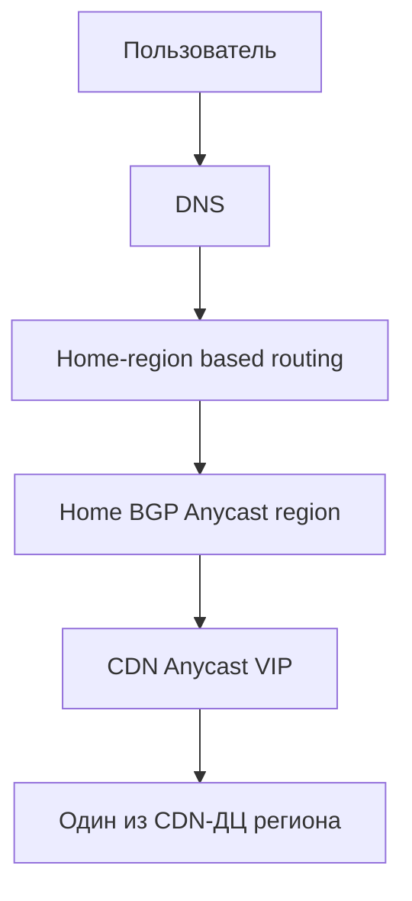
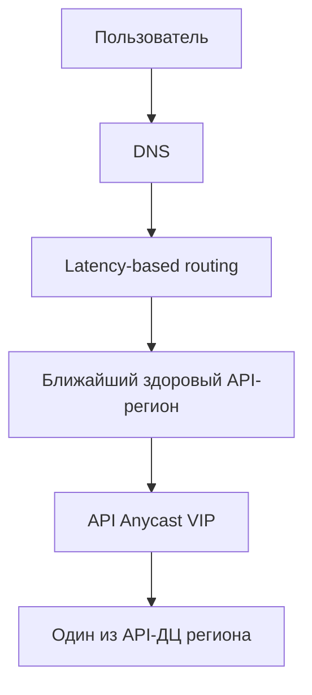
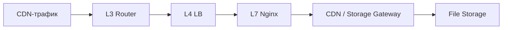
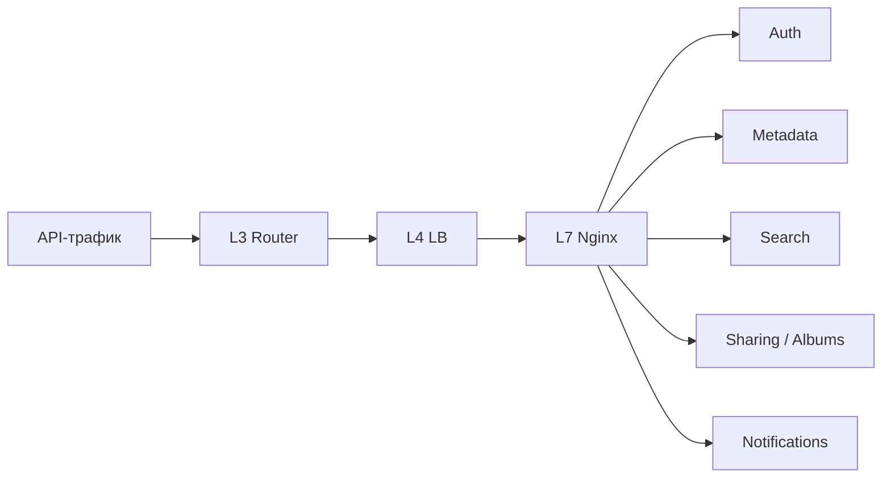

# VK-Highload-Coursework

## 1. Тема и целевая аудитория

> **Тема**: Google Photos

**Аудитория сервиса:**

- По данным Google на май 2025 года, сервис Google Photos достиг _1.5 млрд активных пользователей в месяц_ [^1]. Кроме того, общее количество загружаемых фотографий достигло 6 млрд/день. [^2]

**Функционал MVP:**

Аналог Google Photos будет иметь следующие функции:

- Авторизация
- Загрузка и скачивание фото
- Распознавание лиц на фото
- Поиск по галерее (дата, метаданные о камере, геоданные, лица в кадре)
- Возможность поделиться фото и видео
- Совместные альбомы (например, семейные)
- Уведомления при добавлении фото в совместный альбом

## 2. Расчет нагрузки

### 2.1. Продуктовые метрики:

| Показатель             |      Значение | Расчёт / источник                                                                                                                                                            |
| ---------------------- | ------------: | ---------------------------------------------------------------------------------------------------------------------------------------------------------------------------- |
| MAU                    | **~1.5 млрд** | Google в мае 2025 года сообщала о более чем 1.5 млрд активных пользователей в месяц. [^1]                                                                                    |
| DAU                    |  **~225 млн** | `1.5 млрд * 0,15 = 225 млн`. Коэффициент `DAU / MAU = 0,15` принимается как инженерное допущение на основе опубликованных benchmark-значений stickiness. [^3]                |
| Средний размер галереи | **2795 фото** | Среднестатистический пользователь смартфона хранит около 2795 фотографий в фотоплёнке. Значение используется как приближение среднего размера пользовательской галереи. [^4] |

Значение 2795 фотографий относится к фотоплёнке пользователя смартфона, а не непосредственно к Google Photos. Поэтому в данной работе оно используется как приближённая оценка размера пользовательской галереи. Это позволяет получить независимую проверку порядка необходимого объёма хранения.

#### 2.1.1. Распределение пользователей по регионам

Google не публикует актуальное разбиение аудитории Google Photos по географическим регионам. Поэтому для распределения аудитории проектируемого сервиса используется приближение по распределению пользователей Интернета в 2025 году. По данным World Bank / ITU, собранным и обработанным Our World in Data, в 2025 году в мире было около **6,046 млрд интернет-пользователей**. [^5]

Доли регионов рассчитываются как `Кол-во пользователей интернета в регионе / 6,046 млрд`. Далее предполагается, что доля аудитории Google Photos в каждом регионе примерно пропорциональна доле интернет-пользователей.

| Регион                                                  | Интернет-пользователи, 2025 |      Доля |           MAU |           DAU |   Действия/сутки |
| ------------------------------------------------------- | --------------------------: | --------: | ------------: | ------------: | ---------------: |
| Северная Америка                                        |                     367 млн |  **6,1%** |  **91,5 млн** | **13,73 млн** |    **770,7 млн** |
| Европа и Центральная Азия                               |                     862 млн | **14,3%** | **214,5 млн** | **32,18 млн** |   **1,807 млрд** |
| Латинская Америка и Карибский бассейн                   |                     558 млн |  **9,2%** | **138,0 млн** | **20,70 млн** |   **1,162 млрд** |
| Ближний Восток и Северная Африка, Афганистан и Пакистан |                     527 млн |  **8,7%** | **130,5 млн** | **19,58 млн** |   **1,099 млрд** |
| Африка к югу от Сахары                                  |                     472 млн |  **7,8%** | **117,0 млн** | **17,55 млн** |    **985,5 млн** |
| Восточная Азия и Тихоокеанский регион                   |                   2 110 млн | **34,9%** | **523,5 млн** | **78,53 млн** |   **4,410 млрд** |
| Южная Азия                                              |                   1 150 млн | **19,0%** | **285,0 млн** | **42,75 млн** |   **2,401 млрд** |
| **Итого**                                               |               **6 046 млн** |  **100%** |  **1,5 млрд** |   **225 млн** | **≈13,602 млрд** |

Здесь `Действия/сутки = 13,60225 млрд * доля региона` (п. 2.2). Аналогично можно распределять по регионам отдельные категории нагрузки из таблицы ниже. Такое распределение предполагает одинаковую среднюю активность пользователя во всех регионах. В реальной системе поведение, размер галереи, частота загрузок и доля push-уведомлений могут заметно различаться по регионам.

### 2.2. Среднее кол-во действий пользователя в день

В случаях, когда Google публикует месячное количество активных пользователей для определённого действия, сначала рассчитывается интенсивность действия на одного пользователя, а затем она переносится на выбранную аудиторию проекта.

| Тип действия                    | Среднее количество действий на 1 DAU в день | Как получено                                                                                                                                                                                                                                                                         | Действий в день при 225M DAU |
| ------------------------------- | ------------------------------------------: | ------------------------------------------------------------------------------------------------------------------------------------------------------------------------------------------------------------------------------------------------------------------------------------ | ---------------------------: |
| Авторизация / session           |                                    **1,09** | В исследовании Ubuntu One зафиксировано 42,5 млн пользовательских сессий за 30 дней при 1,294794 млн пользователей: `42,5 млн / 1,294794 млн / 30 ≈ 1,09 сессии/пользователя/день`. Значение используется как ориентир для personal-cloud сервиса. [^6]                              |      `1,09 * 225M = 245,25M` |
| Загрузка фото                   |                                   **26,67** | Google сообщила о более чем 6 млрд загружаемых фото и видео в день. В 2025 году Google Photos имел более 1,5 млрд MAU. Сначала получаем `6 млрд / 1,5 млрд = 4` загрузки на MAU в день, затем переносим показатель на проектируемую аудиторию: `4 * 1,5B / 225M ≈ 26,67`. [^2][^1]   |    `26,67 * 225M ≈ 6,0 млрд` |
| Скачивание фото                 |                                    **5,30** | Для проектируемого сервиса принимается инженерное допущение **~5,3 скачивания/DAU/день** (≈19,9% от действий по загрузке).                                                                                                                                                           |   `5,3 * 225M = 1,1925 млрд` |
| Распознавание лиц на новых фото |                                   **26,67** | Принимается одна фоновая задача распознавания для каждого нового загруженного фото/медиаобъекта: `1 * количество загрузок = 26,67 операции/DAU/день`. Речь идёт об одной задаче обработки фотографии, а не об отдельной операции на каждое найденное лицо.                           |    `26,67 * 225M ≈ 6,0 млрд` |
| Поиск по галерее                |                                   **0,247** | Google сообщила, что более 370 млн пользователей ежемесячно выполняют поиск по своим фото. Для оценки количества запросов принимается одно поисковое действие на одного такого пользователя в месяц: `370M / 1,5B ≈ 0,247`. [^1]                                                     |     `0,247 * 225M = 55,575M` |
| Шеринг                          |                                   **0,293** | Google сообщила, что более 440 млн пользователей ежемесячно делятся своими воспоминаниями. Принимается одно действие шеринга на одного такого пользователя в месяц: `440M / 1,5B ≈ 0,293`. [^1]                                                                                      |     `0,293 * 225M = 65,925M` |
| Создание совместного альбома    |                                   **0,010** | Открытых данных о частоте создания совместных альбомов нет, поэтому принимается сценарное допущение: **1% DAU создают совместный альбом в сутки**. `1% = 0,01` действия/DAU/день.                                                                                                    |        `0,01 * 225M = 2,25M` |
| Добавление в совместный альбом  |                                    **0,10** | При отсутствии открытых данных принимается: **10% DAU выполняют добавление в совместный альбом в сутки**. `10% = 0,10` действия/DAU/день.                                                                                                                                            |        `0,10 * 225M = 22,5M` |
| Просмотр совместного альбома    |                                    **0,20** | При отсутствии открытых данных принимается: **20% DAU выполняют просмотр совместного альбома в сутки**. `20% = 0,20` действия/DAU/день.                                                                                                                                              |          `0,20 * 225M = 45M` |
| Push-уведомления                |                                    **0,30** | Публичных данных Google Photos о числе push-уведомлений нет. Для согласования с нагрузкой совместных альбомов принимается **10% DAU выполняют добавление**, а на одно добавление приходится в среднем **3 получателя** (4 человека в семье): `0,10 * 3 = 0,30` уведомления/DAU/день. |        `0,30 * 225M = 67,5M` |
| **Итого**                       |                                  **≈60,93** |                                                                                                                                                                                                                                                                                      |            **≈13,6966 млрд** |

Таким образом, в среднем один активный пользователь генерирует около **60,45 пользовательских/фоновых операций в сутки** в соответствии с принятой моделью. При 225 млн DAU это составляет примерно **13,60225 млрд операций в сутки**.

### 2.3 Технические метрики:

Для проектируемого сервиса принимаются два уровня подписки:

- бесплатный — **10 GB**;
- платный — **200 GB**.

Исследование All About Cookies показывает, что 62% опрошенных пользователей платят за облачное хранилище. [^7]

Оценочная доля Google в размере **15–19% рынка personal cloud**. [^8]

Для расчёта принимается 62% \* 17% = **10,5% платных пользователей**. Это рассматривается как отдельное инженерное допущение.

Количество пользователей тарифов:

```text
Платные:
1,5 млрд * 10,5% = 157,5 млн пользователей

Бесплатные:
1,5 млрд * 89,5% = 1,3425 млрд пользователей
```

Номинальный логический объём предоставленного пользователям хранилища:

```text
157,5 млн * 200 GB + 1,3425 млрд * 10 GB

= 31,5 млрд GB + 13,425 млрд GB
≈ 44,925 млрд GB
≈ 44,93 EB
```

Полученное значение **44,93 EB** является логической ёмкостью, то есть объёмом, доступным пользователям по тарифам. Для оценки реального физического объёма хранения необходимо учитывать репликацию данных.

Тогда необходимый физический объём для пользовательских данных:

```text
44,93 EB * 3
≈ 134,78 EB
```

Таким образом:

- **логическая ёмкость:** `≈44,93 EB`;
- **физическая ёмкость с учётом 3-кратной репликации:** `≈134,78 EB`.

Полученное значение не включает дополнительные накладные расходы самой storage-системы, такие как служебные метаданные, свободный резерв для восстановления после отказов, временное пространство, версии объектов, thumbnails и индексы, т.к. размеры этих категорий являются погрешностью на фоне размера хранилища для основного контента. Поэтому **134,78 EB следует рассматривать как минимальную оценку физического объёма данных с учётом только трёхкратной репликации**.

Дополнительно можно оценить объём фотографий через средний размер пользовательской галереи:

```text
1,5 млрд пользователей * 2795 фото
≈ 4,1925 трлн фото
```

При среднем размере одного фото около 5 MB:

```text
4,1925 трлн * 5 MB
≈ 20,96 EB
```

С учётом трёхкратной репликации:

```text
20,96 EB * 3
≈ 62,89 EB
```

Эта оценка ниже расчётной ёмкости тарифов `134,78 EB`, поскольку пользователи в среднем не обязаны полностью заполнять выделенные квоты. Поэтому в качестве расчётного верхнего уровня инфраструктуры используется значение, полученное из тарифов.

#### 2.3.1. Пиковый трафик (2х от нормального)

Т.к. у сервиса облачного хранилища практически не бывает пиковых сезонов, кроме праздников, когда множество людей будет делать больше фотографий, будем считать, что пиковый трафик будет превышать средний **в 2 раза**.

В реальности трафик будет более-менее равномерный в виду регионального распределения пользователей, но для большей надежности системы я заложил 2-кратный пик как самый худший и маловероятный, но тем не менее возможный сценарий (например, при изменении условий по подписке, например, больше места в том же тарифе, и большое количество людей за раз оформит подписку и начнет загружать фото).

| Категория                                | Объём пикового трафика | Краткий расчёт                                              |
| ---------------------------------------- | ---------------------: | ----------------------------------------------------------- |
| Upload (входящий)                        |      **~5 556 Гбит/с** | `6 млрд * 5 MB * 8 / 86400 * 2 ≈ 5 556 Гбит/с`              |
| Download + Share / просмотр shared album |      **~1 146 Гбит/с** | `(1,1925 млрд + 45M) * 5 MB * 8 / 86400 * 2 ≈ 1 146 Гбит/с` |
| Служебный трафик                         |        **~132 Гбит/с** | `~66 Гбит/с * 2 ≈ 132 Гбит/с`                               |
| API / поиск / авторизация                |       **~1,61 Гбит/с** | `~314 866 RPS * 0,64 KB * 8 ≈ 1,61 Гбит/с`                  |
| **ИТОГО пиково**                         |      **~6 835 Гбит/с** | `5 556 + 1 146 + 132 + 1,61 ≈ 6 835 Гбит/с`                 |
|                                          |      **≈ 6,84 Тбит/с** |                                                             |

#### 2.3.2. RPS (средний / пиковый)

Средний RPS рассчитывается как:

`RPS_avg = N_day / 86400`

Пиковый RPS:

`RPS_peak = RPS_avg * 2`

| Категория             |   Средний / пиковый RPS | Краткая формула                 |
| --------------------- | ----------------------: | ------------------------------- |
| Авторизация / session |     **~2 839 / ~5 677** | `245,25M / 86400`               |
| Upload                |  **~69 444 / ~138 889** | `6 млрд / 86400`                |
| Download              |   **~13 802 / ~27 604** | `1,1925 млрд / 86400`           |
| Поиск                 |       **~643 / ~1 286** | `55,575M / 86400`               |
| Шеринг                |       **~763 / ~1 526** | `65,925M / 86400`               |
| Совместные альбомы    |       **~807 / ~1 615** | `(2,25M + 22,5M + 45M) / 86400` |
| Уведомления           |       **~781 / ~1 563** | `67,5M / 86400`                 |
| Face recognition      |  **~69 444 / ~138 889** | `6 млрд / 86400`                |
| **Итого**             | **~158 525 / ~317 050** |                                 |

#### 2.3.3. Распределение нагрузки по регионам

Если сохранить принятое допущение, что активность пользователей пропорциональна их региональной доле, то средний и пиковый RPS, а также пиковый сетевой трафик распределяются аналогично.

| Регион                                                  |      Доля |          MAU |         DAU |   Действия/сутки |  Средний RPS |  Пиковый RPS |    Пиковый трафик |
| ------------------------------------------------------- | --------: | -----------: | ----------: | ---------------: | -----------: | -----------: | ----------------: |
| Северная Америка                                        |  **6,1%** |     91,5 млн |   13,73 млн |   **835,49 млн** |   **~9 670** |  **~19 340** |   **~417 Гбит/с** |
| Европа и Центральная Азия                               | **14,3%** |    214,5 млн |   32,18 млн |   **1,959 млрд** |  **~22 669** |  **~45 338** |   **~977 Гбит/с** |
| Латинская Америка и Карибский бассейн                   |  **9,2%** |    138,0 млн |   20,70 млн |   **1,260 млрд** |  **~14 584** |  **~29 168** |   **~629 Гбит/с** |
| Ближний Восток и Северная Африка, Афганистан и Пакистан |  **8,7%** |    130,5 млн |   19,58 млн |   **1,192 млрд** |  **~13 792** |  **~27 583** |   **~595 Гбит/с** |
| Африка к югу от Сахары                                  |  **7,8%** |    117,0 млн |   17,55 млн |   **1,068 млрд** |  **~12 365** |  **~24 730** |   **~533 Гбит/с** |
| Восточная Азия и Тихоокеанский регион                   | **34,9%** |    523,5 млн |   78,53 млн |   **4,780 млрд** |  **~55 325** | **~110 650** | **~2,385 Тбит/с** |
| Южная Азия                                              | **19,0%** |    285,0 млн |   42,75 млн |   **2,602 млрд** |  **~30 120** |  **~60 239** | **~1,299 Тбит/с** |
| **Итого**                                               |  **100%** | **1,5 млрд** | **225 млн** | **≈13,697 млрд** | **~158 524** | **~317 049** |  **~6,84 Тбит/с** |

Краткие формулы:

`Региональный MAU = 1,5B * Доля региона`

`Региональный DAU = 225M * Доля региона`

`Региональные действия/сутки = 13,60225 млрд * Доля региона`

`RPS_avg = 157 433 * Доля региона`

`RPS_peak = 314 866 * Доля региона`

`Traffic_peak = 6 835 Гбит/с * Доля региона`

## 3. Глобальная балансировка

Для сервиса масштаба Google Photos одного локального балансировщика недостаточно: пользователи распределены по всему миру, а основная нагрузка формируется большими объёмами загрузки и скачивания данных.

### 3.1. Функциональное разбиение по доменам

Внешние точки входа сервиса разделяются по назначению:

| Контур  | Домен                  | Основные операции                                                       | Глобальная политика   |
| ------- | ---------------------- | ----------------------------------------------------------------------- | --------------------- |
| **CDN** | `media.photos.example` | Upload / Download                                                       | **Home-region based** |
| **API** | `api.photos.example`   | Авторизация, поиск, метаданные, шеринг, совместные альбомы, уведомления | **Latency-based**     |

Для CDN пользователь получает домашний регион (`home region`), который хранится как атрибут аккаунта. Все обычные upload/download-запросы сначала направляются в CDN-пул его home-региона. Это уменьшает количество межрегиональных обращений к данным и упрощает поддержку репликации.

Для API домашняя привязка не используется: запрос направляется в здоровый API-регион с минимальной измеренной задержкой до пользователя. Такой принцип соответствует latency-based DNS-маршрутизации, при которой выбирается регион с наименьшей сетевой задержкой до клиента.

### 3.2. Обоснование расположения ДЦ

Пиковый media-трафик из раздела 2 составляет:

```text
Upload                         ≈ 5 556 Гбит/с
Download + shared album view   ≈ 1 146 Гбит/с

Итого CDN-трафик               ≈ 6 702 Гбит/с
```

Если ограничить максимальную пиковую нагрузку одного CDN-ДЦ значением **250 Гбит/с** (т.е. 10 сетевых карт по **25 Гбит/с**), минимальное теоретическое количество площадок:

```text
ceil(6 702 / 250) = 27 CDN-ДЦ
```

Однако простого деления на 27 недостаточно: нагрузка между географическими регионами различается в несколько раз. Поэтому количество площадок дополнительно определяется региональной нагрузкой. В проекте используется **32 CDN-площадки**, что позволяет оставить запас относительно лимита 250 Гбит/с и не создавать одного доминирующего ДЦ.

| BGP Anycast-регион                    | Доля нагрузки | CDN-площадок | Средняя пиковая нагрузка на одну площадку |
| ------------------------------------- | ------------: | -----------: | ----------------------------------------: |
| Северная Америка                      |          6,1% |            2 |                           **~204 Гбит/с** |
| Европа + Центральная Азия             |         14,3% |            4 |                           **~240 Гбит/с** |
| Латинская Америка                     |          9,2% |            3 |                           **~206 Гбит/с** |
| MENA                                  |          8,7% |            3 |                           **~194 Гбит/с** |
| Африка к югу от Сахары                |          7,8% |            3 |                           **~174 Гбит/с** |
| Восточная Азия + Тихоокеанский регион |         34,9% |           11 |                           **~213 Гбит/с** |
| Южная Азия                            |         19,0% |            6 |                           **~212 Гбит/с** |
| **Итого**                             |      **100%** |       **32** |                          **≤ 250 Гбит/с** |

Таким образом, даже наиболее нагруженная отдельная площадка получает около **240 Гбит/с**, то есть примерно **3,6% общего CDN-трафика**, а не десятки процентов. Совокупная нагрузка региона EAP остаётся большой, но она распределяется между 11 CDN-площадками.

Предлагаемые инженерные точки размещения CDN:

| Регион                                | CDN-площадки                                                                                     |
| ------------------------------------- | ------------------------------------------------------------------------------------------------ |
| Северная Америка                      | Ashburn, Dallas                                                                                  |
| Европа + Центральная Азия             | Frankfurt, London, Warsaw, Istanbul                                                              |
| Латинская Америка                     | São Paulo, Santiago, Mexico City                                                                 |
| MENA                                  | Dubai, Tel Aviv, Cairo                                                                           |
| Африка к югу от Сахары                | Johannesburg, Cape Town, Lagos                                                                   |
| Восточная Азия + Тихоокеанский регион | Tokyo, Osaka, Seoul, Singapore, Hong Kong, Taipei, Bangkok, Jakarta, Sydney, Melbourne, Auckland |
| Южная Азия                            | Mumbai, Delhi, Bengaluru, Chennai, Dhaka, Karachi                                                |

### 3.3. Распределение API-запросов по ДЦ

API-трафик значительно меньше media-трафика: в пиковом режиме он составляет около **1,61 Гбит/с**, поэтому для API число площадок определяется в первую очередь требованиями к задержке и отказоустойчивости, а не пропускной способностью.

В проекте создаётся по две API-площадки в каждом из семи логических регионов:

| BGP Anycast-регион                    | API-ДЦ                 |
| ------------------------------------- | ---------------------- |
| Северная Америка                      | Ashburn, Dallas        |
| Европа + Центральная Азия             | Frankfurt, Warsaw      |
| Латинская Америка                     | São Paulo, Mexico City |
| MENA                                  | Dubai, Cairo           |
| Африка к югу от Сахары                | Johannesburg, Lagos    |
| Восточная Азия + Тихоокеанский регион | Tokyo, Singapore       |
| Южная Азия                            | Mumbai, Delhi          |

Для `api.photos.example` используется следующий алгоритм:

```text
Пользователь
     │
     ▼
Authoritative DNS
     │
     ▼
Latency-based routing
     │
     ├── ближайший здоровый API-регион
     │
     ▼
BGP Anycast VIP региона
     │
     ▼
один из API-ДЦ региона
```

Latency-based маршрутизация выбирает регион с минимальной измеренной задержкой среди доступных и здоровых регионов. При недоступности ближайшего региона запрос направляется в следующий по задержке регион.

После выбора API-региона BGP Anycast используется для выбора одной из нескольких точек входа внутри региона. Один сервисный префикс может объявляться с нескольких площадок, а сеть выбирает маршрут на основе своей глобальной топологии. RFC 4786 отдельно отмечает, что Anycast подходит для распределения сервиса между несколькими географическими узлами, но не гарантирует равномерное распределение нагрузки между ними. [^9]

Поэтому API Anycast используется прежде всего для выбора ближайшей и доступной точки входа и для failover, а не для точного распределения RPS.

### 3.4. Схема Anycast-балансировки

В данной работе выделяются семь логических **BGP Anycast-регионов**:

- Северная Америка
- Европа + Центральная Азия
- Латинская Америка
- MENA
- Африка к югу от Сахары
- Восточная Азия + Тихоокеанский регион
- Южная Азия

Для каждого региона CDN- и API-площадки объединяются в собственный пул входа. Внутри такого региона один и тот же сервисный префикс может анонсироваться несколькими площадками через BGP. Отказавшая площадка снимает анонс, после чего трафик переходит на другой Anycast-узел региона.


На карте **кружки обозначают CDN-площадки**, **квадраты — площадки, на которых одновременно размещены CDN и API**, а штрихованные области обозначают логические BGP Anycast-регионы.

### 3.5. Схемы балансировки API- и CDN-запросов

Для CDN применяется home-region based routing:



Критерий выбора для CDN — **home region пользователя**. Это сохраняет близость media-трафика к основному месту хранения и репликации данных.

Для API используется latency-based routing:



На уровне API допускается переключение между регионами, поскольку запросы к метаданным и индексам обслуживаются из реплицируемой инфраструктуры. Это позволяет выбирать ближайший по задержке регион без привязки к home region пользователя.

### 3.6. Механизм регулировки трафика между ДЦ

Для обоих контуров контролируются health checks, error rate и задержка. При отказе площадки её Anycast-анонс снимается, поэтому новый трафик перестаёт поступать на неисправный узел. RFC 4786 описывает именно такой принцип эксплуатации Anycast-сервисов. [^9]

Различие между контурами состоит в выборе резервной площадки:

| Контур | Основной критерий                | Failover                                                                                              |
| ------ | -------------------------------- | ----------------------------------------------------------------------------------------------------- |
| CDN    | Home region + доступность данных | Другая CDN-площадка того же региона; при крупном отказе — доступная реплика данных в соседнем регионе |
| API    | Минимальная задержка             | Следующий по latency здоровый API-регион                                                              |

Для CDN нельзя автоматически отправлять запрос в любой ближайший ДЦ: резервная площадка должна иметь доступ к соответствующей копии данных. Для API такая привязка слабее, поскольку метаданные и индексы предполагаются доступными в нескольких регионах.

Таким образом, итоговая глобальная схема разделяет задачи:

```text
                         Пользователь
                              │
                  ┌───────────┴───────────┐
                  │                       │
             CDN/media                   API
                  │                       │
          Home-region based          Latency-based
                  │                       │
          BGP Anycast region      BGP Anycast region
                  │                       │
           CDN-площадки (32)          API-ДЦ (14)
```

DNS выполняет выбор логического региона, BGP Anycast — выбор доступной точки входа внутри выбранного региона, а локальный L4/L7-балансировщик из раздела 4 распределяет трафик между серверами конкретного ДЦ.

## 4. Локальная балансировка

После глобального выбора точки входа трафик необходимо распределить между серверами внутри конкретного дата-центра. Поскольку в разделе 3 CDN и API вынесены в отдельные контуры, локальная балансировка также выполняется независимо для этих двух типов трафика.

Для обоих контуров используется двухуровневая схема: L3-маршрутизация с ECMP распределяет входящий поток между несколькими L4-балансировщиками, после чего L4 распределяет TCP-соединения между L7-балансировщиками Nginx. На L7 выполняется TLS termination и маршрутизация запроса к нужному сервису.

Разница между контурами определяется характером нагрузки:

- CDN обслуживает основной объём сетевого трафика: upload и download. Здесь главным ограничением является пропускная способность сетевых интерфейсов и балансировщиков.
- API обслуживает небольшой по объёму, но более чувствительный к задержке трафик: авторизацию, поиск, метаданные, шеринг, совместные альбомы и уведомления. Здесь важнее низкая задержка обработки запроса.

### 4.1. Локальная балансировка CDN

После выбора home-region пользователя глобальным уровнем запрос попадает в один из CDN-ДЦ этого региона. Внутри площадки используется следующая схема:



L3-маршрутизаторы используют ECMP и распределяют входящие соединения между несколькими L4-балансировщиками. Такой подход позволяет избежать единственной точки отказа и равномерно загрузить L4-узлы.

На L4-уровне TCP-соединения распределяются между Nginx. Поскольку CDN обрабатывает большие объёмы данных, основным ограничением является throughput, а не количество HTTP-запросов.

Nginx на L7 терминирует TLS и передаёт запросы в CDN/Storage Gateway. Upload-запрос приводит к записи объекта в файловое хранилище, а download-запрос — к чтению объекта из кеша или файлового хранилища. Бинарные данные не проходят через основную БД: БД содержит только метаданные и ссылку на объект.

Для CDN запросы не перераспределяются между произвольными ДЦ внутри локального слоя: глобальная home-region based политика из раздела 3 сохраняет привязку пользователя к своему региону. При отказе площадки переключение выполняется на уровне глобальной балансировки, после чего новый трафик поступает в другой доступный CDN-ДЦ того же региона или к доступной реплике данных.

### 4.2. Локальная балансировка API

Для API после latency-based выбора региона запрос попадает в один из API-ДЦ выбранного региона. Внутри ДЦ используется отдельный пул балансировщиков:



L4 выполняет распределение TCP-соединений между Nginx, а L7 анализирует HTTP-запрос и выбирает нужный backend.

Для большинства коротких API-запросов можно использовать `round-robin`. Для запросов с существенно различающимся временем выполнения предпочтителен `least_conn`. Поисковые запросы и операции с метаданными могут иметь отдельные upstream-пулы, что позволяет независимо масштабировать эти сервисы.

В отличие от CDN, API-ДЦ не привязаны к `home_region` пользователя. Глобальный слой уже выбрал регион с минимальной задержкой, поэтому локальный уровень должен прежде всего равномерно распределять запросы между доступными экземплярами сервисов.

### 4.3. Отказоустойчивость

Все уровни локальной балансировки должны иметь резерв. Отказ одного L4 или L7-узла не должен приводить к отказу всего дата-центра.

Для L4 используется схема **N×2**. Сначала определяется минимальное количество узлов, необходимое для обработки пикового трафика, затем количество удваивается. Например, если для площадки требуется 3 рабочих L4-узла, разворачивается 6.

Для L7 используется схема **N+2**. К расчётному количеству рабочих Nginx добавляются два резервных узла. Если требуется 10 рабочих экземпляров, фактически разворачивается 12.

При отказе отдельного L4-узла ECMP исключает неисправный маршрут, а оставшиеся узлы продолжают принимать трафик. При отказе Nginx L4-балансировщик перестаёт направлять на него новые соединения.

Полный отказ дата-центра обрабатывается уже глобальным уровнем из раздела 3: для CDN трафик переводится на другую площадку home-region либо на доступную реплику, а для API — на следующий здоровый регион с подходящей latency.

### 4.4. Расчёт количества балансировщиков CDN

Пиковый CDN-трафик из раздела 3 составляет около **6 702 Гбит/с**. Он распределён между **32 CDN-площадками**, при этом максимальная расчётная нагрузка одной площадки составляет около **240 Гбит/с**.

Для расчёта принимаются следующие инженерные ограничения:

- один L4-сервер способен безопасно обработать до **80 Гбит/с**;
- один L7-сервер Nginx способен обработать до **25 Гбит/с**;
- для L4 используется запас **N×2**;
- для L7 используется запас **N+2**.

Значения 80 и 25 Гбит/с являются инженерными допущениями проекта. Реальная производительность зависит от CPU, сетевых карт, TLS-нагрузки, размера пакетов и характера трафика.

Количество узлов для каждой CDN-площадки:

```text
N_L4 = ceil(Пиковый_трафик_ДЦ / 80 Гбит/с) × 2

N_L7 = ceil(Пиковый_трафик_ДЦ / 25 Гбит/с) + 2
```

Например, для самой нагруженной CDN-площадки в Европе:

```text
Пиковый трафик ≈ 240 Гбит/с

L4:
ceil(240 / 80) × 2
= 3 × 2
= 6 серверов

L7:
ceil(240 / 25) + 2
= 10 + 2
= 12 серверов
```

Расчёт по регионам:

| BGP Anycast-регион | CDN-ДЦ | Пиковый трафик одного CDN-ДЦ | L4 на один ДЦ | L7 на один ДЦ | Всего L4 | Всего L7 |
| --- | ---: | ---: | ---: | ---: | ---: | ---: |
| Северная Америка | 2 | ~204 Гбит/с | 6 | 11 | 12 | 22 |
| Европа + Центральная Азия | 4 | ~240 Гбит/с | 6 | 12 | 24 | 48 |
| Латинская Америка | 3 | ~206 Гбит/с | 6 | 11 | 18 | 33 |
| MENA | 3 | ~194 Гбит/с | 6 | 10 | 18 | 30 |
| Африка к югу от Сахары | 3 | ~174 Гбит/с | 6 | 9 | 18 | 27 |
| Восточная Азия + Тихоокеанский регион | 11 | ~213 Гбит/с | 6 | 11 | 66 | 121 |
| Южная Азия | 6 | ~212 Гбит/с | 6 | 11 | 36 | 66 |
| **Итого** | **32** | **≤ 240 Гбит/с** | — | — | **192** | **347** |

Таким образом, для CDN-контура требуется ориентировочно **192 L4-балансировщика и 347 L7-балансировщиков**. Наиболее большое количество узлов приходится на Восточную Азию и Тихоокеанский регион, поскольку там расположено 11 CDN-площадок.

### 4.5. Расчёт количества балансировщиков API

Пиковый внешний API-трафик из раздела 2 составляет около **1,61 Гбит/с**. В соответствии с архитектурой раздела 3 он распределяется между **14 API-ДЦ**.

Для размерного расчёта принимается равномерное распределение как базовый сценарий:

```text
1,61 Гбит/с / 14 ≈ 0,115 Гбит/с на API-ДЦ
```

Фактическое распределение не обязано быть равномерным, поскольку глобальный слой использует latency-based routing. Однако даже при существенном skew нагрузки один API-ДЦ остаётся далеко ниже пропускной способности одного L4/L7-узла, принятой в проекте.

Для каждой площадки:

```text
N_L4 = ceil(0,115 / 80) × 2
     = 1 × 2
     = 2 сервера

N_L7 = ceil(0,115 / 25) + 2
     = 1 + 2
     = 3 сервера
```

При 14 API-ДЦ получаем:

| Показатель | На один API-ДЦ | Всего для 14 API-ДЦ |
| --- | ---: | ---: |
| Пиковый API-трафик | ~115 Мбит/с | ~1,61 Гбит/с |
| L4 | 2 | **28** |
| L7 Nginx | 3 | **42** |

Таким образом, API-контур требует ориентировочно **28 L4** и **42 L7** узлов.

### 4.6. Итоговая схема локальной балансировки

В результате локальная архитектура имеет два независимых пула:

```text
CDN:
L3 / ECMP → L4 → L7 Nginx → CDN / Storage Gateway → File Storage

API:
L3 / ECMP → L4 → L7 Nginx → Auth / Metadata / Search / Sharing / Notifications
```

Для CDN локальная балансировка рассчитана от пикового сетевого трафика каждой площадки. Для API она рассчитана от RPS и небольшого сетевого объёма, поэтому пропускная способность балансировщиков не является ограничивающим фактором.

Суммарно для обеих плоскостей получается ориентировочно:

```text
L4 = 192 + 28 = 220 серверов
L7 = 347 + 42 = 389 серверов
```

При этом эти значения относятся именно к балансировщикам. Backend-сервера API, Storage Gateway, CDN-кеши и файловое хранилище масштабируются отдельно.

### 4.7. Выбор алгоритмов балансировки

На L4-уровне используется распределение TCP-соединений между доступными L7-узлами. Основная цель этого слоя — эффективно распределить сетевой поток и обеспечить отказоустойчивость.

На L7-уровне алгоритм выбирается по характеру сервиса:

- `round-robin` — для коротких API-запросов с близким временем обработки;
- `least_conn` — для запросов с различной длительностью выполнения;
- отдельные upstream-пулы — для независимого масштабирования Auth, Metadata, Search, Sharing/Albums, Notifications и CDN/Storage Gateway.

Такое разделение сохраняет простую локальную схему и одновременно позволяет независимо масштабировать CDN и API. Глобальный уровень отвечает за выбор региона и площадки, а локальный — за распределение нагрузки между экземплярами сервисов внутри выбранного ДЦ.


[^3]: DAU/MAU Ratio (Stickiness): Definition, Formula & Benchmarks // IdeaPlan. 2024. URL: https://www.ideaplan.io/metrics/dau-mau-ratio-stickiness

[^4]: Woolf M. 26+ Mobile Photography Statistics for 2026 // PhotoAiD. 2023, обновлено 9 Dec. 2025. URL: https://photoaid.com/blog/mobile-photography-statistics/ (дата обращения: 24.09.2026).

[^7]: Schafer D. Cloud Storage Pricing Guide: Compare Google One, iCloud, OneDrive, Dropbox, and More // All About Cookies. 24 June 2026. URL: https://allaboutcookies.org/cloud-storage-pricing

[^8]: Gupta A. Personal Cloud Market Size, Share & Trends [2035] // Market Research Future. 2026. URL: https://www.marketresearchfuture.com/reports/personal-cloud-market-7041

[^6]: Gracia-Tinedo R., Tian Y., Sampé J., Harkous H., Lenton J., García-López P., Sánchez-Artigas M., Vukolić M. Dissecting UbuntuOne: Autopsy of a Global-scale Personal Cloud Back-end // Proceedings of the 2015 Internet Measurement Conference. 2015. DOI: 10.1145/2815675.2815677. URL: https://www.researchgate.net/publication/282334268_Dissecting_UbuntuOne_Autopsy_of_a_Global-scale_Personal_Cloud_Back-end

[^2]: Selier J. Ask Photos: A new way to search your photos with Gemini // Google. 14 May 2024. URL: https://blog.google/products-and-platforms/products/photos/ask-photos-google-io-2024/

[^1]: Ben-Yair S. 10 tips for 10 years of Google Photos // Google. 28 May 2025. URL: https://blog.google/products-and-platforms/products/photos/google-photos-10-years-tips-tricks/

[^5]: Our World in Data. Number of people using the Internet. Данные International Telecommunication Union (ITU) // World Bank, 2025; обновление 27 July 2026. URL: https://ourworldindata.org/grapher/number-of-internet-users

[^9]: Abley G., Lindqvist J. RFC 4786 — Operation of Anycast Services. RFC Editor, 2006. URL: https://www.rfc-editor.org/rfc/rfc4786

[^10]: Amazon Web Services. Latency-based routing — Amazon Route 53 Developer Guide. URL: https://docs.aws.amazon.com/Route53/latest/DeveloperGuide/routing-policy-latency.html
